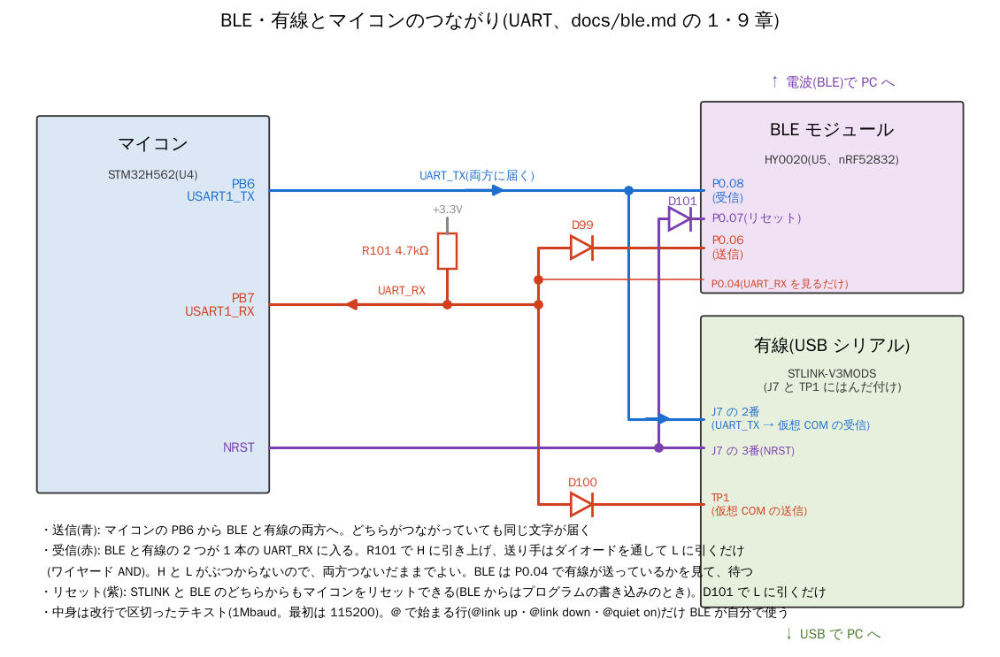

# 無線(BLE)のソフトの設計(2026-11-23)

BLE モジュール **FDK HY0020**(nRF52832、回路は `hardware/kicad/KOGUMA-Mk4/ui.kicad_sch` の U5)で、PC と機体を無線でつなぐ。この文書は、STM32・nRF52832・PC の3つのソフトの分担と、やりとりの決まりを決める。

決めたこと(ユーザー、2026-11-23):

- **探索中は送らない**。探索が終わったときに、迷路のデータとログを送る
- 無線でやること: ログ、パラメータ、プログラムの書き込み、**ターンの調整の自動化**

## 1. 全体の形

```
 PC(Chrome の MK3 ビューア + Web Bluetooth、または Python)
   ↑↓ BLE(Nordic UART Service = NUS。2M PHY、データ長の拡張)
 nRF52832(HY0020)… UART と BLE の橋渡しだけ。中身は見ない(@ で始まる行だけ自分で処理)
   ↑↓ UART 1Mbaud(STM32 の USART1、PB6・PB7)
 STM32H562 … 今までどおり UART に文字を書く・読むだけ
```

- **STM32 から見ると、今までの UART と同じ**。無線か有線(J7・TP1 の USB シリアル)かを気にしない。同じ決まりで、有線のときもそのまま動く
- **有線と無線は、両方つないだままでよい**。STM32 に送る線(UART_RX)は、HY0020 と有線(TP1)がどちらもダイオードで L に引くだけ(ワイヤード AND)なので、ぶつからない。機体からの送信は両方に届く(9章)
- やりとりは **行のテキスト(ASCII、改行で区切る)**。MK3 のビューアの形(`#BEGIN LOG …` の CSV、`tools/mazefile.py` の迷路の形)をそのまま使う。プログラムの書き込みだけは、バイナリを base64 にした行で送る

## 2. 受信側(PC)がいないとき

**問題なく動く**。

- nRF52832 は、PC とつながっていない間は、自分の名前(`KOGUMA-MK4`)を周りに知らせる電波(アドバタイズ)を出して待っているだけ。PC がいなくても、STM32 の動きにはかかわらない
- つながったか・切れたかを、nRF52832 が STM32 に行で知らせる(`@link up`・`@link down`)。**STM32 はつながっていないときは送らない**
- **BLE の状態は状態の LED 0(D114、前の LED の左)で出す**(2026-11-27、ユーザー): 消灯 = 電波を止めている、ゆっくり点滅 = 待っている、点灯 = つながっている、速い点滅 = 書き込み中(`software/main-controller/MODES.md`)
- つながっていないときに STM32 が送っても、nRF52832 が捨てるだけで、STM32 は止まらない(UART の送信は DMA で投げっぱなし。返事を待たない)
- 送れなかった迷路とログは **内蔵 Flash に残っている** ので、あとで PC をつないでから取り出せる(4章)
- 電流: 待っている間(アドバタイズ、1秒に1回)は平均 数十µA〜1mA 程度、送っている瞬間は約 7.5mA(+4dBm、DC/DC)。3.3V の DC-DC(1.5A)にとっては小さい
- 走っている間に電波を止めたいときは、STM32 から `@quiet on` を送る(アドバタイズを止め、つながっていれば切る)。壁センサへの影響が見えたら使う(2.4GHz の電波と、送るときの 7.5mA の電流の揺れ。受光アンプは +3V3A で分けてある)

## 3. 走っている間と、終わったとき

| 状態 | STM32 が送るもの | 受け付けるコマンド |
|---|---|---|
| 待ち(止まっている) | 聞かれたことへの返事だけ | すべて |
| 探索中・最短走行中・調整の走行中 | **送らない**(ログは RAM にためる) | `stop` だけ(すぐ止まる) |
| 終わった(止まった) | 下の手順 | すべて |

探索が終わったとき(スタートに戻って止まったとき)の手順:

1. モーターを止める(EN = L)
2. 迷路のデータとログを **内蔵 Flash に書く**(止まっているときだけ書く。`docs/spec.md` の「内蔵Flashの使い方」)
3. `@link up` のときだけ、続けて送る: `#EVENT explore_done` → `#BEGIN MAZE`〜`#END MAZE` → `#BEGIN LOG`〜`#END LOG`
4. つながっていなければ何も送らない。あとで PC から `get maze`・`get log` で取り出す

最短走行や、調整の走行が終わったときも同じ(`#EVENT run_done`、ログだけ)。

## 4. やりとりの決まり

### 4.1 機体 → PC

すべて行。`#` で始まる行が見出し、それ以外はデータ。

```
#STATUS state=idle batt=11.82 maze=16x16 explored=1 log=3
#EVENT explore_done
#BEGIN MAZE size=16 goal=7,7
(tools/mazefile.py の形の迷路)
#END MAZE crc=1a2b3c4d len=1234
#BEGIN LOG id=3 dt=0.001 n=8000 div=1
t,x,v,v_target,w,w_target,angle,...(MK3 と同じ CSV。列は足してよい)
0.000,0.0,...
#END LOG crc=5e6f7081 len=456789
#BEGIN PARAMS
turn90.entry_acc=0.7
...
#END PARAMS crc=... len=...
#OK set turn90.entry_acc
#ERR unknown command: xxx
```

- `#END` の行に、本文の **CRC32 と長さ** を付ける。PC で合わなければ、もう一度 `get` する(BLE は届かなかった分を自動で送り直すが、UART・バッファのあふれに備える)
- ログは MK3 の形(`#BEGIN LOG dt=… n=… div=…` + 1行目が列の名前の CSV)。**MK3 のビューアでそのまま読める**

### 4.2 PC → 機体

| コマンド | 意味 |
|---|---|
| `status` | `#STATUS` を返す |
| `get maze` | 内蔵 Flash の迷路を送る |
| `get log [id]` | ログを送る(id を省くと最新) |
| `list` | Flash にあるログの一覧(id、種類、時刻、長さ) |
| `get params` | パラメータをすべて送る |
| `set <名前> <値>` | パラメータを変える(RAM。`save` までは Flash に書かない) |
| `save` | パラメータを Flash に書く |
| `run <種類> [名前=値 ...]` | 走る。種類は `explore`・`fast`・`turn_test` など。名前=値 はその1回だけの値 |
| `stop` | すぐ止まる(走っている間も受け付ける) |
| `fw begin <長さ> <crc>`・`fw <位置> <base64>`・`fw end` | プログラムの書き込み(6章) |

### 4.3 nRF52832 だけが処理する行(`@` で始まる)

| 行 | 向き | 意味 |
|---|---|---|
| `@link up`・`@link down` | nRF → STM32 | PC とつながった・切れた(nRF が起動したときも `@link down`) |
| `@link?` | STM32 → nRF | 今つながっているかを聞く → `@link up` か `@link down` が返る(STM32 が再起動したあと用。2026-11-28) |
| `@quiet on`・`@quiet off` | STM32 → nRF | 電波を止める・戻す |
| `@reset` | PC → nRF | STM32 の NRST を 10ms L にする(STM32 には届けない) |
| `@flash` | PC → nRF | STM32 をブートローダの書き込みの待ちに入れる: UART_RX を L にしたまま NRST を 10ms L、放してから 50ms 後に UART_RX を放す(6.2) |
| `@name <名前>` | PC → nRF | アドバタイズの名前を変えて保存 |

### 4.4 流れの制御(送る速さの調整)

UART には RTS・CTS の線がない(MCU のピンが足りない)。そこで **XON・XOFF**(0x11・0x13、テキストには出てこない文字)を使う。

- nRF52832 の送り待ちのバッファ(**8KB**。2026-11-28: nRF52832 の RAM 64KB に入る大きさにした。前の案は 32KB)が 3/4 を超えたら、nRF52832 が STM32 に XOFF を送る。STM32 は送るのを止める。1/4 を下回ったら XON
- 有線(USB シリアル)のときは XOFF が来ないので、そのまま流れる
- 速さの目安: UART 1Mbaud で約 90kB/s。BLE は PC の Bluetooth しだいで 20〜100kB/s(2M PHY、データ長の拡張、MTU 247)。迷路(数KB)は一瞬、ログ 256KB は 3〜13秒

## 5. ターンの調整の自動化

```
PC: run turn_test right90 entry_acc=0.70 offset=2.0
機体: 値を受け取る → 前の壁センサに手をかざすのを待つ(置き直す時間) → 走る(直進 → 右 90° → 直進)→ 止まる
機体: ログを Flash に書く → #EVENT run_done → #BEGIN LOG … #END LOG
PC: ログからターンの出口の位置・角度のずれを計算 → 次の値を決める → run turn_test …(くり返す)
```

- スタートは **手をかざしてから**(MK3 と同じ)。機体を置き直す時間をとるため、PC から送ったらすぐ走り出す形にはしない
- PC 側の「次の値を決める」は、最初は2分探索(出口のずれの符号で値を半分ずつ動かす)。うまくいけば、数値の最適化に広げる
- よい値が見つかったら `set` → `save` で機体に残す

## 6. プログラムの書き込み

**無線でも有線(今までのケーブル)でも、人がやるのはコマンド1つ(またはボタン1つ)だけ**。リセットのタイミング・ボタンを押しながら電源、などは要らない形にする。

### 6.1 Flash の分け方

**2026-11-27: MCU を STM32H562 にしたので直した**(H562 の Flash は 8KB のセクタ、`docs/spec.md` の「内蔵Flashの使い方」)。

- 0x08000000〜(64KB、バンク 1 の先頭の 8 セクタ): **自分のブートローダ**。無線の書き込みでは消さない(ブートローダが自分で断る)
- 0x08010000〜(448KB、バンク 1 の残り): 走るプログラム。走るプログラムは最初に VTOR を 0x08010000 にする
- **2026-11-28: ブートローダを作った**(`software/bootloader/`、README に中身)。前の案の「先頭の見出し(印・長さ・CRC32)」はやめた: 見出しの CRC はビルドのあとに書き足す手間がいり、SWD(STLINK)で書いたプログラムには付かないため。代わりに、ベクタテーブル(スタックの初めの値・リセットの番地)で正しいかを見て、無線の書き込みでは**先頭の 1KB を最後に書く**(途中で切れると先頭が消えたまま = 正しくない、になる)
- 書き込みは 16 バイト単位(H562)。`fw` の 1 行 192 バイトは 16 の倍数なので、そのまま書ける
- (H725 のときは、セクタ 0 の 128KB がブートローダ、0x08020000 から走るプログラムの予定だった)

### 6.2 ブートローダの決まり(起動のたび。待たない)

電源・リセットのあと、ブートローダは次を順に見る(全部で約 1ms):

1. TAMP のバックアップレジスタ 0 に「書き込みへ」の印(`0x464C5348`)がある(走るプログラムが `fw begin` を受けて書き、ソフトでリセットした) → 書き込みの待ち(印は消す)
2. UART_RX が 1ms の間ずっと L(HY0020 が `@flash` で引いている) → 書き込みの待ち
3. 走るプログラムが正しくない(スタックの初めの値が RAM の中、リセットの番地が走るプログラムの中、でない。書いている途中で切れた、まだ書いていない) → 書き込みの待ち
4. どれでもない → **すぐ走るプログラムへ飛ぶ**(待ち時間なし。電源を入れてすぐ走れる。デバッガもそのまま使える)

- 書き込みの待ちに入ったら `#BOOT ready` を送り、状態の LED 0(D114)を速く点滅させる。**10 秒何も来なければ**、走るプログラムが正しければそちらへ飛ぶ(HY0020 がおかしくなって UART_RX を L にしたままでも、機体は止まらない)
- ブートローダはモーター・ファンの線を触らない(リセットのあとの入力のまま。MP6551 は中のプルダウン、ファンは R42 で止まっている)

### 6.3 無線で書く

PC で `python tools/fw.py <プログラムの .bin> --ble`(有線なら `--port COM5`。`software/main-controller/tools/fw.py`、2026-11-28 に作った)。ツールが次を全部やる:

1. `fw begin <長さ> <crc>` を送る。走るプログラムが生きていれば、印を書いてソフトでリセット → ブートローダが `#BOOT ready`
2. 1 秒で返事がなければ(プログラムが壊れている・止まっている)、`@flash` を送る → ブートローダが `#BOOT ready`。`#ERR busy`(走っている)が返ったときは `@flash` を使わず、止まるのを待つ
3. ブートローダに `fw begin <長さ> <crc>` を送り直す → 走るプログラムの領域を消して `#OK fw begin`(ブートローダにすでにいたときは、1 の返事がこれ)
4. `fw <位置> <base64>`(1行 192 バイト分)を送る。先頭から途切れずに 4KB 書けるごとに `#OK fw <位置>`。行が飛ぶと `#ERR fw gap <位置>`。2 秒返事がないか #ERR なら、その 4KB を送り直す(3回まで)
5. `fw end` → ブートローダが全体の CRC を確かめ、合えば先頭の 1KB を書いて `#OK fw end`、走るプログラムへ

- 走っている間(探索中など)は `fw begin` を受け付けない(`#ERR busy`)。止まっているときだけ書き込む
- 途中で切れても、ブートローダが残っているので、もう一度ツールを動かせばよい(6.2 の 3)

### 6.4 有線で書く(今までのケーブル、J7)

- J7 は ToraNeko.Mk3 の J6 と同じ並び(1 3.3V、2 UART_TX、3 NRST、4 SWCLK、5 GND、6 SWDIO)。同じケーブルと STLINK-V3MODS で、SWD で書き込み・デバッグ、仮想 COM ポートでログ
- **VS Code(STM32Cube 拡張)の「実行」「デバッグ」のままでよい**。走るプログラムの ELF に、ブートローダも入れておく(リンカの設定で、ブートローダの bin を 0x08000000 に置く)。書くたびに同じブートローダも書かれるので、「ブートローダが入っているか」「全部消すで消えた」を気にしなくてよい
- ブートローダは待たない(6.2 の 4)ので、デバッガはリセットのあと、そのまま main で止まる
- SWD は無線・ブートローダ・HY0020 と関係なく、いつでも勝つ(無線の書き込みの途中でも上書きできる。無線のほうは返事がなくなって、ツールが止まって知らせる)
- コマンドを打つときは、今までどおり TP1(UART_RX)に線をつなぐ。無線とつないだままでよい(9章)

### 6.5 HY0020 自身の書き込み

- 最初の1回だけ TP2・TP3(nRF52832 の SWD)で書く。Nordic のブートローダ(DFU)も一緒に入れておき、そのあとは BLE で書き換える(nRF Connect のアプリなど)
- **HY0020 は中身が空で届く**(データシート: "blank radio module")。なので、橋渡しのプログラムを自分で書き込まないと何も動かない(2026-11-27 に確かめた)
- 書き込み器(案、まだ決めていない): **CMSIS-DAP の書き込み器**なら何でもよい(OpenOCD・pyOCD で nRF52832 を書け、読み出しの禁止(APPROTECT)を外す操作もできる)。安いのは Raspberry Pi Pico に公式の debugprobe を入れたもの。ESP32 で作る CMSIS-DAP(無線のものもある)も同じように使えるはず(未確認)。Nordic の道具(nRF Connect)をそのまま使うなら nRF52 DK か J-Link。STLINK は、APPROTECT を外す操作ができないことがあるので勧めない(2026-11-27、ユーザー: 知り合いは ESP で書き込んでいた)

### 6.6 HY0020 の最初の書き込みの手順(2026-11-27。道具は Raspberry Pi Pico の debugprobe の場合)

HY0020 は中身が空で届くので、基板に載せたあと、最初に1回だけ SWD で書く。2回目からは BLE で書き換える(DFU)。

**HY0020 の中で使う端子**(データシートの表と回路図 `ui.kicad_sch` の U5): P0.08 = 受信(マイコンの UART_TX から)、P0.06 = 送信(D99 → UART_RX)、P0.04 = UART_RX を見るだけ、P0.07 = マイコンの NRST を L に引く(D101)。
32MHz と 32.768kHz の水晶は中にある(データシートの図3-1)。nRESET(P0.21)はつないでいない(中のプルアップのまま)。

**プログラム**(`software/ble/`、2026-11-28 に作った。中身とビルドの仕方は `software/ble/README.md`): nRF Connect SDK v3.4.2、ボードは `nrf52dk/nrf52832` で作る。
nRF52 DK の UART のピンは TX P0.06・RX P0.08 で HY0020 の使い方と同じなので、そのまま使える。ただし **DK の初めの設定のハードの流れ制御(RTS P0.05・CTS P0.07)は切る**(P0.07 はマイコンのリセットに使うため)。DC/DC を ON(`CONFIG_BOARD_ENABLE_DCDC=y`)、名前は `KOGUMA-MK4`。
ビルドすると、ブートローダ `build/mcuboot/zephyr/zephyr.hex` と、このプログラム `build/ble/zephyr/zephyr.signed.hex` の 2 つができる(最初は両方書く)。

**作者がやること**(上から順に):

1. 書き込み器を作る: Raspberry Pi Pico の BOOTSEL のボタンを押しながら PC の USB に挿す → 出てきたドライブに、Raspberry Pi の公式の `debugprobe_on_pico.uf2`(GitHub の raspberrypi/debugprobe の Releases)をコピーする。ドライブが消えれば成功
2. PC に pyOCD を入れる: `pip install pyocd` → `pyocd list` で Pico(「CMSIS-DAP」と出る)が見えれば成功
3. 線をつなぐ(3本): Pico の **GP2 → TP3(BLE_SWDCLK)**、**GP3 → TP2(BLE_SWDIO)**、**GND → 機体の GND**(J7 の5番など)。TP2・TP3 は前の BLE モジュール U5 の右の 1mm の丸いパッド。細い線をはんだ付けするか、ばねのピンを当てる
4. 機体の電源を入れる(電池。Pico から機体に電気は送らない)
5. 消す: `pyocd erase -t nrf52832 --mass -f 1m`。「locked」などと出たら、`--mass` のまま、もう一度(読み出しの禁止を外しながら全部消す)
6. 書く(2 つを順に): `pyocd flash -t nrf52832 -f 1m build/mcuboot/zephyr/zephyr.hex` → `pyocd flash -t nrf52832 -f 1m build/ble/zephyr/zephyr.signed.hex`。どちらも最後に書けたという表示が出れば成功
7. 確かめる: スマホに Nordic の「nRF Connect」アプリを入れ、SCAN を押す → **KOGUMA-MK4** が出れば成功。CONNECT → 「Nordic UART Service」が見えれば、マイコンとの橋渡しが動いている
8. 線を外す(2回目からは BLE で書き換える)

- pyOCD の代わりに OpenOCD(`interface/cmsis-dap.cfg` と `target/nrf52.cfg`)でも書ける。nRF52 DK や J-Link があれば、Nordic の nRF Connect for Desktop の「Programmer」で書いてもよい
- 書き込みの間、マイコン(STM32)は動いていてよい(HY0020 の SWD はマイコンとつながっていない)

## 7. 作るもの

| ソフト | 中身 | もと |
|---|---|---|
| nRF52832(HY0020) | NUS の UART の橋渡し、`@` の行、XON・XOFF、NRST・`@flash`、有線が送っている間は待つ(9章)、DFU。**2026-11-28 に作った**(`software/ble/`、nRF Connect SDK v3.4.2。ビルドは通った、実機は未確認) | Nordic nRF5 SDK または nRF Connect SDK の見本(peripheral_uart / ble_app_uart)。最初の書き込みは TP2・TP3(SWD) |
| STM32(走るプログラム) | コマンド、状態、Flash への保存、ログ・迷路の送信 | MK3 のコマンドとログの形 |
| STM32(ブートローダ) | 6章 | 新しく作る |
| PC | MK3 のビューアに **「BLE でつなぐ」**(Web Bluetooth で NUS)を足す。ターンの調整は Python(bleak)で別に作るか、ビューアに足す | `KOGUMA.MkIIl/tools/viewer.html`(Web Serial) |

作る順:

1. **有線で** STM32 のコマンドと送り方を作る(4章)。ビューアはそのまま使える
2. nRF52832 の橋渡しを作り、ビューアに BLE を足す。有線と同じことが無線でできるのを確かめる
3. ターンの調整の自動化(5章)
4. ブートローダと無線の書き込み(6章)

## 8. まだ決めていないこと

- UART の速さ: 1Mbaud にする(MK3 は 115200。256KB のログが約 22 秒かかる)。STLINK-V3 の仮想 COM ポートが 1Mbaud で使えるか確かめる
- ~~ログの列と、1 回の走行で取る長さ~~ → 2026-11-28 に決めた(`docs/log.md`)
- `turn_test` のコースと、ずれの測り方(エンコーダ・IMU・壁センサのどれで出口を見るか)
- 大会の規則(走行中の無線)。大会では、ログの取り出しとパラメータの変更だけに使う

## 9. 有線と無線のぶつかり(回路で防ぐ。2026-11-23)



(図は `docs/img/ble_uart.py` で作る。2026-11-27)

ユーザーの決定: **ぶつかりは回路で防ぎ、書き込みのタイミングを人が気にしなくてよいようにする**。回路は `hardware/kicad/KOGUMA-Mk4/ui.kicad_sch`。

| ぶつかり | 防ぎ方 |
|---|---|
| STM32 に送る側が2つ(HY0020 の P0.06 と、有線の TP1) | **ワイヤード AND**: UART_RX を R101 4.7kΩ で引き上げ、HY0020 は D99、TP1 は D100(BAT54WS)で L に引くだけ。H と L がぶつからない。**両方つないだままでよく、どちらからも送れる** |
| 2つが同時に送る | HY0020 が P0.04 で UART_RX を見る。有線が送っている間(最後の変化から 100µs)は、PC からの行をためて待ち、行の途中に割り込まない。有線は止められないので、無線の書き込みの最中に有線で打つと混ざることがあるが、書き込みの行は CRC で確かめるので送り直しになるだけ |
| NRST を動かす側が3つ(STLINK、HY0020、MCU の中のリセット) | どれも L に引くだけ。HY0020 は D101 を通すので、ソフトが H を出してもぶつからない |
| 電源を切っていて、有線だけつないでいる | 有線の送信の H は D100 で止まり、MCU に電流が回らない(ダイオードがないと、TP1 から PB7 の保護ダイオードを通して +3V3 に回る) |
| 書き込みの最中に、もう一方からも書く | SWD が勝つ(6.4)。無線の書き込みは返事がなくなり、ツールが止まって知らせる。ブートローダが残っているので、やり直せる |
| HY0020 がおかしくなる(UART_RX を L にしたまま、など) | ブートローダの待ちは 10 秒で走るプログラムへ(6.2)。SWD はいつでも使える |

数字:
- L のとき: 4.7kΩ で約 0.7mA。BAT54WS の順方向の電圧 約 0.3V + 送る側の L 約 0.1V = 約 0.4V。STM32 の L の上限 0.3 × 3.3V = 0.99V に余裕がある。nRF52832 の標準の出力(L で 1mA 以上)で引ける
- H に戻る速さ: 4.7kΩ × 約 25pF(ダイオード2つ・ピン・線)= 約 0.12µs、10〜90% で約 0.26µs。1Mbaud の 1 ビット 1µs の真ん中で読むので間に合う
- BAT54WS の逆方向の漏れは 2µA 以下(25V)。4.7kΩ で 0.01V なので、H は 3.3V のまま
- PB7 の内部のプルアップは要らない(R101 がある)

