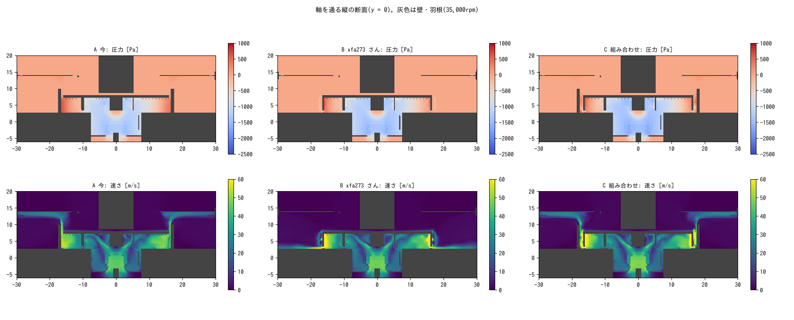
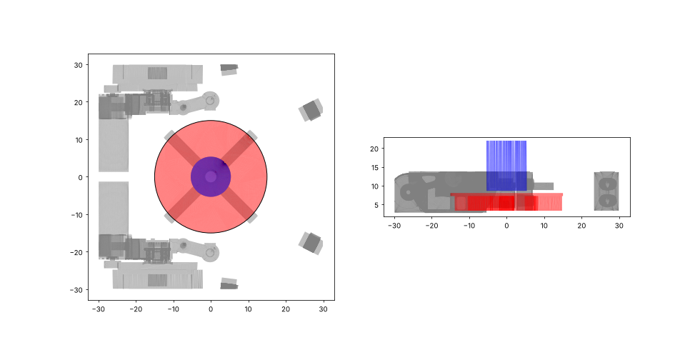
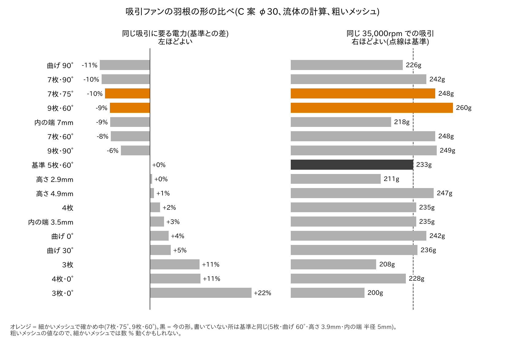

# 吸引ファンの形の比べ(流体の計算、2026-11-24)

xfa273 さんの X の投稿(DMM で印刷したファン)の形と、今の MK4 のファン、その組み合わせを、35,000rpm で比べた。報告の PDF(D を足した4つの比べ): [日本語](fan_cfd_report_ja.pdf)・[English](fan_cfd_report_en.pdf)


| 形 | 中身 |
|---|---|
| **A 今** | 羽根 φ32(5枚)+ 上の板。羽根の外に**止まった輪**(ファンの台、半径 16.5〜17.5)。空気は輪と羽根の間から上へ出る |
| **B xfa273 さん** | 羽根の外に**回る外の壁**(半径 16〜16.6、羽根・上の板と一体)。止まった輪はない。空気は外の壁の下の端(フレームとのすき間 0.5mm)から横へ出る |
| **C 組み合わせ** | B の羽根 + 止まった輪(半径 17.6〜18.6)。空気は回る壁と輪の間(1mm)から上へ出る |
| **D 壁なし**(2026-11-25 に追加) | A から止まった輪を除いた形。羽根に外の壁もない。空気は羽根の先からそのまま横へ出る |

羽根の形はどれも同じ(厚さ 0.6mm、内の端 半径 5、後ろへ 60° 曲げた5枚、高さ z 3.3〜7.2、上の板 z 7.2〜8.0)。xfa273 さんの形は写真から読んだ推定。

## 結果(細かいメッシュ、35,000rpm)

| | A 今 | B xfa273 さん | C 組み合わせ | D 壁なし |
|---|---|---|---|---|
| 機体の下の圧力 | −1,177Pa | −1,271Pa | −1,371Pa | **−1,673Pa** |
| 吸引(68 × 34mm) | 277g | 299g(+8%) | 323g(+17%) | **394g(+42%)** |
| 漏れる空気 | 63.3 L/min | 65.7 L/min | 68.2 L/min | 75.1 L/min |
| トルク(圧力・摩擦) | 1.169 mN·m(1.035・0.133) | 1.422 mN·m(1.228・0.194) | 1.395 mN·m(1.255・0.140) | 1.540 mN·m(1.393・0.147) |
| 羽根を回す仕事 | 4.28W | 5.21W(+22%) | 5.11W(+19%) | 5.64W(+32%) |
| **同じ吸引 277g にしたとき** | 35,000rpm・4.28W | 33,700rpm・4.65W(**+9%**) | 32,400rpm・4.06W(**−5%**) | 29,300rpm・3.32W(**−22%**) |

- 同じ吸引にしたときは、負圧が回転数の2乗、仕事が3乗に比例するとして換算した
- **2026-11-25 に足した D(壁なし)が、4つの中で一番よい**。同じ回転数で吸引が A の 1.42 倍、同じ吸引なら電力が A より 22%(C より 18%)少ない。輪(A・C)や回る外の壁(B・C)は羽根の出口を狭くして、空気の出を妨げていた。D の空気は羽根の先からフレームと基板の間を横へ吹き出す。まわりの部品を入れても D の得はほとんど変わらなかった(下の「D の確かめ」)。印刷した羽根で確かめる(くり返し 1,000 → 1,500 回で吸引 −0.5%)
- (D を足す前の 3 つの比べ)**C が一番よい**。B より吸引が 8% 強く、仕事は少し小さい。B は回る外の壁の外側の面が開いた空気をこするので摩擦が大きい(0.19 mN·m)。C は輪との間の空気が一緒に回るので摩擦が A と同じくらい(0.14)で、その空気が回ることで、すき間でも圧力を少し上げていると考えられる
- **B は同じ回転数では A より強いが、同じ吸引で比べると仕事が 9% 多い**。吸引を上げたいだけなら、A の回転数を上げるのと大差ない
- 回転数の差: C で 277g なら A より約 7% 遅く回せばよい



B は空気がフレームの上を這って横へ吹き出す(フレームの上の部品に当たる)。A と C は上へ出て、基板の下を横へ抜ける。D は羽根の高さのまま、フレームと基板の間を横へ広がる。

## D の確かめ(2026-11-25、ユーザー「逆流してくる空気があると思う」)

**羽根を通る空気を、外へ出る量と内へ戻る量に分けた**(φ32、細かいメッシュ、L/min)

| 場所 | A 今(輪あり) | D 壁なし |
|---|---|---|
| 羽根の先(半径 16.2mm)の羽根の高さ | 外へ 88 / 内へ 43 | 外へ 108 / 内へ 54 |
| 羽根の下とフレームのすき間 0.5mm(半径 13〜15mm) | 正味 11〜13 が内へ戻る | 正味ほぼ 0 |

- 羽根の先の逆流は、A も D も同じくらい起きている(出した量の半分くらいが戻る)
- A は輪の中の圧力が上がり、空気が羽根の下を通って吸い込みの穴の方へ押し戻される。D は羽根の外が大気に近い圧力なので、ここの戻りがない。A の弱さはここから来ていると考えられる

**回る範囲(MRF)の境目**(φ32 D、粗いメッシュ): 境目を半径 16.5 → 18mm に広げると、387g・5.02W → 398g・4.89W。D はむしろ少しよくなる。境目の置き方で D が有利に出ているのではない

**まわりの部品を入れた比べ**(φ30、細かいメッシュ、35,000rpm、`make_case.py D <フォルダ> parts tip=15`・`make_case.py C <フォルダ> parts tip=15 gap=0.9`): ファンの台(輪の所を除く)・モーターのマウント・タイヤ・ギア・壁センサのホルダなどの STEP(`mechanical/order_t24/`)を、フレームと基板の間に入れた

| φ30 | 部品なし | 部品あり |
|---|---|---|
| C 組み合わせ | 254g・3.90W | 251g・3.88W |
| D 壁なし | 336g・3.95W | **343g・3.79W** |

- 部品を入れても、C・D とも値は 2% ほどしか変わらない。D の横へ吹き出す空気は、部品に当たっても吸引をほとんど弱めない
- 部品ありで、D は C より吸引 +37%。同じ吸引 251g にそろえると、D は 29,900rpm・2.37W で、**C より電力 −39%**

入れた部品(灰色。左が上から、右が横から見た図):



## 気をつけること

- **メッシュで値が変わる**: 粗いメッシュから細かいメッシュで、A は吸引 +3%・仕事 +9%、B は +1%・+8%、**C は +11%・+9%**。C はすき間 1mm の流れが粗いメッシュでは足りていなかった。差の向き(C > B > A)は細かいメッシュの方を信じるが、C の値はもう1段細かくすると、また数 % 動くかもしれない
- 収束: くり返し 1,000 → 1,500 回で、吸引は A 0%・B +1.5%・C +1%
- スカートのすき間の漏れは、0.15mm × 縁 204mm と同じ面積の穴(半径 3.12mm)にした。吸引する面は 68 × 34mm(spec では 80 × 42.6mm に広げたが、3つの比べには関係しない)
- ファンの台の腕、モーターの支え、壁センサのホルダなどは入れていない。モーターの損失は入れていない(羽根を回す仕事だけ)
- 実物は印刷の精度(羽根の厚さ、すき間)で変わる。最後は吸引の力とファンの電流を実測して決める

## 作り方

OpenFOAM v1912(Ubuntu のパッケージ)の simpleFoam、MRF(回る範囲を回る座標で解く)、kOmegaSST、定常。4並列で1つ約1時間(細かいメッシュ 140〜180万セル)。

```sh
# 形 A・B・C のケースを作る(coarse を付けると粗いメッシュ)
python3 docs/calc/fan_cfd/make_case.py C <フォルダ>
# メッシュを作って解く(くり返し 1500 回)
bash docs/calc/fan_cfd/run_case.sh <フォルダ> 1500
# 結果を読む(@1000 で途中の回)
python3 docs/calc/fan_cfd/post.py <フォルダA> <フォルダB> <フォルダC>@1000 <フォルダC>
# 図
python3 docs/calc/fan_cfd/flow_fig.py docs/img/tire24/fan_cfd_flow.png <フォルダA> <フォルダB> <フォルダC>
python3 docs/calc/fan_cfd/section_fig.py
# 英語の図
python3 docs/calc/fan_cfd/section_fig.py --en
python3 docs/calc/fan_cfd/flow_fig.py docs/img/tire24/fan_cfd_flow_en.png <フォルダA> <フォルダB> <フォルダC>
# 報告の PDF(どれが良かったかだけの1枚。日本語・英語)
python3 docs/calc/fan_cfd/report_pdf.py
```

報告の PDF: [日本語](fan_cfd_report_ja.pdf)・[English](fan_cfd_report_en.pdf)

このパッケージは関数オブジェクト(forces など)が「sha1」のエラーで動かないので、`post.py` が書き出したメッシュと場を読んで、負圧・流量・トルクを自分で計算している。

## 羽根の形の比べ(C 案 φ30、粗いメッシュ、2026-11-25)

C 案を φ30(輪は今のファンの台と同じ半径 16.5〜17.5)にして、羽根の枚数・曲げ・高さ・内の端を1つずつ変えた。基準は 5枚・後ろへ 60° 曲げ・高さ 3.9mm・内の端 半径 5mm。



- **羽根を増やす(7〜9枚)と、吸引が上がり、同じ吸引に要る電力も 8〜9% 減る**。3〜4枚はどちらも悪い
- 曲げ 0° は同じ回転数での吸引は少し上がるが、電力がもっと増える。曲げを強くすると電力は減るが、同じ吸引に回転数が要る(羽根の付け根の曲げの力も増える)
- 高さは電力の効率をほとんど変えない
- 細かいメッシュで確かめた(35,000rpm、1,500 回):

| C 案 φ30 | 吸引 | 羽根を回す仕事 | 同じ吸引 254g にしたとき |
|---|---|---|---|
| 基準(5枚・60°) | 254g | 3.90W | 3.90W |
| 7枚・75° | 254g | 3.54W | **3.54W(−9%)** |
| 9枚・60° | 273g | 3.98W | 33,800rpm・**3.57W(−8%)** |

  粗いメッシュの見立てどおり、羽根を増やすと同じ吸引に要る電力が 8〜9% 減る。これは C 案(輪あり)での結果。D(壁なし)の羽根の形はまだ比べていない

```sh
# ケース(粗いメッシュ)
python3 docs/calc/fan_cfd/make_case.py C <フォルダ> coarse tip=15 gap=0.9 blades=7 sweep=75
# 図(数値はスクリプトの中に書き写してある)
python3 docs/calc/fan_cfd/blade_screen_fig.py
```
