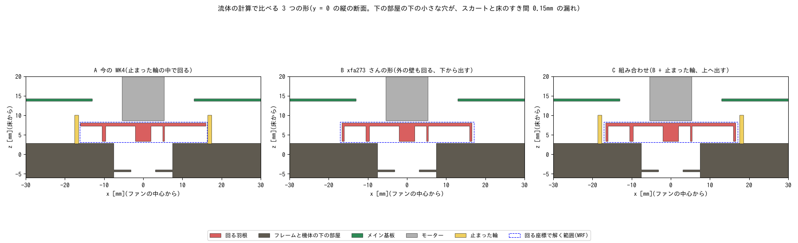

# 吸引ファンの形の比べ(流体の計算、2026-11-24)

xfa273 さんの X の投稿(DMM で印刷したファン)の形と、今の MK4 のファン、その組み合わせを、35,000rpm で比べた。



| 形 | 中身 |
|---|---|
| **A 今** | 羽根 φ32(5枚)+ 上の板。羽根の外に**止まった輪**(ファンの台、半径 16.5〜17.5)。空気は輪と羽根の間から上へ出る |
| **B xfa273 さん** | 羽根の外に**回る外の壁**(半径 16〜16.6、羽根・上の板と一体)。止まった輪はない。空気は外の壁の下の端(フレームとのすき間 0.5mm)から横へ出る |
| **C 組み合わせ** | B の羽根 + 止まった輪(半径 17.6〜18.6)。空気は回る壁と輪の間(1mm)から上へ出る |

羽根の形はどれも同じ(厚さ 0.6mm、内の端 半径 5、後ろへ 60° 曲げた5枚、高さ z 3.3〜7.2、上の板 z 7.2〜8.0)。xfa273 さんの形は写真から読んだ推定。

## 結果(細かいメッシュ、35,000rpm)

| | A 今 | B xfa273 さん | C 組み合わせ |
|---|---|---|---|
| 機体の下の圧力 | −1,177Pa | −1,271Pa | **−1,371Pa** |
| 吸引(68 × 34mm) | 277g | 299g(+8%) | **323g(+17%)** |
| 漏れる空気 | 63.3 L/min | 65.7 L/min | 68.2 L/min |
| トルク(圧力・摩擦) | 1.169 mN·m(1.035・0.133) | 1.422 mN·m(1.228・0.194) | 1.395 mN·m(1.255・0.140) |
| 羽根を回す仕事 | 4.28W | 5.21W(+22%) | 5.11W(+19%) |
| 空気にした仕事 ÷ 回す仕事 | 29% | 27% | **30%** |
| **同じ吸引 277g にしたとき** | 35,000rpm・4.28W | 33,700rpm・4.65W(**+9%**) | 32,400rpm・4.06W(**−5%**) |

- 同じ吸引にしたときは、負圧が回転数の2乗、仕事が3乗に比例するとして換算した
- **C が一番よい**。B より吸引が 8% 強く、仕事は少し小さい。B は回る外の壁の外側の面が開いた空気をこするので摩擦が大きい(0.19 mN·m)。C は輪との間の空気が一緒に回るので摩擦が A と同じくらい(0.14)で、その空気が回ることで、すき間でも圧力を少し上げていると考えられる
- **B は同じ回転数では A より強いが、同じ吸引で比べると仕事が 9% 多い**。吸引を上げたいだけなら、A の回転数を上げるのと大差ない
- 回転数の差: C で 277g なら A より約 7% 遅く回せばよい


B は空気がフレームの上を這って横へ吹き出す(フレームの上の部品に当たる)。A と C は上へ出て、基板の下を横へ抜ける。

## 気をつけること

- **メッシュで値が変わる**: 粗いメッシュから細かいメッシュで、A は吸引 +3%・仕事 +9%、B は +1%・+8%、**C は +11%・+9%**。C はすき間 1mm の流れが粗いメッシュでは足りていなかった。差の向き(C > B > A)は細かいメッシュの方を信じるが、C の値はもう1段細かくすると、また数 % 動くかもしれない
- 収束: くり返し 1,000 → 1,500 回で、吸引は A 0%・B +1.5%・C +1%
- スカートのすき間の漏れは、0.15mm × 縁 204mm と同じ面積の穴(半径 3.12mm)にした。吸引する面は 68 × 34mm(spec では 80 × 42.6mm に広げたが、3つの比べには関係しない)
- ファンの台の腕、モーターの支え、壁センサのホルダなどは入れていない。モーターの損失は入れていない(羽根を回す仕事だけ)
- 実物は印刷の精度(羽根の厚さ、すき間)で変わる。最後は吸引の力とファンの電流を実測して決める

## 作り方

OpenFOAM v1912(Ubuntu のパッケージ)の simpleFoam、MRF(回る範囲を回る座標で解く)、kOmegaSST、定常。4並列で1つ約1時間(細かいメッシュ 140〜180万セル)。

```sh
# 形 A・B・C のケースを作る(coarse を付けると粗いメッシュ)
python3 docs/calc/fan_cfd/make_case.py C <フォルダ>
# メッシュを作って解く(くり返し 1500 回)
bash docs/calc/fan_cfd/run_case.sh <フォルダ> 1500
# 結果を読む(@1000 で途中の回)
python3 docs/calc/fan_cfd/post.py <フォルダA> <フォルダB> <フォルダC>@1000 <フォルダC>
# 図
python3 docs/calc/fan_cfd/flow_fig.py docs/img/tire24/fan_cfd_flow.png <フォルダA> <フォルダB> <フォルダC>
python3 docs/calc/fan_cfd/section_fig.py
```

このパッケージは関数オブジェクト(forces など)が「sha1」のエラーで動かないので、`post.py` が書き出したメッシュと場を読んで、負圧・流量・トルクを自分で計算している。
