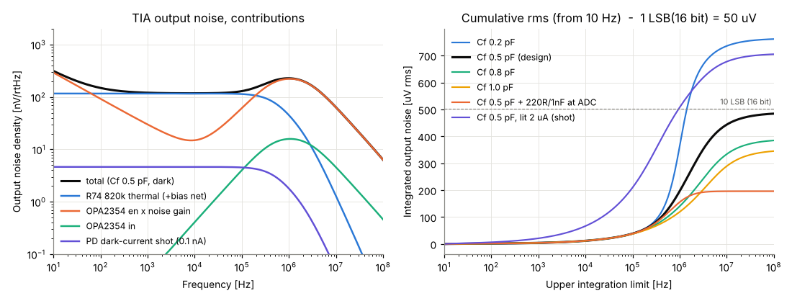
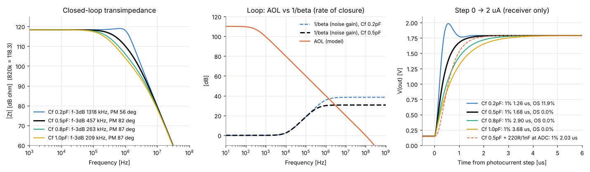
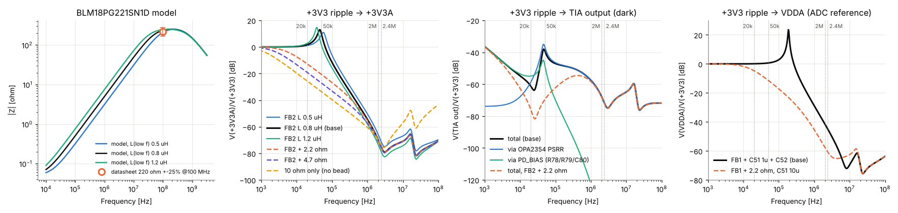
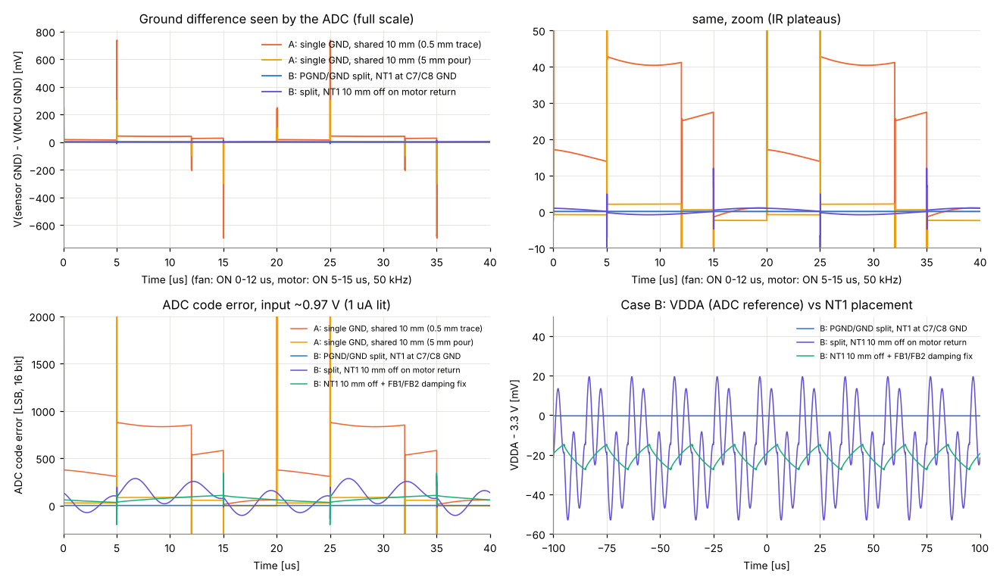
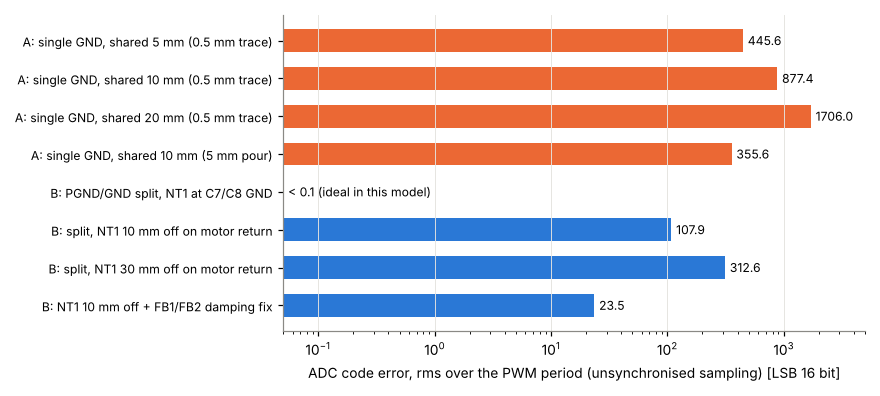
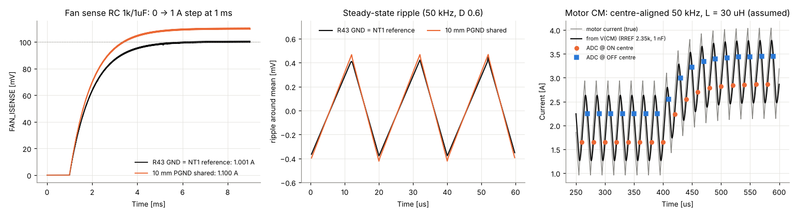

# ノイズの評価(SPICE、2026-11-06)

KOGUMA MK4 の回路図(`hardware/kicad/KOGUMA-Mk4/`)から、壁センサの受光アンプ、電源、GND、電流の計測について、ngspice(LTspice と同じ SPICE)でノイズを計算した。部品の値とつながりは回路図から書き出したネットリスト(KiCad)で確かめた。

**ひとことで**: 受光アンプ自体のノイズは 16 ビットの ADC で約 10 LSB rms(12 ビットなら 1 LSB 未満)で、問題にならない。**効くのは GND と ADC の基準電圧(VDDA)**。MK3 のように大きい電流の戻りと GND を共有すると数百〜千 LSB 以上の誤差になる。MK4 の PGND / GND の分け方なら、NT1 を正しい場所に置けば誤差はほぼ 0 になる。ただし NT1 がずれると VDDA のフィルタ(FB1 + 1µF)の共振で ±30mV 以上揺れ、約 100 LSB rms の誤差になる。

## 目次

1. [目的と範囲](#1-目的と範囲)
2. [やり直し方](#2-やり直し方)
3. [前提(仮定)の表](#3-前提仮定の表)
4. [結果 1: 受光アンプのノイズ・安定性・応答](#4-結果-1-受光アンプのノイズ安定性応答)
5. [結果 2: 電源のノイズの経路](#5-結果-2-電源のノイズの経路)
6. [結果 3: GND の共通インピーダンス(MK3 型と MK4 型)](#6-結果-3-gnd-の共通インピーダンスmk3-型と-mk4-型)
7. [結果 4: ファンとモーターの電流計測](#7-結果-4-ファンとモーターの電流計測)
8. [結論と改善案(効く順)](#8-結論と改善案効く順)
9. [限界](#9-限界)

## 1. 目的と範囲

- MK3 では吸引の PWM(約50kHz)と車輪の PWM が壁センサ FL・L にのった(`docs/spec.md` の「モーター・吸引のノイズ対策」)。MK4 の回路で同じことが起きないか、どこが弱いかを数字で見る
- 対象:
  1. 受光アンプ(SFH 229 FA → OPA2354、820kΩ ∥ 0.5pF)のノイズ・安定性・ステップ応答
  2. +3V3 の揺れが +3V3A(FB2 + C85 など)、PD_BIAS、OPA2354 の PSRR を通って出力に出る量。VDDA(ADC の基準)への経路も
  3. GND の共通インピーダンス: MK3 型(GND 1つ)と MK4 型(PGND / GND を NT1 でつなぐ)、NT1 の位置
  4. ファンの電流(R43 0.1Ω → 1k / 1µF)とモーターの CM(RREF 2.35kΩ、1nF)
- 使った回路図の値(ネットリストで確認):
  - 受光: D74〜D77 SFH 229 FA(アノード GND、カソード → −入力)、R74〜R77 820k、C74〜C77 0.5p C0G、U74・U75 OPA2354(V+ = +3V3A、V− = GND)
  - PD_BIAS: R78 1k(+3V3A から)/ R79 47Ω、C80 10µF → 3.3 × 47 / 1047 = **0.148V**。C80 とで約 354Hz の低域通過
  - +3V3A: FB2 BLM18PG221SN1D、C85・C78・C79 10µF(0603)、C83・C84 100nF
  - VDDA: FB1 BLM18PG221SN1D、C51 1µF、C52 100nF(VFQFPN68 は VREF+ = VDDA)
  - 壁センサの ADC は ADC1(16 ビット、`docs/pinmap.md`)。**1 LSB = 3.3V / 65536 = 50.4µV**(12 ビットなら 0.81mV)
  - +3V3 の出力コンデンサ C7・C8(22µF 0805)と U1 の GND は **PGND**。NT1 は PGND と GND を 1 か所でつなぐ
  - ファン: Q40 IRLML6344 → R43 0.1Ω → PGND。R44 1k → FAN_ISENSE、**C40 1µF は GND**
  - モーター: MP6551 CM → R22 4.7k(+3V3)/ R23 4.7k(GND)、C23 1nF → ADC2

## 2. やり直し方

```sh
cd docs/calc/noise
python3 run_all.py          # ngspice -b で 8 本のネットリストを回し、図と summary.json を作る(20秒ほど)
python3 run_all.py --plot   # 計算はせず、out/ のデータから図だけ作り直す
ngspice -b 01_tia_noise.cir # 1本だけ回すとき(このフォルダで実行する)
```

- ngspice 42(`/usr/bin/ngspice`)、Python 3 + numpy(2.0 以上、`np.trapezoid`)+ matplotlib
- 計算の生データは `out/`(git に入れない、`.gitignore`)、図は `fig/`、主な数字は `summary.json`

| ファイル | 中身 |
|---|---|
| `lib/models.lib` | OPA2354(1回路)の振る舞いモデル(GBW・ノイズ・入力容量・PSRR)、SFH 229 FA、BLM18PG221、MLCC(ESR・ESL)、基板の線(R・L) |
| `lib/blocks.lib` | 壁センサ1チャンネル + FB2・C85 など + PD_BIAS + VDDA(FB1・C51・C52)のまとまり |
| `01_tia_noise.cir` | `.noise`: Cf 0.2 / 0.5 / 0.8 / 1.0pF、ノイズ源ごとの内訳、光が当たったとき(ショットノイズ)、ADC の入口に RC を付けたとき |
| `02_tia_ac.cir` | `.ac`: 閉ループの電流→電圧の変換、ループを −入力で切ったループゲイン(位相余裕) |
| `03_tia_tran.cir` | `.tran`: 光の電流 0 → 2µA のステップ |
| `04_supply_ac.cir` | `.ac`: +3V3 → +3V3A / PD_BIAS / 出力 / VDDA。フェライトのインダクタンスの幅、直列抵抗の対策 |
| `05_ground_A.cir` | `.tran`: MK3 型(GND 1つ)。共有する長さ 5 / 10 / 20mm、ベタのとき |
| `05_ground_B.cir` | `.tran`: MK4 型(PGND / GND + NT1)。NT1 のずれ 0 / 10 / 30mm、対策あり |
| `06_fan_sense.cir` | `.tran` + `.ac`: ファンの電流の RC、PGND を共有したとき |
| `07_motor_cm.cir` | `.tran` + `.ac`: モーターの CM、センターアラインの PWM でどこを読むか |
| `run_all.py` | 全部を回して図と `summary.json` を作る |

ノイズ源の作り方(SPICE の `.noise` は周波数で変わるノイズ源を直接書けないため): 1mA を流したダイオード2個の差をとると、直流は消えてショットノイズ(白色)と KF による 1/f ノイズだけが残る。それを従属電源で倍率をかけて OPA2354 の en(6.5nV/√Hz、1/f の角 20kHz)や、周波数に比例して増える in にした。モデルの中の抵抗は `noisy=0` にしてある。

## 3. 前提(仮定)の表

| 項目 | 使った値 | 出典・理由 |
|---|---|---|
| OPA2354 GBW / AOL | 100MHz(G=+10)/ 110dB、第1極 316Hz、第2極 400MHz(仮定) | TI SBOS233H(2026-08改訂)表 6.7、図 6-17(位相は 100MHz 付近まで約90°) |
| OPA2354 en | 6.5nV/√Hz(1MHz)、1/f の角 20kHz(1kHz で約 30nV/√Hz) | 同 表 6.7、図 6-11 から読んだ |
| OPA2354 in | 50fA/√Hz(1MHz、OPA2354)、周波数に比例 | 同 表 6.7、図 6-11 |
| OPA2354 入力容量 | 差動 2pF、同相 2pF | 同 表 6.7(10^13Ω ∥ 2pF) |
| OPA2354 PSRR | 直流 200µV/V(−74dB)、9.5kHz から −20dB/dec(100kHz で約 −54dB、1MHz で約 −34dB)。**位相は不明** | 同 表 6.7(typ.)と図 6-16 の傾き。PSRR と PD_BIAS の2つの経路が足し合うか打ち消すかは位相しだいなので、両方を別に示す |
| OPA2354 出力抵抗、電流 | 開ループ 35Ω、1回路 4.9mA | 同 表 6.7 |
| SFH 229 FA 容量 | 11.5pF(逆電圧 0.15V) | ams OSRAM データシート v1.4(2022-08-11): C0 13pF(0V)、容量のグラフで 0.1〜0.2V は約 11〜12pF |
| SFH 229 FA 暗電流 | 0.1nA(ショットノイズ) | 同: 0.05nA typ(10V、25°C)。温度が上がると増えるので2倍にした(ノイズへの影響は無視できる) |
| SFH 229 FA 並列抵抗 | 10GΩ(仮定) | データシートに値なし。820k に比べ十分大きければ結果は変わらない |
| −入力の基板の浮遊容量 | 1pF(仮定) | フォトダイオードの足(ホルダから基板へ曲げる)とパッド。Cf の ±0.3pF の振りに 820k 自体の容量(約 0.05〜0.2pF)も含めて見る |
| LXDC55FAAA-203 | 2MHz、出力の揺れ 20mVp-p(12V、1A、22µF、100MHz 帯域)。0.1〜0.5A では約 10mVp-p | 村田 データシート(表と「Output Ripple-Noise」のグラフ)。2MHz は `docs/spec.md`。軽い負荷では PFM で周波数が下がる(モデルにはない) |
| +3V3 の PWM 周波数の揺れ | **5mVp-p(仮定)** | DC-DC の入力変動・負荷変動への応答(50kHz)はデータシートにない。**実機で測ること** |
| MCU の SMPS(2.4MHz)の揺れ | 10mVp-p(仮定) | DS13311 の 2.4MHz。振幅は仮定 |
| BLM18PG221SN1D | 220Ω ±25%(100MHz)、直流抵抗 0.1Ω 以下、1.4A。**モデル: 0.05Ω +(0.8µH ∥ 250Ω ∥ 0.9pF)**、L は 0.5〜1.2µH で振る | 村田の値(`docs/bom.md`)。インピーダンスのカーブの細かい値は入手できなかったので、100MHz で 220〜235Ω、10MHz で約 50Ω になるように合わせた(`fig/fig03_supply_path.png` の左)。低い周波数のインダクタンスがいちばん不確か |
| MLCC の実効容量 | 10µF 0603 は 3.3V で **5µF**、C80(0.15V)は 10µF、C51 1µF は 0.8µF、ESR 5〜20mΩ、ESL 0.5〜0.6nH | DC バイアスでの容量の減り(X5R 0603 の一般的な値)の仮定 |
| 基板の線 | 1oz(35µm)、0.49mΩ/□(25°C)。インダクタンス 0.7nH/mm(0.5mm 幅)、0.9nH/mm(0.15mm)、0.3〜0.4nH/mm(ベタ)。L に 10Ω を並列(数値の安定と高い周波数の損失) | 2層 0.6mm 基板の目安。ネットクラス Default 0.15mm / Battery 0.5mm / Motor 0.4mm |
| PWM | **50kHz**(MK3 の値。MK4 は `docs/control.md` で「20kHz の倍数、40〜80kHz、モーターのインダクタンスを測ってから」)。周波数特性は 20 / 40 / 50 / 80kHz で読む | |
| GND に流れる電流 | ファン: 0 ↔ 1.67A(デューティ 0.6、電池から平均 1A)、立ち上がり 50ns。モーター: 0 ↔ 3A(デューティ 0.5、5µs ずらす)、30ns。MCU 150mA(直流)、OPA2354 4 × 4.9mA、ADC 2mA | ファン 1A は `docs/spec.md`。MP6551 の SR は 0Ω(最速)なので切り替わりを速めにした |
| モーター | 巻線 1Ω + ドライバ 27mΩ、**L = 30µH(仮定、未測定)**、逆起電力 4V、電池 12V | `docs/spec.md`。L は `docs/control.md` で「未測定」 |
| MP6551 CM | +1A で 120µA(1/10,000 の比で +側の値) | `docs/spec.md`(データシート Rev.1.0 の表) |
| 温度 | 27°C | ngspice の標準 |

## 4. 結果 1: 受光アンプのノイズ・安定性・応答





**ノイズ**(暗いとき、出力、10Hz〜100MHz で積分。ADC はサンプリングで全部の帯域を拾うので上限を広くとった):

| 条件 | 出力の rms | 16ビットの LSB | 12ビットの LSB | 入力の電流に直すと | 点灯と消灯の差(10µs 離れた2回、CDS) |
|---|---|---|---|---|---|
| **Cf 0.5pF(今の設計)** | **484µV** | **9.6** | 0.60 | 0.59nA rms | 620µV = 12.3 LSB |
| Cf 0.2pF(−0.3pF) | 761µV | 15.1 | 0.95 | 0.93nA | 929µV = 18.5 LSB |
| Cf 0.8pF(+0.3pF) | 385µV | 7.6 | 0.48 | 0.47nA | 496µV = 9.8 LSB |
| Cf 1.0pF | 345µV | 6.9 | 0.43 | 0.42nA | 445µV = 8.8 LSB |
| Cf 0.5pF + ADC の入口に 220Ω / 1nF | **196µV** | **3.9** | 0.24 | 0.24nA | 244µV = 4.9 LSB |
| Cf 0.5pF、光 2µA(出力 約1.8V、ショットノイズ) | 705µV | 14.0 | 0.88 | 0.86nA | 921µV = 18.3 LSB |

内訳(Cf 0.5pF): OPA2354 の en 474µV、R74 820k の熱雑音 91µV(116nV/√Hz、計算どおり)、in 34µV、暗電流 4µV。

- **いちばん大きいのは OPA2354 の電圧ノイズ × ノイズゲイン**。−入力の容量(フォトダイオード 11.5p + 入力 4p + 基板 1p ≒ 16.5pF)と Cf 0.5pF で、高い周波数のノイズゲインが 1 + 16.5 / 0.5 ≒ 34 倍(31dB)になり、6.5nV × 34 ≒ 220nV/√Hz が ループの交点(約 3MHz)まで続く。帯域(457kHz)の外のノイズなので、**ADC の入口の RC(220Ω / 1nF、723kHz)で 60% 減る**。そのかわり落ち着くまでが約 0.4µs 延びる(1% まで 1.68 → 2.03µs、0.01% まで 3.28 → 3.72µs)
- 820k の熱雑音は 91µV で小さい。1/f は点灯と消灯の差(数µs 離れた2回)をとるとほぼ消える
- 光が強い(2µA)と、光そのもののショットノイズ(0.8pA/√Hz)が 820k の熱雑音(0.14pA/√Hz)より大きくなる。これは信号に比例するので、強いときの SN 比は約 1.8V / 0.7mV ≒ 68dB で十分
- 壁が遠くて信号が数 mV のときは、10 LSB rms(0.5mV)が効きはじめる。そのときは ADC のオーバーサンプリング(H7 のハードウェア平均)か、入口の RC で下げる

**安定性と応答**:

| Cf | 帯域(−3dB) | ピーク | 位相余裕 | 1% まで | 0.1% まで | 0.01% まで | オーバーシュート |
|---|---|---|---|---|---|---|---|
| 0.2pF | 1318kHz | 0.6dB | 56° | 1.26µs | 1.85µs | 2.44µs | 11.9% |
| **0.5pF** | **457kHz** | なし | **82°** | **1.68µs** | **2.48µs** | **3.28µs** | 0% |
| 0.8pF | 263kHz | なし | 87° | 2.90µs | 4.33µs | 5.74µs | 0% |
| 1.0pF | 209kHz | なし | 87° | 3.68µs | 5.46µs | 6.96µs | 0% |
| 0.5pF + ADC の入口に 220Ω / 1nF | — | — | — | 2.03µs | 2.87µs | 3.72µs | 0% |

- 0.5pF は余裕が大きい(位相余裕 82°)。浮遊容量で −0.3pF ずれても(0.2pF)発振はしない(56°)が、12% はね返る。+0.3pF ずれると 1% までが 1.7 → 2.9µs に延びる。`docs/spec.md` の「約1.9µs(1%)」とほぼ合う
- 16 ビットで 1 LSB 以内(約0.003%)まで待つなら、受光だけで約 4µs。NJU6080 の ON の遅れ(2.5µs)を足して、**点灯してから約 7µs 後に読む**のが目安(0.5pF ± 0.3pF を含めるなら 8〜9µs)
- このモデルには出力の飽和・スルーレートがない(2µA → 1.64V の段差なら OPA2354 の 110V/µs は効かない)

## 5. 結果 2: 電源のノイズの経路



| 経路(+3V3 の揺れ 1V あたり) | 20kHz | 40kHz | 50kHz | 80kHz | 2MHz | 2.4MHz |
|---|---|---|---|---|---|---|
| +3V3 → +3V3A(今の FB2 + 約15µF) | +1.8dB | **+10.3dB** | **+9.9dB** | −6.5dB | −70dB | −75dB |
| +3V3 → 受光の出力(暗いとき、合計) | −61dB | −44dB | −39dB | −46dB | −68dB | −72dB |
| 同、OPA2354 の PSRR 経由だけ | −59dB | −40dB | −37dB | −45dB | −68dB | −72dB |
| 同、PD_BIAS 経由だけ | −55dB | −48dB | −48dB | −65dB | ほぼ 0 | ほぼ 0 |
| +3V3 → +3V3A(**FB2 に 2.2Ω を直列**) | −12.8dB | −18.7dB | −20.6dB | −24.8dB | −70dB | −75dB |
| +3V3 → 受光の出力(FB2 + 2.2Ω) | −76dB | −73dB | −70dB | −64dB | −68dB | −72dB |
| +3V3 → **VDDA**(今の FB1 + C51 1µF) | +0.1dB | +0.4dB | +0.6dB | +1.7dB | −42dB | −45dB |
| +3V3 → VDDA(FB1 + 2.2Ω、C51 10µF) | −4.7dB | −9.5dB | −11.3dB | −15.3dB | −58dB | −61dB |

- **FB2 は数十 kHz ではフィルタにならず、逆に増やす**。フェライトは低い周波数ではただのインダクタ(約 0.8µH)で、+3V3A のコンデンサ(10µF × 3、3.3V で実効 約15µF)と **約45kHz で直列共振(+13dB、Q 約4.5)**する。共振の周波数は MK3 の PWM(50kHz)や MK4 の候補(40〜80kHz)のど真ん中。フェライトの L の幅(0.5〜1.2µH)で 37〜56kHz に動く
- それでも受光の出力への影響は小さい。50kHz で −39dB なので、+3V3 が 5mVp-p 揺れても出力は 56µVp-p(1.1 LSB)。PD_BIAS の C80(10µF)が 354Hz で落とし、OPA2354 の PSRR(50kHz で約 −50dB)もある
- **VDDA(ADC の基準)のほうが問題**。FB1 + C51 1µF は **約186kHz で +24dB(Q 約15)**の共振があり、PWM の周波数ではまったく減らない(+0.6dB)。ADC の値は 入力 / VDDA なので、VDDA の揺れはそのまま「割合の誤差」になる。+3V3 が 50kHz で 5mVp-p 揺れると、1.5V の入力で **約49 LSB p-p**(16ビット)。2MHz(20mVp-p)では 1.5 LSB、2.4MHz(10mVp-p)では 0.5 LSB で小さい
- 2MHz・2.4MHz は FB2・FB1 とコンデンサでよく落ちている(受光の出力で 0.2 LSB 以下)

想定した揺れでの出力(16ビットの LSB、p-p):

| 揺れの元(仮定) | 受光の出力(今) | 受光の出力(FB2 + 2.2Ω) | VDDA の揺れによる誤差(入力 1.5V、今) | 同(FB1 + 2.2Ω、C51 10µF) |
|---|---|---|---|---|
| PWM 20kHz、5mVp-p | 0.09 | 0.02 | 46 | 26 |
| PWM 50kHz、5mVp-p | 1.1 | 0.03 | 49 | 12 |
| DC-DC 2MHz、20mVp-p | 0.16 | 0.16 | 1.5 | 0.24 |
| MCU SMPS 2.4MHz、10mVp-p | 0.05 | 0.05 | 0.5 | 0.08 |

PWM の揺れは PWM に同期しているので、点灯・消灯を PWM の同じ位置で読めば大部分は消える(下の「改善案」)。

## 6. 結果 3: GND の共通インピーダンス(MK3 型と MK4 型)





モデル(`05_ground_A.cir`・`05_ground_B.cir`):

- **A(MK3 型)**: GND が1つ。ファン(1.67A)とモーター(3A)の戻りが、センサの GND の取り出し口と MCU(VSSA)の間の線(長さ L)を通る。+3V3 は同じ GND から
- **B(MK4 型)**: ファン・モーターの戻りは PGND だけを通って電池側のコンデンサへ。GND(下の面のベタ、幅 3mm 相当)は NT1 で PGND とつながる。NT1 を C7・C8(+3V3 の出力コンデンサ)の GND にぴったり置いた場合と、そこからモーターの戻り道に沿って 10mm・30mm ずらした場合
- どちらも受光は 1µA で点灯(出力 約0.97V)。ADC の値 = (出力 − MCU の GND)/(VDDA − MCU の GND)× 65536

| 条件 | センサと MCU の GND の差(p-p、ns のトゲを含む) | 平らな所(両方 ON) | ADC の誤差 rms(PWM と非同期) | 平らな所の誤差(両方 ON / 両方 OFF) | VDDA の揺れ |
|---|---|---|---|---|---|
| A: 共有 5mm(0.5mm の線) | 719mV | 19.7mV | 446 LSB | 430 / 10 LSB | — |
| **A: 共有 10mm(0.5mm の線)** | **1432mV** | **40.5mV** | **877 LSB** | 837 / 50 LSB | — |
| A: 共有 20mm(0.5mm の線) | 2836mV | 79.0mV | 1706 LSB | 1587 / 198 LSB | — |
| A: 共有 10mm(5mm 幅のベタ) | 602mV | 2.1mV | 356 LSB | 85 / −3 LSB | — |
| **B: NT1 を C7・C8 の GND に** | **0.0mV** | 0.07mV | **< 0.1 LSB** | 0 / 0 LSB | 0.01mV |
| B: NT1 が 10mm ずれる | 24mV | −0.8mV | 108 LSB | 127 / −57 LSB | **72mVp-p** |
| B: NT1 が 30mm ずれる | 45mV | −2.0mV | 313 LSB | 338 / −140 LSB | 209mVp-p |
| B: 10mm ずれ + FB1・FB2 の対策 | 24mV | 0.05mV | 24 LSB | 69 / 78 LSB | 13mVp-p |

- **A(MK3 型)は、たった 5〜10mm の共有で数百 LSB**。平らな所の電圧(I × R)は 0.5mm の線 10mm で 40mV(16ビットで 800 LSB、12ビットで 50 LSB)。切り替わりのトゲ(L × di/dt、7nH × 3A / 30ns ≒ 0.7V)は 30〜50ns と短いが、ADC が当たると大きく外れる。MK3 で FL・L だけにのったこと(右側にはのらない)は、電源ではなく(電源なら4本ともにのる)、**FL・L の GND がファン・モーターの戻り道にあった**と考えると合う
- PWM に同期して読んでも、点灯と消灯の間でデューティや電流が変われば、平らな所の差(例: 両方 ON で 837 LSB、OFF で 50 LSB)がそのまま残る。MK3 で同期読みにしても残った(右の5〜10倍)のはこれで説明できる
- **B(MK4 型)は、NT1 の場所が正しければ、このモデルでは誤差がほぼ 0**。PGND の電流は GND を流れず、+3V3 も GND から見て揺れない
- **NT1 がずれると別の形で効く**。NT1 と C7・C8 の GND の間にモーターの電流が流れると、GND から見た +3V3 が I × Z(10mm で 3A × 9.8mΩ ≒ 29mV + トゲ)だけ揺れる。これが FB1 と C51 の共振(186kHz、Q 約15)を叩き、**VDDA が ±35mV 揺れ、ADC の誤差 108 LSB rms**。さらに平均で約 15mV 下がる(電流に比例した 0.45% の倍率の誤差)。FB1・FB2 に 2.2Ω を足すと 24 LSB rms まで下がるが、平均のずれは残る。**NT1 の位置がいちばん大事**
- LED のパルス(2個で 20mA)が GND のベタ(20mm、3.3mΩ)を流れると約 65µV(1.3 LSB)。点灯時だけの決まったずれなので、校正で消える

## 7. 結果 4: ファンとモーターの電流計測



**ファン(R43 0.1Ω → R44 1k / C40 1µF、ADC1_INP9)**:

| 項目 | 値 |
|---|---|
| PWM の減り(RC、159Hz) | 20kHz −42dB、40kHz −48dB、**50kHz −50dB**、80kHz −54dB |
| 残る揺れ(50kHz、デューティ 0.6、1A) | **0.88mVp-p = 17 LSB p-p(±0.44%)** |
| 電流のステップへの遅れ | 90% まで 2.3ms、99% まで 4.5ms、99.9% まで 6.5ms(τ = 1ms) |
| R43 の GND と ADC の GND の間に PGND を 10mm(0.5mm の線)共有 | 読みが **+9.8%**(1.10A と読む) |

- ファンのモーター・羽根の時定数(数十 ms 以上)に比べて 1ms の遅れは問題ない。ソフトスタートの見張りにも足りる
- 揺れは ±0.44% なので、**PWM に同期させなくてもよい**。同期させれば決まったずれになる(なお吸引の PWM の周期を車輪とそろえるので、同期はしやすい)
- 注意: R43 は PGND、C40 は GND。R43 の GND の端子から NT1 までの PGND の電圧が、そのまま測定値に足される。ファンの電流だけが流れる所なら倍率の誤差(校正で消える)だが、モーターの電流も流れる所なら混ざる

**モーター(MP6551 CM → 2.35kΩ ∥ 1nF、τ = 2.35µs)**:

| 項目 | 値 |
|---|---|
| PWM の減り | 20kHz −0.4dB、40kHz −1.3dB、**50kHz −1.9dB**、80kHz −3.8dB(ほとんど落ちない) |
| モーターの電流の揺れ(L = 30µH の仮定、12V、50kHz、デューティ 0.5) | 約 2.0A p-p → CM の電圧で約 390mVp-p(約 7,700 LSB) |
| 平均 1.95A のとき、ON の真ん中で読む | 1.65A(**−15%**) |
| 同、OFF の真ん中で読む | 2.30A(**+18%**) |
| 同、ON と OFF の真ん中の平均 | 1.97A(+1.3%) |
| 平均 3.1A(デューティ 0.6) | ON 2.85A(−8%)、OFF 3.44A(+11%)、平均 3.14A(+1.3%) |

- CM の 1nF は PWM の揺れをほとんど落とさないので、**PWM に同期して読むのは必須**(`docs/spec.md` の方針どおり)
- ただし「センターアラインの真ん中で読めば平均」は、RC の遅れ(2.35µs)があると成り立たない。真ん中では電流が傾いているので、2.35µs 前の値を読むことになる。**ON の真ん中と OFF の真ん中の2回を読んで平均する**(誤差 約1%)か、トリガを約 2.4µs 遅らせる。C23 を小さく(例 220pF、τ 0.5µs)すれば偏りも小さくなる
- 傾きはモーターの L で決まる。L を測ったら、このネットリスト(`07_motor_cm.cir` の `lm`)で計算し直す

## 8. 結論と改善案(効く順)

| 順 | 何をする | 効果(このモデルで) | コスト |
|---|---|---|---|
| 1 | **NT1 を C7・C8(+3V3 の出力コンデンサ)の GND のパッドに置く**。モーター・ファンの戻り(→ C2〜C4)が、C7・C8 の GND と NT1 の間を通らないように引く。DC-DC の入力側のループ(C5・C6 ↔ U1)からも離す | ずれ 10mm で 108 LSB rms、30mm で 313 LSB rms → ほぼ 0 | 基板の引き方だけ |
| 2 | **VDDA のフィルタを直す**: FB1 に 2.2Ω(1〜4.7Ω)を直列に足し、C51 を 1µF → 4.7〜10µF に | 186kHz の共振(+24dB)が消える。50kHz の揺れ 5mVp-p による誤差 49 → 12 LSB p-p(1.5V 入力)。NT1 ずれのときの VDDA の揺れ 72 → 13mVp-p | 抵抗1個、コンデンサの値。VDDA が約 4mV 下がる(一定なら校正で消える) |
| 3 | **ソフト: 壁センサの点灯・消灯を、車輪とファンの PWM の同じ位置で読む**(切り替わりから 0.5µs 以上離す)。点灯してから約 7µs 待つ。必要ならハードウェアのオーバーサンプリング | PWM に同期した残り(VDDA の揺れ、GND のトゲ)が点灯と消灯で打ち消し合う | ソフトだけ(`docs/spec.md` の方針どおり) |
| 4 | **FB2 に 2.2Ω を直列に足す**(+3V3A は 22.8mA で約 50mV 下がる) | 45kHz の共振(+13dB)が消え、50kHz で +3V3A が −21dB。受光の出力への影響 −39dB → −70dB | 抵抗1個。または PWM を 30〜70kHz から外す(80kHz など) |
| 5 | **モーターの CM は ON と OFF の真ん中の2回を読んで平均**(または約 2.4µs 遅らせる、C23 を小さく) | 読みの偏り −15% / +18% → 約 +1% | ソフト(ADC2 の注入変換を2回) |
| 6 | 受光の出力の ADC の入口に RC(例 220Ω + 1nF C0G)を付けるかを、実機で決める | ノイズ 484 → 196µV rms(9.6 → 3.9 LSB)。落ち着くまでが約 0.4µs 延びる(1% まで 2.03µs) | 部品4組。遠い壁で信号が小さく、ノイズが見えたら |
| 7 | ファンのシャント R43 の GND の端子を NT1 の近くに置く(または R43 → NT1 の間にモーターの電流を流さない)。読みの倍率は1A で校正する | 10mm の共有で +9.8% の誤差を避ける | 基板の引き方 |
| 8 | 受光の −入力(820kΩ の高インピーダンスの点)を、モーター・ファンの切り替わる線(J2・J3 の OUT、Q40 のドレイン)から離す。−入力のまわりを GND で囲う | 下の「限界」の計算: 1fF の結合でも 1回の切り替わりで約 24mV の跳ね(0.4µs で戻る) | 基板の引き方 |

Cf(0.5pF)は変えなくてよい。±0.3pF の浮遊容量でも安定(位相余裕 56〜87°)で、ノイズも 16 ビットで 10 LSB 前後。0.2pF 側に振れたときの 12% のはね返りは、読むまでの待ち時間(7µs)の中で収まる。

## 9. 限界

- **基板の寄生は入っていない**。GND・PGND の線の長さと幅は仮定の値(5〜30mm、0.5mm の線、3〜5mm のベタ)で振った。基板を引いたら、実際の長さと幅でネットリストの `TRACE` を直して計算し直す
- **モデルは振る舞いのモデル**。OPA2354 は線形(飽和・スルーレート・入力段の非線形なし)、PSRR の位相は不明、フェライトは R-L-C の当てはめ(低い周波数の L が不確か、直流電流による L の減りなし)、MLCC の容量の減りは仮定、DC-DC はただの電圧源(PFM、ループの応答、入力の揺れへの応答なし)、MP6551 の CM は理想の電流源(応答の速さ・0A のずれ・+と−の比の違いなし)
- **磁界・電界の結合は入っていない**。モーター・ファンの電流のループからの誘導や、切り替わる線と受光の −入力の間の容量は計算していない。目安: 切り替わる線(12V、30ns)と −入力の間に 1fF あると、電荷 12fC が Cf 0.5pF に入って約 24mV の跳ね(0.41µs で戻る)。フォトダイオードの足とホルダの位置で決まるので、基板で離す・囲うしかない
- ADC そのもののノイズ(ENOB)、サンプリングのコンデンサが受光の出力から電荷を取る影響、ADC のクロックのノイズは入っていない
- +3V3 の PWM 周波数の揺れ(5mVp-p)は仮定。**実機で +3V3 と VDDA を GND(信号)基準で測り、この表の値を入れ直す**のが次の一歩
- 電流の大きさ(ファン 1A、モーター 3A)、PWM の周波数(50kHz)は条件の一例。誤差は電流にほぼ比例し、共振(45kHz・186kHz)との位置関係で変わる

## 出典

- TI OPA354 / OPA2354 / OPA4354 データシート SBOS233H: <https://www.ti.com/lit/ds/symlink/opa2354.pdf>
- ams OSRAM SFH 229 FA データシート v1.4(2022-08-11): <https://static.chipdip.ru/lib/233/DOC027233583.pdf>
- 村田製作所 LXDC55FAAA-203 データシート: <https://datasheetbank.com/pdf-view/LXDC55FAAA-203-Murata.pdf>
- 村田製作所 BLM18PG221SN1D(220Ω ±25% @100MHz、0.1Ω 以下、1.4A): <https://www.digikey.it/en/products/detail/murata-electronics/BLM18PG221SN1D/1948326>
- このリポジトリの `docs/spec.md`(電源、MCU の電源、壁センサ、モーター・吸引のノイズ対策、モータードライバ、ファン)、`docs/control.md`、`docs/pinmap.md`、`docs/bom.md`
