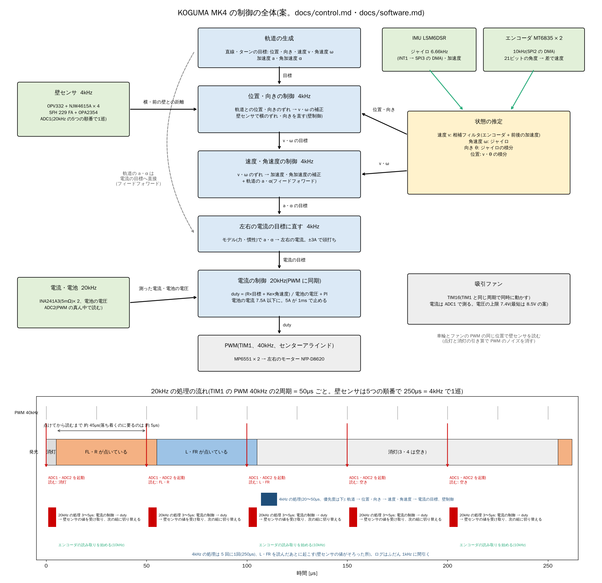

# MK4 制御の設計(案)

2026-10-12作成。ソフトの作り(割り込み・フォルダ・保存など)は `docs/software.md`。ハードは`docs/spec.md`、ピンは`docs/pinmap.md`。数値は50g・タイヤ15mm・ギア比3.15(41T:13T)・3S(11.1V)での計算。

## 1. 全体の構成(カスケード)



上: 制御の段とセンサ。下: 20kHz の処理の流れ(壁センサの順番、`docs/software.md` の4章)。図は 2026-11-26 に作った

```
軌道の生成(直線・ターンの目標: 位置 x, y、向き θ、速度 v、角速度 ω、加速度 a、角加速度 α)
   │
   ▼
[位置・向きの制御] 4kHz      ← 自己位置(エンコーダ・ジャイロ)、壁センサ(横・前)
   │ v、ω の目標(軌道の値 + 補正)
   ▼
[速度・角速度の制御] 4kHz ← 推定速度(エンコーダ+加速度)、ジャイロ
   │ 加速度・角加速度の目標(軌道の a・α + 補正)
   ▼ (左右の電流の目標に換算: 下記「3. モデル」)
[電流の制御] 20kHz(PWMに同期) ← INA241A3(5mΩ のシャント。2026-11-23 に MP6551 の CM から変えた)
   │ duty
   ▼
モーター
```

- 内側ほど速く応答させる(目安: 内側は外側の5〜10倍)
- 調整は内側から: 電流 → 速度・角速度 → 位置・向き
- 各段に制限: 電流3A、加速度・角加速度の上限、速度の上限
- **軌道の加速度・角加速度は、フィードフォワードとして直接電流に入れる**。フィードバックは「ずれ」だけを直す。MK3は速度のPID + 電圧のフィードフォワード(係数Aff・Bffを実機で合わせていた)だった

## 2. 状態の推定

| 推定するもの | 使うセンサ | 方法 |
|---|---|---|
| 速度 v | エンコーダ(MT6835、21ビット。この表を書いたときは AS5047P、14ビット)+ IMUの前後の加速度 | **まず相補フィルタ**(下記)。加速度のずれでふらつくなら、バイアスも推定するカルマンフィルタ(状態2つ)に替える |
| 角速度 ω | ジャイロ | そのまま(6.66kHz)。止まっているときにバイアスを測る。左右のエンコーダの差でゆっくり補正 |
| 向き θ | ジャイロの積分 | 壁(左右の距離の差、前壁の左右のセンサの差)で補正 |
| 位置 x, y | v・θの積分 | 壁の切れ目・前壁で補正 |

### 相補フィルタ(2026-10-12決定)

```
速度の予測 = 前回の速度 + 加速度 × Δt
速度       = 速度の予測 + K × (エンコーダから求めた速度 − 速度の予測)
```

- 速い変化は加速度から、ゆっくりした変化はエンコーダから取る。Kは固定で、境目の周波数を決める1つだけの値
- ログにエンコーダ・加速度・推定速度を残して、Kを決める
- 出口は「推定速度」なので、あとでカルマンフィルタに替えても他に影響しない

## 3. モデル(制御される側)

### 並進

- 1つの車輪の力 F = Kt × ギア比 × 電流 / タイヤの半径(Kt = 1.47mNm/A)
- **ロータの慣性**: NFP-D8620のロータの慣性(0.15g·cm²未満)はギア比の2乗(約10倍)で効き、車輪の側に換算すると2個で**約5.3gの質量**に相当する(ギア比の2乗に比例、タイヤの半径の2乗に反比例)。有効質量は約55g
- 左右に同じ電流を流したとき: **1Aあたり約22 m/s²**(ロータの慣性を入れない場合は約25 m/s²)

### 回転

トレッドは約58mm(2026-10-17の配置図。タイヤの端から端約65mm。最初はMK3と同じ55mmとしていた)。


- 慣性モーメント: **約220 g·cm²**(2026-10-17、配置図から部品ごとに足した見積もり。内訳は`docs/spec.md`の「機構の配置」)。ロータの分が足される。最初はMK3から逆算した値を質量に比例させて133 g·cm²としていたが、機体の端にあるフレームと壁センサが効いて大きくなった。MK3のSTEPから同じ方法で計算すると約450 g·cm²で、MK3の電流から逆算した値(約210)は電流の頭打ちで小さく出ていた(`docs/spec.md`の「STEPから読んだMK3の実寸と重さ」)
- 左右に±1A流したとき(トレッドで変わる):

| トレッド | 慣性モーメント(本体 + ロータ) | 角加速度 |
|---|---|---|
| **58mm(配置図)** | 220 + 45 g·cm² | **約1,360 rad/s²(約78,000 deg/s²)** |
| 55mm | 220 + 40 g·cm² | 約1,310 rad/s²(約75,000 deg/s²) |
| 45mm | 220 + 27 g·cm² | 約1,130 rad/s²(約65,000 deg/s²) |
| 40mm | 220 + 21 g·cm² | 約1,030 rad/s²(約59,000 deg/s²) |

(133 g·cm²としていたときは、55mmで約1,970 rad/s²だった)

- V90 3300の入りの角加速度では、外側のモーターに約4.6A要る(片側3Aの制限ではV90は約2700まで)。ターンの入りだけ電流の制限を上げるか、角加速度を下げた軌道にする(`docs/spec.md`の「機構の配置」)

### 電流の目標への換算(フィードフォワード)

```
左右の和の電流   = 有効質量 × 加速度 × 半径 / (Kt × ギア比) + 転がり抵抗の分
左右の差の電流   = 慣性モーメント × 角加速度 × 半径 / (Kt × ギア比 × トレッド/2)
右 = (和 + 差) / 2、左 = (和 − 差) / 2
```

有効質量・慣性モーメント・転がり抵抗は、実機で測る(下記「5. 同定」)。

### 電気

- 巻線抵抗1Ω + ドライバ0.03Ω。**銅は1°Cで約0.39%抵抗が増える**(60°C上がると約1.23倍)。電流制御の積分で吸収する
- 逆起電力 Ke = 1.51mV/(rad/s)。3m/sで約1.9V
- インダクタンスは未測定(電気の時定数は20kHzの1周期より短いと見込む)

## 4. 各段の制御

### 電流(20kHz、PWMに同期)

- PWMの周波数は20kHzの倍数(40〜80kHzなど)。インダクタンスを測ってから決める

- duty =(R × 電流の目標 + Ke × モーターの角速度)/ 電池の電圧 + PI(電流の目標 − 測った電流)
- 電池の電圧は毎周期ADCで測る(MK3は走る前に1回だけ測っていた)
- 電流の目標を±3Aで頭打ち。dutyの上限も「電流が3Aを超えないduty」で毎周期計算する(ADCが読めなくても効く守り)
- 積分は巻線の温度による抵抗の変化と、モデルのずれを吸収する
- **減速のときに電池へ戻る電流(回生)を制限する**: 電池の内部抵抗で電圧が上がり、満充電(12.6V)だとMP6551・DC-DCの入力上限14Vに近づく。電池の電流(= duty × モーターの電流)がマイナス側に一定以上にならないよう、電流の目標を制限する

### 速度・角速度(4kHz)

- **周期は 4kHz(2026-11-26 決定、ユーザー)**。壁センサの1巡(20kHz の処理の5つの順番、250µs)にそろえ、20kHz の処理の5回に1回、L・FR を読んだあとに起こす(`docs/software.md` の4章)。使うセンサの値はいつも新しい(消灯 100µs 前、FL・R 50µs 前、L・FR いま)。2026-10-12 には「MK3・carmine と同じ 1kHz から」としていた
- **4kHz にした理由**: 速度の制御の遅れ(1.5 × 周期 + 電流の制御の遅れ 約 75µs)で失う位相が小さい。1kHz では遅れ 1.57ms で、応答 100Hz のとき 57°(実際は 50〜70Hz で頭打ち)。4kHz では 0.45ms で 16°(200Hz でも 32°)。応答を 100〜200Hz まで上げる余地ができる
- **電流の制御はじゃまにならない**: 電流は 20kHz で、読んでから PWM に反映するまで約 75µs。PI の帯域は約 1.7kHz まで出せ、目標の電流にはフィードフォワードで約 75µs あとに届く。「内側は外側の 5〜10 倍」は周期ではなく帯域の比で、速度の応答 50〜100Hz に対して 17〜33 倍、200Hz でも 8 倍ある。モーターのインダクタンス(未測定)が 100µH と大きくても、電流の帯域は約 1.6kHz で足りる(5章で測る)
- CPU: 1回 20〜50µs × 4kHz で 8〜20%。20kHz の処理と合わせても 2〜3 割
- ゲインは周期から換算する作り(ToraNeko と同じ)なので、MK3 のゲインは周期の定数を変えて持ってくる。周期が短いと微分の値のノイズが大きく見えるので、速度の推定(相補フィルタ)と D の項のフィルタはログを見て決める
- 加速度・角加速度のFFは「理論値 × 係数」にし、係数は1未満から調整する(carmineは理論値より小さめにしていた)。速度のFFは入れない(carmineでは不安定になって削除した)

- 左右の車輪ごとではなく、**並進(v)と回転(ω)に分けて**制御する。それぞれ「和の電流」と「差の電流」を出す
- 出力 = 軌道の加速度(フィードフォワード)+ PI(目標の速度 − 推定速度)
- 応答の目安: 50〜100Hzから始めて、ギアのガタやタイヤのたわみによる振動が出ない範囲で上げる。**応答の速さ(Hz)は、速度のずれをどれくらい素早く直すか**: ずれの約6割を直す時間は 1 ÷ (2π × 周波数)で、50Hz なら約 3.2ms、100Hz なら約 1.6ms。電流 1A で約 22m/s² 加速するので、比例のゲインは 50Hz で約 14 A/(m/s)、100Hz で約 29 A/(m/s)(0.1m/s ずれたら 1.4A・2.9A)。上げすぎると、ギアのガタ・タイヤのたわみ・センサのノイズで震える

### 位置・向き(4kHz)

**方針(2026-10-12決定): MK3方式で走らせ始め、軌道追従に段階的に移る。**

1. 上の段の出口は、どちらの方式でも「v・ωの目標への補正」にそろえる。電流・速度の段は共通にして、上の段だけ差し替えられるようにする
2. 最初はMK3方式で走らせる: 軌道追従のゲインは0にして、壁制御だけを効かせる。MK3と同じ動きから始めて、新しいハード(電流制御、速度のオブザーバ)の確認に集中する
3. 斜めとターンから軌道追従を入れる: 自己位置の精度を確かめながらゲインを上げる。壁があるところは壁センサで自己位置を直す

理由: MK3の困りごと(斜めのパターンの不調、大回り90で外に膨らんで壁に当たった、速度ごとにターンの前距離・後距離を実機で合わせ直す)は、壁がない斜め・ターン中に向きと横のずれがたまる問題で、軌道追従が得意な場面。一度に全部変えると、うまく走らないときに新しいハードと新しい制御のどちらの問題か切り分けにくいので、段階を踏む。

軌道追従の中身:


- 軌道の目標の位置・向きと、自己位置の差を、進む向き・横・向きのずれに分ける
- 進む向きのずれ → vの補正、横と向きのずれ → ωの補正
- 横のずれと向きのずれは、壁センサで直接測れる(MK3の横壁制御は、PWMとジャイロの目標に直接足していた。MK4ではωの補正として入れる)
- 前壁があるときは、前のセンサの距離で進む向きのずれも直す

### ターン中の滑り(あとで)

- 滑りの角度を遠心力に比例(θ = k × v × ω)と考えて、軌道で前距離・後距離を補正する方法がある(`docs/turn_speed_research.md`の調べ。MK3リポジトリ)。電流と加速度が測れるので、MK4では滑りの推定もしやすい

## 5. 同定(実機で測るもの)

| 測るもの | 方法 |
|---|---|
| 巻線抵抗 R | 車輪を止めた状態で小さな電圧をかけ、電流を測る。温度も記録 |
| インダクタンス L | 電圧をステップで入れたときの電流の立ち上がりをオシロで見る(PWMの周波数と電流制御を決める) |
| Kt(= Ke) | 機体を浮かせて空転させ、電圧と回転数(エンコーダ)から |
| 電流の換算 | 既知の電流を流して、INA241A3 の 0A の値と傾きを左右それぞれ測る(CMS も同じときに測る) |
| 有効質量・転がり抵抗 | 一定の電流で直進させ、加速度(IMU・エンコーダ)と電流の関係から |
| 慣性モーメント | 左右に逆の電流を流し、角加速度(ジャイロ)から |
| 加速度・ジャイロのバイアス | 止まっているときに平均 |

ログに、電流の目標・測った電流・duty・電池の電圧・推定速度・加速度・角速度を残す。

## 6. 決めること

決まったこと: トレッドは約58mm(配置図、2026-10-17)。位置・向きの制御は上記の段階的な方針。

周期(2026-10-12決定、**2026-11-26 に変更**): 電流20kHz、**速度・角速度・位置・向き 4kHz**(壁センサの1巡と同じ。4章)。2026-10-12 は速度・角速度・位置・向き 1kHz から(あとで2〜5kHzを試す)としていた。速度の推定はまず相補フィルタ。

参考: carmine(2023年度クラシック)のソフトウェア解説 <https://b4rracud4.hatenadiary.jp/entry/20240302/1709363142>。速度・角速度1kHz(PI + 加速度のFF)→ 電流20kHz(PI + 逆起電力の補償)のカスケードで、MK4とほぼ同じ構成。

残っていること: なし(実機での同定とゲインの調整)
