# MK4 フレームの強度の計算と形(frame_v5、リブなし)

2026-10-17作成。フレーム(1mmのカーボン板 + 吸引する面をふさぐ0.2mmのポリカーボネート)を有限要素法(FEM)で計算し、強さと硬さが上がる形を探した。配置は`docs/spec.md`の「機構の配置」。

計算のスクリプトは`docs/calc/frame/`、製作用のDXFは`docs/calc/frame/frame_v4.dxf`、図は`docs/img/frame/`。

> **2026-10-19(frame_v5)**: 「8.9」の見直しの**C2**(後ろ側と吸引する面の中の背骨を細く、前の外周の枠・骨G・ファンのまわりを太く、マウントの下の窓をなくし、後ろの窓をマウントの所でまっすぐ切る)に、**四角い窓を2か所ずつ足して肉抜き**した: マウントの下(x −13.6〜−4.5、|y| 18.3〜23.8)と、タイヤの穴の後ろの横の帯(x −19.5〜−9.0、|y| 26.6〜33.3、上の角は外周の枠に平行)。窓はほかの切り口から2mm以上離し、角はR1.5。タイヤの穴の前の横の帯にも開けると前の角が柔らかくなる(前の角 +5%)ので、後ろだけにした(`results/refine_try2.json`、`refine_try3.json`)。
>
> | 項目 | **frame_v5** | frame_v4.7 |
> |---|---|---|
> | カーボン | **5.62g** | 5.70g |
> | フレームの慣性モーメント | 66.9 g·cm² | 68.6 g·cm² |
> | A: 前の滑り板に3N | **0.38mm** | 0.42mm |
> | A: 後ろの滑り板に3N | 0.31mm | 0.28mm |
> | B: 前の角に1.5N | **0.41mm** | 0.45mm |
> | 1次の固有振動数 | **274Hz** | 262Hz |
> | 座屈する力(正面 / 角 / 横) | **178 / 101** / 508N | 159 / 92 / 576N |
> | 材料の安全率(最小) | 8.6 | 8.5 |
> | 寸法 | 前: 外周の枠3.0、骨G 4.0、背骨4、辺3.0 / 後ろ: 外周の枠2.0、骨G 3.0、背骨3、辺2.5 / 筋交いA 2.0 / 吸引の中の背骨3、ファンのまわり4.5、吸引の縁3.0(mm) | |
>
> 前の滑り板・前の角・振動・正面と角の座屈が約1割よくなり、0.08g軽くなった。後ろの滑り板は1割柔らかくなった(それでも前より硬い)。横の衝突で座屈する力は1割下がった(30Nの17倍)。ねじの穴は7つのまま(マウント4、ファンの台3)。細かいメッシュの値(`results/final50_result.json`、パラメータは`results/final_params.json` = `v5_params.json`)。製作用のDXFは`docs/calc/frame/frame_v5.dxf`と`docs/calc/frame/order/MK4FRAME50_T1.dxf`(注文用)、3Dは`mechanical/frame_v5_3d.step`。マウントとのぶつかりの確認も同じ結果。
>
> 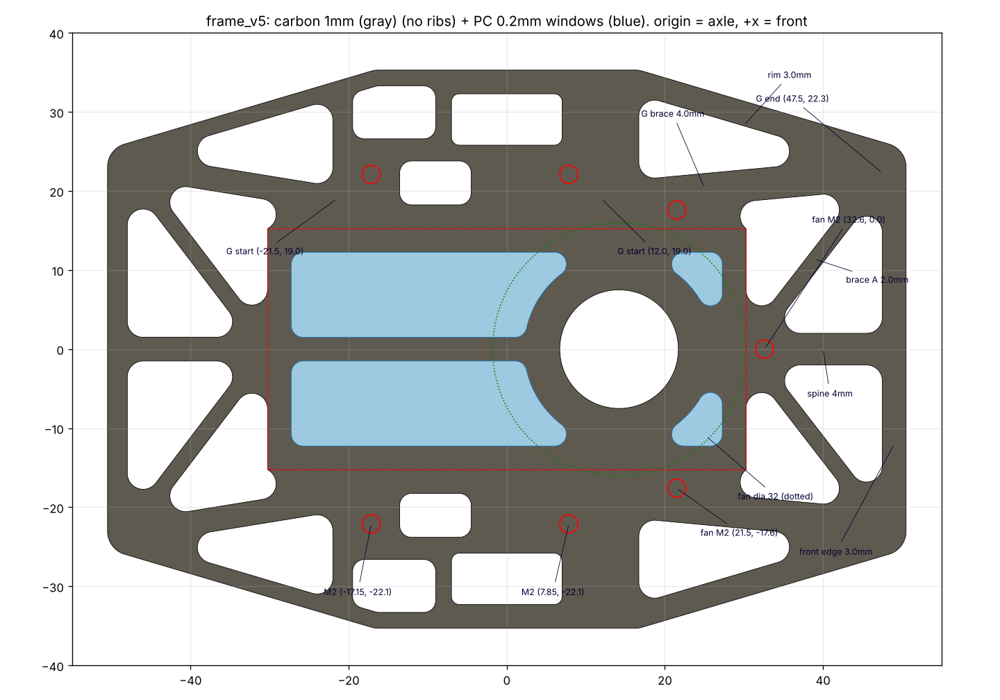
>
> 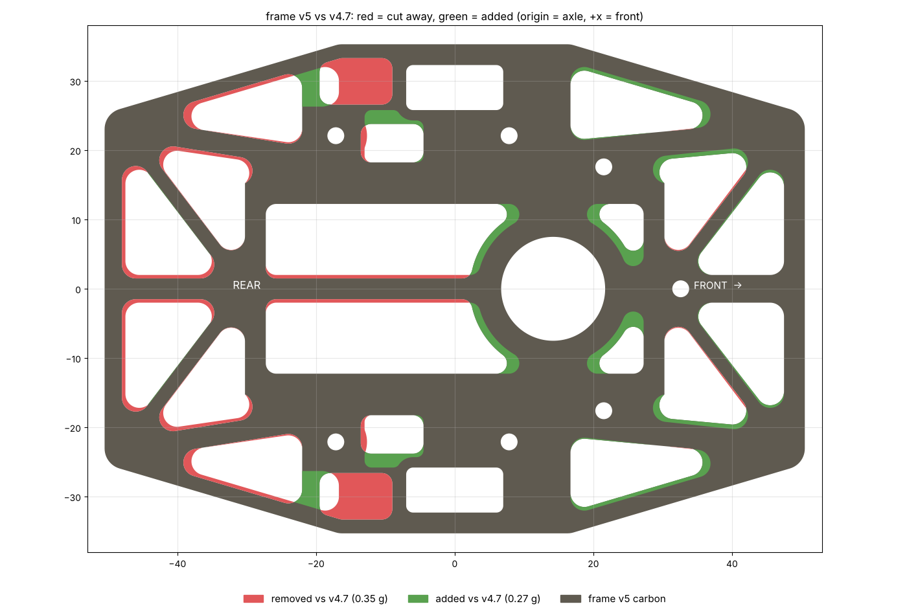
>
> 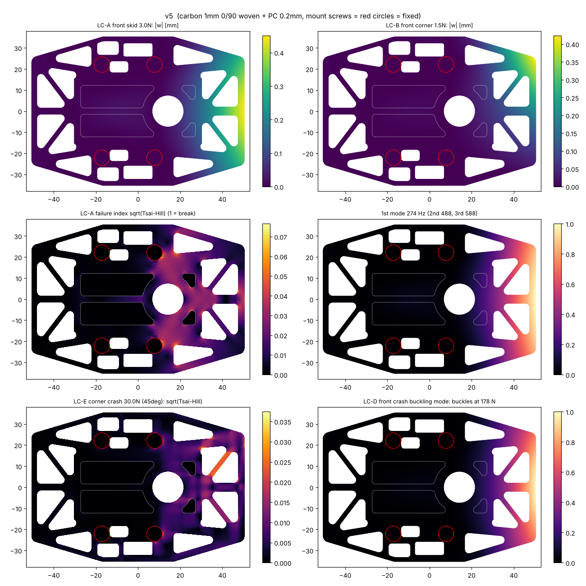

> **2026-10-19(frame_v4.7)**: **タイヤの穴を前後14mm**にした(v4.6までは13mm。穴の角の丸み(R1)の所で、タイヤとのすき間が0.26mmしかなかった)。ねじの穴は機体の案 v4(`docs/vehicle.md`)に要る7つ: モーターマウント (7.85, ±22.1)、(−17.15, ±22.1)、吸引ファンの台 (21.5, ±17.6)、(32.6, 0)。すべてM2用のφ2.3。滑り板とスカートは接着なので穴は要らない。
>
> | 項目 | **frame_v4.7** | frame_v4.4〜v4.6 |
> |---|---|---|
> | カーボン | 5.70g | 5.72g |
> | A: 前 / 後ろの滑り板に3N | 0.42 / 0.28mm | 0.42 / 0.28mm |
> | B: 前の角に1.5N | 0.45mm | 0.45mm |
> | 1次の固有振動数 | 262Hz | 262Hz |
> | 座屈する力(正面 / 角 / 横) | 159 / 92 / 576N | 159 / 92 / 627N |
> | 材料の安全率(最小、横の衝突) | 8.5 | 9.2 |
>
> 穴を前後に1mm広げた分、横の帯が少し弱くなった(横の衝突)。ほかはほとんど変わらない。細かいメッシュの値(`results/final47_result.json`、パラメータは`results/v4_7_params.json`)。レイヤー別のDXFは`docs/calc/frame/frame_v4_7.dxf`、図は`img/frame/v4_7_drawing.png`。注文用のファイルと3Dはv5に置き換えた。

> **2026-10-19(frame_v4.6)**: 吸引ファンのケースをフレームに留めるねじの穴を3つ足した: (21.5, ±17.6)、(32.6, 0)、φ2.3(`design.py`の`FAN_SCREWS`。機体の案 v3、`docs/vehicle.md`)。どれも穴のまわりに2mm以上の材料があり、吸引する面の外で、下に出るねじの頭(φ3.8)とスカートの間は0.45mm。形とFEMの値はv4.4と同じ(穴は計算に入れていない)。レイヤー別のDXFは`docs/calc/frame/frame_v4_6.dxf`、図は`img/frame/v4_6_drawing.png`。注文用のファイルと3Dはv4.7に置き換えた。

> **2026-10-19(frame_v4.5)**: ねじをM2にしたので(`docs/vehicle.md`)、モーターマウントの4か所の穴を**φ2.3**にした(v4.4はφ3.2)。形とFEMの値はv4.4と同じ(FEMはねじのまわりを固定として計算していて、穴は入れていない)。レイヤー別のDXFは`docs/calc/frame/frame_v4_5.dxf`、図は`img/frame/v4_5_drawing.png`。注文用のファイルと3Dはv4.6に置き換えた。

> **2026-10-18 決定(frame_v4.4)**: frame_v4.3に、前後の大きな窓の対角に細い**筋交いA**(幅2.0mm、4本)を足した。前後の角(骨Gの端、(±47.5, ±22.8))から、背骨の根元((±30.25, 0)、吸引する面の辺)まで。幅は1.5〜2.5mmで比べ、ほとんど差がなかった(筋交いは主に長さの向きに力を受けるので、細くてよい)。加工業者の最小の幅1.5mmに公差±0.2mmを見て、2.0mmにした(`results/brace_A.json`)。
>
> | 項目 | **frame_v4.4** | frame_v4.3 |
> |---|---|---|
> | カーボン | **5.72g**(M3の穴を抜くと5.66g) | 5.30g |
> | フレームの慣性モーメント | 68.8 g·cm² | 61.6 g·cm² |
> | A: 前 / 後ろの滑り板に3N | 0.42 / 0.28mm | 0.46 / 0.32mm |
> | B: 前の角に1.5N | 0.45mm | 0.47mm |
> | 1次の固有振動数 | 262Hz | 257Hz |
> | 座屈する力(正面 / 角 / 横) | 159 / 92 / 627N | 141 / 91 / 627N |
> | 角の衝突(30N)の安全率 | 25.3 | 12.2 |
> | 材料の安全率(最小) | 9.2(横の衝突) | 9.3 |
>
> 筋交いの幅による違い(粗いメッシュ、v4.3との差): 1.5mmで+0.34g、前の滑り板−8%、後ろ−13%、前の角−5%、正面で座屈+11%。2.5mmで+0.49g、−10%、−15%、−7%、+15%。
>
> 細かいメッシュの値(`results/final44_result.json`)。レイヤー別のDXFは`docs/calc/frame/frame_v4_4.dxf`。注文用のファイルと3Dはv4.5に置き換えた。マウントとのぶつかりの確認も同じ結果。
>
> 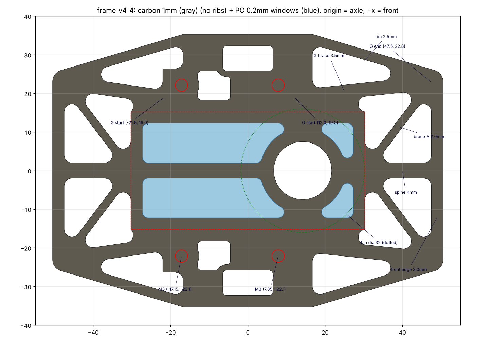
>
> 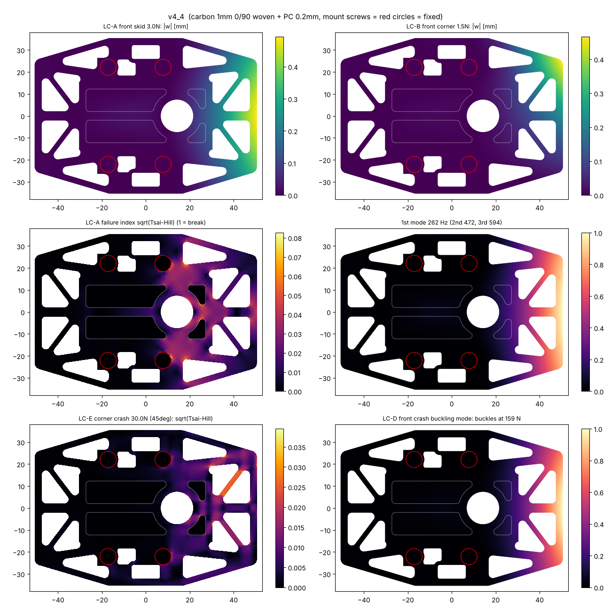
>
> 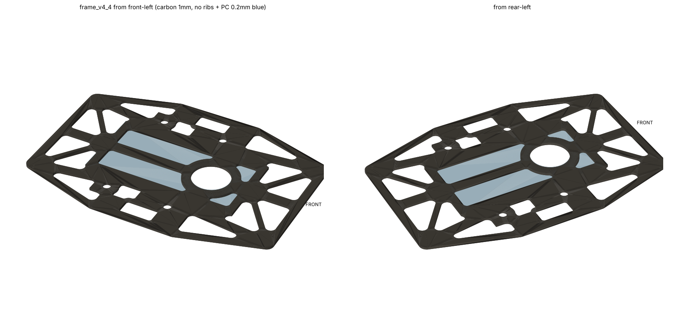

> **2026-10-18 決定(frame_v4.3)**: frame_v4.2に、**モーターマウントの下の窓**(左右に1つずつ、x −13.0〜−4.5、|y| 18.25〜25.8、角R1)を足した(下の「8.7」)。後ろのねじとエンコーダ基板の間で、マウント自体がねじの間をつないでいるので、フレームはほとんど力を受けていない。エンコーダ基板が立つ所(x ±3、|y| 20.46〜21.06)のまわり1.5mmと、タイヤの穴の横の帯(横からの衝突の守り)は残した。
>
> | 項目 | **frame_v4.3** | frame_v4.2 |
> |---|---|---|
> | カーボン | **5.30g**(M3の穴を抜くと5.25g) | 5.48g |
> | フレームの慣性モーメント | 61.6 g·cm² | 62.7 g·cm² |
> | A: 前 / 後ろの滑り板に3N | 0.46 / 0.32mm | 0.46 / 0.32mm |
> | B: 前の角に1.5N | 0.47mm | 0.47mm |
> | 1次の固有振動数 | 257Hz | 257Hz |
> | 座屈する力(正面 / 角 / 横) | 141 / 91 / 627N | 141 / 91 / 738N |
> | 材料の安全率(最小) | 9.3(横の衝突) | 10.0 |
>
> 細かいメッシュの値(`results/final43_result.json`)。レイヤー別のDXFは`docs/calc/frame/frame_v4_3.dxf`、図は`img/frame/v4_3_drawing.png`。注文用のファイルと3Dはv4.4に置き換えた。

> **2026-10-18 決定(frame_v4.2、リブなし)**: リブは付けないことにした。リブの溝もなくしたので、骨Gの幅は溝の決まり(両側に1.5mmの肉)に縛られなくなり、**骨Gの幅を3.5mm**にした(リブなしで骨・枠の組み合わせを32通り計算し直した結果、下の「8.6」)。ほかの寸法はframe_v4.1と同じ。
>
> | 項目 | **frame_v4.2(リブなし、骨G 3.5mm)** | frame_v4.1(リブあり) | v3(今までの形) |
> |---|---|---|---|
> | カーボン | **5.48g**(M3の穴を抜くと5.43g) | 6.17g | 4.51g |
> | ポリカーボネート | 0.40g | 0.40g | 0.40g |
> | フレームの慣性モーメント | 63 g·cm² | 73 g·cm² | 47 g·cm² |
> | A: 前の滑り板に3N | 0.46mm | 0.22mm | 0.72mm |
> | A: 後ろの滑り板に3N | 0.32mm | 0.18mm | 0.63mm |
> | B: 前の角に1.5N | 0.47mm | 0.071mm | 0.91mm |
> | C: 吸引600g(吸引する面の縁 / ポリカーボネート) | 0.027mm / 0.080mm | | |
> | 1次の固有振動数(壁センサ1.5gを載せて) | 257Hz(2次465Hz) | 455Hz | 202Hz |
> | D: 正面衝突で座屈する力 | 141N | 308N | 82N |
> | E: 角の衝突(45°)で座屈する力 | 91N | 387N | 42N |
> | F: 横からの衝突で座屈する力 | 738N | | |
> | 材料の安全率(すべての荷重で最小) | 10.0 | 8.2 | 3.2 |
>
> 細かいメッシュ(要素約5.6万)の値。結果は`docs/calc/frame/results/final42_result.json`、レイヤー別のDXFは`docs/calc/frame/frame_v4_2.dxf`、図は`img/frame/v4_2_drawing.png`。注文用のファイルと3Dはv4.3に置き換えた。
>
> 下の「1.」〜「7.」はframe_v4(リブあり)の検討の記録。

> **2026-10-17 追記(frame_v4.1)**: モーターマウント v1(`docs/mount.md`)に合わせて、タイヤの穴(y 25.8〜32.3、前後13mm)、M3の穴((7.85, ±22.1)、(−17.15, ±22.1))、マウントが載る所(窓を開けない)、骨Gの始まり(前 (12.0, ±19.0)、後ろ (−21.5, ±19.0))を直した。2026-10-18に、加工業者の最小の溝幅(1.5mm)に合わせてリブの溝を幅1.6mmにし、溝の両側に1.5mmの肉が残るよう**骨Gの幅を4.6mm**にした。リブは前33.2mm(つめ3個)、後ろ23.8mm(つめ2個)。カーボン約6.1g(板 + リブ)、前の滑り板0.22mm、後ろ0.18mm、前の角0.071mm、1次の固有振動数455Hz、正面衝突で座屈する力308N、角の衝突387N、材料の安全率(最小)8.2。製作用のDXFは`docs/calc/frame/frame_v4_1.dxf`(レイヤー別)と`docs/calc/frame/order/`(注文用、下の「9. 注文のしかた」)、図は`img/frame/v4_1_drawing.png`。下の本文はframe_v4の値。

## 1. 結論

**モーターマウントの前後の端から前後の角まで、まっすぐな骨(G)を通し、その上に1mmのカーボンを縦に立てたリブ(高さ3mm)を差し込んで接着する。**

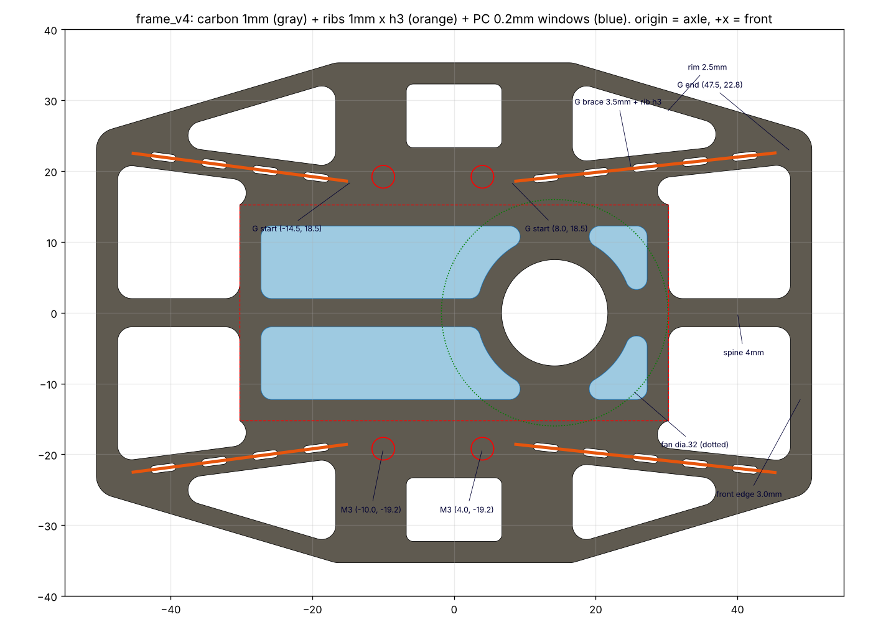

| 項目 | 今の形(v3) | **frame_v4(おすすめ)** | 軽い案 | 強い案 |
|---|---|---|---|---|
| カーボン(リブを含む) | 4.21g | **5.91g**(板5.28g + リブ0.63g) | 5.69g | 6.45g |
| ポリカーボネート | 0.40g | 0.40g | 0.40g | 0.40g |
| フレームの慣性モーメント(車軸まわり) | 45 g·cm² | 70 g·cm² | 66 g·cm² | 77 g·cm² |
| A: 前の滑り板に3N(たわみ) | 0.76mm | **0.23mm(−70%)** | 0.25mm | 0.19mm |
| A: 後ろの滑り板に3N | 0.78mm | 0.21mm | 0.23mm | 0.17mm |
| B: 前の角に1.5N(たわみ) | 1.00mm | **0.086mm(−91%)** | 0.094mm | 0.053mm |
| 1次の固有振動数(壁センサ1.5gを載せて) | 194Hz | **440Hz(2.3倍)** | 419Hz | 481Hz |
| D: 正面衝突で座屈する力 | 79N | **290N(3.7倍)** | 267N | 425N |
| E: 角の衝突(45°)で座屈する力 | 39N | **347N(8.8倍)** | 329N | 390N |
| 材料の強さの安全率(すべての荷重で最小) | 3.1 | **9.8** | 7.3 | 9.7 |

- 軽い案: 外周の枠2.0mm、骨Gの幅3.0mm(ほかはframe_v4と同じ)
- 強い案: frame_v4 + 背骨の上にもリブ、リブの高さ4mm
- **代わりに増えるもの**: 重さ+1.7g、フレームの慣性モーメント+25 g·cm²。機体全体の見積もり(約220 g·cm²)が約245 g·cm²になり、同じ電流での角加速度は約1割下がる

## 2. 前提

### 材料

| | 値 | メモ |
|---|---|---|
| カーボン板 | 平織り(0/90)、1.0mm。E1 = E2 = 55GPa、G12 = 4.0GPa、ν12 = 0.05、密度1.55g/cm³ | 繊維の向きは機体の前後・左右に合わせる。斜め45°は硬さが約1/3になる(G12が小さい) |
| 強さ | 引っ張り600MPa、圧縮500MPa、面内のせん断90MPa | 一般的な値。判定はTsai-Hill(1で壊れる)。安全率 = 1/√(指数) |
| ポリカーボネート | 0.2mm、E = 2.4GPa、ν = 0.38、密度1.2g/cm³ | 吸引する面の窓をふさぐ。フレームの上面に貼る |

### 支え方

- フレームはモーターマウントのM3ねじ(左右2本ずつ)だけで固定する(**ねじの位置は仮**: x = −10mm と +4mm、y = ±19.2mm)。ねじのまわり(直径7.4mm)を固定とした
- マウントが板に面で当たって支える分や、基板・支柱で支える分は入れていない(安全側)

### 荷重

| 名前 | 荷重 | 想定 |
|---|---|---|
| A | 前(または後ろ)の滑り板(x = ±45mm、中心線)に下向き3N | 急な減速で前のめりになる(吸引400g、134m/s²、重心の高さ10mmで約1.5N)の2倍。落としたときもこのくらい |
| B | 前の角(x = 49.2、y = 22)に下向き1.5N | 角を柱や床の継ぎ目に引っ掛けたとき |
| C | 吸引600g(5.9N)を吸引する面に均一の圧力で | 吸引の設計値 |
| D | 前の辺の真ん中30mmに後ろ向き50N(面内) | 2〜3m/sで正面から壁に当たる程度 |
| E | 前の角に斜め45°から30N(面内) | 斜め走行で柱に当たる |
| F | 横の張り出し(タイヤの外)に30N(面内) | 横から壁に当たる |
| 振動 | 前の辺に壁センサ1.5g、前後の滑り板0.3gずつ | 1次の固有振動数 |

### 目標(この計算で決めた目安)

A ≤ 0.25mm、B ≤ 0.15mm、1次の固有振動数 ≥ 400Hz、D・Eで座屈する力が設計の荷重の5倍以上、材料の安全率 ≥ 5、リブの安全率 ≥ 10。

## 3. 計算の方法

- 曲げ(面外): Morley要素(薄い板の理論)。面内: 2次の三角形要素(平面応力)。メッシュは約5万要素(三角形、最大0.15mm²)
- 座屈: 面内の荷重(D・E・F)の応力から幾何剛性を作り、曲げの剛性との固有値問題を解く。「何倍の荷重で座屈するか」が出る
- 縦のリブ: リブと足元の板を合わせた断面の曲げ剛性(リブの方向だけ)を、足元の板の要素に足す
- ポリカーボネートの窓は、ポリカーボネートの材料の要素として入れる
- 道具: scikit-fem、triangle、shapely(`pip install scikit-fem triangle shapely ezdxf matplotlib scipy`)

### 確かめ(はりの式との比較、`test_verify.py`・`test_rib.py`)

| 項目 | FEM | はりの式 | 差 |
|---|---|---|---|
| 片持ちの帯(2.5 × 35mm)の先に1N: たわみ | 1.2125mm | 1.2152mm | −0.2% |
| 同じ帯の1次の固有振動数 | 786Hz | 785Hz | +0.1% |
| 同じ帯の軸方向の座屈(片持ち) | 23.1N | 23.1N | 0% |
| 同じ帯の面内の曲げ | 0.2043mm | 0.1996mm | +2%(せん断の分) |
| 幅4mmの帯 + 高さ4mmのリブの片持ち | 0.0096mm | 0.0087mm | +10%(FEMがやわらかめ = 安全側) |

### メッシュの細かさ(frame_v4)

| 要素の大きさ | 要素数 | A | B | 振動数 | Dで座屈する力 |
|---|---|---|---|---|---|
| 0.3mm² | 3.4万 | 0.235mm | 0.090mm | 429Hz | 287N |
| 0.15mm²(この文書の値) | 5.4万 | 0.229mm | 0.086mm | 440Hz | 290N |
| 0.08mm² | 9.1万 | 0.225mm | 0.082mm | 446Hz | 295N |

0.15mm²と0.08mm²の差は2%以内なので、十分に細かい。

### 材料の値がずれたとき(frame_v4、0.3mm²)

| 材料 | A | 振動数 | Dで座屈する力 |
|---|---|---|---|
| 基準(E = 55GPa、G12 = 4GPa) | 0.235mm | 429Hz | 287N |
| E = 45GPa | 0.278mm | 394Hz | 246N |
| E = 65GPa | 0.204mm | 460Hz | 326N |
| G12 = 3GPa | 0.246mm | 419Hz | 269N |
| G12 = 5GPa | 0.226mm | 437Hz | 302N |

板が柔らかめ(E = 45GPa)でも、目標はほぼ満たす。

## 4. 分かったこと(計算の順番に)

1. **今の形(v3)の弱いところ**(`img/frame/v3_diag.png`): 前の滑り板のたわみ0.76mmのうち、約6割は張り出し(x = 30〜45mm)、残りは吸引する面の前半分(ファンの穴のまわり、ポリカーボネートの窓でやわらかい)で起きる。衝突では、材料が壊れる前に前の張り出し全体が面の外へ座屈する(正面79N、角39N)。**材料の強さには余裕があり、問題は面の外への硬さと座屈**
2. **前後の端の窓に筋交いを入れる**(stage1): 筋交いの向きを7通り試したが、たわみは最大で2割しか減らない。付け根が細いままだから
3. **吸引する面の中に骨、付け根の窓を埋める**(stage2a・2b): 効くが、重さにほぼ比例するだけ(4.8g → 6.7gで、たわみ 0.64 → 0.36mm)。**1mmの平らな板は、面の外への曲げに弱い**(硬さが厚さの3乗で、幅には1乗でしか効かない)
4. **縦のリブ**(stage3): 高さ4mmのリブは、幅4mmの平らな帯の約55倍曲がりにくい。座屈には強く効く(正面衝突で座屈する力が最大で約2倍)が、張り出しだけに付けてもたわみは3〜4割しか減らない。張り出しの付け根からマウントのねじまでの板が曲がるから
5. **リブをマウントの近くまで伸ばす**(stage4): たわみが半分以下になった。荷重の通り道(滑り板・角 → マウントのねじ)を、途中でやわらかい所を通さずにつなぐことが大事。ただしこの骨は吸引ファン(直径32mm)の横を通るのでぶつかる
6. **骨G(マウントの端 → 前後の角、ファンを避けてまっすぐ)+ リブ**(stage5・6): 一番効率がよい。重さ+1.7gで、角のたわみは約1/12、座屈する力は3.7〜8.8倍。枠・骨の幅・リブの高さを48通り比べて、目標を満たす中から、作りやすさ(外周の枠2.5mm以上)と重さで選んだ

各段の計算の結果は`docs/calc/frame/results/stage*.json`。

## 5. frame_v4 の形

座標は車軸の中心が原点、+xが前、+yが左(mm)。左右・前後に対称(リブの始まりの位置だけ、前後でマウントの位置に合わせて違う)。

| 部分 | 寸法 |
|---|---|
| 外形 | 前後101mm(±50.5)、左右70.6mm(±35.3)、前後の辺の半幅25.3mm、外の角R3 |
| 外周の枠 | 2.5mm |
| 前後の辺 | 3.0mm(壁センサを付ける) |
| 背骨(中心線、前後の張り出し) | 4.0mm(滑り板を付ける) |
| **骨G** | 幅3.5mm。前: (8.0, ±18.5) → (47.5, ±22.8)、後ろ: (−14.5, ±18.5) → (−47.5, ±22.8) |
| **リブ(4本)** | 1mmのカーボン、高さ3mm。前: (8.5, ±18.55) → (45.51, ±22.58)、長さ37.2mm。後ろ: (−15.0, ±18.56) → (−45.52, ±22.54)、長さ30.8mm |
| 吸引する面 | ±30.25 × ±15.25mm。外周の枠3mm、中の背骨4mm、ファンの穴(14.2, 0)直径15mm、穴のまわり3.5mm |
| ポリカーボネートの窓 | 吸引する面の中の、カーボンのない所(図の水色)。板は吸引する面と同じ大きさの1枚(ファンの穴だけ開ける) |
| タイヤ(とスパー)の穴 | 前後13.5mm × 左右9mm(y = ±23.3〜±32.3)、角R1 |
| 窓の角 | R2 |
| M3の穴(仮) | (−10, ±19.2)、(4, ±19.2)、穴3.2mm、まわりは直径7.4mm以上の肉 |

### DXF(`docs/calc/frame/frame_v4.dxf`)のレイヤー

| レイヤー | 中身 |
|---|---|
| CARBON | カーボン板の外形と窓 |
| M3 | M3の穴(φ3.2) |
| RIB_SLOT | リブのつめを差す溝(幅1.1mmの長丸、長さ3.6mm) |
| RIB_PARTS | リブの部品4本(同じ1mmの板から切る)。板の下に並べてある |
| PC_SHEET | ポリカーボネートの板。板の下に置いてある |

丸い所は細かい折れ線になっている。Fusionで読み込んで、必要なら円弧に描き直す。

## 6. 作るときの注意

- **リブは繊維がリブの長さの向きになるように切る**(板の0°方向をリブに合わせる)。45°で切ると硬さが約1/3になる
- **リブのつめ**: 長さ3mm・深さ1mm(板の厚さ)。前のリブは5個、後ろのリブは4個。溝は幅1.1mm。業者の最小の溝幅(刃物の径)を確かめる。1.1mmが無理なら、つめを2mm幅にして溝を2.1mmにする(計算への影響は小さい)
- **接着**: エポキシで、溝の中とリブの根元の両側に小さな盛り(フィレット)を付ける。計算では、リブと板が一体で曲がる(すべらない)としている
- **ポリカーボネートは上面に貼る**: 吸引すると上の大気圧が板を下(カーボン)に押し付けるので、はがれる向きの力がかからない。吸引600gでのポリカーボネートのたわみは約0.08mm
- **窓の角はR2以上**: カーボンは尖った内側の角から割れる
- 材料の安全率は約10あるので、M3の穴の縁(ねじ1本に約13Nかかっても、穴の縁の押す応力は約4MPa)や接着の強さは問題にならない

## 7. 確かめること(仮の値)

- **モーターマウントのねじの位置**: (−10, ±19.2)、(4, ±19.2)と仮に置いた。骨Gはマウントの前後の端から始まるので、マウントが決まったら始まりの位置を合わせて計算し直す(`design.py`の`MOUNT_SCREWS`、`G_FRONT`、`G_REAR`)
- **タイヤの穴**: スパー41T(直径12.9mm)も板の面を通るので、タイヤの幅 + スパーの厚さ + すき間で9mmとした。実際のタイヤの幅で決める
- **リブの高さ3mm**: 上にある部品(基板、電池、壁センサ)とぶつからないか。リブGはファン(直径32mm)から約3mm離れている。ファンのケースが大きければ確かめる
- **滑り板の位置**: 背骨の上(x = ±45mm)とした
- **壁センサの位置**: 前の辺の上とした(重さ1.5g)

## 8.5 リブは要るか(2026-10-18)

同じ条件(frame_v4.1の形)で、リブあり・なしを比べた(`results/rib_compare.json`)。

| 形 | カーボン | 前の滑り板(3N) | 後ろ(3N) | 前の角(1.5N) | 1次の振動数 | 正面衝突で座屈 | 角の衝突で座屈 | 材料の安全率 |
|---|---|---|---|---|---|---|---|---|
| v3(今までの形) | 4.51g | 0.72mm | 0.63mm | 0.91mm | 202Hz | 82N | 42N | 3.2 |
| **v4.1 リブあり** | 6.17g | **0.22mm** | **0.18mm** | **0.071mm** | **455Hz** | **308N** | **387N** | 8.2 |
| v4.1 リブなし(骨G 4.6mm) | 5.64g | 0.44mm | 0.29mm | 0.44mm | 265Hz | 151N | 100N | 10.3 |
| リブなし、骨G 6mm | 5.82g | 0.42mm | 0.27mm | 0.41mm | 271Hz | 161N | 109N | 10.2 |
| リブなし、骨G 8mm | 6.07g | 0.40mm | 0.25mm | 0.37mm | 280Hz | 174N | 114N | 10.2 |

- リブ(0.53g)で、前の角のたわみは約1/6、振動数は1.7倍、座屈する力は正面で2倍、角で3.9倍になる
- 同じ重さを骨Gを太くするのに使っても(骨G 8mm)、ほとんど良くならない。平らな板は面の外へ曲げるのに弱いので、縦に立てた板(リブ)でないと効かない
- 材料が壊れる心配は、リブなしでもない(安全率10)。リブは「硬さ(センサの揺れ、角のたわみ)」と「衝突で座屈しにくいこと」のため
- 溝はフレームに開けておけば、リブは後から付けられる。まずリブなしで走らせて、必要なら付ける、という進め方もできる(溝の分の強さの低下は小さい)
- **2026-10-18、リブなしに決めた**(frame_v4.2)。溝も開けない。リブが要ると分かったら、`final_params.json`の`v_ribs`を`["G"]`、`brace_w`を4.6に戻せばframe_v4.1の形とリブの部品が出る(板は作り直し)

## 8.6 リブなしでの形の選び直し(2026-10-18)

リブがある前提で選んだ寸法を、リブなしで選び直した。骨の組み合わせ(G、G + H)、背骨の幅(4、6mm)、骨Gの幅(3.0、4.6mm)、外周の枠(2.5、3.5mm)、前後の辺(3.0、4.0mm)の32通りを、粗いメッシュで計算した(`sweep.py 7`、`results/stage7.json`)。

| 形 | カーボン | 前の滑り板 | 後ろ | 前の角 | 1次の振動数 | 正面で座屈 | 角で座屈 |
|---|---|---|---|---|---|---|---|
| 一番軽い(骨G 3.0mm) | 5.38g | 0.48mm | 0.32mm | 0.50mm | 251Hz | 約133N | 約84N |
| **v4.2(骨G 3.5mm、細かいメッシュ)** | **5.48g** | **0.46mm** | **0.32mm** | **0.47mm** | **257Hz** | **141N** | **91N** |
| 骨G 4.6mm(v4.1からリブだけ外した形) | 5.64g | 0.44mm | 0.29mm | 0.44mm | 264Hz | 約151N | 約100N |
| 外周の枠3.5mm(骨G 3.0mm) | 5.66g | 0.44mm | 0.30mm | 0.44mm | 261Hz | | |
| 骨G + H(骨G 3.0mm) | 5.85g | 0.40mm | 0.24mm | 0.45mm | 265Hz | | |
| 一番重い(G + H、4.6mm、背骨6mm、枠3.5mm、辺4mm) | 6.65g | 0.35mm | 0.20mm | 0.37mm | 279Hz | | |

- **リブがないと、どこを太くしてもあまり良くならない**。一番軽い形から一番重い形まで+1.27g(+24%)で、たわみは約27%減、振動数は約11%上がるだけ。どの寸法も、1gあたりの効き目はほぼ同じで、ここから急に良くなる所がない
- 材料の安全率はどの形でも約10で、壊れる心配はない。差が出るのは硬さと座屈だけ
- そこで、重さと慣性モーメントを増やさないことを優先し、一番軽い形に近い**骨G 3.5mm**にした(3.0mmより0.1g重いが、前の角のたわみと座屈する力が約7%良い)
- 外周の枠・背骨・前後の辺はframe_v4.1のまま(2.5mm、4mm、3.0mm)。筋交いHは付けない(+0.47gで、前の角は良くならない)

## 8.7 ポケット加工で薄くできるか(2026-10-18)

板を片面から掘って薄くする(ポケット加工)と、どれくらい軽くなるかを計算した(`pocket.py`、`results/pocket_tf0.5.json`、`results/pocket_windows.json`)。

1. frame_v4.2の曲げのひずみエネルギー(前・後ろの滑り板、前の角、1次の振動)から、働いていない所を探す
2. 縁・窓・穴から1.5mm、ねじのまわり(半径4.5mm)、滑り板、吸引する面の縁(スカート、3mm)は全厚で残す。その中で、働いていない順に30%・60%・100%の所を、半径1mmの刃物が通る形にする
3. 底の厚さ0.5mmに掘る(下面から掘り、上面は平らに残す)。片面から掘ると底が板の真ん中からずれるので、曲げ剛性は下限(底だけの板)と上限(底が板の真ん中のまわりで曲がる)の間になる。表の幅はその範囲
4. 同じ所を貫通の窓にした場合と、板全体を0.8mmにした場合とも比べた

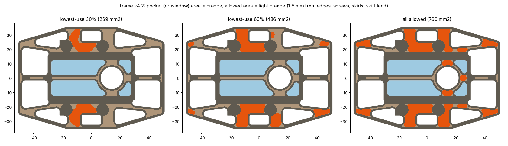

粗いメッシュ(sweepと同じ)での値。v4.2の行も同じメッシュで計算した。

| 案 | カーボン | 前の滑り板 | 後ろ | 前の角 | 1次の振動数 | 座屈(正面 / 角 / 横) | 材料の安全率 |
|---|---|---|---|---|---|---|---|
| v4.2 | 5.48g | 0.460mm | 0.314mm | 0.471mm | 257Hz | 141 / 91 / 744N | 10.4 |
| ポケット 30%(269mm²) | 5.27g(−0.21) | +0.0〜0.1% | +0.1〜0.3% | +0.1〜0.2% | 257Hz | 141 / 90 / 600〜690N | 10.2 |
| ポケット 60%(486mm²) | 5.10g(−0.38) | +1.0〜2.7% | +0.6〜1.5% | +0.8〜2.0% | 254〜257Hz | 134〜138 / 89〜90 / 520〜650N | 10.0 |
| ポケット 100%(760mm²) | 4.89g(−0.59) | +12〜37% | +2〜5% | +13〜44% | 217〜243Hz | 109〜129 / 67〜82 / 440〜610N | 6.2〜8.5 |
| **同じ30%の所を窓に** | **5.06g(−0.42)** | +0.3% | +0.4% | +0.7% | 257Hz | 141 / 90 / 434N | 6.0(横の衝突) |
| 同じ60%の所を窓に | 4.71g(−0.76) | +3.7% | +1.9% | +2.2% | 253Hz | 133 / 93 / 387N | 5.3(横の衝突) |
| 板全体を0.8mmに | 4.38g(−1.10) | +95% | +95% | +95% | 188Hz | 72 / 46 / 381N | 7.0 |

- 働いていない所は、**モーターマウントの下と、タイヤの穴の横の帯**(マウントのねじの間。マウント自体が2本のねじの間をつないでいるので、フレームは力をほとんど受けていない)
- そこを0.5mmに掘ると、0.2〜0.4g軽くなり、硬さはほぼ変わらない。ただし**同じ所を窓にすれば、倍の0.4〜0.8gが軽くなり、硬さの変化もほぼ同じ**。曲げの硬さは厚さの3乗、重さは厚さに比例するので、半分の厚さを残すより、全部抜いて残りを全厚にした方が、1gあたりの硬さは高い。ポケットのほうが良いのは横の衝突だけ(窓にすると横の安全率が10 → 6になる。それでも十分)
- 板全体を薄くするのは一番悪い(0.8mmで1.1g軽いが、たわみは約2倍、座屈する力は約半分で、v3に近くなる)
- 作るときの問題:
  - カーボンラボ.jpでは、ポケット・座ぐりは「応相談」(STEPで1部品1ファイル、またはDXF + 深さを書いたPDF)。深さの公差は書かれていない。板の厚さの公差(±0.5mmと書いてある)がそのまま底の厚さのばらつきになる
  - 積層の「標準」は表面がクロス、中がUD。半分まで掘ると、底は中のUDが出て、繊維と直角の向きに割れやすくなる。掘るなら「全クロス」にする
  - 片面だけ掘ると、板の上下の対称が崩れ、成形のときの残留応力で、薄い所が反ることがある
- **結論: ポケット加工は使わない**。軽くするなら、働いていない所に窓を開ける方が、加工も普通の切り出しのままで、2倍軽くなる(板の厚さは注文の都合で1mmのまま)

上の窓(ラスターから作った形)は、エンコーダ基板が立つ所に重なり、タイヤの穴の後ろの横の帯(横からの衝突の守り)にもかかっていた。そこで、きれいな形の窓を2通り作り直して計算した(`design.py`の`mount_windows`、`results/mount_windows.json`、粗いメッシュ)。

| 窓 | カーボン | 前の滑り板 | 後ろ | 前の角 | 1次の振動数 | 横の衝突で座屈 | 横の衝突の安全率 |
|---|---|---|---|---|---|---|---|
| なし(v4.2) | 5.48g | 0.460mm | 0.314mm | 0.471mm | 257Hz | 744N | 10.4 |
| **マウントの下だけ('pad')** | **5.30g(−0.18)** | +0.1% | +1.6% | +0.3% | 257Hz | 631N | 9.5 |
| マウントの下 + 横の帯('pad'、'side') | 5.14g(−0.34) | 0.0% | +0.1% | +0.5% | 257Hz | 501N | 6.6 |

- **マウントの下だけに窓を開ける(frame_v4.3)**。硬さはほとんど変わらず、0.18g軽くなる
- 横の帯は開けない。開けるとさらに0.16g軽くなるが、横からの衝突の安全率が9.5 → 6.6に下がる。フレームをタイヤより外に出して守っている意味が薄れる

## 8.8 ねじ穴を足すとき(2026-10-18、2026-10-19にM2に合わせて直した)

モーターマウントの4か所と吸引ファンのケースの3か所(v4.6)のほかのねじ穴(基板・電池・壁センサ・滑り板など)は、使う部品に合わせて決める。要る穴を足してから注文する。図の緑は、今ある7か所の穴を除いた所

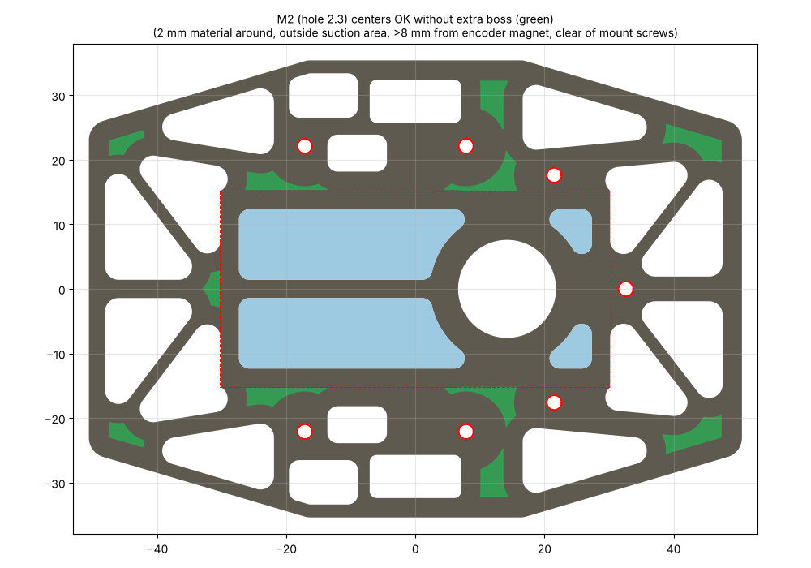(`hole_map.py`で作る。ねじの太さは`design.py`の`SCREW`、`HOLE_D`)

- 緑の所に穴の中心を置けば、肉を足さなくても穴のまわりに2mm以上残る(吸引する面の外、エンコーダの磁石から8mm以上、マウントのねじと重ならない)
- 穴はM2用のφ2.3。細い所(外周の枠2.5mm、前後の辺3.0mm、骨G 3.5mm、筋交いA 2.0mm、背骨4mm)に開けるときは、穴のまわりを直径6.3mm以上に広げる(ボス)。M3のころより、置ける所(緑)がずっと広い
- 加工業者の決まり: 穴の縁とほかの切り口の間は1.5mm以上、内側の角はR0.75以上
- 吸引する面(±30.25 × ±15.25mm)の中には開けない(上に貼るポリカーボネートを突き抜けると空気がもれる)
- 鉄のねじはエンコーダの磁石(車軸の端)とAS5047Pから離す
- M2の鉄の低頭L5 + ナイロンのナットで1組約0.25g。重さの配分(ねじ等1.5g以下)に入れる
- 穴の位置が決まったら、`design.py`に足して(または穴を足したDXFで)、強さと注文の決まり(`make_order.py`の幅の確認)を確かめ直す

## 8.9 フレームの見直し: 細くできる所・強くすべき所(2026-10-19)

窓や骨が増えてごちゃついてきたので、v4.7の各部分がどれだけ働いているかを計算し直した(`refine.py`)。

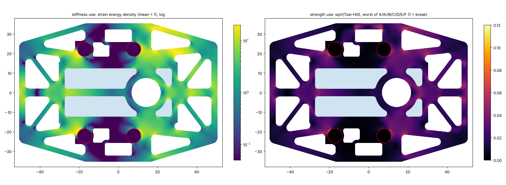

左は硬さへの効き(滑り板・前の角・振動・座屈の形での曲げのひずみエネルギー。黄色ほど効いている)、右は材料の使い方(1で壊れる。どこも0.12以下)。

| 部分 | 重さ | 働き(平均1) | 材料の使い方(最大) |
|---|---|---|---|
| 外周の枠(前の斜め) | 0.23g | **6.7** | 0.08 |
| 前の背骨 | 0.11g | **5.2** | 0.07 |
| 前の辺 | 0.26g | 3.1 | 0.07 |
| 後ろの辺 | 0.26g | 2.8 | 0.05 |
| 吸引する面の中(カーボン) | 1.38g | 2.6 | 0.07 |
| 後ろの背骨 | 0.11g | 2.4 | 0.04 |
| 外周の枠(後ろの斜め) | 0.24g | **1.5** | 0.03 |
| マウントの下 | 0.98g | 1.4 | 0.10 |
| 横の帯(タイヤの穴の横) | 0.67g | **1.0** | **0.12**(横の衝突) |

荷重は前に多い(前の角・正面・角の衝突)ので、**前が働き、後ろは働きが半分くらい**。横の帯は硬さには効いていないが、横の衝突で一番材料を使う所。

部材の幅を1つずつ変えたとき(粗いメッシュ、`results/refine_sens.json`)。「1gあたり」は7つの値(前・後ろの滑り板、前の角、振動、正面・角・横の座屈)の変化の平均を、重さの変化で割ったもの。大きいほど、重さあたりよく効く:

| 部材 | 細くしたとき | 太くしたとき | 1gあたり |
|---|---|---|---|
| **骨G**(3.5 → 2.5 / 4.5mm) | −0.19g、前の角 −14%、角の座屈 −13% | +0.14g、前の角 +6%、角の座屈 +8% | **41 / 32** |
| **外周の枠**(2.5 → 2.0 / 3.0mm) | −0.11g、前の角 −8% | +0.10g、前の角 +4%、角の座屈 +5% | **35 / 27** |
| **ファンのまわり**(3.5 → 2.5 / 4.5mm) | −0.11g、前の滑り板 −8% | +0.10g、前の滑り板 +6%、正面の座屈 +7% | **29 / 28** |
| 背骨(4 → 3 / 5mm) | −0.05g | +0.04g | 24 / 21 |
| 吸引する面の縁(3 → 2.5 / 4mm) | −0.13g | +0.22g | 23 / 17 |
| 前後の辺(3 → 2.5 / 4mm) | −0.06g | +0.11g | 20 / 15 |
| 筋交いA(2 → 1.5 / 3mm) | −0.08g | +0.14g | 17 / 12 |
| 吸引する面の中の背骨(4 → 3 / 5mm) | −0.05g、ほぼ後ろの滑り板だけ −3% | +0.05g | **15 / 9** |
| マウントの下の窓をなくす | +0.18g、**横の座屈 +17%**(安全率 8.7 → 9.6) | | 13 |
| 窓の角をR3に | +0.42g、どこも +6〜12% | | 18 |

- **強くすべき所**: 骨G、外周の枠(前)、ファンのまわり。1gあたりの効きが一番大きい
- **細くできる所**: 後ろ側(外周の枠・辺・背骨・骨G。働きが前の半分)、吸引する面の中の背骨(効きが一番小さい)
- **すっきりさせる所**: マウントの下の小さな窓(なくすと横の衝突に強くなる)、後ろの窓の段(マウントの所でまっすぐ切る)

この3つをまとめた案(`design.py`に後ろだけの幅`*_rear`と、窓をまっすぐ切る`pad_full`を足した。細かいメッシュの値):

| 項目 | v4.7(今) | **C1 すっきり** | **C2 すっきり + 前を強く** |
|---|---|---|---|
| 変えた所 | | マウントの下の窓なし、後ろの窓の段なし、吸引の中の背骨 3mm、後ろ: 枠2.0・辺2.5・背骨3・骨G 3.0mm | C1 + 前: 枠3.0・骨G 4.0mm、ファンのまわり4.5mm |
| カーボン | 5.70g | 5.79g(+0.09) | 5.98g(+0.28) |
| 慣性モーメント | 68.6 g·cm² | 68.3 | 70.0 |
| 前の滑り板(3N) | 0.42mm | 0.42mm | **0.38mm** |
| 後ろの滑り板(3N) | 0.28mm | 0.31mm | 0.30mm |
| 前の角(1.5N) | 0.45mm | 0.44mm | **0.41mm** |
| 1次の振動数 | 262Hz | 262Hz | **275Hz** |
| 座屈(正面 / 角 / 横) | 159 / 92 / 576N | 159 / 92 / **688N** | **178 / 102 / 688N** |
| 材料の安全率(最小) | 8.5 | 9.5 | 9.4 |
| 切り抜く所の数(窓・タイヤの穴・ファンの穴。ねじの穴を除く) | 21 | 19 | 19 |

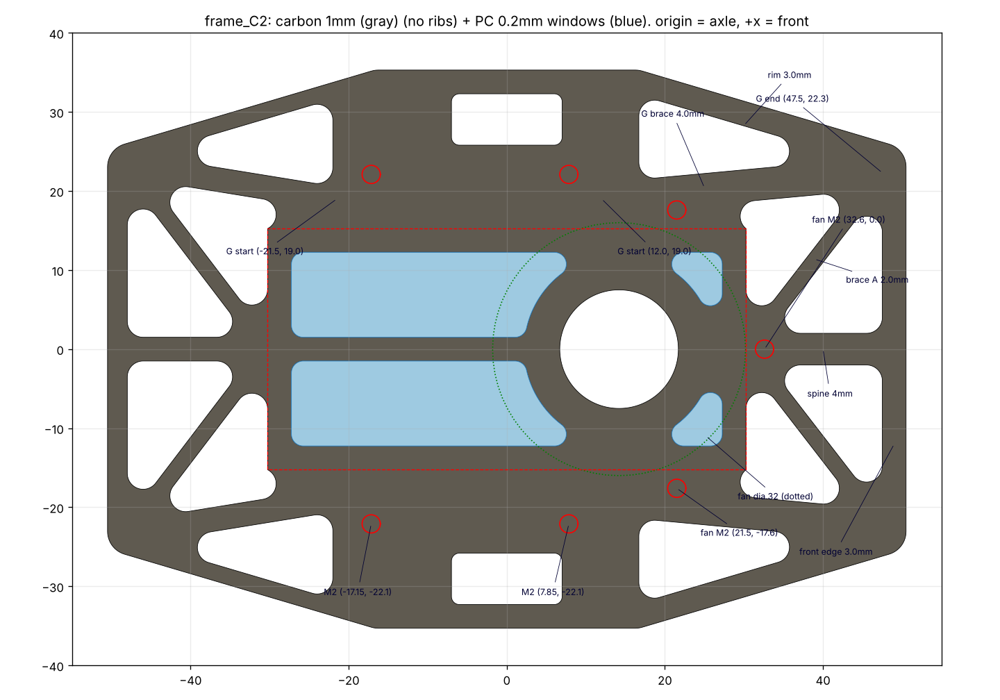

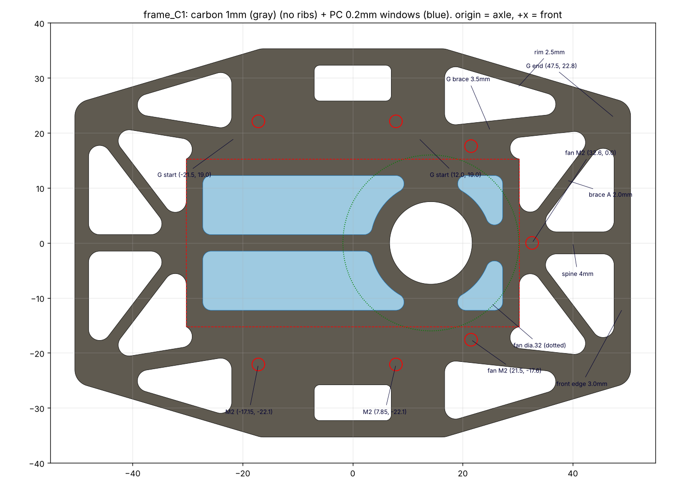

- C1は、重さをほとんど変えずに、すっきりさせて横の衝突に強くした形(後ろの滑り板は少し柔らかくなるが、前より硬い)
- C2は、C1に前の強化を足した形。+0.28gで、前の滑り板・前の角・座屈が1割よくなる
- 筋交いAをなくすと後ろの滑り板が3割柔らかくなる(筋交いAは後ろの背骨を支えている)ので、残す
- パラメータは`results/v5_C1_params.json`、`v5_C2_params.json`
- **2026-10-19: C2に決め、さらに肉抜きしてframe_v5にした**(先頭の「frame_v5」)

## 9. 注文のしかた(カーボン板の切り出し)

国内なら**カーボンラボ.jp(小沢精密工業)**が、個人・1枚から、DXFの入稿で板の切り出しを受けている(<https://cfrp-japan.com/board/>、入稿の決まり <https://cfrp-japan.com/guide/tech-info/cfrp-2d/>)。2026-10-18に確かめた内容:

| 項目 | 決まり | MK4のファイル |
|---|---|---|
| ファイル | DXF、上から見た外形の実線だけ、1:1。寸法線・文字・中心線は入れない。ファイル名は半角英数字 | `order/MK4FRAME50_T1.dxf`(フレーム1枚、リブなし) |
| 複数の部品 | 1つのファイルに並べてよい。部品の間は5mm以上 | フレーム1枚だけ |
| 最小の穴・溝 | 厚さ5mm以下: 穴φ1.5mm、溝の幅1.5mm | M2の穴φ2.3mm。一番細い材料は筋交いA・後ろの外周の枠の2.0mm |
| 内側の角 | 最小R0.75(尖った角はR0.75になる) | 窓R2、タイヤの穴R1 |
| 寸法の公差 | ±0.2mm(600mmまで) | |
| 厚さ | 1mmあり。厚さの公差は ±0.5mm と書いてある | 1mmの実際の厚さを見積もりのときに聞く |
| 材料 | ドライカーボン。織り: 標準(綾織)・平織・クラッシュ。積層: 標準(クロス)・全クロス・全UD。仕上げ: マット・ツヤ | **標準(綾織)・標準(クロス)・マット**(計算は0/90の平織り・綾織りの値) |
| 値段の目安 | 100 × 100mm、1mmで約1,140円(穴・角の丸みの加工代が別に一律でかかる) | 101.0 × 70.6mm |
| 納期 | 注文の確定から3〜4週間 | |

手順:

1. 見積もりのフォーム(<https://cfrp-japan.com/order-board-data/>)に`MK4FRAME50_T1.dxf`を付け、厚さ1mm・綾織・クロス・マット・数量(予備を含めて2枚など)を書く。備考に「繊維の向きは図のX方向(前後)を0°に」と書く
2. 当日〜3営業日でメールで見積もりが来る。メールで注文して、支払う
3. 届いたら、縁のバリを水をかけながら耐水ペーパーで落とす(カーボンの粉は吸わない)
4. ポリカーボネート0.2mmは、`order/MK4PC50_template_A4_1to1.pdf`を「実際のサイズ」で印刷して型にし、カッターで切る(または`MK4PC50_T02.dxf`をレーザー加工に出す)。フレームの上面に貼る

`make_order.py`が、穴・溝・材料の幅が1.5mmより狭い所がないかを確かめる(frame_v5はOK)。

ほかの選択肢(海外): FPVドローンのフレーム用に、3Kのカーボン板をDXFから切り出す業者が多い(例: CarbonVega <https://carbonvega.com/upload/>、最小の形1.5mm)。送料と納期を比べて選ぶ。

## 8. 計算をやり直すには

```sh
cd docs/calc/frame
python3 test_verify.py                       # 計算が正しいかの確認
python3 analyze.py                           # 今の形(既定の値)を計算
python3 report.py final "$(cat results/final_params.json)"   # 図と結果
python3 make_dxf.py results/final_params.json frame_v5       # DXF(レイヤー別)
python3 make_order.py                        # 注文用の DXF と型紙(order/)
python3 ../../../mechanical/frame_3d.py ../../../mechanical   # 3D(STEP)
```

形の寸法は`design.py`の`DEFAULT`と、`final_params.json`の値で変えられる。
