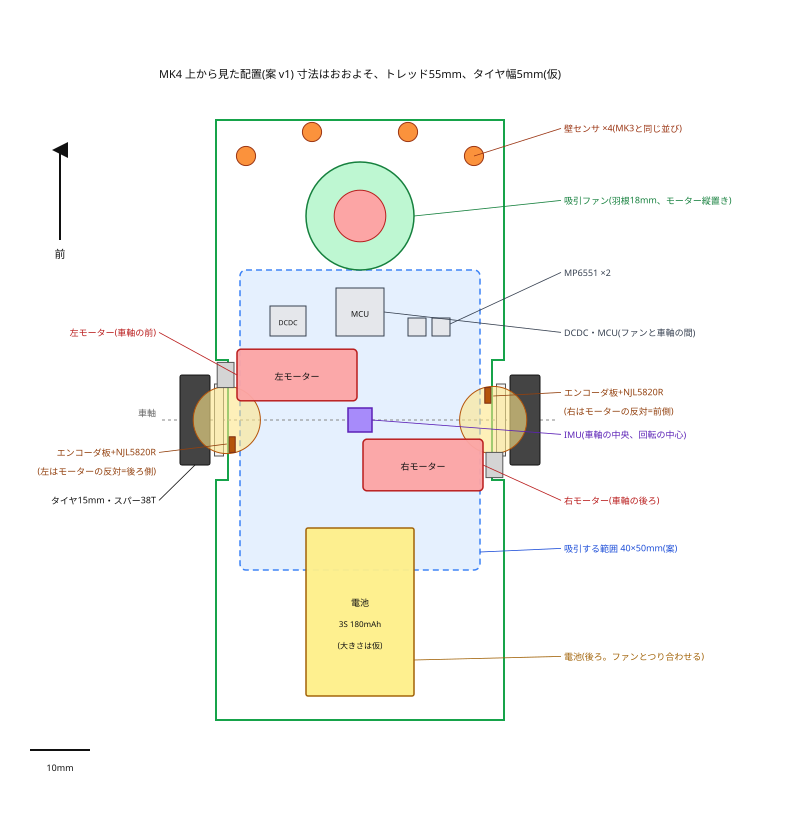

# MK4 機構の配置(案 v1)

2026-10-12作成。上から見た図: `docs/img/layout_top_v1.svg`。寸法はおおよそ。

## 前提(決まっていること)

- トレッド55mm、タイヤ15mm(幅は仮に5mm)、2輪
- モーター NFP-D8620(直径8.6 × 長さ20mm、軸1.2mm × 5.1mm、軸は前側だけ)× 2 + ファン用 × 1
- スパー RT 38T(m0.3、歯先12.0mm、厚さ1.5mm)、ピニオン12T(案)、中心距離7.5mm
- エンコーダ板 encoder_disk 100pr(外形11.2mm)をそのまま使う、センサ NJL5820R
- 電池 3S 180mAh、吸引ファン(羽根15〜20mm、自作)、IMUはLSM6DSR
- 質量50g目標

## 配置の案

| 部品 | 置き方 | 理由 |
|---|---|---|
| 走行用モーター | 車軸と平行に、**左は車軸の前、右は車軸の後ろ**(互い違い)。中心の高さは車軸と同じ(床からモーターの下面まで約3.2mm) | 2本のモーター(長さ20mm + 軸)はトレッド55mmの内側に1列には並ばない。前後にずらすと収まり、2つの重さが車軸の前後でつり合う |
| エンコーダ板 | スパーの**内側の面(モーター側)**に貼る | 車輪と同じ回転なので、走った距離が正確 |
| エンコーダのセンサ | スパーの横の小さな基板(モーターの取り付け部品に固定)。**モーターと反対側**(左は車軸の後ろ、右は前)で、板の半径4mmの位置を読む | モーターの胴(車軸から3.2〜11.8mm)と板(半径5.6mmまで)は重なるが、反対側なら空いている |
| ピニオン | スパーの厚さ(1.5mm)より**タイヤ側**にはみ出させ、モーター側には出さない | エンコーダ板とピニオンの歯先(スパーの中心から5.4mm)がぶつからないように。スパーとタイヤの間に少しすき間を取る |
| IMU | 基板の上、**車軸の中央**(回転の中心) | ターン中の遠心力が加速度に混ざりにくい(速度のオブザーバのため) |
| 吸引する範囲 | 車軸を中心に40 × 50mm程度(スカートで囲む) | 吸引の力の中心を車軸に合わせ、前後に傾かないようにする |
| 吸引ファン | 車軸の前(約35mm)。モーターは縦置き、羽根は基板の下 | 車軸の真上はモーターが通っていて、羽根(15〜20mm)が入らない。吸引する範囲の中にあれば、ファンの位置は前にずれてよい |
| 電池 | 車軸の後ろ(約30mm) | ファン(モーター5.3g + 羽根)とつり合わせる |
| MCU・DC-DC・ドライバ | ファンと車軸の間 | 配線が短くなる。ドライバはモーターの近く |
| 壁センサ | 前の端。MK3と同じ並び(前2本、斜め横2本) | |
| 全体の大きさ | 長さ約100mm、基板の幅48mm(タイヤの部分は切り欠く)、タイヤの外側まで約60mm | MK3は120 × 70mm |

## 重心(大まかな見積もり)

- 左右のモーターは車軸の前後7.5mmで打ち消し合う
- 電池を12g・車軸の後ろ32mm、ファンを7g・前34mmとすると、重心は車軸の約3mm後ろ。電池の位置で調整する
- 2輪なので、前後に低い摩擦のそり(スキッド)を付ける

## 決めること・確かめること

1. 全体の長さ(壁センサの位置。MK3は120mm)
2. タイヤの幅とホイールの形、車軸と軸受、スパーとホイールの固定
3. 電池の大きさ・重さ(品番)
4. ファンの羽根とダクト、スカートの高さ
5. モーターの取り付け部品(エンコーダのセンサ基板も固定する)。中心距離7.5mmの精度を出す
6. 高さ: ファンのモーターを縦置きにすると、いちばん高いところが30mm前後になる見込み
