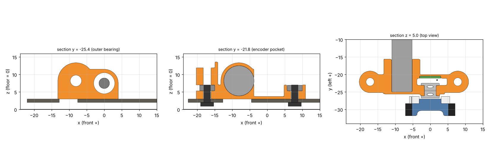
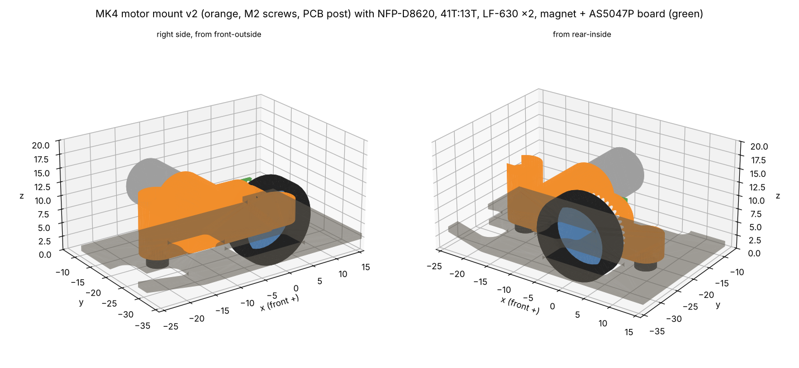

# MK4 モーターマウント v2

> **2026-10-19 v2**: v1のねじをM2にし(穴φ2.3、ナットの穴は二面幅4.2 × 深さ1.7、耳の半径3.1)、**後ろの耳の上に基板を受ける柱**(半径3.1、z 7.0〜13.6)を足した(機体の案 `docs/vehicle.md`)。後ろの耳は、フレームのねじのナットと、柱の上の基板のねじのナットを、どちらも後ろから横に入れる。**1個1.02g**(v1は0.83g)。STEP・STLは`motor_mount_R_v2.*`・`_L_v2.*`。ぶつかりの確認(`check.py`)はv1と同じ結果(ナットとねじのすき間だけ変わった)。v1は`mount.py`の`P_V1`で作り直せる。下の本文はv1のときの説明(ねじ以外は同じ)。

2026-10-17作成。ToraNeko.Mk3の足回り(車輪・41T・平行ピン・LF-630・磁石・エンコーダ基板)をそのまま使い、MK4のモーター(NFP-D8620、直径8.6 × 20mm)と41T:13Tに合わせて作った。CADは`mechanical/motor_mount/`(CadQueryのスクリプト、STEP、STL)。

## 1. 決めたこと

| 項目 | 値 |
|---|---|
| 形 | ToraNeko.Mk3と同じ考え方の、片側1個の樹脂のブロック。車軸の軸受2個とモーターを1つの部品で持つ(軸間の精度が部品1個で決まる) |
| モーターの位置 | **車軸の後ろ、水平から5°上**。中心 (x, z) = (−8.07, 8.21)。軸間8.1mm |
| 重さ | **1個0.83g**(樹脂1.2g/cm³)。PA12なら0.70g。MK3のマウントは約3g、ToraNekoは約0.45g |
| 大きさ | 前後32.4mm(x −20.85〜+11.55)、左右5.5mm + モーターの筒(y −26.1〜−15.6、右側)、高さ10.4mm(z 3.0〜13.4) |
| 固定 | **M2 × 2本**(v2。下から鉄の低頭小ねじL5、ナイロンのナットはマウントの六角の穴に入れる。v1はM3)。ねじの位置 (7.85, ±22.1) と (−17.15, ±22.1) |
| 材料(JLC3DP) | **樹脂(光造形)をすすめる**。軸受の穴(φ6.0)の精度が要るため。PA12(MJF)は軽いが、寸法のばらつき(約±0.3mm)が大きい |

座標は車軸の中心が原点(床がz = 0)、+xが前、+yが左。下の値は右側(外側が−y)。左側はyの符号を反対にする。

## 2. 部品の並び(右側、外側から)

| 部品 | y の範囲 | メモ |
|---|---|---|
| タイヤ | −31.8 〜 −28.3 | 直径15mm、幅3.5mm。**ToraNekoのタイヤは直径14mmなので、15mmのものを用意する** |
| ホイール | −31.8 〜 −26.7 | ToraNekoと同じ |
| スパー 41T(m0.3、厚さ2mm) | −28.3 〜 −26.3 | ホイールの内側に付ける。中の穴は約φ8(外の軸受のつばが入る) |
| 3×6 平行ピン(車軸) | −29.7 〜 −23.7 | 車輪・41Tと一緒に回る |
| LF-630(外) | −26.7 〜 −24.7 | つばが外側。マウントの外の面(y −26.1、半径3.7の輪)で受ける |
| LF-630(内) | −24.5 〜 −22.5 | つばが内側。マウントの面(y −23.1)で受ける |
| 磁石 φ3 × 1 | −23.7 〜 −22.7 | ピンの内側の端。内の軸受の穴の中に入る |
| AS5047P | −22.2 〜 −21.0 | 磁石とのすき間0.5mm |
| エンコーダ基板 0.6mm | −21.06 〜 −20.46 | マウントの溝(幅0.7mm、上が開いている)に上から差す。フレームの上面(z 3.0)に立つ |
| ピニオン 13T(厚さ2mm) | −27.9 〜 −25.9 | 41Tと1.6mmかみ合う(ToraNekoと同じずらし方) |
| モーターの前の面 | −25.0 | マウントの壁(厚さ0.6mm、y −25.0〜−25.6)に当てる |
| モーター本体 | −25.0 〜 −5.0 | 左右のモーターの内側の端の間は10mm |
| マウント | −26.1 / −25.6 〜 −20.0、モーターの筒は −15.6 まで | 筒は吸引する面(|y| ≤ 15.25)に入らない |

## 3. ぶつからないことの確認

ToraNeko.Mk3のSTEPから足回りの部品を取り出してMK4の位置に置き(`tn_parts.py`)、マウント・モーター・ピニオン・フレーム・ポリカーボネート・ねじと重ねて、重なる体積とすき間を計算した(`check.py`、結果は`check_result.txt`)。

| 組み合わせ | すき間 | メモ |
|---|---|---|
| マウント − ピニオン(回る) | 0.30mm | |
| マウント − 41T(回る) | 0.36mm | |
| タイヤ − ピニオン、タイヤ − モーターの軸(回る) | 0.40mm | 軸を切った後 |
| ホイール − ピニオン(回る) | 0.41mm | |
| モーター − ポリカーボネート | 0.71mm | |
| モーター − フレーム | 0.91mm | |
| AS5047P − 磁石 | 0.5mm | ToraNekoと同じ |
| 内の軸受のつば − モーター(どちらも止まっている) | 0.20mm | |
| マウント − 軸受 | 0(圧入) | 穴φ6.0 |

ぶつかる所はない(軸受は圧入、モーターの前の面・フレーム・ナットは意図して当てている)。2026-10-18にリブなしのframe_v4.2、マウントの下に窓を開けたframe_v4.3、筋交いAを足したframe_v4.4、2026-10-19にframe_v4.7・v5・v6で計算し直し、結果は同じ。

## 4. 作るとき・組むときの注意

- **モーターの軸を切る**: NFP-D8620の軸(長さ5.1mm)は、そのままだとタイヤ(半径7.5mm)の内側の面に届く(軸間8.1 − 軸の半径0.6 = 7.5mm で、すき間0)。**前の面から2.9mmで切る**(y −27.9、ピニオンの外の面と同じ)。ピニオンを軸の先にそろえて付ける
- **軸受の穴 φ6.00**: 圧入のつもり。試しに印刷して、ゆるければ接着、きつければリーマで広げる
- **モーターの穴 φ8.70**: モーター(φ8.6)を内側から差して、前の面を壁に当てて接着する
- **一番薄い所**: モーターの穴と軸受の穴の間の壁0.75mm(ToraNekoと同じ)。樹脂の最小の肉厚(0.6〜0.8mm)を業者で確かめる
- **ねじの頭**: 低頭小ねじの頭がフレームの下に出る(フレームの下面は床から2.0mm)。**頭の高さが1.5mm以下なら床まで0.5mm以上**。M2の低頭(頭の高さ約1.1mm)なら床まで約0.9mm。買う前に頭の高さを確かめる
- **組む順番**:
  1. LF-630を外と内から押し込む(つばを外側に)
  2. 磁石を平行ピンの端に接着する。ホイールに41Tとタイヤを付け、ピンを外から差す
  3. モーターの軸を切り、ピニオンを付け、モーターを内側から差して接着する
  4. エンコーダ基板を上から溝に差す
  5. フレームに載せ、下からM2 L5(鉄の低頭)、上でナイロンのナットを締める(後ろの耳は、先にナットを後ろから横に入れておく)

## 5. フレームへの影響(frame_v4.1 → v4.2)

マウントに合わせてフレームを直し、強度を計算し直した(`docs/frame.md`)。今の形は**frame_v6**(2026-10-19。安全率を5まで下げてよいとして、作れる一番細い幅にした。マウントの下の窓は x −13.6〜−4.5、|y| 18.3〜23.8)、DXFは`mechanical/frame/frame_v6.dxf`。

- タイヤ・ホイール・41Tの穴: y 25.8〜32.3(幅6.5mm)、前後13mm(v4は9 × 13.5mm)。マウントが載る板が増える。**v4.7から前後14mm**(角でタイヤとのすき間が0.26mmだったため)
- ねじの穴: (7.85, ±22.1)、(−17.15, ±22.1)。v4.5からM2用のφ2.3(v4.4まではM3用のφ3.2)
- マウントが載る所(x −22〜12.5、|y| 15.25〜26.3)は窓を開けない
- 骨Gの始まり: 前 (12.0, ±19.0)、後ろ (−21.5, ±19.0)(マウントの耳のすぐ外)
- 骨Gの幅: v4.1では4.6mm(リブの溝1.6mmの両側に1.5mmの肉を残すため)。v4.2からはリブも溝もないので**3.5mm**
- **v4.3: マウントの下に窓**(x −13.0〜−4.5、|y| 18.25〜25.8、角R1)。後ろのねじのまわり(半径4.5mm)と、エンコーダ基板が立つ所(x ±3、|y| 20.46〜21.06)のまわり1.5mmは板を残した。マウントは窓の上をまたいで、2本のねじとその耳で留まる

| 項目 | frame_v4(リブあり) | frame_v4.1(リブあり) | frame_v4.2(リブなし) | frame_v4.3(+ マウントの下の窓) | **frame_v4.4(+ 筋交いA)** |
|---|---|---|---|---|---|
| カーボン(リブを含む) | 5.91g | 6.17g | 5.48g | 5.30g | **5.72g** |
| A: 前の滑り板に3N | 0.23mm | 0.22mm | 0.46mm | 0.46mm | 0.42mm |
| A: 後ろの滑り板に3N | 0.21mm | 0.18mm | 0.32mm | 0.32mm | 0.28mm |
| B: 前の角に1.5N | 0.086mm | 0.071mm | 0.47mm | 0.47mm | 0.45mm |
| 1次の固有振動数 | 440Hz | 455Hz | 257Hz | 257Hz | 262Hz |
| D: 正面衝突で座屈する力 | 290N | 308N | 141N | 141N | 159N |
| E: 角の衝突で座屈する力 | 347N | 387N | 91N | 91N | 92N |
| 材料の安全率(最小) | 9.8 | 8.2 | 10.0 | 9.3 | 9.2 |

## 6. 決まっていないこと

- **MK4のエンコーダ基板**: 6 × 8.5 × 0.6mm(ToraNekoと同じ外形)。MK4はフレームの上面から磁石の軸まで4.5mm(ToraNekoは4.61mm)なので、**AS5047Pの中心を基板の下の辺から4.5mmに置く**。メイン基板への配線6本(SPIの3本、CS、電源、GND)の通し方
- **直径15mmのタイヤ**(ToraNekoのホイールに合うもの)
- **手持ちの41Tの厚さと穴の径**(このモデルはToraNekoの41T: 厚さ2mm、穴φ約8mm)
- マウントの上(z 13.4まで)に載る電池・基板との高さ。モーターの上の面はz 12.5
- ファン(直径32mm)とモーターは、上から見て約3mm離れている。ファンのケースの大きさが決まったら確かめる

## 7. ファイル

| ファイル | 中身 |
|---|---|
| `mechanical/motor_mount/mount.py` | マウントのCadQueryのスクリプト(寸法は先頭の`P`) |
| `mechanical/motor_mount/motor_mount_R_v2.step` / `_L_v2.step` | 右・左のマウント(Fusionで読み込む) |
| `mechanical/motor_mount/motor_mount_R_v2.stl` / `_L_v2.stl` | JLC3DPに出す用 |
| `mechanical/motor_mount/mk4_drive_R_check.step` | 確認用の組み立て(右側: マウント、モーター、ピニオン、足回り、フレーム、ねじ) |
| `mechanical/motor_mount/tn_drive_mk4_right.step` | ToraNeko.Mk3の足回りの部品をMK4の位置に置いたもの |
| `mechanical/motor_mount/check.py`、`check_result.txt` | ぶつかりとすき間の確認 |
| `mechanical/motor_mount/render.py` | 図(`check.py`のあとで実行) |

必要なもの: `pip install cadquery scikit-fem triangle shapely ezdxf matplotlib`
