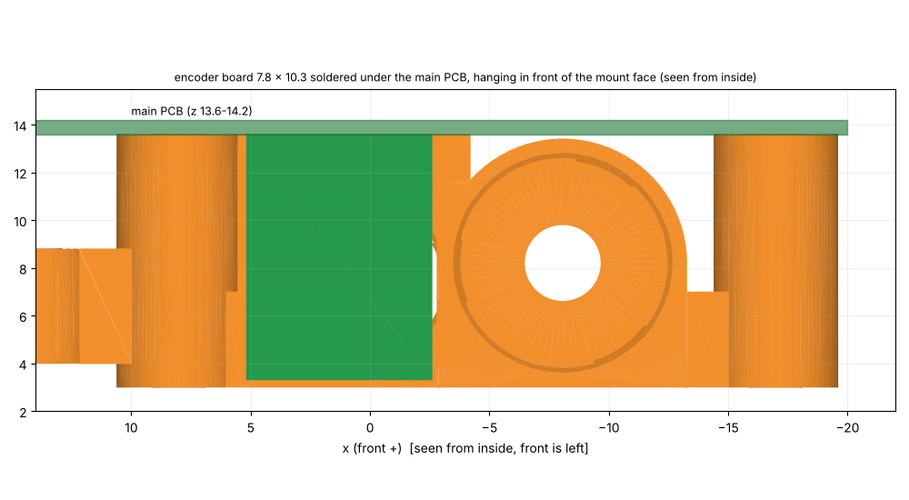
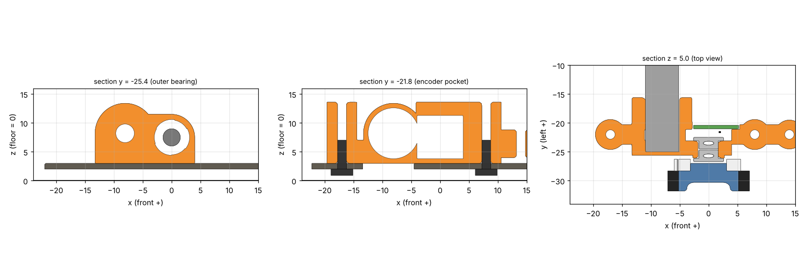
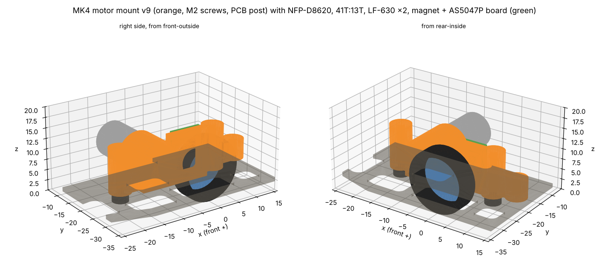

# MK4 モーターマウント v9

> **2026-10-29 v9**: **エンコーダ基板を、溝に差して裏の壁で支えるのをやめた**。同じ日に、**エンコーダ基板はメイン基板の裏にはんだ付けして立てる**ことにした(z 3.3〜13.6、フレームとのすき間0.3mm)。マウントの面(0.1mm)と前の当たり面(x 5.4、0.2mm)は、メイン基板ごと下ろすときの案内(触れない)。初めは面に当てて接着する案だった。
> - エンコーダ基板は **7.8 × 10.3 × 0.6mm**(x −2.6〜5.2、y −21.0〜−20.4、z 3.3〜13.6。AS5047P の中心は x 0、z 7.5 = 基板の上の辺から6.1mm、後ろの辺から2.6mm)。AS5047P のある面はマウントの面(y −21.1)の側で、面との間は0.1mm。モーターの筒とは0.27mm。AS5047P(y −22.2〜−21.0)と磁石の間は 0.5mm(部品の並びの表と同じ)。位置はメイン基板(マウントの柱に M2 で留める)で決まる
> - マウントの面の縁: 上 z 11.3〜13.6、前 x 4.0〜5.2、下 z 3.0〜3.8。くぼみ(AS5047P・部品・内の軸受のつば)は x −4.0〜4.0、z 3.8〜11.3。エンコーダ基板の内側は開いている
> - メイン基板との配線は、はんだ付けの所でつながるので、配線6本が要らない
> - くぼみの後ろの端をモーターの穴とつなげた。内の軸受のつばとモーターの間は 0.2mm しかなく、v8 まではその間に 0.2mm の薄い壁が残っていたため。くぼみの底(フレームの上の床)は 0.7 → 0.8mm
> - 1個 **1.29g**(v8は1.25g)。STEP・STLは`motor_mount_R_v9.*`・`_L_v9.*`。v8は`mount.py`の`P_V8`で作り直せる
>
> 
>
> **2026-10-29 v8**: 薄い壁・重さ・印刷の誤差・組み立てを見直した。1個 **1.25g**(v7は1.48g)。形の役目と寸法(軸間8.10mm、ねじの位置、継ぎ目 (14, ±22))は同じ。STEP・STLは`motor_mount_R_v8.*`・`_L_v8.*`。v7は`mount.py`の`P_V7`で作り直せる。
> - **モーターの穴と軸受の穴の間の壁 0.75 → 0.80mm**(JLC のすすめる最小): モーターの穴を φ8.7 → **φ8.6(寸法どおり、圧入)**にした
> - **3点で受ける穴**: モーターの穴と軸受の穴のまわりを 0.1mm 逃がし、幅2.6mm の当たり面を 120° おきに3つ残した。当たり面の1つは相手の穴の側に向けたので、間の壁は 0.80mm のまま。印刷で穴が少し小さめでも押し込め、ゆるければ接着できる。筒の壁は 0.8 → 0.9mm にして、逃がした所でも 0.8mm を残す
> - **穴の入口に面取り 0.3mm**: 軸受(外・内)、モーター(内から入れる側)、タップの下穴の上下。入れやすく、タップを立てやすい
> - **軽く**: 耳と柱の半径 3.1 → 2.6(下穴 φ1.6 のまわりの肉は 1.8mm)、耳とマウントをつなぐ板の幅 6.2 → 3.4mm
> - エンコーダ基板の溝の所だけ、モーターの筒の壁が約0.72mm(溝の幅で決まる。v7 は約0.67mm)
>
> **2026-10-21 v7**: **継ぎ目を (20, ±22) から (14, ±22) へ**動かし、継ぎ目の台の半径を3.0 → 2.5にした。v6 の継ぎ目はフレームの窓の上にあり、下から台と腕が見えていた。(14, ±22) は前の耳の前のカーボンの上で、半径2.5の台がすべてカーボンに載る(フレームは変えない)。腕は前の耳からまっすぐ前へ6mm。1個1.48g(v6は1.64g)。輪とのすき間は2.0mm、前の耳の上の基板の柱とは0.4mm。STEP・STLは`motor_mount_R_v7.*`・`_L_v7.*`。v6は`mount.py`の`P_V6`で作り直せる。
>
> **2026-10-20 v6**(続き): ファンの台の前の耳のねじ (33, 0) をやめ、台はこの腕の2か所だけで持つ(frame v6.6)。輪の壁を1.0mm(外側 φ35)にしたので、輪とマウントの前の柱のすき間は約2.2mm、走行用モーターとは1.15mm。マウントの形は変わらない。
>
> **2026-10-20 v6**: 吸引ファンを**羽根 φ32、囲いの内径 φ33**(輪の外側 φ34.2)にしたので、**継ぎ目を (10, ±16) から (20, ±22) へ**動かした(輪の外側から約2.6mm外)。腕は前の耳 (8, ±22) からまっすぐ前へ伸びる。1個1.64g。ファンの輪とマウントの前の柱のすき間は約2.6mm。STEP・STLは`motor_mount_R_v6.*`・`_L_v6.*`。v5は`mount.py`の`P_V5`で作り直せる。
>
> **2026-10-20 v5**: **前の耳から腕を伸ばして、吸引ファンの台を持つ**(継ぎ目 (10, ±16)、腕は幅3.4mm・z 4.0〜8.8、継ぎ目の柱は半径3.0)。ファンの台は継ぎ目に載せ、上からナイロンのM2 L6でマウントの腕のねじ山に留める。ファンの台の左右の柱(フレームに留めていた (22, ±18))はなくした。**前の耳の上にも基板を受ける柱**(半径3.1、z 13.6まで、上にねじ山)を立てた。1個1.53g(v4は1.14g)。ファンの輪とのすき間0.94mm。STEP・STLは`motor_mount_R_v5.*`・`_L_v5.*`。v4は`mount.py`の`P_V4`で作り直せる。
>
> **2026-10-20 v4**: **ナットをやめ、ねじの穴に M2 のねじ山を切る(タップ)**。下穴は φ1.6(印刷のあと φ1.6 のドリルを通してから M2 のタップを立てる)。前の耳・後ろの耳(下からフレームのねじ、かみ合いは耳の高さ4mm)と、後ろの柱の上(基板のねじ)。ナットの穴がなくなって肉が増え、**1個1.14g**(v3は1.02g、ナット3個 0.06g はなくなる)。ナットのまわりの薄い壁(約0.7mm)もなくなった。STEP・STLは`motor_mount_R_v4.*`・`_L_v4.*`。v3は`mount.py`の`P_V3`で作り直せる。
>
> **2026-10-19 v3**: フレーム v6.1 に合わせて、**ねじの位置を1mm単位**にした: 前 (8, ±22)、後ろ (−17, ±22)(v2は (7.85, ±22.1)、(−17.15, ±22.1))。前に0.15mm、内側に0.1mm動いただけで、形・重さ(1.02g)・ぶつかりの確認の結果はv2と同じ。STEP・STLは`motor_mount_R_v3.*`・`_L_v3.*`。v2は`mount.py`の`P_V2`で作り直せる。
>
> **2026-10-19 v2**: v1のねじをM2にし(穴φ2.3、ナットの穴は二面幅4.2 × 深さ1.7、耳の半径3.1)、**後ろの耳の上に基板を受ける柱**(半径3.1、z 7.0〜13.6)を足した(機体の案 `docs/vehicle.md`)。後ろの耳は、フレームのねじのナットと、柱の上の基板のねじのナットを、どちらも後ろから横に入れる。**1個1.02g**(v1は0.83g)。STEP・STLは`motor_mount_R_v2.*`・`_L_v2.*`。ぶつかりの確認(`check.py`)はv1と同じ結果(ナットとねじのすき間だけ変わった)。v1は`mount.py`の`P_V1`で作り直せる。下の本文はv1のときの説明(ねじ以外は同じ)。

2026-10-17作成。ToraNeko.Mk3の足回り(車輪・41T・平行ピン・LF-630・磁石・エンコーダ基板)をそのまま使い、MK4のモーター(NFP-D8620、直径8.6 × 20mm)と41T:13Tに合わせて作った。CADは`mechanical/motor_mount/`(CadQueryのスクリプト、STEP、STL)。

## 1. 決めたこと

| 項目 | 値 |
|---|---|
| 形 | ToraNeko.Mk3と同じ考え方の、片側1個の樹脂のブロック。車軸の軸受2個とモーターを1つの部品で持つ(軸間の精度が部品1個で決まる) |
| モーターの位置 | **車軸の後ろ、水平から5°上**。中心 (x, z) = (−8.07, 8.21)。軸間8.1mm |
| 重さ | **1個0.83g**(樹脂1.2g/cm³)。PA12なら0.70g。MK3のマウントは約3g、ToraNekoは約0.45g |
| 大きさ | 前後32.4mm(x −20.85〜+11.55)、左右5.5mm + モーターの筒(y −26.1〜−15.6、右側)、高さ10.4mm(z 3.0〜13.4) |
| 固定 | **M2 × 2本**(v2。下から鉄の低頭小ねじL5、ナイロンのナットはマウントの六角の穴に入れる。v1はM3)。ねじの位置 (8, ±22) と (−17, ±22)(v3。v2までは (7.85, ±22.1) と (−17.15, ±22.1)) |
| 材料(JLC3DP) | **樹脂(光造形)をすすめる**。軸受の穴(φ6.0)の精度が要るため。PA12(MJF)は軽いが、寸法のばらつき(約±0.3mm)が大きい |

座標は車軸の中心が原点(床がz = 0)、+xが前、+yが左。下の値は右側(外側が−y)。左側はyの符号を反対にする。

## 2. 部品の並び(右側、外側から)

| 部品 | y の範囲 | メモ |
|---|---|---|
| タイヤ | −31.8 〜 −28.3 | 直径15mm、幅3.5mm。**ToraNekoのタイヤは直径14mmなので、15mmのものを用意する** |
| ホイール | −31.8 〜 −26.7 | ToraNekoと同じ |
| スパー 41T(m0.3、厚さ2mm) | −28.3 〜 −26.3 | ホイールの内側に付ける。中の穴は約φ8(外の軸受のつばが入る) |
| 3×6 平行ピン(車軸) | −29.7 〜 −23.7 | 車輪・41Tと一緒に回る |
| LF-630(外) | −26.7 〜 −24.7 | つばが外側。マウントの外の面(y −26.1、半径3.7の輪)で受ける |
| LF-630(内) | −24.5 〜 −22.5 | つばが内側。マウントの面(y −23.1)で受ける |
| 磁石 φ3 × 1 | −23.7 〜 −22.7 | ピンの内側の端。内の軸受の穴の中に入る |
| AS5047P | −22.2 〜 −21.0 | 磁石とのすき間0.5mm |
| エンコーダ基板 0.6mm | −21.0 〜 −20.4 | 7.8 × 10.3mm(x −2.6〜5.2、y −21.0〜−20.4、z 3.3〜13.6)。**メイン基板の裏にはんだ付けして立てる**(v9)。AS5047P のある面をマウントの面(y −21.1)の側に向け、マウントのくぼみに入れる |
| ピニオン 13T(厚さ2mm) | −27.9 〜 −25.9 | 41Tと1.6mmかみ合う(ToraNekoと同じずらし方) |
| モーターの前の面 | −25.0 | マウントの壁(厚さ0.6mm、y −25.0〜−25.6)に当てる |
| モーター本体 | −25.0 〜 −5.0 | 左右のモーターの内側の端の間は10mm |
| マウント | −26.1 / −25.6 〜 −20.0、モーターの筒は −15.6 まで | 筒は吸引する面(|y| ≤ 15。v6.1までは15.25)に入らない |

## 3. ぶつからないことの確認

ToraNeko.Mk3のSTEPから足回りの部品を取り出してMK4の位置に置き(`tn_parts.py`)、マウント・モーター・ピニオン・フレーム・ポリカーボネート・ねじと重ねて、重なる体積とすき間を計算した(`check.py`、結果は`check_result.txt`)。

| 組み合わせ | すき間 | メモ |
|---|---|---|
| マウント − ピニオン(回る) | 0.30mm | |
| マウント − 41T(回る) | 0.36mm | |
| タイヤ − ピニオン、タイヤ − モーターの軸(回る) | 0.40mm | 軸を切った後 |
| ホイール − ピニオン(回る) | 0.41mm | |
| モーター − ポリカーボネート | 0.71mm | |
| モーター − フレーム | 0.91mm | |
| AS5047P − 磁石 | 0.5mm | ToraNekoと同じ |
| 内の軸受のつば − モーター(どちらも止まっている) | 0.20mm | |
| マウント − 軸受 | 0(圧入) | 穴φ6.0 |

ぶつかる所はない(軸受は圧入、モーターの前の面・フレーム・ナットは意図して当てている)。2026-10-18にリブなしのframe_v4.2、マウントの下に窓を開けたframe_v4.3、筋交いAを足したframe_v4.4、2026-10-19にframe_v4.7・v5・v6で計算し直し、結果は同じ。

## 4. 作るとき・組むときの注意

- **モーターの軸を切る**: NFP-D8620の軸(長さ5.1mm)は、そのままだとタイヤ(半径7.5mm)の内側の面に届く(軸間8.1 − 軸の半径0.6 = 7.5mm で、すき間0)。**前の面から2.9mmで切る**(y −27.9、ピニオンの外の面と同じ)。ピニオンを軸の先にそろえて付ける
- **軸受の穴 φ6.00**: 圧入。v8 から3つの当たり面で受ける(まわりは 0.1mm 逃がす)。きつければ当たり面を少し削り、ゆるければ接着する
- **モーターの穴 φ8.6**(v8 から。v7 までは φ8.70 で接着): 3つの当たり面に、モーターを内側から押し込み、前の面を壁に当てる。ゆるければ接着する
- **一番薄い所**: モーターの穴と軸受の穴の間の壁0.80mm(v8。v7 までは 0.75mm で ToraNeko と同じ)。JLC の光造形のすすめる最小の壁(0.8mm)ちょうど
- **ねじの頭**: 低頭小ねじの頭がフレームの下に出る(フレームの下面は床から2.0mm)。**頭の高さが1.5mm以下なら床まで0.5mm以上**。M2の低頭(頭の高さ約1.1mm)なら床まで約0.9mm。買う前に頭の高さを確かめる
- **組む順番**:
  1. LF-630を外と内から押し込む(つばを外側に)
  2. 磁石を平行ピンの端に接着する。ホイールに41Tとタイヤを付け、ピンを外から差す
  3. モーターの軸を切り、ピニオンを付け、モーターを内側から差して接着する
  4. エンコーダ基板はメイン基板の裏にはんだ付けしてあるので、メイン基板を載せるときに、マウントの面の内側へ上から下ろす(v9)
  5. フレームに載せ、下からM2 L5(鉄の低頭)を、ねじ山を切った耳にねじ込む(v4。v3まではナイロンのナット)

## 5. フレームへの影響(frame_v4.1 → v4.2)

マウントに合わせてフレームを直し、強度を計算し直した(`docs/frame.md`)。今の形は**frame_v6.2**(2026-10-19。frame_v6 を前後100 × 左右70mmにし、ねじの穴を1mm単位に、吸引する面を60 × 30mmにした。マウントの下の窓は x −13.6〜−4.5、|y| 18.3〜23.8)、DXFは`mechanical/frame/frame_v6_6.dxf`(frame v6.6)。

- タイヤ・ホイール・41Tの穴: y 25.8〜32.3(幅6.5mm)、前後13mm(v4は9 × 13.5mm)。マウントが載る板が増える。**v4.7から前後14mm**(角でタイヤとのすき間が0.26mmだったため)
- ねじの穴: (8, ±22)、(−17, ±22)(v6.1から。v6までは (7.85, ±22.1)、(−17.15, ±22.1))。v4.5からM2用のφ2.3(v4.4まではM3用のφ3.2)
- マウントが載る所(x −22〜12.5、|y| 15〜26.3)は窓を開けない
- 骨Gの始まり: 前 (12.0, ±19.0)、後ろ (−21.5, ±19.0)(マウントの耳のすぐ外)
- 骨Gの幅: v4.1では4.6mm(リブの溝1.6mmの両側に1.5mmの肉を残すため)。v4.2からはリブも溝もないので**3.5mm**
- **v4.3: マウントの下に窓**(x −13.0〜−4.5、|y| 18.25〜25.8、角R1)。後ろのねじのまわり(半径4.5mm)と、エンコーダ基板が立つ所(x ±3、|y| 20.46〜21.06)のまわり1.5mmは板を残した。マウントは窓の上をまたいで、2本のねじとその耳で留まる

| 項目 | frame_v4(リブあり) | frame_v4.1(リブあり) | frame_v4.2(リブなし) | frame_v4.3(+ マウントの下の窓) | **frame_v4.4(+ 筋交いA)** |
|---|---|---|---|---|---|
| カーボン(リブを含む) | 5.91g | 6.17g | 5.48g | 5.30g | **5.72g** |
| A: 前の滑り板に3N | 0.23mm | 0.22mm | 0.46mm | 0.46mm | 0.42mm |
| A: 後ろの滑り板に3N | 0.21mm | 0.18mm | 0.32mm | 0.32mm | 0.28mm |
| B: 前の角に1.5N | 0.086mm | 0.071mm | 0.47mm | 0.47mm | 0.45mm |
| 1次の固有振動数 | 440Hz | 455Hz | 257Hz | 257Hz | 262Hz |
| D: 正面衝突で座屈する力 | 290N | 308N | 141N | 141N | 159N |
| E: 角の衝突で座屈する力 | 347N | 387N | 91N | 91N | 92N |
| 材料の安全率(最小) | 9.8 | 8.2 | 10.0 | 9.3 | 9.2 |

## 6. 決まっていないこと

- **MK4のエンコーダ基板**: 7.8 × 10.3 × 0.6mm(v9、x −2.6〜5.2、y −21.0〜−20.4、z 3.3〜13.6)。メイン基板の裏(左右 y ±20.4〜21.0)にはんだ付けして立てる。AS5047Pの中心を基板の上の辺から6.1mm、後ろの辺から2.6mmに置く(磁石の軸、フレームの上面から4.5mm)。AS5047P と部品は、マウントのくぼみ(x −4.0〜4.0、z 3.8〜11.3 = 基板の後ろの辺から −1.4〜6.6、上の辺から 2.3〜9.8)に入る大きさにする。メイン基板との付け方(直角のはんだ付け、スリット、端面の半円の穴など)と、直角の精度の出し方は基板を描くときに決める
- **直径15mmのタイヤ**(ToraNekoのホイールに合うもの)
- **手持ちの41Tの厚さと穴の径**(このモデルはToraNekoの41T: 厚さ2mm、穴φ約8mm)
- マウントの上(z 13.4まで)に載る電池・基板との高さ。モーターの上の面はz 12.5
- ファン(直径32mm)とモーターは、上から見て約3mm離れている。ファンのケースの大きさが決まったら確かめる

## 7. 注文(JLC3DP、2026-10-21)

印刷は JLC3DP の光造形、ねじ山は届いてから自分でタップを立てる。JLC3DP は印刷でねじ山を作るのも、ねじ山の加工も M6 以上なので、M2 は頼まない。

### 頼むもの

| 項目 | 内容 |
|---|---|
| ファイル | `mechanical/motor_mount/motor_mount_R_v9.stl`、`motor_mount_L_v9.stl`(単位 mm) |
| 方式・材料 | 光造形(SLA)、**JLC Temp Resin**(荷重たわみ温度 101°C @ 66psi、引っ張り強さ 60〜71MPa、伸び 4〜7%、すすめる壁 0.8mm 以上、精度 ±0.2mm / 100mm、薄い黄色)。走行用モーターの熱で圧入・軸受の穴がゆるまないよう、熱に強いものにする。Black Resin(54〜65°C)・LEDO 6060(56°C)は避ける |
| 数 | R・L を **3個ずつ**(1組は予備、1組はタップと圧入の練習用) |
| 仕上げ | 標準(色付け・研磨なし) |
| 備考に書くこと | 「φ1.6 の穴はあとでタップを立てるので、ふさがないでください」「穴のまわりの細い当たり面は削らないでください」 |
| 1個の重さ | 1.29g(樹脂 1.2 g/cm³ として、体積 1072mm³) |

- モーターの穴と軸受の穴の間の壁は 0.80mm(v8 から。v7 は 0.75mm)。届いたら欠けがないか見る
- 精度が ±0.2mm なので、圧入の穴とギアの軸間は届いてから合わせる(下の「届いたら」)

### 届いたら

1. **割れ・欠け・反りを見る**: 特にモーターの穴と軸受の穴の間の壁(0.80mm)
2. **ねじ穴(下穴 φ1.6、1個に3つ)**: φ1.6 のドリルを手で通してから、M2 のタップを立てる。3つとも上下に抜けている

| 穴 | 位置(右側) | 長さ | タップを立てる向き | 入るねじ | かかる長さ |
|---|---|---|---|---|---|
| 前の耳 + 基板の柱 | (8, −22) | z 3.0〜13.6(10.6mm) | 下からと上から | 下: 鉄の低頭 M2 L5(フレーム)、上: ナイロンのなべ M2 L4(基板) | 下 4.0mm、上 3.4mm |
| 後ろの耳 + 基板の柱 | (−17, −22) | z 3.0〜13.6(10.6mm) | 下からと上から | 同上 | 同上 |
| ファンの台の継ぎ目 | (14, −22) | z 4.0〜8.8(4.8mm) | 上から | ナイロンのなべ M2 L6(ファンの台) | 4.0mm |

   - 道具: M2 のハンドタップ(抜け穴なので普通のハンドタップでよい)、小さいタップハンドルかピンバイス、φ1.6 のドリル
   - タップはまっすぐ立て、半回転進めて 1/4 回転戻す。重くなったら戻して切りくずを払う。**M2 のタップは折れやすいので力を入れない**
   - 樹脂はもろめ(伸び 4〜7%)。下穴のまわりの肉は耳と柱で約 1.8mm、継ぎ目で約 1.7mm。下穴の上下に面取り 0.3mm があるので、タップは入れやすい
   - 鉄のねじは軽く締めて止める(樹脂のねじ山がなめる)。ナイロンのねじはねじの方が先に負ける
3. **軸受の穴 φ6.0**: LF-630 を押し込む。穴は3つの当たり面で受ける(まわりは 0.1mm 逃がしてある)。きつければ当たり面をリーマかやすりで少し削る、ゆるければ接着する
4. **モーターの穴 φ8.6**(v8 から寸法どおり、3つの当たり面): モーターを内側から押し込み、前の面を壁に当てる。きつければ当たり面を少し削る、ゆるければ接着する
5. **エンコーダ基板**(v9): メイン基板の裏にはんだ付けしたものを、メイン基板ごと上から下ろす。マウントの面と0.1mm、前の当たり面(x 5.4)と0.2mm 離れた所に来る(触れない)
6. **ギアのかみ合い**: 41T とピニオン 13T を付けて手で回し、引っかかりがないか確かめる(軸間 8.10mm、精度 ±0.2mm)

## 8. ファイル

| ファイル | 中身 |
|---|---|
| `mechanical/motor_mount/mount.py` | マウントのCadQueryのスクリプト(寸法は先頭の`P`) |
| `mechanical/motor_mount/motor_mount_R_v9.step` / `_L_v9.step` | 右・左のマウント(Fusionで読み込む) |
| `mechanical/motor_mount/motor_mount_R_v9.stl` / `_L_v9.stl` | JLC3DPに出す用 |
| `mechanical/motor_mount/mk4_drive_R_check.step` | 確認用の組み立て(右側: マウント、モーター、ピニオン、足回り、フレーム、ねじ) |
| `mechanical/motor_mount/tn_drive_mk4_right.step` | ToraNeko.Mk3の足回りの部品をMK4の位置に置いたもの |
| `mechanical/motor_mount/check.py`、`check_result.txt` | ぶつかりとすき間の確認 |
| `mechanical/motor_mount/render.py` | 図(`check.py`のあとで実行) |

必要なもの: `pip install cadquery scikit-fem triangle shapely ezdxf matplotlib`
