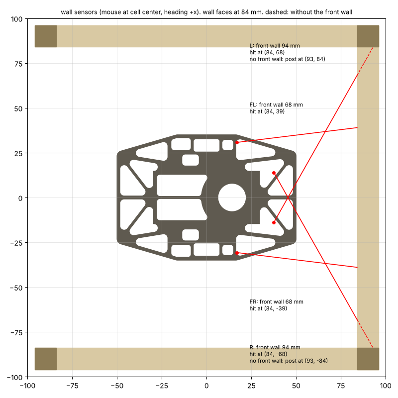

# KOGUMA MK4 設計仕様

KOGUMA MkIIl(MK3、[tokoro0917/koguma.mkiil](https://github.com/tokoro0917/koguma.mkiil))の後継機。2026-10-09時点。まずハードを決める。

## 方針の変更(2026-10-10)

**軽く、タイヤを小さくする。タイヤ径は15mm**(MK3は23.1mm。2026-10-10に15mmで決め、2026-10-17に一度14mmにしたが、床とのすき間のため15mmに戻した)。これにともない:

- スパーはMK3の70Tを使えない(下記「ギア比」)。モジュールと歯数を決め直す
- エンコーダをスパーから41Tで取る方式も決め直す
- **質量の目標は50g**(MK3は78g)。2026-10-11に40gから変更(電池を3S 180mAhにしたため)。下の「直線の加速」「グリップ」「ターン中の電流」は40gのときの計算で、50gの値は「50gでの計算」にまとめた
- ギアは**モジュール0.3**
- 23mm・90gで決めたこと(モーター、片側1個)は、14〜15mmでも変わらない(下記の計算)。電池は2026-10-11に3Sに変更

関連: ピンの割り当て `docs/pinmap.md`、部品表 `docs/bom.md`、機械部品の注文一覧 `docs/order.md`、制御 `docs/control.md`、フレームの強度 `docs/frame.md`、モーターマウント `docs/mount.md`、機体の仮の案 `docs/vehicle.md`、計算 `docs/calc/`

## 目標

- クラス: **クラシック(16×16)**
- 重点: 走行速度・加速 / メモリ・計算能力 / 調整・運用のしやすさ

## 決まったこと

| 項目 | 決定 | 理由 |
|---|---|---|
| クラス | クラシック16×16 | |
| 駆動方式 | 2輪(MK3と同じ) | |
| モーター | **NFP-D8620-3665-3-7.4**(8.6×20mm コアレス、7.4V版)を**片側1個** | 下記「モーター」「片側1個か2個か」 |
| 電源 | **3S LiPo 180mAh 45C**(公称11.1V、満充電12.6V、最大8.1A)(2026-10-12に30Cから変更) | 下記「電源(3S)」。**8A程度流れることがある**前提で、電源の経路(スイッチのMOSFET・コネクタ・配線)を選ぶ |
| タイヤ径 | **15mm**(2026-10-17に14mmから戻した) | 軽くするため(2026-10-10に方針変更)。スパー41Tで床まで1.05mm残すため15mmにした |
| 質量 | **50g目標**(40gから変更) | 下記「質量の配分」「50gでの計算」 |
| ギアのモジュール | **0.3** | |
| スパー | **41T**(手持ちの余り、m0.3、歯先12.9mm。2026-10-17に38Tから変更。材質・内径・厚さは要確認) | 手持ちがあるため。タイヤ15mmで床まで約1.05mm(下記「スパー41T」) |
| ピニオン | **13T**(m0.3、軸径1.2mm用、**ギア比3.15**、軸間8.10mm)(2026-10-17に11Tから変更)。入手は自分で行う | NFP-D8620はToraNekoのNFP-D0812より直径が0.6mm大きく、11T(軸間7.80mm)では軸受と当たる。軸間を0.3mm広げてToraNekoと同じすき間にする |
| 足回り | **ToraNeko.Mk3と同じ構成**: 3×6の平行ピンの車軸、軸受LF-630、ミニッツのタイヤ(MK4は15mm)、スパー41T(ピニオンはMK4は13T)(2026-10-17決定) | モーターはNFP-D8620なので、モーターの取り付けは作り直す |
| エンコーダ | **磁気式 MT6835 × 2**(車軸の端にφ3の磁石、垂直に立てた小さな基板)(2026-10-17に光学式から AS5047P に、2026-10-29に MT6835 に変更) | 足回りと基板の形は ToraNeko.Mk3 と同じ。下記「エンコーダ」 |
| ねじ | **M2**(2026-10-19決定。M3から変更)。**2026-10-30: 鉄の低頭 M2 L5 の1種類だけ**(10本: フレームの下からマウントへ4、基板へ4、ファンの台へ2)。印刷の部品にはねじ山を切る。フレームの穴はφ2.2 | 軽くするため(機体の案で鉄のM3 6.6g → 1.2g)。`docs/vehicle.md` |
| 吸引 | ファンを続ける。吸引力は**400g前後に見直す案**(50gなら400gでV90 約2660以上。下記「50gでの計算」) | |

## 検討中

| 項目 | 案 | メモ |
|---|---|---|
| モータードライバ | **MP6551**(MPS、2026-10-12にDRV8874から変更。下記「モータードライバ」) | 小さく(2.5×3mm)、オン抵抗が27mΩ。電流制限は決められないので、ソフトで制限する |
| 電流の制限 | まず片側3A。温度を実測して見直す | 連続で流してよい電流が公表されていない |
| ファン | **モーターは走行用と同じNFP-D8620(7.4V版)、羽根は自分で設計する**。軽いモーターには変えない(2026-10-19) | 下記「吸引ファン」 |
| MCU | **STM32H725RG**(Cortex-M7 550MHz、RAM 564KB、Flash 1MB、VFQFPN68 8×8mm)(2026-10-12決定) | 下記「MCU」。小さいのでハーフサイズにも流用できる |
| 不揮発メモリ | **外付けしない。STM32H725RGの内蔵Flash(1MB)を使う**(2026-10-12) | 下記「MCU」の「内蔵Flashの使い方」 |
| 通信 | **MK3と同じ: UART(PCとはUSBシリアル変換でつなぐ)+ 書き込み・デバッグはSWD**(2026-10-12) | ピンはUART 2本(TX/RX)、SWD 2本(SWDIO/SWCLK)+ NRST |
| 壁センサ | **MK3と同じ回路**(4本: FL・L・R・FR)(2026-10-12) | 下記「壁センサ」 |
| IMU | **LSM6DSR(MK3と同じ)**(2026-10-12決定)、SPI3 | |
| 制御周期 | 2〜4kHz(MK3は1kHz) | MCUを決めてから |

## MK3の現状

| 項目 | MK3 |
|---|---|
| MCU | STM32F446RE(180MHz、Flash 512KB / RAM 128KB) |
| 機体 | 全長120mm・幅70mm・78g、トレッド55mm、タイヤ径23.1mm |
| ギア | スパー70T。エンコーダは41Tのギアでスパーから取る(`GEARRATIO` 1.7073 = 70/41 はエンコーダとタイヤの比)。モーターのピニオンは**20T**(モーターとタイヤの比 3.5) |
| モーター | **NFP-D0816-3-3.4**(4.5V版、<https://nfpshop.com/product/8mm-coreless-dc-motor-16mm-type-model-nfp-d0816s>)を4S(16V)で使用。巻線抵抗5.4Ω、トルク定数26.8 g·cm/A(2.63mNm/A)、無負荷15,500rpm/8mA(4.5V)、停止電流0.83A(4.5V)、4.1g |
| ドライバ | MP6550(1個ずつ)。ISETに2kΩ → 電流制限 約2.5A(ピーク)。VISEN(電流の出力)はコンデンサだけでMCUにはつながっていない。PWMは50kHz(TIM3、90MHz / 9 / 200) |
| 電源 | 電池 → 逆接続防止のPch MOSFET(IRLML6402) → VBAT。5VはDC-DCモジュール(MYLSM00502ERPL)、3.3VはLDO(MIC5219)。電池の電圧は47k/10kで分圧してADC |
| 吸引ファン | VBATからNch MOSFET(IRLML6344)でローサイドPWM(TIM2)、還流ダイオードあり |
| センサ | 壁センサ4本(FL/L/R/FR)、LSM6DSR、SPIの磁気式エンコーダ |
| 吸引 | 約400g |
| 走り | 最短はコーナー2000〜2400、直線6000mm/s、加速度20000〜25000 |

MK3の課題:

1. 直線の加速が約25000mm/s²で、左右のモーターの電圧(duty)が張り付く
2. V90の限界(約2200)も、滑りではなくdutyの張り付き
   - 1と2はどちらも、**モーター1個あたり約1.3Aで頭打ち**になっていると考えると説明がつく(下記「MK3の加速を止めていたもの」)
3. RAMが足りない(16×16で112KB/128KB)。32×32はビルドできない
4. 会場の感度合わせのたびに、値を書き写してビルドし直す。迷路はRAMにしか残らない
5. ギアの滑りが疑われている(2026-10-08)

## モーター: NFP-D8620-3665-3-7.4

販売ページ: <https://nfpshop.com/product/8-6-x-20mm-coreless-dc-motor-high-efficiency-low-noise>

| 項目 | 値 |
|---|---|
| 定格電圧 | 7.4V |
| 巻線抵抗 | 1Ω |
| トルク定数 | 15 g·cm/A(1.47 mNm/A) |
| 無負荷回転数 / 無負荷電流 | 46,000rpm / 140mA |
| 停止トルク / 停止電流 | 108.8 g·cm(10.7 mNm)/ 7.41A |
| 最大出力 / 最大効率 | 12.8W / 72% |
| 重さ / 大きさ | 5.3g / 直径8.6mm × 長さ20mm |

- 無負荷回転数から求めた逆起電力定数は1.51 mV/(rad/s)で、トルク定数1.47とほぼ一致する(表の値は矛盾していない)
- モーター定数 Kt/√R は1.47(MK3は1.13)。同じ発熱で1.3倍のトルクが出る
- **受注生産で約4週間かかる**。予備も含めて早めに注文する
- **連続で流してよい電流が公表されていない**。電圧をかけっぱなしにすると最大7.4A(発熱 I²R 最大約55W)になるので、ドライバで電流を測ってソフトで制限する
- 外形図(販売ページの画像。図の名前はNFP-D08520): **軸径1.2mm(0/−0.005)、軸の長さ5.1mm**、軸受けの出っ張り直径2.4mm・長さ0.3mm。軸は片側だけ(後ろに軸がないので、モーターの軸にエンコーダは付けられない)。注文時に軸の長さ・リード線・コネクタ・回転方向を選べる

## 計算

### MK3の加速を止めていたもの

MK3のピニオンは20T(モーターとタイヤの比3.5)。この比とNFP-D0816-3の値で計算すると、16Vいっぱいなら約61m/s²まで電圧は張り付かないはずだが、実機は25000〜28000mm/s²で張り付いた。

| | MK3で必要な電流(1個あたり) |
|---|---|
| 直線 25〜28 m/s² | 1.22〜1.37A |
| V90 2200の入り(外側の車輪、慣性モーメント約210 g·cm²のとき) | 約1.3A |

直線とV90の両方が**約1.3A**でそろう。モーターに約1.3Aより流れない何か(ドライバMP6550の電流制限の設定、電池・配線の電圧降下など)があり、目標に追いつけないのでフィードバックがdutyを上限まで上げていた、と考えると両方を説明できる。回路図(KOGUMA-CHAN.MkII)で、MP6550のISETには2kΩがつながっている。MP6550はISETの抵抗に出力電流1Aあたり100µAを流し、その電圧が0.5Vに達すると電流を制限するので、制限は 0.5V / (100µA × 2kΩ) = **約2.5A**。データシート(MP6550 Rev.1.0)では、超えると下側のFET2つをオンにして(ブレーキ)17µs止め、電流が制限の8割(2.0A)より下がっていれば再びオンにする。下がっていなければ、下がるまで止めたままにする。

**データシートどおりに動いていれば、平均の電流は2.0〜2.5A**で、直線の加速は計算上41〜51m/s²(転がり抵抗やギアの損失で1〜2割下がっても35〜45m/s²)になる。**実機の25〜28m/s²(平均約1.3A)は、この半分くらいしかない。** 2.5Aの設定だけでは説明できない。

有力な原因: **VISENに0.1µF(C11、C18)がつながっている。データシートではVISENの容量は500pF以下。** その200倍の容量があると、VISENの電圧が実際の電流より遅れて動く。電流が2.5Aを超えてもすぐには止まらず、止まったあとは、VISENが0.4V(2.0A相当)に下がるまで止めたままになる。止まっている時間が延びるので、平均の電流が下がる。ほかに、電池の電圧降下(走行中の電圧はdutyの計算に入っていない)も重なっている可能性がある。

確かめ方:

- オシロスコープでVISEN(200mV/A)と、モーターの端子の電圧を見る。加速中にブリッジが長く止まっていれば、電流制限が原因
- **VISENの0.1µF(C11、C18)を外す**(VISENはMCUにつながっていないので、ほかに影響はない)。2.5Aの保護は残したまま、データシートどおりの動きになる。張り付く加速度が40m/s²前後まで上がれば、これが原因
- ISETを1kΩ(約5A)にすると、16Vでの停止電流(約3A)より上なので電流制限は事実上なくなる。モーター(加速中40W以上の発熱)、MP6550(2Aクラス)、電池に余裕がないので、試すなら短時間で

MK3は電池の電圧を走る前に1回だけ測り(`Motor_Setup_Voltage()`)、走行中の電圧降下はdutyの計算に入っていない。電池は4S 180mAhで、ファンとモーターの電流で下がっている可能性もある。**ログ(モード4 No.7)に`g_V_batt`を足して、加速中の電池の電圧を見ると、電池とドライバのどちらが原因か切り分けられる。**

MK4への影響:

- **MK4のドライバは、1個あたり4A以上流せるものにする**(片側3Aでの直線43m/s²、V90 3000の入りで約3.5A)。MP6550は2Aクラスなので使わない。電流制限は瞬間の値で効くので、平均で使いたい電流よりかなり上に設定する
- **ドライバの電流の出力をMCUのADCにつなぐ**。電流の制限をソフトで行い、ログで電流を見られるようにする。電流の出力ピンにつなぐ部品(コンデンサ・フィルタ)は、データシートの容量の上限を守る(MK3はMP6550のVISENに上限500pFのところ0.1µFをつけていた)
- コアレスモーターはインダクタンスが小さく、PWMのたびに電流が大きく上下する。PWMの周波数(MK3は50kHz)は、NFP-D8620のインダクタンスを測ってから決める
- MK4のコーナーの限界は、ドライバの電流の上限(=ソフトで決める電流制限)とグリップのどちらか小さい方で決まる。電圧(duty)には余裕がある

MK3の`Define.h`の`KE`(2.09e-3)は、データシートの無負荷回転数から求めた値(2.75e-3 V/(rad/s))と合わない。`KT`(2.63e-3)と`MOTORR`(5.4)はデータシートと一致する。また、MK3の`GEARRATIO`(70/41)はエンコーダの比で、モーターのフィードフォワードにも使われているので、モーター側は約2倍(3.5/1.71)ずれている。

計算は`docs/calc/drive_calc.py`で出せる(`python3 docs/calc/drive_calc.py --gear 4 5` のようにギア比を指定できる)。仮定: 質量50g(既定。以下の表の一部は40gのとき)、タイヤ径15mm(既定)、トレッド55mm(`--mass`・`--tire`で変えられる)、電源7.4V、摩擦・ドライバの損失・電池の電圧降下は入れていない。MK3はピニオン20T(`--mk3-pinion`で変えられる)。

### 50gでの計算(3S 11.1V、ギア比3.15(41T:13T)、タイヤ15mm。2026-10-17に計算し直し)

| 項目 | 値 |
|---|---|
| モーター1個1Aあたりの加速 | 24.7 m/s² |
| 片側3Aでの加速 | 74 m/s² |
| 電圧の上限で出せる加速(0 / 3 / 6 / 8 m/s) | 275 / 228 / 181 / 149 m/s² |
| グリップの限界(吸引300 / 400 / 600g) | 104 / 134 / 194 m/s² 以上(V90 約2350 / 2660 / 3200以上) |
| V90の入りの外側のモーター(2200 / 2700 / 3000 / 3300) | 1.1 / 1.6 / 2.0 / 2.4A(必要な電圧は26〜46%)。慣性モーメント133 g·cm²、ロータなしのとき。**配置図(約220 g·cm²)では2.0 / 3.1 / 3.8 / 4.6A**(下記「機構の配置」) |

- 50gでも、加速の限界は電流(片側3Aで74 m/s²)とグリップ。電圧には大きな余裕がある
- 吸引400gでV90 約2660以上。MK3(2200、電流で頭打ち)より上。もっと上げたければ吸引を500g前後に

### 直線の加速(片側1個、15mm・40g)(40g・タイヤ15mmのときの計算)

| ギア比 | 電圧の上限(0 / 3 / 6 m/s) | 片側3Aに制限 | 50 m/s²に必要な電流 / 1個の発熱 | 6m/sでの回転数 | 無負荷の最高速 |
|---|---|---|---|---|---|
| MK3(20T、3.5、23.1mm・78g) | 61 m/s²(0 m/s)。実機は約1.3Aで頭打ちして25〜28 m/s² | 1.3Aで約27 m/s² | | | |
| 2.5(40T:16T) | 181 / 144 / 108 m/s² | 74 m/s² | 2.0A / 4.2W | 19,100rpm | 14.7 m/s |
| **3.0(39T:13T)** | 218 / 165 / 111 | **88** | **1.7A / 2.9W** | 22,900rpm | 12.3 m/s |
| 3.45(38T:11T) | 250 / 180 / 110 | 101 | 1.5A / 2.2W | 26,400rpm | 10.7 m/s |

- 40gになったので、モーターには大きな余裕がある。片側3Aなら、ギア比3でMK3の実機の3倍以上(88 m/s²)
- 実際に使う加速度(例えば50 m/s²)なら、1個あたり1.7Aで、発熱は約3W。熱の心配はほぼなくなる
- 6m/sでも電圧には余裕がある(110 m/s²前後)。直線の最高速を6m/sより上げる余地もある
- 直線の加速の限界は、モーターではなくグリップと、制御・機構(滑り、ギア)になる

### グリップ

MK3はV90 2200(横91.5m/s²、78g、吸引400g)で滑らず、先にdutyが張り付いた。ここから摩擦係数は**μ ≥ 1.52**(下限)。2輪なので吸引の力はほぼすべて駆動輪にかかるとした。

| 吸引(40g) | グリップの限界 | V90の目安(MK3の横Gから換算) |
|---|---|---|
| 300g | 127 m/s² 以上 | 約2590以上 |
| **400g** | **164 m/s² 以上** | **約2950以上** |
| 600g | 238 m/s² 以上 | 約3550以上 |

- 40gなら、**吸引400gでも機体の重さの10倍**になり、グリップはMK3(78g・400g)の1.8倍
- 吸引600gにする必要は薄い。ファンを小さく・軽くでき、電池も小さくできるので、**吸引400g前後を目標にする案**をすすめる
- 吸引の中心が車軸から前後にずれると、機体の端が床に当たってグリップが減る。ファンは車軸の近くに置く

### ターン中の電流とduty(V90)

ターンの入りでは、機体を回し始めるために外側の車輪に大きなトルクが要り、外側の車輪は機体より速く回るので逆起電力も大きい。MK3の`Motor_Sula_COS`の角速度の形と、`G_Turn2000`のV90(2000deg/s・130000deg/s²を速度に合わせて換算)で計算した。MK3のV90 2200の限界は約1.3Aの頭打ちと考え、慣性モーメントを「V90 2200の入りで外側のモーターが1.3A」になるように逆算した(207 g·cm²)。MK4は質量に比例させた(40gで106 g·cm²。機体が小さくなればもっと下がる)。

| V90の速度 | ギア比3.0 | MK3 |
|---|---|---|
| 2200 | 0.9A / 35% | 1.3A / 58% |
| 2400 | 1.1A / 39% | 1.5A / 68% |
| 2700 | 1.4A / 46% | 2.0A / 84% |
| 3000 | 1.7A / 54% | 2.4A / 101% |
| 3300 | 2.0A / 62% | 2.9A / 120% |

(外側のモーター1個の電流のピーク / 必要な電圧 ÷ 電源電圧)

- 電流も電圧も十分に余裕がある。**コーナーの限界はグリップで決まる**(吸引400gでV90 約2950以上)
- 電流・%の値はおおよそ

### 片側1個か2個か

(タイヤ23mm・90gのときの検討。40gではモーターに大きな余裕があるので、片側1個で決まり。2個目の場所を残す必要もない)

片側2個(同じスパーに2つのピニオン、1つのドライバに並列)も検討した。

| | 片側1個 | 片側2個 |
|---|---|---|
| 質量 | 90g | 102g(+12g) |
| 直線の加速35m/s²での電流 / 発熱合計 | 2.5A/個、12W | 1.4A/個、8W |
| 6m/sでの電圧の上限 | 49 m/s² | 87 m/s² |
| コーナー(グリップ、吸引600g) | **V90 約2460以上** | 約2330以上 |
| 機構 | シンプル | ピニオン2つのかみ合わせ、ギアの滑りの心配が増える |
| 電源 | | ピーク電流が大きい |

**片側1個にした。**

## ギア比

タイヤ径15mmなので、**MK3のスパー70Tは使えない**(モジュール0.3なら直径21mmで、タイヤより大きい)。スパーの歯先の直径は、床とのすき間を残して**13mm以下**にする(タイヤの半径7.5mmから約1mm)。

モジュール0.3なら、スパーは**41T以下**(歯先の直径 = 0.3 ×(歯数+2)≤ 13mm)。手持ちがあるので41Tを使う(下記「スパー41T」)。

### 今の機体での見直し(2026-10-27)

機体の案 v4(52.76g、慣性モーメント251 g·cm²、タイヤ15mm、トレッド60mm、3S 11.1V)で、スパー41Tに付けるピニオンを11〜15Tで比べた(`docs/calc/gear_study.py`)。直線の時間は、3m/sで入って3m/sで出るとき。摩擦・ドライバの損失・電池の電圧降下は入れていない。

| ピニオン | ギア比 | 軸間 | 片側3Aの加速 | 無負荷の最高速 | 14m/sでの回転数 | V90 3000の外側の電流 | 15区画の直線(3A / 3.5A) |
|---|---|---|---|---|---|---|---|
| 11T | 3.73 | 7.80mm | 83 m/s² | 14.8 m/s | 66,400rpm | 2.9A | 299 / 285ms |
| 12T | 3.42 | 7.95mm | 76 | 16.2 | 60,900 | 3.2A | 307 / 290ms |
| **13T(今)** | **3.15** | **8.10mm** | **70** | **17.5** | **56,200** | **3.4A** | **316 / 298ms** |
| 14T | 2.93 | 8.25mm | 65 | 18.9 | 52,200 | 3.7A | 325 / 306ms |
| 15T | 2.73 | 8.40mm | 61 | 20.2 | 48,700 | 4.0A | 334 / 314ms |

- **41T:13T(3.15)のままにする**。11Tと15Tの差でも直線の時間は1割ほどで、13Tとの差は±3%くらい
- 加速は片側の電流の上限で決まる(吸引400gでも550gでも、グリップの限界まで届かない)。ギア比が高いほど電流あたりの加速とターンが良く、電池(上限8.1A)に楽
- **11T・12Tにはできない**: 軸間が狭くなり、モーターが内側の軸受に当たる。13T(8.10mm)ですき間0.20mm、12T(7.95mm)では0.05mmになり、印刷の精度(±0.2mm)では無理
- **ギア比は形でほぼ上限が決まっている**: 軸間8.1mm以上(モーターと軸受)と、スパーの歯先φ12.9mm程度まで(タイヤ15mmと床)。歯を細かくしても、m0.25の49T:16Tで3.06、m0.2の62T:19Tで3.26で、3.15とほとんど変わらない
- **モーターの回転数**: 14m/sで約56,000rpm。7.4V版の無負荷(46,000rpm)を超え、3Sで回すから出せる速さ。ブラシと軸受の寿命を考えるなら、最高速は約11m/s(約44,000rpm)に抑えるのが無難(15区画で1割弱遅くなる)
- ギア比より、片側の電流の上限を3A → 3.5Aに上げる方が効く(15区画で316 → 298ms)。電池の上限(8.1A)と合わせて考える

### スパー41T(2026-10-17決定)

手持ちの余りの41T(モジュール0.3)を使う。アールティの38Tは取り下げ。材質・内径・厚さは手持ちのものを測って書く。

| ピニオン | ギア比 | 1Aあたりの加速 | 片側3Aでの加速 | 6m/sでの電圧の上限 | 6m/sでの回転数 | 無負荷の最高速 | V90 3300の入り | 中心距離 |
|---|---|---|---|---|---|---|---|---|
| 11T | 3.73 | 31.3 m/s² | 94 m/s² | 197 m/s² | 30,500rpm | 13.8 m/s | 1.9A | 7.80mm |
| 12T | 3.42 | 28.7 m/s² | 86 m/s² | 192 m/s² | 28,000rpm | 15.1 m/s | 2.1A | 7.95mm |
| **13T** | **3.15** | 26.5 m/s² | 80 m/s² | 186 m/s² | 25,800rpm | 16.3 m/s | 2.3A | 8.10mm |
| 14T | 2.93 | 24.6 m/s² | 74 m/s² | 180 m/s² | 24,000rpm | 17.6 m/s | 2.4A | 8.25mm |

(50g、タイヤ14mm、3S 11.1V。タイヤ15mmでは加速が約7%下がり、最高速が約7%上がる)

- **13Tに決定**(2026-10-17)。最初はToraNeko.Mk3と同じ11Tにしたが、NFP-D8620はNFP-D0812より直径が0.6mm大きく(半径で0.3mm)、軸間7.80mmでは軸受(LF-630、外径6mm)と当たる。13Tで軸間が8.10mm(+0.30mm)になり、ToraNekoと同じすき間になる。CADで足りなければ14T(8.25mm)
- スパーを大きくする(42T・43T)と軸間は広がるが、床に近づき、手持ちの41Tも使えないのでやめた
- タイヤ15mm・41T:13T(3.15)での値: 片側3Aで74 m/s²、無負荷の最高速17.5 m/s、V90 3300の入りで2.4A。加速の限界はグリップ(吸引400gで約134 m/s²)より下だが、ふだん使う範囲(〜60 m/s²)には足りる
- **床とのすき間**: 歯先12.9mmなので、タイヤ15mmで床まで約1.05mm(14mmでは0.55mmだったので15mmに戻した)
- エンコーダは磁気式(車軸の端の磁石)にしたので、41Tの横面にエンコーダ板は付けない

| スパー | ピニオン | ギア比 | スパーの歯先 | ピニオンの直径(ピッチ円) | 中心距離 |
|---|---|---|---|---|---|
| 40T | 16T | 2.50 | 12.6mm | 4.8mm | 8.4mm |
| 39T | 14T | 2.79 | 12.3mm | 4.2mm | 7.95mm |
| **39T** | **13T** | **3.00** | 12.3mm | 3.9mm | 7.8mm |
| 41T | 13T | 3.15 | 12.9mm | 3.9mm | 8.1mm |
| 38T | 12T | 3.17 | 12.0mm | 3.6mm | 7.5mm |
| 38T | 11T | 3.45 | 12.0mm | 3.3mm | 7.35mm |

### アールティで手に入るギア(2026-10-10に検索で確認。在庫・仕様は購入前に確認)

| 品名 | モジュール | 歯数 | 内径 | 厚さ | 材質 | 価格 |
|---|---|---|---|---|---|---|
| 精密切削ピニオンギヤ(RT-PN)2個入り | 0.3 | 9T | 0.8mm | 2mm | 真鍮 | 880円 |
| マイクロマウス用ギア | 0.3 | 38T | 3.0mm | 1.5mm | POM(白) | 2,200円 |

- **38T:9Tならギア比4.22**。スパー38Tの歯先は12.0mmで、タイヤ14mmにも収まる(床まで1.0mm)
- **ただしRT-PNの内径は0.8mmで、NFP-D8620の軸(1.2mm)には入らない**。9Tのピッチ円は2.7mm、歯の根元の直径は約1.95mmなので、1.2mmに広げると肉厚が約0.38mmしか残らない
- ピニオンは、軸径1.2mm用のモジュール0.3を別に探すか、作る(KERI's Labにモジュール0.3をCNCで作った例あり)

38T:9T(4.22)の計算(40g、15mm): 片側3Aで124 m/s²、6m/sでの電圧の上限96 m/s²、6m/sで32,300rpm、無負荷の最高速8.7 m/s。V90 3300の入りで1.4A。40gなら電流はさらに減るが、最高速の上限が下がる(直線6m/sには足りる)。

- スパーをRTの38Tにするなら、ピニオンは11T(3.45)〜13T(2.92)で、軸径1.2mm用のものを探す
### スパー38Tとピニオンの組み合わせ(40g、15mm)(タイヤ15mmのときの計算)

| ピニオン | ギア比 | 片側3Aでの加速 | 6m/sでの電圧の上限 | 6m/sでの回転数 | 無負荷の最高速 | 歯の根元の直径 / 1.2mmの穴の肉厚 |
|---|---|---|---|---|---|---|
| 11T | 3.45 | 102 m/s² | 110 m/s² | 26,400rpm | 10.7 m/s | 2.55mm / 0.67mm |
| **12T** | **3.17** | **93 m/s²** | 111 m/s² | 24,200rpm | 11.6 m/s | 2.85mm / 0.83mm |
| 13T | 2.92 | 86 m/s² | 111 m/s² | 22,300rpm | 12.6 m/s | 3.15mm / 0.97mm |
| (RTの9T) | 4.22 | 124 m/s² | 96 m/s² | 32,300rpm | 8.7 m/s | 1.95mm / 0.38mm(内径0.8mmで入らない) |

- **第一案は12T(ギア比3.17)**。11〜13Tのどれでも性能は十分なので、手に入るものでよい
- V90 3300の入りで1.9A(12T)

### ピニオンの入手

軸径1.2mm用・モジュール0.3のピニオンは、自分で手に入れる(2026-10-11)。

- ピニオンは接着(真鍮なら瞬間接着剤・嫌気性接着剤)か圧入で固定する。リーマで広げるなら、軸に対して締まりばめになるよう1.2mm(H7程度)で仕上げる
- 中心距離は0.3 ×(38 + 12)/ 2 = 7.5mm
- 以前の第一案だった39T:13T(ギア比3.0)は、スパーをRTの38Tにしたので取り下げ。40gではモーターに余裕があるので、ギア比を上げる必要はない。ピニオンを小さくしすぎない(13T)方が、作りやすく歯も強い
- 熱をもっと減らしたい・加速をもっと出したいなら38T:11T(3.45)。直線の最高速を伸ばしたいなら40T:16T(2.5)
- ピニオンが小さいので、NFP-D8620の軸径(外形図で確認)に付けられるかで、モジュールと歯数が決まる
- ピニオンの歯数が少ない(17T未満)と歯の根元が細くなる(切り下げ)。市販のピニオンが手に入るかも確認する
- MK3で疑われていたギアの滑り(歯飛び)を防ぐため、かみ合わせの精度(中心距離)を出せる構造にする
- モーター(直径8.6mm)は、中心距離が約8mmなので車軸の斜め上か前後に置く。タイヤの半径(7.0mm)よりモーターの半径(4.3mm)が小さいので、車軸と同じ高さにも置ける
- ファームウェアでは、MK3の`GEARRATIO`(エンコーダの換算とモーターのフィードフォワードの両方に使われている)を、**エンコーダの比**と**モーターとタイヤの比**の2つに分ける。MK3では`motor.c`のフィードフォワードもエンコーダの比1.7073を使っているので、モーター側(3.5)と約2倍ずれている

## モータードライバ

**決定: MP6551**(MPS、データシートRev.1.0、2026-10-12)。MK3のMP6550と同じメーカーの系列。

| 項目 | 値 |
|---|---|
| 電源電圧 | 2.5〜14V(絶対最大16V) |
| 電流 | 5A |
| オン抵抗 | 上側15mΩ + 下側12mΩ = 27mΩ(DRV8874は200mΩ) |
| 過電流保護 | ピーク8.5〜14A(フォールドバック)。**値は決められない** |
| 電流の出力 | CM1・CM2: 下側FETの電流の1/10,000を出す(両方向。データシートの例で+1Aで120µA、−1Aで−91µA) |
| 制御 | IN1・IN2・EN1・EN2(EN1 = EN2 = Lでスリープ)、nFAULT(オープンドレイン)、SR(出力の切り替わりの速さ) |
| PWM | 500kHzまで |
| 大きさ | QFN-14(2.5 × 3mm) |

DRV8874から変えた理由:

- **オン抵抗が約1/7**。モーターの巻線抵抗が1Ωしかないので、ドライバの電圧降下と発熱(3Aで約0.24W、DRV8874は約1.8W)が効く
- **面積が約1/4**。50gの機体に向く
- DRV8874を選んだ理由だった「絶対最大40V」は、3.3VのDC-DC(LXDC55FAAA-203、入力14Vまで)があるので、機体全体ではどのみちVBATを14V以下に抑える必要があり、意味が薄くなった
- 足りない点は「電流制限の値を決められない」こと。下記の2つのソフトの制限で守る

### モーターの電流の守り方(MP6551には電流制限の設定がないため)

1. **dutyの上限をその都度計算する**: エンコーダの速度から逆起電力 E = Ke × モーターの角速度 を求め、(電源電圧 × duty − E)/ 巻線抵抗(1Ω + 0.03Ω)≦ 3A になるdutyを上限にする。ADCが読めなくても電流を抑えられる
2. **CMの電流をADCで読んで、制限を超えたら止める**

止まった状態で duty 100% にすると 12.6V / 1Ω = 12.6A 流れる。過電流保護(8.5〜14A)はモーターを守る値ではないので、1が基本の守り。

### 駆動のしかたと電流の測り方

- IN1・IN2の両方をPWMにする(TIM1のCH1〜CH4)。前進はIN1にPWM・IN2 = 0、後退はIN1 = 0・IN2にPWM。PWMのオフの間はどちらの向きも両方の出力がLになり、下側のFETで減衰する(スローディケイ)
- CM1・CM2を別々にADCで読む。0に固定している側(前進ならOUT2 → CM2)の下側FETには、PWMのオンでもオフでもモーターの電流がそのまま流れるので、そちらを読む
- **CM1とCM2をつないで1本にしない**。オフの間、片方の下側FETは逆向きに電流が流れて打ち消し合い、「duty × モーターの電流」(電池から出る電流)しか読めなくなる
- CMの出力: VOUT = VREF +(RREF × モーターの電流)/ 10,000。3.3VとGNDの間に同じ値の抵抗2本をつなぐ(データシートの「ADCの電源に比例させる」つなぎ方)。**4.7kΩ × 2**(VREF 1.65V、RREF 2.35kΩ)にする(2026-10-29。下の「MP6551の電流計測は使えるか」)
- +側と−側で出力の比が違う(+1Aで120〜125µA、−1Aで−91〜−95µA)。実機で電流と出力の関係を測って補正する
- **VBATを14V以下に**: MP6551とDC-DCの両方の入力上限が14V(絶対最大16V)。3Sの満充電は12.6V。減速のときの電圧の上がりを、VBATのコンデンサ(必要ならTVS)で抑える

### 電流の計測のノイズ対策(2026-10-12)

ノイズの元: PWMの切り替わりの瞬間のスパイク、コアレスモーターのブラシのノイズ、大電流によるGNDの電位の揺れ、PWMのたびの電流の上下(リップル)。

- **PWMに同期してADCを取る**: TIM1のトリガでADCを動かし、PWMの切り替わりから離れた時刻(センターアラインPWMの山か谷)で取る。切り替わりのスパイクを避けられる
- **MP6551のCMは電流で出てくる**ので、電圧で引き回すより配線のノイズやGNDの揺れに強い。**RREF(と、つけるならフィルタのコンデンサ)はMCUのADCピンのそばに置く**
- CMにつなぐコンデンサの上限は、MP6551のデータシートには書かれていない(MK3のMP6550はVISENに500pF以下という制限があった)。つけるなら小さい値から試し、波形を見て決める。**1nF から始める**(2026-10-29)
- ADCのハードウェアのオーバーサンプリング(H7のADCにある)で平均して、細かいノイズを減らす
- GND: モーター・ファンの大電流のGNDと、MCU・センサのGND(VSSA)を分け、1点でつなぐ
- ファンのシャント: 0.1Ωなら増幅なしで読める(1Aで0.1V)。電圧はシャントの両端から細い線で取り出す(ケルビン接続)
- 専用IC: 付けない(2026-10-29、下の「MP6551の電流計測は使えるか」)

### MP6551の電流計測は使えるか(2026-10-29調査)

結論: **専用IC(シャント + INA240 など)を付けず、MP6551 の CM で始める**。精度の保証がないので、1個ずつ・向きごとに校正する前提。

データシート(Rev.1.0)の CM:

| 項目 | 値 | 意味 |
|---|---|---|
| 比 | 1/10,000(typ. のみ) | 最小・最大がない。精度は保証されていない |
| +1A のときの出力 | 表は 120µA、温度のグラフは 25°C で約 125µA | 表とグラフが食い違う |
| −1A のときの出力 | 表は −91µA、グラフは約 −95µA | +と−で約25%違う |
| 温度による変化(+側) | −40°C で 129µA → 125°C で 120µA | 25〜85°C で約 −2% |
| 0A のずれ、応答の速さ | 書かれていない | 波形の図(20kHz、2A)では PWM の電流の上下にそのままついていく |
| 出力できる電圧 | 3.57V まで | |

- **今の駆動方法は CM に合っている**: 片側の下側のFETをずっと ON にするので、そのFETには PWM の ON でも OFF でもモーターの電流が流れる(下側のFETで測る方式の弱点の「見えない時間」がない)。測るFETは切り替わらないので、切り替わりのスパイクも直接は入らない
- **要る精度**: モーター1個で 1A が約 25 m/s²。50mA のノイズでも約 1.3 m/s²。倍率のずれ(5〜10%)は電流の制御の積分で吸収できる。数%・数十mA で足りるので、専用ICの 0.2% は要らない
- **RREF を 3.1kΩ から 2.35kΩ に**: 3.1kΩ(6.2kΩ × 2)では +側が約 4.3A で 3.3V に届き、V90 の入り(4.6A)や守りに見たい 5A が測れない。2.35kΩ(4.7kΩ × 2)なら −40°C でも約 5.4A まで。+側 約 0.29V/A、−側 約 0.22V/A、ADC の実際の分解能を12ビット(約0.8mV)として約3mA刻み
- **CM に 1nF**: RREF とで約 2.4µs(約68kHz)。ADC が読むときの電荷もここから出る
- **校正**: 0A は起動のとき、止まった状態で両方の入力を L にして測る。倍率は、1個ずつ、決まった抵抗に一定の電流を流して、+と−を別々に測る
- **読むピンを切り替える**: 前進なら CM2、後退なら CM1(0 に固定している側)
- CM が使えなかったときの逃げ道: 電流を 3A 以下に抑える duty の上限は ADC なしで効く(上の「モーターの電流の守り方」の1)。制御も電流を使わない形(FF で電圧を出す、MK3 と同じ)に戻せる。基板を作る前に試すなら評価ボード EV6551-QB-00A(納期が長い)

専用IC(INA240)と比べたとき:

| | MP6551 の CM | シャント + INA240 |
|---|---|---|
| 精度 | 保証なし(校正が要る) | 倍率のずれ 0.2% 以下、0 のずれ ±25µV 以下 + シャントの精度 |
| 応答の速さ | 書かれていない | 400kHz(販売店の表) |
| 部品 | 抵抗とコンデンサだけ | 1モーターあたり TSSOP-8(3 × 6.4mm)+ シャント + パスコン |
| 経路の抵抗 | 増えない | +10mΩ |
| ADC のピン | 4本 | 2本 |

### 検討のときの比較(参考)

条件: 3S(満充電12.6V)と減速時の電圧の上がりに耐える、ピークで3A以上(40gでは、ふだんの加速・ターンは2A以下、制限いっぱいで3A)、電流の出力(MCUのADCへ)と電流制限がある、オン抵抗が小さい(モーターの巻線抵抗が1Ωしかないので、ドライバの抵抗がそのまま効く)。

| | DRV8874(TI) | DRV8214(TI) | MP6550(MK3) | DRV8251A(TI) |
|---|---|---|---|---|
| 電源電圧(動作 / 絶対最大) | 4.5〜37V / 40V | 1.65〜11V / 12V | 1.8〜22V | 4.5〜48V |
| 電流 | 6Aピーク | 4Aピーク、2A RMS | 2Aクラス(OCP 4〜6A) | 4.1Aピーク |
| オン抵抗(上+下) | 200mΩ | 240mΩ | | 450mΩ |
| 電流の出力 | IPROPI(450µA/A) | IPROPI(ゲイン切り替え) | VISEN(100µA/A) | IPROPI |
| 電流制限 | VREFで設定、サイクルごと / 固定オフ時間を選べる | VREFで設定 | ISETで設定、固定オフ時間17µs | VREFで設定 |
| 制御 | GPIO(PH/EN、PWM、ハーフブリッジ独立) | PWM+I²C | PWM | PWM |
| パッケージ | HTSSOP-16(5×6.4mm) | WQFN-16(3×3mm) | QFN-12(2×2mm) | HSOP-8(4.9×6mm) |

- (以前の検討)3Sにしたので、DRV8214(絶対最大12V)は使えない。2Sのときは40gにしたので、第一候補はDRV8214に変える案だった。 3×3mmで小さく軽い。40gではふだんの電流が2A以下なので、連続2A RMS・ピーク4Aで足りる。ただし絶対最大12Vで、2Sの満充電8.4Vとの差が3.6Vしかないので、電源のコンデンサを厚くし、減速時に電源の電圧が上がりすぎないか確かめる。I²Cで設定が要る
- DRV8874(以前の第一候補) 6Aピークとオン抵抗200mΩで余裕があり、絶対最大40Vなので、減速時にモーターが電源を押し上げても心配が少ない。制御もMK3と同じGPIOのPWMでよい。欠点は大きさ(2個で約5×6.4mm × 2)
- DRV8251Aはオン抵抗450mΩで、モーター(1Ω)に対して大きすぎるので外す
- オン抵抗の影響: DRV8874(200mΩ)だと電圧の上限で出せる加速が約1/1.2になり、3Aで約1.8W発熱する。MP6551(27mΩ)ならどちらもほぼ無視できる

## 電源(3S)

3S LiPo(公称11.1V、満充電12.6V)。モーター(NFP-D8620)は7.4V版のまま。

| | 2S(7.4V) | 3S(11.1V) | 3S満充電(12.6V) |
|---|---|---|---|
| 電圧の上限で出せる加速(0 / 3 / 6 / 8 m/s) | 229 / 170 / 111 / 72 m/s² | 343 / 285 / 226 / 186 | 390 / 331 / 272 / 233 |
| 無負荷の最高速(ギア比3.15) | 11.7 m/s | 17.5 m/s | 19.9 m/s |
| モーターの無負荷回転数(duty 100%) | 約46,900rpm | 約70,300rpm | 約79,800rpm |
| 止まっているときにduty 100%で流れる電流 | 7.4A | 11.1A | 12.6A |

(40g、タイヤ15mm、ギア比3.15)

- 40gでは、2Sでも加速は電流(片側3Aで93 m/s²)とグリップで決まっていた。3Sで増えるのは**高速での電圧の余裕**(直線を8m/s以上にする余地)と、**吸引ファンに使える電圧**
- **7.4Vのモーターに最大12.6Vをかけることになる**(MK3は4.5Vのモーターを16Vで使っていた)。止まった状態でduty 100%にすると12.6A流れるので、**ソフトの電流制限は必須**(MP6551には電流制限の設定がない。下記「モータードライバ」)
- 回転数は、ギア比3.15・6m/sで約24,100rpm(定格の無負荷回転数46,000rpmの約半分)なので、ふつうの走行では定格を超えない。dutyの上限で、モーターの電圧の平均が定格(7.4V)を大きく超えないようにすることも考える
- 電源電圧が高いほど、コアレスモーターのPWMの電流の上下(リップル)が大きくなる。PWMの周波数はNFP-D8620のインダクタンスを測ってから決める
- ドライバ: MP6551(動作14Vまで、絶対最大16V)。3Sの満充電12.6Vは範囲内だが、減速時の電圧の上がりを抑える
- **電源は3.3Vの1系統だけにする(5Vは作らない、2026-10-12決定)**。3.3Vは3S(最大12.6V)から小さなDC-DC(降圧)で直接作る(LDOでは発熱が大きい)。3.3Vを使うのは、MCU(内蔵SMPSでコアの電圧を作る)、IMU、壁センサ(発光・アンプ)、エンコーダ、LED、ブザー
- **3.3VのDC-DC: 村田製作所 LXDC55FAAA-203**(2026-10-12決定、秋月電子 109577)

| 項目 | 値(データシート) |
|---|---|
| 入力 | 4〜14V(絶対最大16V) |
| 出力 | 0.8〜5.3V(FBとGNDの間の抵抗RFBで決める)、最大1.5A、過電流保護1.5〜3.5A(自動復帰) |
| 効率 | 87%(入力12V、出力3.3V、1A) |
| スイッチング周波数 | 2MHz |
| 待機電流 | 150µA(出力0A)、EN=Lで3µA |
| 大きさ・重さ | 5 × 5.8 × 2.1mm(インダクタ内蔵のモジュール)、0.35g |
| その他 | EN端子(0.9V以上でON)、パワーグッド出力(PG、オープンドレイン)、ソフトスタート |

  - 3.3Vにする抵抗: RFB = 7.28 /(3.3 − 0.8)− 1.6 = 1.31kΩ。1.30kΩ(E96)なら出力は約3.31V
  - 3Sの満充電12.6Vは入力の上限14Vの内側だが、余裕は1.4V。モーターの減速でVBATが持ち上がることがあるので、VBATに大きめのコンデンサを置き、必要ならTVSダイオードで16Vを超えないようにする
  - 出力のコンデンサは22〜150µFの範囲で入れる(データシートの条件)
(OPV332 2個直列)、ブザー、3.3VのLDOの入力の3つ。MK4ではどれも3.3Vで足りるようにした(下記「壁センサ」。ブザーSMT-0540-S-Rの定格は3V(2〜4V)なので、3.3Vの方が合っている)
- 3Sの電池は、同じ容量なら2Sより重い。40gの配分(電池8g以下)に入る容量を選ぶ

### 電流の目安(50g、タイヤ15mm、ギア比3.15、3S 11.1V)

モーター1個あたり 1A で約25 m/s²(加速 = 2 × Kt × ギア比 × 電流 /(タイヤの半径 × 質量))。

| 直線の加速 | モーター1個の電流 | 電池の電流(モーター2個、0 / 3 / 6 m/s) |
|---|---|---|
| 30 m/s²(MK3の実機くらい) | 1.2A | 0.3 / 0.7 / 1.1A |
| 50 m/s² | 2.0A | 0.9 / 1.6 / 2.3A |
| 74 m/s²(片側3A) | 3.0A | 1.9 / 3.0 / 4.0A |

(ドライバのオン抵抗0.2Ωを含む。電池の電流 = モーターの電力 / 電池の電圧)

| 設定 | 目安 | 理由 |
|---|---|---|
| ふだん使う加速 | 1.2〜2.4A(30〜60 m/s²) | V90 3300の入りは、配置図の慣性モーメント(約220 g·cm²)で4.6A(下記「機構の配置」) |
| ソフトの電流制限 | **3A** | 74 m/s²まで出せて、発熱は I²R = 9W(短時間なら問題ない)。温度を測って見直す。3AではV90は約2700まで。ターンの入りだけ4.5〜5Aに上げるかを実測で決める |
| ドライバの電流制限(VREF) | **4〜5A** | ソフトが暴走したときの守り。ふだんは効かない値にする |
| 電池が出せる電流 | **5A以上**(モーター最大4A + ファン + 回路) | ファンの電流が決まったら見直す |

電池の容量とCレート(5A出す場合): 100mAhなら50C、150mAhなら33C、200mAhなら25C。

**決定: 3S 180mAh 45C**(最大8.1A、2026-10-12に30Cから変更)。電池からは**8A程度流れることがある**。電源の経路(スイッチのMOSFET・電池のコネクタ・配線・VBATのパターン)は8Aで選ぶ。

**重さに注意**: 3S 180mAhは重いので、質量の目標を50gにした。品番が決まったら重さを量り、配分を見直す。軽い電池(150mAh級)には変えない(2026-10-19)。

### 電池のつなぎ方と電源の経路(2026-10-28検討)

**決定: 1S 180mAhを3個立てて並べ、自分で直列にする**(`docs/vehicle.md`の仮の案と同じ形)。

MK3は1Sを4個、**1個ずつJST PHでつないでいた**。PHの定格は1ピン2A(AWG24のとき)、接点の抵抗は1か所10mΩ以下(新品のとき。抜き差しやさびで増える)。メーカーのカタログで確かめること。MK3では接点8か所が直列で、最短の約5A(定格の2.5倍)を流していた。MK3の内部抵抗0.64Ω(MkIIlの`docs/next_robot.md`の「1」)のうち、0.1〜0.3ΩくらいはPHの接点と細い線で説明できそう。定格を超えて使い続けていたので、接点が傷んでもっと増えていた可能性もある。

- **MK4では、電源の経路(走るときの電流が流れる所)にPHを使わない**。MK4は最大8A(定格の4倍)流れる
- **決定: B(電池の側で直列にして1本にまとめる)**(2026-10-29。10-28 に一度 A にしたが変更)。**3S用のバランス充電器を買って充電する**。接点が6か所から2か所になり、約1g軽い。充電のたびにバランス充電器が3個の電圧をそろえるので、セルの減り方のずれもたまりにくい

| | A: 基板の上で直列にする | **B: 電池の側で直列にして1本にまとめる(決定)** |
|---|---|---|
| つなぎ方 | 1Sごとに2ピンのコネクタ(× 3)。基板のパターンで +→− をつなぐ | 3個のタブを直接はんだ付けして直列にする。電源のコネクタ1個 + バランス端子(JST-XH 4ピン) |
| 経路のコネクタ | 3個(接点6か所)が直列 | 1個(接点2か所) |
| 重さ | Bより約1g重い(BT2.0 3組で約1.7g + 線6本) | BT2.0 1組(約0.58g)+ バランス端子と細い線4本 |
| 充電 | 1Sの充電器で1個ずつ | 3S用のバランス充電器 |
| 電池の交換 | 1個ずつ替えられる | 3個まとめて替える |

- Bにした理由: 接点6か所のどれか1つが振動や衝突で一瞬浮くと電源が切れてリセットする(A の一番の弱点)。接点の抵抗も重さも B が有利
- **直列にした電池を、1Sの充電器で充電しない**: 口がいくつもある1Sの充電器は −側が中でつながっていることが多く、直列の電池の2個を同時につなぐと下のセルがショートする(LiPoなので火が出るおそれ)。充電は必ずバランス端子からバランス充電器で行う。電池に付いてくる PH は切る
- バランス端子は走るときも付けたままになる(電池の線の分だけ重い)。基板にはつながない(下記「1セルごとの電圧」)
- **電源のコネクタ: BETAFPV BT2.0**(2026-10-28決定)。下の表は販売店の値で、PH以外は公表された試験の値がない

| | JST PH(MK3) | **BT2.0** | GNB27 | XT30 / XT30U |
|---|---|---|---|---|
| 続けて流せる電流 | 2A(AWG24、JSTの仕様書) | 9A(瞬間15A) | 9A(瞬間15A) | 15A(瞬間30A) |
| 接点の抵抗 | 10mΩ以下(新品)、20mΩ以下(環境の試験のあと) | 公表なし | 公表なし | 1.2mΩ以下 |
| 重さ(オス + メス) | 軽い | 約0.58g | オス0.36g | 約1.7g |
| 大きさ | 小さい | オス 6.0 × 4.2 × 10.5mm | オス 8.9 × 8.6 × 3.1mm | 約 13 × 11 × 6mm |

  - BT2.0にした理由: 機体が50gより約3g重く、XT30との約1.1gの差が大きい。9Aは最大8Aに足りる(余裕は少ない)。2S用のケーブルも売られている。1S用のBT2.0の電池を間違えて挿しても4.2Vで、壊れない
  - 基板に直接付ける形は見つからないので、ケーブル付きのものを基板のパッドにはんだ付けする
  - 届いたら、つないだときの接点の抵抗を測る(1Aくらいを流して電圧を見る)。付いてくる線が細ければ AWG22〜24 につけ替える
  - ドローンの店の「PH2.0は4.5A」は互換品の値とみられる。JSTの仕様書では2A
- 3個は +と− が交互になるように並べると、つなぐ線がいちばん短い。つないだ所の抵抗を測る。電池を留めるバンドで、つないだ所に力がかからないようにする
- **1セルごとの電圧は基板では測らない**: H725の残りのピン(PD2・PB3・PC15・PH0・PH1)はどれもADCの入力にならない(STのピン定義で確かめた)。走る前にバランス端子をセルチェッカー(またはバランス充電器)で見る。合計の電圧で止める値は高めにしてある(下記)

#### 経路の抵抗の予算(全部で0.2〜0.3Ωが目標)

| 部分 | 見込み | メモ |
|---|---|---|
| 電池のセル(1S 180mAh × 3) | 0.15〜0.25Ω? | 小さいセルは新品でも1個50〜80mΩくらい。**予算のほとんどをセルが使う**。品番が決まったら実測する |
| 電源のコネクタ | 〜5mΩ | 品番しだい |
| 配線(往復10cm) | 〜13mΩ | AWG26の場合 |
| AO4407A | 13mΩ | |
| 基板のパターン | 〜10mΩ | 1oz、幅1mm、長さ20mmで約10mΩ |
| セル以外の合計 | 約40〜50mΩ | |

#### 回生でVBATはどれだけ上がるか

モーター1個が電池に戻せる電力は、最大でも E²/(4R)(E = 逆起電力、R = 巻線1Ω + ドライバ0.03Ω)。巻線抵抗が大きいので、戻すはずの電力の大半はモーターの中で熱になる。

| 速度 | 逆起電力 E | 電池に戻る電流(モーター2個の最大) | VBATの上がり(経路0.3Ω) | (0.64Ω) |
|---|---|---|---|---|
| 6 m/s | 3.8V | 約0.56A | +0.17V | +0.36V |
| 8 m/s | 5.1V | 約1.0A | +0.3V | +0.64V |

- 満充電の12.6Vから上がっても13.3V以下で、MP6551・DC-DCの入力の上限14Vには届かない
- 逆起電力(8m/sで5V)はVBATよりずっと低いので、ドライバを切っても(ENをL)ボディダイオードを通ってVBATを押し上げることはない。強いブレーキは逆向きのPWMになり、電池から電流を使う側になる
- 走っている途中で電池が外れても、モーターはVBATを押し上げない(DC-DCの電圧が下がって止まるだけ)
- `docs/control.md`の「回生の制限」は念のため残すが、なくても14Vは超えない見込み

#### 電源を入れた瞬間の跳ね上がり(こちらが本当に危ない。対策は2026-10-29決定)

AO4407Aが速くONになると、配線のインダクタンスとVBATのセラミックコンデンサの間で電圧が振動し、最悪で約2倍(〜25V)まで跳ねることがある。MP6551・DC-DCの絶対最大16Vを超える。

- **ゆっくりONにする**: AO4407Aのゲートとソースの間に100kΩ(R1)と100nF(C1)、スライドスイッチとの間に10kΩ(R2)を入れる(2026-10-29、回路図)。ONは C1 ×(R1∥R2 ≈ 9.1kΩ)で約1ms、ONのときの VGS = −VBAT × 100/110(12.6Vで−11.5V、11.3Vで−10.3V)。OFFは R1 × C1 で約10ms
  - 前は「ゲートとソースの間に10kΩ」だったが、ゲートにコンデンサを付けると、スイッチが直接ゲートをGNDに落とす形ではコンデンサが一瞬で放電してゆっくりにならない。そこでスイッチとの間に抵抗を入れ、ゲートとソースの間の抵抗を大きくした
  - OFFがゆっくり(約10ms)なので、モーターを回したまま電源を切ると、その間 Q1 が半分ONの状態で熱を持つ。止まってから切る
- **振動を抑えるコンデンサ**: セラミックだけにせず、ESRのあるポリマー(または電解)を1個入れる
- **SMF13A**は、この短い跳ね上がりを吸収する役目

#### VBATのコンデンサ(案)

- 両方のドライバは同じTIM1で動き、PWMは同じ位相。リップルの目安 ΔV ≈ I × D(1−D)/(f × C)。2個で3Aずつ、40kHzだと、**実際に効く容量が60µFで約0.6V、100µFで約0.4V**
- 25Vのセラミックは、12Vをかけると容量が半分以下になる(DCバイアス)
- 案: 各MP6551のそばに100nF + 10µF(25V)、VBATの共通に22µF(25V)× 2 + ポリマー47µF(25V)× 1
- PWMを80kHzにすればリップルは半分。モーターのインダクタンスを測ってから見直す

#### 電池の電圧を測る点と止める電圧(2026-10-29決定)

- FFで使うのはドライバにかかる電圧なので、分圧(47kΩ + 10kΩ)は**MP6551のVINの近く**から取る
- **止める電圧: 合計11.3V**(平均約3.77V/セル)。**止めるかどうかはソフトで決める**(回路で電源を切る仕組みは付けない)
  - 走っている間は、電流で電池の電圧が下がる(8A × 経路0.25Ωで約2V)。測った瞬間の値で比べると加速のたびに止まるので、ソフトでは止まっているとき(または電流が小さいとき)の値か、時間で平均した値を使う。決め方はソフトを作るときに決める

## MCU

条件(2026-10-12): F446(180MHz)以上の周波数、ログを取れるだけのRAM、パッケージがF446RE(LQFP64、本体10×10mm)を超えない。

| | STM32H7A3RI | STM32H725RG | STM32H563RI | STM32F722RE | (MK3: F446RE) |
|---|---|---|---|---|---|
| コア / 周波数 | Cortex-M7 / 280MHz | Cortex-M7 / 550MHz | Cortex-M33 / 250MHz | Cortex-M7 / 216MHz | Cortex-M4 / 180MHz |
| RAM | **1,376KB** | 564KB | 640KB | 256KB | 128KB |
| Flash | 2MB | 1MB | 2MB | 512KB | 512KB |
| パッケージ | LQFP64(10×10mm) | VFQFPN68(8×8mm、裏に放熱パッド) | LQFP64 | LQFP64 | LQFP64 |
| FPU | 倍精度 | 倍精度 | 単精度 | 単精度 | 単精度 |
| ログ(1msごとに48バイト)を取れる時間の目安 | 約20秒 | 約8秒 | 約10秒 | 約3秒 | (MK3は2000サンプル=2秒) |

(ログの時間は、迷路・ダイクストラなどに数百KBを残した大まかな目安)

- **決定: STM32H725RG**(2026-10-12)。いちばん速く(550MHz)、パッケージが小さい(8×8mm)ので、ハーフサイズにも使い回せる
- (検討時の第一候補だった)STM32H7A3RI。F446と同じLQFP64で、はんだ付けと基板の大きさはMK3と同じ感覚。RAMが1.4MBあるので、ログを長く取れて、32×32迷路も余裕で入る。280MHz・倍精度FPU

### STM32H725RGで確かめること・気をつけること

- **採用実績**(2026-10-12に検索): マイクロマウスでSTM32H725を使った例は見つからなかった。モーター制御では、ODrive MicroがSTM32H725を使っている。H72x/H73xはCORDIC(三角関数)とFMAC(フィルタ)の演算器、モーター制御用のPWMタイマ2本を持つ

- **はんだ付け**: QFNで裏に放熱パッドがあるので、リフロー(ホットプレート・ホットエアー)で付ける。手はんだは難しい
- **型番の末尾**: VFQFPN68は末尾がV(RGV6は−40〜85°C、RGV3は−40〜125°C)。在庫を見て選ぶ
- **電源**: H725は内蔵のSMPSとLDOを持つ。どちらで使うか(配線とコンデンサ)をデータシート・リファレンスマニュアルで決める
- **ピン数**: VFQFPN68で使えるIOは46本(STM32H725REV6の製品情報)。使えるGPIOの数を、エンコーダ、モーターのPWM、ドライバの電流(ADC)、壁センサ(ADC+LED)、IMU・Flash(SPI)、UART・USBなどで数えて足りるか確かめる
- **RAMの分かれ方**: 564KBはAXI SRAM・DTCM・ITCMなどに分かれている。大きなログのバッファはAXI SRAMに置く
- **内蔵Flash**: 外付けのメモリは付けない(2026-10-12決定)。迷路・パラメータ・ログは内蔵Flashに保存する(下記)

### 内蔵Flashの使い方(案)

H72x/H73xの内蔵Flashは1MB。消去は128KBのセクタ単位、書き込みは256ビット(32バイト)単位(ECC付き)。数値はリファレンスマニュアル(RM0468)で確かめる。

| 領域 | 大きさ | 用途 |
|---|---|---|
| プログラム | 512KB(4セクタ) | MK3のファームウェアは約107KB。余裕は十分 |
| パラメータ・迷路 | 256KB(2セクタ) | 2つのセクタを交互に使う(書き込み中に電源が切れても、もう片方が残る) |
| ログ | 256KB(2セクタ) | 走行後に止まってから、RAMのログを書き写す |

- 消去・書き込みのあいだはFlashの読み出しが止まることがあり、1セクタの消去に時間がかかる。**走行中には書かず、止まっているときだけ書く**
- 1つのセクタに、レコードを後ろへ追記していく形にする(32バイト単位で、同じ場所は消去しないと書き直せないため)。いっぱいになったら、もう片方のセクタに最新を書いてから消去する
- 書き換えの回数には上限がある(1セクタ1万回程度)。追記の形にすれば、消去の回数は少なくて済む
- 会場の感度の倍率・ターンのパラメータをここに保存し、MK3のように書き写してビルドし直さずに済むようにする
- STM32H563RI(Cortex-M33、250MHz、640KB)も条件を満たす。H5は新しい系列で、HALの書き方がF4/H7と少し違う
- STM32F722REは周波数は上だが、RAMが256KBでログの改善が小さい
- ログをもっと長く取りたい、電源を切っても残したい場合は、外付けのSPI Flashに書く(不揮発メモリの項で決める)

## 制御周期(2026-10-12検討)

MK3は1kHz(1msごとの割り込み)。MK4は電流20kHz・速度1kHzから(詳しくは`docs/control.md`、2026-10-12決定)。

**CPUは足りる**: 100µsは550MHzで55,000クロック。MK3は割り込みの中でエンコーダ2個とIMUをSPIで読み、待っていた。MK4はエンコーダ(SPI2)とIMU(SPI3)の読み出しをDMAにして待たないようにする。割り込みの処理と変数はITCM・DTCM(待ちのないRAM)に置く。MK3はDebugビルド(-O0)だったので、最適化(-O2など)も入れる。

**センサの側に限りがあるので、全部を10kHzにはしない(マルチレート)**:

| 処理 | 周期の案 | 理由 |
|---|---|---|
| モーターの電流の読み取り、電流の制御、dutyの上限 | 20kHz(PWMに同期) | 電流の制限は速いほど安全。CMはPWMに同期してADCで読む |
| IMU(LSM6DSR) | 6.66kHz | ジャイロのデータの更新はデータシートで最大6.66kHz。10kHzで読んでも同じ値が続く |
| エンコーダ(AS5047P)の読み出しと速度 | 10kHz | SPI2をDMAで読む。1m/sで1周期に約35LSB進むので、差から速度が求まる(下記「エンコーダ」) |
| 壁センサ | 2〜5kHz程度 | 発光して、アンプ(820kΩ + 2.2pF、帯域約88kHz)が落ち着くのを待ってから読む。左右・前で順番に光らせる |
| 速度・角速度・位置の制御、軌道 | 1kHzから(速度・角速度はあとで2〜5kHzを試す) | 電流・センサに合わせて決める |
| ログ | 1〜10kHz | RAMの量で決める(1msごと48バイトで約8秒) |

### 電流制御(2026-10-12検討)

MP6551のCMをPWMに同期してADCで読める(10kHz)ので、**モーターの電流を目標に合わせる制御(電流制御 = トルク制御)ができる**。

- モーターのトルクは電流に比例する(Kt = 1.47mNm/A)。電流を決めれば、車輪の力と加速度が決まる(50gで1Aあたり約25 m/s²)
- 制御の形: 外側(位置・速度・角度、2〜10kHz)が加速度・角加速度の目標を出す → 左右の電流の目標に換算 → 内側の電流制御(10kHz)がdutyを決める
- 内側は「フィードフォワード + 小さなPI」: duty =(R × 電流の目標 + Ke × モーターの角速度)/ 電池の電圧 に、測った電流との差のPIを足す
- よいところ: 電池の電圧が下がっても、逆起電力が変わっても、同じ電流(= 同じ加速度)が出る。MK3のフィードフォワード(係数Aff・Bffを実機で合わせていた)がいらなくなる。電流の制限(3A)も同じ仕組みで自然にかかる。ログで電流を見られる
- 気をつけること: コアレスモーターはインダクタンスが小さく、電流は10kHzの1周期より速く変わる。電流制御は「1周期の平均の電流」を合わせるものと考える。NFP-D8620のインダクタンスを測って、PWMの周波数と一緒に決める
- CMの+側と−側の比の違い(+1Aで120µA、−1Aで−91µA)は、実機で測って補正する

### 速度の求め方(2026-10-12決定、2026-10-17に磁気式エンコーダに合わせて更新)

**エンコーダ(AS5047P、車軸で14ビット)で位置を測り、IMUの加速度と組み合わせて10kHzで速度を推定する。**

- AS5047Pは車軸の角度を14ビット(1LSB約0.0029mm)で測る。差だけでも速度になるが、ノイズを見てIMUと合わせる
- IMUの前後方向の加速度は細かく速いが、積分するとずれていく(バイアス)
- 2つを合わせる(オブザーバ、相補フィルタやカルマンフィルタ): 加速度を積分して速度・位置を予測し、エンコーダの位置とのずれで補正する。加速度のバイアスも一緒に推定する
- 左右の車輪の速度に分けるときは、ジャイロの角速度(左右の差)も使う
- 気をつけること: ターン中の遠心力や、機体の傾き(吸引で前後に傾く)が前後の加速度に混ざる。IMUの取り付けの向きと位置(重心からのずれ)を決めて補正する。加速度の更新も最大6.66kHz

- ファームウェアは、MK3の`INTERRUPTTIME`(1ms)を前提にした式(ゲイン、加速度の積分など)を、周期を変数にして書き直す
- 実機の割り込みの処理時間はGPIOのトグルで測り、余裕を確かめる

## MCUの電源(STM32H725RG、VFQFPN68)

データシートDS13311(STM32H725xE/G)で確かめた(2026-10-12)。

- **VFQFPN68はSMPS(DC/DC)専用**(表紙の注記「VFQFPN68 variant is DCDC only」)。LDOに電源を入れるVDDLDOピンがなく、LDOは使えない。**内蔵SMPSでコア電圧(VCORE)を直接作る形(Direct SMPS)で決まり**
- SMPSはMCUの中にある降圧コンバータ。3.3V(VDD)からコア電圧(1.0〜1.36V)を作る。LDOより効率がよく、消費電流が約6割になる

| 項目 | 値 |
|---|---|
| VDDSMPS | 1.62〜3.6V、VDDと同じ電圧にする |
| スイッチング周波数 | 2.4MHz ± 10% |
| 外付け部品 | インダクタ2.2µH(直流抵抗150mΩ以下、飽和電流1.7A以上、定格電流1.4A以上)、VDDSMPSに4.7µF、VFBSMPSに10µF、VLXSMPSに220pF、VCAPに100nF × 2(3本目のVCAPはつなぐだけ。表15の注1: LDOを使わないときは2.2µFではなく100nF。2026-10-29に直した)。VFBSMPS・VCAPは同じVCOREにつなぐ(図17の「Direct SMPS supply」) |
| 550MHzの条件 | 電圧スケールVOS0(コア1.36V)+ CPU_FREQ_BOOST。VOS0だけなら520MHzまで |
| VOS0をSMPSで使う条件 | VDD 2.2V以上、**ジャンクション温度105°Cまで** |
| 消費電流(550MHz、ITCMで実行、標準値) | 周辺を止めて81mA、全部動かして125mA(SMPS)。LDOなら145mA / 215mA |

- 3.3V(VDD)は電池(3S)から外付けの降圧で作る。MCUだけなら100mA前後
- SMPSのインダクタと配線はスイッチングのノイズを出すので、壁センサのアンプ(OPA2354)とADCの入力から離す
- CubeMXでは電源の設定を「Direct SMPS supply」にする

## 壁センサ

MK3(KOGUMA-CHAN.MkIIの回路図、`docs/reference/KOGUMA-CHAN.MkII_v2.pdf`)と同じ回路を使う(2026-10-12)。

| 部分 | 部品 | 回路 |
|---|---|---|
| 発光 | OPV332 × 4 | MK3は2個を直列にして定電流ドライバNJU6080で10mA(Rs = 20Ω、0.2V / 20Ω)、電源+5V。**MK4は1個ずつNJU6080(計4個)にして、電源を3.3Vにする**。制御は今までどおり2系統で、1本のピンで2個のNJU6080のPWM端子を動かす。**MK3 と同じく対角の2個ずつ**: WALL_LED_FL_R が FL と R、WALL_LED_L_FR が L と FR(MK3 のソフトの WallLED_12 / WallLED_34。2026-10-29 にネット名を WALL_LED_L / WALL_LED_R から変えた) |
| 受光 | SFH 229 FA × 4 | フォトダイオードを**OPA2354**(2回路入り × 2、GBW 100MHz)の電流-電圧変換で受ける。帰還は820kΩ + **0.5pF**、+側にPD_BIAS(約0.15V)。2026-10-29 に AD8606 + 2.2pF(MK3、1% まで 約8µs)から変えた(約1.9µs)。速くした理由: 割り込みの周期を極限まで速くしたとき、受光の回路が一番遅かった(発光の NJU6080 は ON の遅れ 2.5µs、フォトダイオード自体は 10ns)。0.5pF は浮遊容量が効くので実機で波形を見て決める。さらに速くするなら、帰還抵抗を下げて OPV332 の電流を上げる(1µs のパルスなら 48mA まで) |
| MCU | ADC × 4、GPIO × 2 | |

**ホルダ(2026-10-30)**: ToraNeko.Mk3 と同じく、発光と受光を樹脂のホルダ(`mechanical/sensor_holder/`)に入れ、**基板の裏(下)にさかさまに付ける**。発光(OPV332)を基板から遠い穴(基板の下面から 7.6mm、z 6.0)、受光(SFH 229 FA)を近い穴(3.2mm、z 10.4)に入れ、足は後ろから出して基板の側へ曲げ、基板の穴に通す。ホルダのほぞ(3 × 3mm)を下から基板の穴に差して、位置と向きを決める。ホルダは 6.0 × 4.04 × 9.9mm、0.19g(形は ToraNeko のセンサホルダ v4 の STEP を測ったもの。裏に付けるとフレーム(z 3.0)まで 0.1mm しかないので、高さを 10.5 → 9.9mm、穴を 3.5・8.1 → 3.2・7.6mm にした。フレームまで 0.7mm)。光を遮る部品はない(`vehicle.py` の機体で確かめた)。光を通さない黒い樹脂で作り、発光の光が受光に直接入らないようにする。基板のフットプリントは `KOGUMA-Mk4:WallSensor_Holder_Emitter`(ほぞの穴を含む)と `WallSensor_Holder_Receiver` を裏の面に、同じ位置・同じ向きに置く。

**配置(2026-10-30、基板 v16)**: 座標は車軸から、ホルダの前の面(光が出る所)の真ん中。位置と向きは `mechanical/vehicle/pcb_shape.py` の `SENS`。

| センサ | 位置 | 向き | 迷路で(機体がマスの真ん中) |
|---|---|---|---|
| FL / FR(前) | **(17, ±30.75)**。フレームから出さずに一番外(ホルダの外の角はフレームの 1.2mm 内側) | 前から外へ**7°** | 前の壁に68mmで当たる。当たる所は左右 ±39mm(2点で壁の傾きがわかる)。**斜めの直線では、82% の位置で 200〜300mm 先の柱にかかる** |
| R / L(横、左右で交差) | **(42, ±16)**。前の角(クワガタ)の先(光は基板の下、角の間を通る) | 前から63.0°(真横から 27.0°)、反対側へ | **柱の中心より前(柱の前半分の真ん中 x 93)を見る**: 前の壁がなければ反対側の前の柱 (93, ∓84) に112mmで当たる。前の壁があれば前の壁の y ∓66 に92mmで当たる(2026-10-30。それまでは 75° で横の壁の 64mm 前) |

- 前の2本は (12, ±30) から (21, ±27) へ前に出した。ホルダの後ろに足の穴が並ぶので、41T の上(|x| ≤ 8)に基板を出さないため。基板 v9 で外形を削ったので内側へ寄せ、マウントの腕(ファンの台の継ぎ目 (14, ±22))から 1.1mm 離すため前へ(v7・v8 は (18, ±29))
- 横の2本は (41, ±24) から (37.5, ±14) へ内側・後ろに寄せた(基板 v7 では (41, ±18.5)、v8 では (40, ±18)、v9 では (37.5, ±17.5))。ホルダと足の穴が外側(後ろ)に伸びるので、削った基板(v10 では前の腕をセンサの所だけ残す角にした。v11 で振動対策に前と横のセンサの間を埋め、v12・v13 でその中をくり抜いた)の中に収めるため。ホルダはファンの輪から 6mm、光はファンの中心から 26mm(輪の外側から 8mm)離れている
- **横の2本は柱の中心より前を見る**(2026-10-30): 区画の中心で、反対側の前の柱の前半分の真ん中 (93, ∓84) に光を向ける(60.5°)。柱は前の壁と横の壁の交わる所なので、前の壁があるときは、光は柱の手前で前の壁に当たる。柱の角 (84, ∓84) を狙う案(64.6°)、柱の中心 (90, ∓84) を狙う案(61.8°)、柱の前の端 (96)・次の区画 (100) を狙う案(59.2°・57.5°)と比べて決めた
- 2026-10-19 の配置(基板に寝かせる): FL / FR は (12, ±30)、R / L は (41, ±24)。そのときは柱を避けて横の壁を見るため、70°だと当たる所が77mm前で柱にかかりやすいので75°にした
- **前の2本は斜めのときに柱にかかる向きにする**(2026-10-30): MK3 の斜めの制御(`Wallsensor.c` の `calWallConrol_NANAME`)は、前センサ(FL・FR)の値が 110 を超えたら柱から離れる向きに押し返す。斜めの直線では、柱(中心は進む線から 63.6mm、角は 55.2mm)が左右交互に 127mm おきにある(`img/vehicle/sensor_beams_diag.png`)
- **角度はなるべく小さく、センサはなるべく外側に、フレームからは出さない**(2026-10-30): 角度が大きいと、機体の向きがずれたときの影響が大きいため。フレームから出さずに一番外は (17, ±30.75)(ホルダと足のパッドがフレームの 0.5mm 内側)。そこで角度を変えて、斜めの直線の位置を 1mm ずつ動かし、FL か FR が 300mm 以内の柱にかかる割合を数えた

  | 位置 | 外への角度 | 柱にかかる割合 | 柱までの距離 | 柱の角の線まで(機体の中心から) |
  |---|---|---|---|---|
  | MK3 (22, ±27) | 10° | 76% | 162〜259mm | 182mm |
  | (17, ±30.75) | 5° | 17% | 280〜300mm | 296mm |
  | (17, ±30.75) | 6° | 58% | 233〜299mm | 250mm |
  | **(17, ±30.75)** | **7°** | **82%** | 201〜300mm | 216mm |
  | (17, ±30.75) | 8° | 95% | 176〜297mm | 191mm |

  **7° にした**(MK3 より 3° 小さく、柱にかかる割合は MK3 より多い)。柱までは MK3 より 40mm ほど遠いので、柱の値は MK3 より小さく出る。閾値(MK3 は 110)は実機で決め直す
- **横の2本も角度を小さくする**(2026-10-30): 柱(x 93)を見るのは変えずに、センサを前へ出して真横からの角度を小さくした。交差させているので、センサが前・外にあるほど角度が小さくてすむ。向きが 1° ずれたときの横の壁の距離の誤差(左右で逆向きなので平均では消える)と比べた

  | 位置 | 真横からの角度 | 1° のずれで距離 | 基板 |
  |---|---|---|---|
  | (37.5, ±14) | 29.5°(MK3 は 30°) | 1.11mm | 約3,220mm² |
  | **(42, ±16)** | **27.0°** | **1.00mm** | 約3,230mm² |
  | (46, ±18)(フレームの前の角) | 24.7° | 0.90mm | 約3,300mm² |

  中間の (42, ±16) にした。角度を小さくしたいなら見る所を手前に下げるしかない(真横から 20° で x 73、10° で x 55)
- 図は`mechanical/vehicle/sensor_view.py`(`python3 sensor_view.py 出力.png 斜めの出力.png`)。

MK4で気をつけること:

- エンコーダを磁気式(AS5047P)にしたので、光学式で心配していた壁センサの光との干渉はなくなった(2026-10-17)
- **5Vをなくすため、LEDを1個ずつ駆動する**。OPV332の電圧は最大約2.2V(販売店の仕様)、NJU6080の電流検出に0.2V、残りがNJU6080の電圧降下。2個直列(最大4.4V+)は3.3Vでは足りないが、1個なら3.3Vに収まる。NJU6080の電源は2.5〜5.5V。データシートでNJU6080の必要な電圧の余裕(LED端子の最低電圧)を確かめる
- LEDのパルス電流(4個 × 10mA)が3.3Vに流れるので、LEDとNJU6080のそばにコンデンサを置き、MCUのADCの電源(VDDA)とは分けて配線する
- 機体が小さくなり、センサの位置と向きが変わるので、距離変換の表(`WallDistance.c`)と壁制御の目標値は測り直す

## ピンの見積もり(STM32H725RG、使えるIOは46本)

**割り当て表は`docs/pinmap.md`**(2026-10-12作成、MP6551・ファンの電流・磁気式エンコーダに合わせて更新。2026-10-29に発振子(HSE)とエンコーダの校正(PC15)を足し、2026-10-31にIMUの割り込み(PD2)を足した。STのピン定義データで確かめてOK。使う45本、残り1本(PB3))。下は最初の見積もり。

| 用途 | 本数 | メモ |
|---|---|---|
| モータードライバ(MP6551 × 2) | 6 | IN1・IN2をPWMで4本、EN・nFAULTは共通 |
| モーターの電流(CM1・CM2) | 4(ADC) | |
| エンコーダ(MT6835 × 2) | 6 | SPI2(SCK・MISO・MOSI)+ CS × 2 + 校正(CAL_EN、左右共通)(2026-10-17に光学式から変更、2026-10-29 に MT6835 にして校正を足した) |
| 壁センサ | 6 | ADC 4、LED 2 |
| 電池の電圧 | 1(ADC) | |
| 吸引ファン | 1 | PWM |
| IMU(SPI) | 4 | SCK・MISO・MOSI・CS |
| UART | 2 | |
| SWD | 2 | SWDIO・SWCLK(NRSTは専用ピン) |
| LED・ブザー・スイッチ | 9 | LED 7(モード3ビット + ナンバー4ビット)、ブザー 1、スイッチ 1(MK3はLED 12個) |
| 合計 | **37** | 残り9本。水晶(HSE)を付けるなら2本使う |

- **LEDは7個**(2026-10-12決定)。**並びは ToraNeko.Mk3 と同じ**(2026-10-30、基板 v15): 後ろの左右の角に2個ずつ(LED1・2 が左、LED6・7 が右)、後ろの V 字の切り欠きの先に3個(LED3〜5)。座標は `mechanical/vehicle/pcb_shape.py` の `LEDS`。モードとナンバーの表示に使う。モードは3ビット(0〜7)、ナンバーは4ビット(0〜15)。MK3のモードは0〜11まであるので、MK4のファームウェアで最短走行・ターン調整のモードを書き直すときに、0〜7に収める
- ADCが要るのは9本(壁センサ4、モーターの電流4、電池1)。ADCにつながるピンの配置は、STM32CubeMXでVFQFPN68を選んで確かめる
- PWM用のタイマ(モーター、ファン、ブザー)とSPI・ADCのピンが、ぶつからないかもCubeMXで確かめる

## 吸引ファン

モーターは走行用と同じNFP-D8620(7.4V版、5.3g)を使う予定、羽根(インペラ)とダクトは自分で設計する(2026-10-11)。**羽根のまわりを輪で囲い、3本の腕でモーターを真ん中に持つ台を、フレームにM2 × 3本で留める**(2026-10-19、機体の案 v4。基板では留めない。基板はファンの上にφ26の穴を開けて、上へ吐き出す)。**2026-10-20: 羽根をφ32、囲いの内径をφ33にし、ファンの真下はフレームのカーボンで埋める**(吸い込みはフレームの真ん中の穴φ15から。frame v6.6)。モーターの受け(ハブ)は斜め45°の4本の腕で輪につなぎ、台はモーターマウントの腕 (14, ±22) の2か所だけで持ち(フレームには留めない。輪の壁1.0mm)、基板のファンの上の穴は半径17.5mm。3Sなら無負荷で約70,000〜80,000rpmまで回せる。

### 吸引400gに必要な圧力と電力(大まかな見積もり)

吸引力 = 機体の下の負圧 × 面積。負圧が保たれる面積を広く、床とのすき間を狭くするほど、少ない電力で済む。すき間から漏れる空気の量(流量係数0.6)× 負圧 を空気の仕事とし、ファン全体の効率を30%と仮定した。

| 吸引する面積 | 必要な負圧 | すき間0.1mm | すき間0.2mm | すき間0.3mm |
|---|---|---|---|---|
| 30×30mm | 4.4kPa | 8.9W(0.80A) | 17.8W(1.61A) | 26.7W(2.41A) |
| 30×45mm | 2.9kPa | 6.1W(0.55A) | 12.1W(1.09A) | 18.2W(1.64A) |
| 40×50mm | 2.0kPa | 4.0W(0.36A) | 8.1W(0.73A) | 12.1W(1.09A) |

(電気の電力。かっこは3S 11.1Vでの電池の電流)

### 羽根の回転数

羽根の先端の速さが足りないと、負圧が出ない(負圧 ≒ 空気の密度 × 先端の速さ² × 係数0.6〜1.0)。

| 必要な負圧 | 羽根の直径12mm | 15mm | 20mm |
|---|---|---|---|
| 2.0kPa | 64,000〜83,000rpm | 51,000〜66,000rpm | 39,000〜50,000rpm |
| 2.9kPa | 78,000〜101,000rpm | 63,000〜81,000rpm | 47,000〜61,000rpm |
| 4.4kPa | 96,000〜124,000rpm | 77,000〜99,000rpm | 57,000〜74,000rpm |

- NFP-D8620を3Sで回すと、負荷がかかった状態では無負荷(約70,000〜80,000rpm)より下がる。**吸引する面積を広く(40×50mm程度)、羽根を大きく(15〜20mm)して、必要な負圧を2kPa前後に抑える**のが現実的
- すき間(スカートと床)を0.1〜0.2mmに保てるかで、電力が2〜3倍変わる
- どれも大まかな見積もりなので、羽根を作ったら吸引力と電流を実測する
- **重さ**: ファンのモーターだけで5.3g。質量の配分の「ファン+ダクト 4g以下」を超えるので、配分を見直す(下記)

### ファンの電流の目安(2026-10-12)

- **ファンの電流は1A程度にしたい**(電池から。3S 11.1Vで約11W)
- 上の見積もりでは、40 × 50mmの範囲・すき間0.1〜0.2mmで4〜8W(0.36〜0.73A)なので、1Aあれば余裕がある
- **起動の電流に注意**: ファンのモーター(NFP-D8620 7.4V版、巻線抵抗1Ω)は、止まった状態でduty 100%にすると3Sで最大12.6A流れる。ファンの電流のシャントで測りながら、dutyをゆっくり上げて回し始める(ソフトスタート)。dutyの上限も決めておく
- 7.4Vのモーターなので、回っているときもモーターにかかる電圧の平均(電池の電圧 × duty)が7.4Vを大きく超えないようにする

### ファンの電流の計測(2026-10-12)

ファンの電流を測る。MK3と同じく、ファンはVBATからNch MOSFET(MK3はIRLML6344)でローサイドをPWMする。

- MOSFETのソースとGNDの間に**シャント抵抗0.1Ω**を入れ、その電圧をRCフィルタ(例: 1kΩ + 1µF、約160Hz)で平均してADC(PB0、ADC1_INP9)で読む
- 1Aで0.1V。ADCは16ビット(3.3Vで約50µV/LSB)なので、増幅しなくても1Aで約2000カウントになる。シャントでの損失は1Aで0.1W
- PWMのオンの間だけシャントに電流が流れるので、読めるのは「電池から出るファンの電流」(平均)。ファンのモーターに流れている電流は、これをdutyで割る
- シャントのGNDは、MCUやセンサのGNDと1点でつなぐ(大きな電流がセンサのGNDを流れないようにする)
- 吸引力と電流を一緒に記録できるので、羽根の設計の評価に使える

## エンコーダ

### MT6835 に変更(2026-10-29)

割り込みの周期を極限まで速くしたときにネックを減らすため、AS5047P から MagnTek の **MT6835** に変える。

| | AS5047P | **MT6835** | MA732(MPS) |
|---|---|---|---|
| ノイズ | 0.068° rms | **0.0015° rms**(BW=5) | 0.07°(フィルタ 64µs)〜 0.004°(16ms) |
| 遅れ | SPI で 90〜110µs | **約10µs**(ステップ応答 100µs) | 8〜10µs |
| パッケージ | TSSOP-14 | TSSOP-16(本体はほぼ同じ) | QFN-16 3 × 3mm |
| SPI | モード1 | モード3、最高 約16MHz(周期 60ns 以上) | 最高 25MHz |
| 電源 | 3.3V | 3.0〜5.5V、22mA | 3.3V |

- 1ms ごとの角度の差から速度を出すと、ノイズによる速度の揺れは AS5047P で 約13mm/s rms、MT6835 で 約0.3mm/s(タイヤ 15mm で 1° が 0.131mm)
- MA732 はノイズを減らすとフィルタの遅れが大きくなるので外した
- **校正**: 工場出荷の精度は ±0.5°。一定の速さ(AUTOCAL_FREQ で範囲を決める。例: 800〜1600rpm)で回しながら CAL_EN(4番ピン)を VDD に上げ、64回転以上回すと ±0.07° になる。結果は PWM の出力(10番ピン)か、レジスタ 0x113 で分かる。CAL_EN は MCU の PC15(ENC_CAL、左右共通)から H にする(中に 250kΩ のプルダウンがあるので、ふだんは L)。車体を浮かせて左右の車輪を同じ速さで回し、ソフトで校正を始めて 0x113 で結果を読む。成功したら 6 秒以上待って電源を切る(2026-10-29、はんだジャンパの案から変更。ジャンパはメイン基板の下に隠れて触れないため)
- SPI はモード3 で IMU(SPI3)と同じになったが、配線の都合でバスは分けたまま(SPI2)
- 磁石(φ3、直径方向に着磁)、IC と磁石のすき間 0.5mm は変えない。MT6835 は IC の表面で 30mT 以上が要る(AS5047P とほぼ同じ)。MT6835 は磁気を測る中心がパッケージの中心(TSSOP-16 の本体 5.0 × 4.4mm は AS5047P の TSSOP-14 と同じ)なので、IC の中心を基板の下の辺から 4.5mm に置けばよい

### エンコーダの基板(2026-10-29)

KiCad のプロジェクトは `hardware/kicad/KOGUMA-Mk4_Encoder/`(回路図と基板)。メイン基板の側は `ENC_Base_Slot`(J5・J6)。モーターマウント v9(`docs/mount.md`)に合わせる。

**線を使わず、エンコーダの基板をメイン基板の穴に下から通して、上の面で両面からはんだ付けする。左右で同じ基板。**

- マウント v9 でエンコーダの基板はメイン基板に付けて立てる形になった。チップの面はマウントの面から 0.1mm しかないので、メイン基板の下ではチップの面の側にはんだを盛れない。そこで基板を上に伸ばしてメイン基板の穴に通し、上で両面からはんだ付けする。穴で位置が決まり、両面のはんだで直角を保つ
- 外形は **5.3 × 12.3 × 0.6mm**(x −2.65〜2.65、z 3.3〜15.6。下の辺はフレームから 0.3mm 浮く)。v9 の 7.8mm 幅(x −2.6〜5.2)はチップが後ろの辺から 2.6mm の非対称で、左右で鏡の2種類が要るので、チップを真ん中にして細くした。後ろの辺とモーターの筒は約 0.2mm
- メイン基板(v6、0.6mm、z 13.6〜14.2)に穴(NPTH、1.0 × 5.9mm の長円)を開け、上に 1.4mm 出す
- **組む順番**: 机の上でエンコーダの基板をメイン基板の穴に下から通し、上からパッド7つをはんだ付けする(直角に注意)。メイン基板ごとマウントの面の内側へ下ろし、柱に留める。外すときはメイン基板ごと外す
- パッド(基板の上の辺から 0.2〜2.0mm、メイン基板の上の面は 1.4mm の所): チップの面に CAL・MISO・MOSI・SCK・CS(幅 0.6mm、ピッチ 1.0mm)、裏の面に 3.3V・GND(幅 2.2mm)
- MT6835 は 180° 回して、SPI と CAL のある辺(1〜8番)を上に向けた。この5本はチップの面をまっすぐ上のパッドへ。VDD(9)・VSS(12)は IC の下のビア(0.6/0.3mm)で裏に移り、裏の C1(0.1µF、0402)を通って上の 3.3V・GND のパッドへ
- チップの面の部品は MT6835 だけで、マウントのくぼみ(z 3.8〜11.3)に入る(IC のパッドは z 3.9〜11.1)。くぼみの外(z 11.3 より上)は線だけ。裏の面(内側)は開いている
- MT6835 のパッドは幅 0.35mm にした(KiCad の TSSOP-16 は 0.4mm。足の幅は 0.19〜0.30mm)。1・8・9・16番のパッドと基板の縁を 0.2mm 離すため
- 校正のピン CAL_EN を7本目でメイン基板(MCU の PC15)へ出す(はんだジャンパはメイン基板の下に隠れるため)
- 2層、0.6mm。DRC(クリアランス 0.2mm、ビア 0.6/0.3mm、穴と穴 0.25mm、縁まで 0.2mm、ToraNeko.Mk3 と同じ)でエラー 0、回路図と基板の食い違い 0
- 注文するときは面付けする(1枚が小さいため。ToraNeko.Mk3 の `panel/` を参考に)
- 同じ日の最初の案(マウント v7 の溝に差して 6 × 12.8mm)は、v9 で溝がなくなったのでやめた

### 磁気式 AS5047P(2026-10-17決定)(2026-10-29 に MT6835 に変更。以下は AS5047P のときの記録)

**ToraNeko.Mk3(ハーフサイズ、[Tokoro0917/ToraNeko.Mk3](https://github.com/Tokoro0917/ToraNeko.Mk3))と同じ足回りにするため、エンコーダを磁気式に変える。** 光学式(NJL5820R + エンコーダ板)の検討は下に記録として残す。

ToraNeko.Mk3の構成(`mechanical/exported/README.md`、`hardware/kicad/TORANEKO.Mk3/README.md`):

| 部分 | ToraNeko.Mk3 | MK4 |
|---|---|---|
| 車軸 | 3×6の平行ピン(車輪と41Tのギアが付く) | 同じ |
| 軸受 | LF-630(内径3mm)× 片側2個 | 同じ |
| タイヤ | ミニッツのタイヤ、直径14mm | **15mm**(床とのすき間のため) |
| ギア | m0.3、41T:11T(3.73) | **41T:13T(3.15)**。モーターが太く、11Tでは軸受と当たるため(上記「スパー41T」) |
| モーター | NFP-D0812(直径8mm × 12mm) | **NFP-D8620(直径8.6mm × 20mm)**。モーターの取り付けは作り直す |
| エンコーダ | 車軸の端にφ3の磁石(直径方向に着磁)、MT6835 を載せた小さな基板(5.3 × 12.3 × 0.6mm、2026-10-29)を、メイン基板の穴に通して上ではんだ付けして立てる(`docs/mount.md` v9)。磁石とチップのすき間0.5mm | 同じ |
| 読み出し | SPI(エンコーダ専用のバス)、CSを左右で分ける | 同じ(SPI2) |

AS5047P(ams OSRAM):

- 14ビット(1回転16384)の角度をSPIで読む。**車軸で測るので、1LSBは約0.0029mm**(タイヤ15mm)。光学式の0.24mmの約80倍細かい
- 車輪の回転をそのまま測るので、ギアのバックラッシの影響を受けない
- SPIは最大10MHz、16ビット、モード1(CPOL=0、CPHA=1)。IMU(SPI3)とはモードが違うので、バスを分けてSPI2にする(下記のピン)
- 最大28,000rpm。車輪は6m/sで約7,600rpmなので足りる
- 回転による遅れを補正する機能(DAEC)がある
- 電源は3.3Vで動かせる(VDDとVDD3V3をつなぐ)。パスコンはデータシートの3.3V動作の回路にする
- 光学式と違って、壁センサの光の影響を受けない

ファームウェア:

- 速度は角度の差から求められる。10kHzでも1m/sで1周期に約35LSB進む(1LSBの誤差は約3%)。IMUの加速度と合わせる相補フィルタ(`docs/control.md`)は残し、ノイズを見てKを決める
- 角度は1回転で0に戻るので、前回との差を−8192〜8191に直してから足し合わせて位置にする
- ToraNeko.Mk3の`PL_encoder.c`(AS5047P × 2、SPI3)を参考にできる

### 光学式(NJL5820R)の検討(2026-10-17に取り下げ。記録として残す)

参考: pidreamさん「光学式エンコーダNJL5820R」<https://www.pidream.net/2023/10/231008.html>

日清紡マイクロデバイスの反射型センサNJL5820Rで、PCBで作ったエンコーダ板(金フラッシュの反射面と、つや消し黒レジストの非反射面を交互に並べたスリット)を読む。

| 項目 | NJL5820R(データシート Ver.1.3) |
|---|---|
| 出力 | A/B 2相のデジタル出力(90°ずれ、デューティ50%) |
| スリット | 反射0.25mm / 非反射0.25mm(ピッチ0.5mm、50.8LPI) |
| 板との距離 | 0.5〜1.5mm |
| 電源 / LEDの電流 | 2.7〜5.5V / 2〜10mA(推奨) |
| 立ち上がり・立ち下がり | 0.1µs |
| 大きさ | 2.6 × 2.5 × 0.8mm |

pidreamさんの記事の注意点:

- 直径8mm・50スリット(円周 ≒ 0.5mm × 50)で、ハーフサイズの車輪の中に収まる
- LEDの電流は5mAだと読み落とすことがあり、10mA(3.3V、200Ω)で解決
- 金フラッシュがくすんだ板では読み落とす
- 壁センサの光でカウントが増えることがあり、壁センサのLEDの後ろを遮光して解決
- 板が小さいので、発光側と受光側(約1mm離れている)の両方を理想のスリット位置には置けない

利点: 軽い(センサ1個と薄いPCBの板)。磁石を使わないので、モーターの磁石の影響を受けない。

### エンコーダ板のフットプリント

<https://github.com/satoshihamasuna/encoder_disk>(KiCad用、MITライセンス)の**100pr_encoder_diskをそのまま使う**(2026-10-11決定)。

| | 100pr_encoder_disk | 72pr_encoder_disk |
|---|---|---|
| 反射面(銅+マスク開口)の数 | 50(3.6°ずつ、反射・非反射を交互) | 36(5°ずつ) |
| パターンの範囲 | 半径3.0〜4.9mm | 半径2.9〜4.9mm |
| スリット幅が0.25mmになる半径 | 約4.0mm(NJL5820Rに合う) | 約2.9mm(パターンの内側の端) |
| 外形の目安 | 半径5.6mm(直径11.2mm)の円弧 | 同じ |
| 中央 | 直径5.2mmの銅の円 | 同じ |

- **NJL5820R(ピッチ0.5mm)には100pr(50周期)が合う**。pidreamさんの板(直径8mmで50スリット)と同じ寸法。1回転で4逓倍200カウント
- 基板の外形(Edge.Cuts)と軸の穴は入っていないので、取り付ける相手に合わせて自分で描く
- スパー41T(歯先12.9mm、歯底約11.55mm)の横面に貼る場合、ピニオンの歯先はスパーの中心から5.85mmまで来る(38Tでは5.4mmで、板に当たっていた)。ピニオンがスパーの厚さより板の側にはみ出すと、外形11.2mmの板と0.25mmしか離れない。板はそのまま使うので、**ピニオンをスパーの板と反対側にずらし、板の側にはみ出さないようにする**

### 板を付ける場所(タイヤ14mm、スパー41T、ピニオン13T)

| 場所 | スリット数 | 車輪1回転のカウント(4逓倍) | 1カウントの距離 | 1m/sで1msあたり | 6m/sでの1相の周波数 |
|---|---|---|---|---|---|
| A: 車輪の中(直径8mm) | 50 | 200 | 0.220mm | 4.5カウント | 6.8kHz |
| B: スパーの横面(直径9.5mm) | 60 | 240 | 0.183mm | 5.5カウント | 8.2kHz |
| C: モーターの軸(直径8mm、ピニオンとモーターの間) | 50 | 631 | 0.070mm | 14.4カウント | 21.5kHz |

- A・Bは車輪と同じ回転なので、ギアのバックラッシの影響を受けず、走った距離が正確。ただし分解能が粗く、1ms周期で数えるだけだと1m/sでも速度に±20%程度の段差が出る
- Cは分解能がギア比(3.15)倍になるが、モーターの軸は5.1mmしかなく、ピニオン(幅2〜4mm)と板を並べる余裕が少ない。バックラッシの分だけ車輪とずれる
- A・Bにするなら、速度はカウントの差だけでなく、**パルスの間隔(タイマのインプットキャプチャ)**や**IMUの加速度**と組み合わせて求める
- MK3の磁気式エンコーダより分解能はかなり粗くなるので、ファームウェアの速度の求め方を作り直す必要がある

## MK3のFusionデータ(参照)

MK3の機体全体のFusion 360データを、MK3のリポジトリに入れた(2026-10-17): [tokoro0917/koguma.mkiil](https://github.com/tokoro0917/koguma.mkiil) の `mechanical/KOGUMA.MK3.f3z`(ブランチ `mechanical/fusion-data`)。MK4はこれを参照しながら作る。

入っている部品(アーカイブの部品名)と、MK4での扱い:

| MK3の部品 | MK4 |
|---|---|
| 全体v2(アセンブリ) | 参照 |
| 底板v2(カーボンの底板) | 作り直す(上記「機構の配置」の形) |
| 足回りv2、モーターマウントv2 | 作り直す(モーターがNFP-D8620、ギアが41T:13T) |
| LF-630、ベアリング(D6 d3)、3*6平行ピン | そのまま使う |
| ホイール&タイヤ(mini-zナロー2mm) | 径を15mmにして使う |
| 歯車M0.3T41、歯車M0.3T20、スパーギアM0.3_T71 | 41Tはスパーとして使う。ピニオンは13T |
| エンコーダ基板(TSSOP14、AS5047P)、3mm磁石、エンコーダギアマウント | 磁石を車軸の端に付ける形にする(ToraNeko.Mk3と同じ) |
| 8520モータ、8520ファン用モーターマウント、吸引ファン(アクリル)、吸引モーター抑え、一次スカート | ファンはNFP-D8620(8520と同じ大きさ)なので参考にする |
| センサホルダ、センサまとめ、3mm砲丸LED | 壁センサの配置の参考 |
| 基板3 | 参考 |
| ボタンビス3*14、ナイロンナットM3紫、M3*5mmスペーサー、アルミテーパーM3 | MK3はM3。MK4はM2(フレームの下は鉄の低頭L5、ナットと基板のねじはナイロン。2026-10-19) |
| バッテリー4s_300mAh、Lipo 180mAh、NFP-D0816S、吸引モータ | MK3の部品(MK4は3S 180mAh、NFP-D8620) |

- アーカイブの部品名ではMK3のスパーは**71T**(この仕様書の「MK3現状」は70Tと書いている。実物で確かめる)

### STEPから読んだMK3の実寸と重さ(2026-10-17)

MK3全体のSTEP(`mechanical/KOGUMA.MK3_全体v2.step`)を読み、部品ごとの位置・体積から計算した。重さは材質の密度を仮定した値(基板の部品・配線は入れていない)で、合計77gとMK3の実測78gにほぼ合う。

| 項目 | 値 |
|---|---|
| 底板(カーボン1mm) | 72 × 120mm、約6.6g。床から2.5mm上 |
| 基板 | 61.4 × 84.8mm(厚さ1mm)、約5.8g(部品なし)。底板からM3 × 5mmのスペーサーで浮かせる |
| タイヤ | 直径24mm、幅8mm。左右の中心の間(トレッド)は**約60.6mm**(この仕様書の「MK3現状」は55mm) |
| スパー | **71T**(歯先21.9mm)。ピニオン20T、モーターは車軸の前13.3mm |
| エンコーダ | スパーに41Tをかみ合わせ、その軸(3×6の平行ピン、LF-630 × 2)の端に3mmの磁石、AS5047P。車輪の軸はM3の低頭ねじ + 軸受(D6 d3)× 2 |
| 一次スカート | 23 × 49.6mm、床から0.5mm上 |
| 電池 | 1Sのセル × 4(7.5 × 32 × 14mm)、約20g |
| 足回り(片側) | 約16g(モーターマウント約3g、ホイールとタイヤ約4g、モーター、ギア、軸受、ねじ) |

**回転の慣性モーメントは約450 g·cm²**(足回り約190、底板約110、基板約55、電池約55)。

- これまで使っていたMK3の値(約210 g·cm²)は、V90の入りで流れていた電流(約1.3A、頭打ち)から逆算したもので、**頭打ちしていた分だけ小さく出ていた**。実際は約2倍で、MK3がV90で外に膨らんだのは、必要な電流の半分しか流せていなかったため、と考えると合う
- MK4の見積もり(約220 g·cm²)は部品ごとに足した値なので、この方法と同じ考え方。ただしMK4の「車輪・ギアなど 5g」は少なすぎる見込み。MK3のモーターマウントは1個約3gあるので、**MK4のモーターマウントを軽くしないと、慣性モーメントは約260〜280 g·cm²、足回りの重さも配分(5g + 3g)を超える**
- ファームウェアの`GEARRATIO`(1.7073 = 70/41)は、モデルの71Tなら71/41 = 1.7317で、**走った距離が約1.4%ずれる**(実物の歯数を確かめて直す)

## 機構の配置(2026-10-17、案)

> **2026-10-18 機体の仮の案**(`docs/vehicle.md`、STEPは`mechanical/vehicle/mk4_vehicle_v4.step`): 基板をz 13.6に置き、電池をその上、ファンのモーターを縦に置いた。最初の案(v0)は59.5g、軽くしたv1は54.3g、ねじをM2にしたv2は52.6g。v3(渦巻きのケース)は53.9g。**v4(ファンを輪で囲い、3本の腕でモーターを真ん中に持ち、フレームにM2 × 3本で留める。基板のファンの上にφ26の穴、2026-10-19)で、フレーム v6.1(一番細い形、前後100 × 左右70mm)にして52.2g(壁センサを基板に付け、基板をU字にし、印刷の部品はねじ山を切り、ファンの台はマウントの腕で持つ)、重心は車軸の1.5mm後ろ、慣性モーメント249 g·cm²**。φ32のファンにし、ファンの真下をカーボンで埋めて(2026-10-20、frame v6.5・マウント v6)**53.0g、慣性モーメント255 g·cm²**(ファンの台をフレームに留めるねじをなくし、輪の壁を1.0mmにした形)。ファンのモーターと電池は変えない(2026-10-19)ので、ねじ・印刷の材料・基板の厚さで減らす(下の「50gに近づける案」)。

Fusion 360の配置図(上から見た図)から読んだ値。縮尺はタイヤ15mmとファンのモーター8.6mmで合わせたので、±1mm程度の誤差がある。

| 項目 | 値 |
|---|---|
| 前後 | **ファンのある側が前** |
| フレーム | 1mm厚のカーボン。**前後100mm × 左右70mm**(車軸から前後に50mm、左右に35mm。2026-10-19)。今はframe_v6.2(`docs/frame.md`、4.69g、吸引する面は60 × 30mm、タイヤの穴は前後14mm、ねじの穴はM2用φ2.3 × 7で、中心は車軸から1mm単位: マウント (8, ±22)・(−17, ±22)、ファンの台 (22, ±18)・(33, 0))。フレームはタイヤの外の面(|y| 31.8)より3.2mm外に出る |
| タイヤの端から端 | 約65mm(トレッド約58mm)。**フレームはタイヤより左右に約3mmずつ出す(仕様。ぶつけたときにタイヤと足回りを守るため)**。タイヤの通る穴はフレームに開ける |
| 足回り | ToraNeko.Mk3と同じ形のモーターの取り付け。モーターは電池の下(車軸の後ろ、水平から5°上)。**モーターマウント v9**(`docs/mount.md`、1個1.29g、M2 × 2本をねじ山を切った耳に留める。前の耳から腕を出して吸引ファンの台を持つ) |
| **車高** | **フレームの下面を床から2.0mm**(上面3.0mm)(2026-10-17決定) |
| 電池 | 約23 × 32mm。中心は車軸から約4mm後ろ |
| 吸引ファン | 直径約32mm。中心は車軸から約13mm前 |
| 壁センサ | 前の端(外側にないと壁が見えない)。2026-10-19: 前の2本は (12, ±30)、横の2本は (41, ±24)(下の「壁センサ」) |

### 段差と滑り板(2026-10-19)

**滑り板はカグスベール(ニチアス、フリーサイズ)をφ5に切って、フレームの下面(x = ±45)に直接貼る**(MK3と同じ)。厚さは約1.5mm(フッ素加工の樹脂0.5mm + コルク1mm、[id研の測定](http://idken.net/posts/2018-08-22-kagusuberu/)。公式の値はない。実物を測って確かめる)なので、**床とのすき間は約0.5mm**。前の角はカッターで丸める。

- 車輪(タイヤ15mm)で段差を越えるのに要る力は、荷重の0.38倍(0.5mm)、0.58倍(1.0mm)。MK3(タイヤ24mm)は0.30倍、0.44倍で、MK4は約3割大きい。グリップで登れる段差は摩擦係数1.0で約2.2mm(MK3は約3.5mm)。迷路の継ぎ目(〜0.5mm)には十分
- フレームの下面は2.0mm(MK3は2.5mm)。2mmまでの段差はフレームに当たらない
- 一番弱いのは滑り板だった。平らな円柱が床に着いていると、低い段差でも縦の面が当たって引っかかる
- 重心が車軸の1.1mm後ろ・床から12.9mmなので、少しでも加速・減速すると機体は車軸のまわりに傾き、どちらかの滑り板が床に着く(10m/s²で15gf、50m/s²で76gf、70m/s²で107gf)。すき間0.5mmなら傾きは0.64°で、反対側の滑り板は1.0mm上がる
- 加速中は前の滑り板が1.0mm上がるので、1.0mmまでの段差は当たらない。減速中(前の滑り板が床に着く)は、滑り板の角(丸める)で乗り上げる
- すき間0.5mmのとき、スカートの端(前後 ±30mm、床から0.5mm)は傾いた側で床から0.17mmまで下がる(床には着かない。すき間が0.75mmを超えるとスカートが先に床に着く)。横の壁センサの光の高さ(112mm先)のずれは1.2mm。0.2mmにするなら、カグスベールの下に0.3mmの板をはさむ

### 車高(2026-10-17決定)

フレーム(1mmのカーボン)の下面を**床から2.0mm**にする。タイヤ15mmなので車軸は床から7.5mm。

| 項目 | 床からの高さ・寸法 |
|---|---|
| フレーム | 下面2.0mm、上面3.0mm |
| スパー41Tの一番下 | 1.05mm(フレームのタイヤ用の穴を通る) |
| モーター(直径8.6mm、軸間8.1mm) | 車軸のまわりに**水平から約2°以上**上げる(中心7.8mm以上、車軸の後ろ約8.1mm)。一番下が3.5mm以上で、フレームとのすき間0.5mm以上 |
| エンコーダ | 車軸の端の磁石の軸は7.5mm。**エンコーダ基板はフレームの高さの面(上面3.0mm)に垂直に立てる**(ToraNeko.Mk3と同じ形)。磁石の軸はその面から**4.5mm**上(ToraNekoは4.61mm)なので、エンコーダ(MT6835)の中心は基板の立つ辺から4.5mmに合わせる |
| スカート | 床とのすき間0.5mmなら、フレームの下に1.5mm |

- 2.0mmにした理由: モーターをほぼ水平(車軸の後ろ)に置けて全体を低くできる、迷路の床の段差(0.5mm前後)に当たりにくい、エンコーダ基板をToraNekoとほぼ同じ寸法で立てられる
- エンコーダ基板はメイン基板の穴を通して上ではんだ付けする(2026-10-29、下記「エンコーダの基板」)

### 重心と吸引の中心

- 重心は車軸から約0.1mm(基板8g・前の壁センサ1gを仮に入れた、全体約52g)。ほぼ車軸の真上
- **吸引の中心は機体の真ん中(= 車軸の真上)にする**。吸引の力(約400g)は重さの8倍あるので、吸引の中心が車軸からずれると、その分が前後の滑り板にかかってタイヤのグリップにならない(11mm前にずれると約17%)
- ファンは車軸から約13mm前にあるので、スカートで囲む面を車軸の前後に同じくらい広げる。実機で前後の滑り板にかかる力を確かめる

### フレームの強度(2026-10-17、2026-10-19にframe_v6.2)

FEMで計算し、**frame_v6.2**にした(リブなし。モーターマウントの端から前後の角への骨G、前後の窓の対角に筋交いA。材料の安全率を5まで下げてよいとして、作れる一番細い幅(2〜2.5mm)にし、横の帯にも窓を開けた。外形は前後100 × 左右70mm、吸引する面は60 × 30mm、ねじの穴は1mm単位)。詳しくは`docs/frame.md`の先頭と「8.10」。

- カーボン4.69g + 吸引する面のシート(硬質塩ビ0.2mm、2026-10-19にポリカーボネートから変更)0.45g。板は1mm(0.8mmは注文の都合でできない)
- v3(今までの形)からの変化: 前の滑り板(3N)のたわみ0.72 → 0.56mm、前の角(1.5N)0.91 → 0.59mm、1次の固有振動数202 → 233Hz、正面衝突で座屈する力82 → 115N、角の衝突42 → 69N、材料の安全率3.2 → 6.3
- frame_v5(5.62g)から0.96g軽くした代わりに、たわみは1.5倍、振動数は2割下がった。衝突では材料が割れる(6.3倍)より先に座屈する(荷重の約2.3倍)
- タイヤの穴は前後14mm、ねじの穴はM2用φ2.3 × 7(マウント4、ファンの台3)
- ポケット加工(片面から掘って薄くする)は使わない。同じ所を窓にした方が2倍軽くなる(`docs/frame.md`の「8.7」)
- リブ(+0.7g)を付けると前の角のたわみは約1/6、座屈する力は2〜4倍になるが、壊れる心配はリブなしでもないので付けない(`docs/frame.md`の「8.5」「8.6」)
- フレームの慣性モーメントは47 → 56 g·cm²(下の表のフレームの約48 g·cm²も、この分増える)

### 回転の慣性モーメント(見積もり)

部品ごとに足した値(重心まわり)。**約220 g·cm²**。これまでの計算で使っていた133 g·cm²(MK3から逆算した値を質量に比例させたもの)より大きい。MK3(78g)は約210 g·cm²。

| 部分 | 慣性モーメント | 仮定 |
|---|---|---|
| フレーム | 約48 g·cm² | 配置図の形から(全長120mmの案では約57) |
| 車輪・ギアなど | 約39 g·cm² | 5gが車軸の端(中心から28mm) |
| 基板 | 約37 g·cm² | 8g、55 × 50mm、中心(仮) |
| モーター | 約32 g·cm² | 5.3g × 2 |
| 前の壁センサ | 約24 g·cm² | 1g、車軸から約47mm前(仮)。**1gごとに約24 g·cm²** |
| 電池 | 約22 g·cm² | 15g |
| ファン | 約16 g·cm² | 7g |

- 機体の端にあるもの(フレームの前後の端、前の壁センサ)が効く。前の壁センサのまわりは軽く作る(ホルダーより、基板に直接付ける)
- 実際の値は組み立ててから測る(`docs/control.md`の「同定」)

### ターンに要る電流

V90の入り(G_Turn2000を速度で換算した角加速度)の外側のモーター1個の電流(ギア比3.15、タイヤ15mm、ロータの慣性を含む):

| V90の速度 | 133 g·cm²(これまでの仮定、トレッド55mm) | **約220 g·cm²(この配置、トレッド58mm)** |
|---|---|---|
| 2200 | 1.4A | 2.0A |
| 2700 | 2.1A | 3.1A |
| 3000 | 2.6A | 3.8A |
| 3300 | 3.1A | **4.6A** |

- 片側3Aの制限では、V90は約2700まで。3300を目指すなら、(1)ターンの入りだけ電流の制限を上げる(4.5〜5A、短い時間。発熱 I²R は約20〜25W)、(2)ターンの角加速度を下げて、ゆっくり回し始める軌道にする、のどちらか(または両方)
- 電流の制限を上げるときは、モーターとドライバ(MP6551)の温度を実測して決める
- **フレームが質量の配分(フレーム3g以下)を約2.4g超えている**。真ん中の帯(電池・モーターの下)の肉抜きや、外周の枠を細くして軽くする

## 質量の配分(50g、案)

機体の仮の案(`docs/vehicle.md`)で部品を並べて計算すると、v0で59.5g、v1で54.3g、ねじをM2にしたv2で52.6g、ファンのケースをフレームに留めたv3で53.9g、ファンを輪と腕で持つv4で53.2gになった(下の表の右の列は、v4の値)。

モーター以外はこれからの設計で決まるので、各部の上限の目安として置く。部品が決まったら実際の値に置き換える。

| 部分 | 目安 | メモ | 仮の案 v4 |
|---|---|---|---|
| モーター×2 | 10.6g | NFP-D8620(5.3g×2) | 10.6g |
| 電池(3S 180mAh 45C) | 15g以下 | 変えない(2026-10-19)。品番が決まったら量る | 14.5g(仮) |
| 基板+部品 | 8g以下 | 基板の厚さ・大きさで大きく変わる | 7.2g(基板 v6、0.6mm、前はクワガタ、ファンの上はハブの穴だけ、後ろは x −30 まで、約3,500mm²、壁センサを含む。2026-10-29) |
| 吸引ファン(モーター5.3g)+羽根+ダクト | 7g以下 | NFP-D8620(5.3g)のまま(2026-10-19) | 7.7g(羽根φ32、輪の内径φ33・壁1.0mmと腕の台。モーターは台の筒に圧入。2026-10-20) |
| タイヤ・ホイール・ギア・軸・軸受・エンコーダ(磁石・小さな基板) | 5g以下 | | 4.0g |
| モーターの取り付け・フレーム | 3g以下 | フレームはframe_v6.6でカーボン5.22g(ファンの真下を埋めた)+ 塩ビ0.45g(`docs/frame.md`)、マウント v9 1.29g × 2で、約8.2g。超えているので、ほかで減らす | 8.3g(フレーム v6.6、マウント v9は1.29g × 2。ファンの台を持つ腕を含む) |
| 配線・コネクタ・ねじ | 1.5g以下 | | 2.8g(ねじは鉄の低頭 M2 L5 × 10 で2.2g、配線0.6g。2026-10-30) |
| 余裕 | 約0g | ファンと電池は変えないので、ねじ・印刷の材料・基板で減らす(下) | −5.3g |
| 合計 | 50g | | 55.3g |

**50gに近づける案**(2026-10-19。ファンのモーター(NFP-D8620)と電池(3S 180mAh)は変えない。`mechanical/vehicle/vehicle.py`の「もしも」、機体の案 v4、2026-10-20 のφ32のファンの形から):

| 案 | 重さ | 機体 | メモ |
|---|---|---|---|
| ファンの台をフレームに留めるねじ(鉄の低頭 L5)をナイロンに | 0g | 53.0g | 2026-10-20 にフレームに留めるねじをなくした(台はマウントの腕で持ち、そのねじは元からナイロン) |
| マウントのねじ4本をチタンに(M2 × 5、ボタン頭: 頭の高さ約1.0mm、φ3.5) | −0.39g | 52.6g | 強さは鉄とほぼ同じ。フレームの下の頭の高さ(1.5mm以下)にも入る |
| マウントのねじ4本をアルミに(同じ形) | −0.57g | 52.5g | 強さは鉄の半分くらい。ナイロンのナットで締める力なら足りるが、締めすぎに注意 |
| 印刷する部品をPA12(MJF)に(マウント・ファンの台・ホイール) | −0.88g | 52.1g | 樹脂(1.2g/cm³)よりPA12(1.01g/cm³)が軽い。少し柔らかい(マウントのギアのかみ合いは確かめる) |
| 基板を0.6 → 0.4mmに | −0.74g | 52.3g | 電池(14.5g)を載せるので、たわみ・振動を確かめる必要がある |
| **ねじ(ナイロン + チタン)+ PA12** | **−1.27g** | **51.8g** | |
| ねじ(ナイロン + アルミ)+ PA12 | −1.45g | 51.6g | |
| ねじ(ナイロン + チタン)+ PA12 + 基板0.4mm | −2.01g | 51.0g | 一番軽くなる組み合わせ。φ32のファン・ファンの真下のカーボン(2026-10-20、+0.9g)で、これでも50gを少し超える |

基板の部品(2.5g)・配線(0.6g)・壁センサ(0.8g)・電池(14.5g)は仮の値なので、実物を量って見直す。

## 次に決めること

1. モーターの取り付け(NFP-D8620をToraNeko.Mk3と同じ足回りに付ける)
2. 吸引力の目標(400g前後の案)。ファン(NFP-D8620)と電池(3S 180mAh)は変えない
3. モータードライバ(MP6551)の回路(CMの抵抗、VBATのコンデンサ・TVS)
4. ピンの割り当て(`docs/pinmap.md`)をもとにCubeMXで.iocを作り、クロック・DMA・ADCの設定を確かめる
5. 壁センサの位置・向き
6. 50gに近づける案(ねじの材料、印刷の材料、基板の厚さ)から選ぶ。部品を量って質量の配分を見直す
7. ターンの入りの電流の制限(3Aのままか、短い時間だけ4.5〜5Aにするか)を、モーターとドライバの温度を測って決める
