# MK4 機体の仮の案(v4、v3、v2、v1、v0)

部品の並び・ぶつかり・重さ・重心・回転の慣性モーメントを確かめるための、**仮の機体**。決まっている部品(フレーム、モーターマウント、足回り、モーター)はその形で、まだ決まっていない部品(基板の外形、吸引ファンのケースと羽根、電池、壁センサの向き)は仮の形で置いた。

- CAD: `mechanical/vehicle/vehicle.py`(CadQuery。`python3 vehicle.py 出力のフォルダ v4`。v3〜v0 も作れる。`FAST=1` で重さだけ計算する)。ファンのまわりの図は`fan_view.py`
- STEP: `mechanical/vehicle/mk4_vehicle_v4.step`(部品ごとに名前と色が付いている。Fusionで読み込める)。v3〜v0のSTEPはgitの履歴(348976e、44f5662、00902c9、59d30f2)にある
- 計算の結果: `mechanical/vehicle/vehicle_v4_result.json`ほか

## v4(2026-10-19、ファンを輪で囲い、腕でモーターを真ん中に持つ)

ほかの機体の例(輪の上にX字の腕を渡し、真ん中にファンのモーター)に合わせて、v3の渦巻きのケースを作り直した。フレームは**v6.1**(前後100 × 左右70mm、タイヤの穴は前後14mm。安全率を5まで下げてよいとして、作れる一番細い幅にした。ねじの穴7つはこの機体に要るものすべてで、中心は1mm単位)、モーターマウントは**v3**。

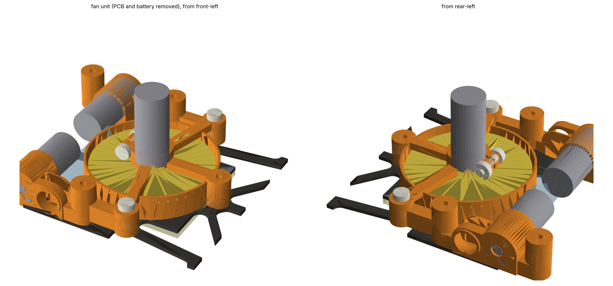

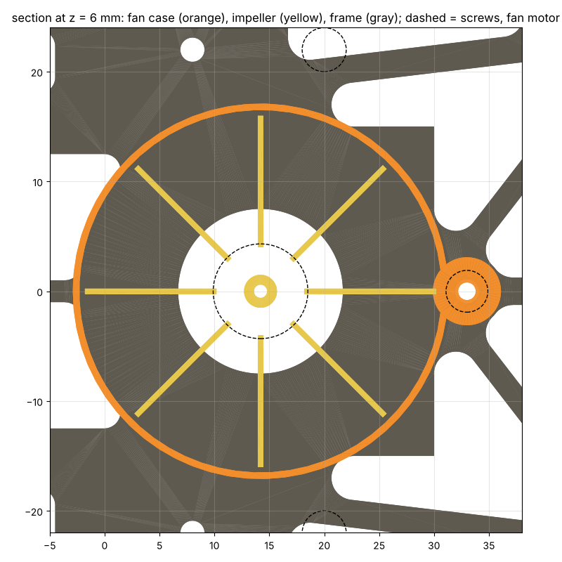

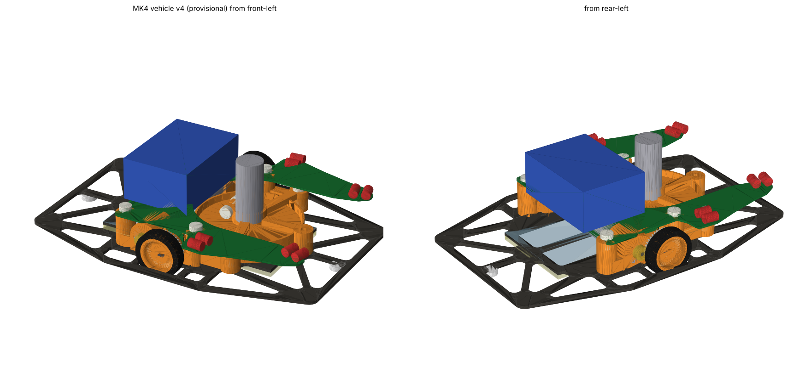

| 部分 | 形 |
|---|---|
| 輪(囲い) | 羽根(**φ32**、2026-10-20 に φ20 から)のまわりを輪で囲う。**内側φ33**(羽根とのすき間0.5mm。それまではφ24)、壁0.6mm、高さ z 3.2〜10.0。ポリカーボネートの上に載る。上は開いていて、空気は腕の間から上へ吐き出す |
| 腕 | **3本**、幅3mm × 厚さ2mm(z 8.8〜10.8)。真ん中のハブから、前の耳 (33, 0) と、左右の継ぎ目 **(20, ±22)** へ(2026-10-20。継ぎ目は (10, ±16) から輪の外へ動かした。その前は左右の柱 (22, ±18))。継ぎ目でモーターマウントの腕に載せ、上からナイロンのM2 L6で留める(マウントの腕にねじ山) |
| ハブ | モーター(NFP-D8620)を縦に、前の面を下にして載せる(z 9.4)。筒に割りを入れて、後ろ向きの耳を横からナイロンのM2で締める(交換できる) |
| フレームへの留め方 | 前の耳 (33, 0) だけ、下から鉄の低頭M2 L5(台にねじ山)。左右はモーターマウントの腕で支える(2026-10-20、絵の案。フレームの穴は5つになった) |
| 基板 | U字。モーターマウントの前後の耳の上の柱(z 13.6、4本)に載せ、ナイロンのM2 L4で留める(柱にねじ山)。**ファンの上は開けて**、吐き出した空気を上へ逃がす |
| 電池 | ファンの上の穴をふさがないように、**5mm後ろ**へ(中心 x −10) |
| 壁センサ | 基板に付ける(2026-10-19)。前の2本 (12, ±30) は外へ5°、横の2本 (41, ±24) は反対側の壁へ75°(左右で交差) |
| 基板の形 | **U字**(2026-10-19、絵の形): 後ろは電池の下(x −19から。電池は2mm後ろにはみ出す)、左右の腕で前の壁センサの耳 (12, ±30) と前の角 (41, ±24) へ。真ん中の前(ファンの上)は開ける(ファンの中心から**半径17.5mm**、前は \|y\| ≤ 17.5。電池の前の端は約4.5mm 穴の上にかかる)。41Tの上(\|x\| ≤ 8)は \|y\| ≤ 25。面積約2,520mm²、部品込み5.26g |

- **合計53.1g**(2026-10-20 に吸引ファンを羽根φ32・囲いφ33にし、ファンの真下をカーボンで埋めた(frame v6.5、マウント v6): フレーム +0.54g、ファン +0.67g(羽根と輪が大きくなった。羽根の重さは仮の形の見積もり)、マウント +0.23g、基板 −0.55g(ファンの上の穴が大きくなった)で +0.88g。その前は52.2g。同じ日にファンの台をマウントの腕で持つ形にした(台の左右の柱とねじ2本がなくなり −0.27g)。同じ日に印刷の部品にねじ山を切ってナットをやめた(+0.27g: マウントと台の肉が増え、ナットがなくなる)。2026-10-19 に壁センサを移し、基板をU字にし、滑り板をカグスベールにした。その前はフレーム v6.2 で52.2g。v6・v6.1も同じ、v5のときは53.1g、v4.7は53.2g、v3は53.9g)。v3から、基板に穴を開けた分(−0.42g)、ケースが軽くなった分(−0.23g)、フレームを細くした分(−0.93g)で軽くなった
- 重心は車軸の1.2mm後ろ。**慣性モーメントは258 g·cm²**(φ32のファンにして249から増えた。その前は基板をU字にして前の真ん中を開けたので、263から下がった)(フレーム v5のときは274、v3は265)。フレームの分が70.5 → 59.4 g·cm²に減った。電池を後ろへずらした分は増えている(電池の分 23 → 31 g·cm²)
- ぶつかる所はない(2026-10-20 にフレーム v6.5・マウント v6・φ32のファンで確かめ直した。羽根と輪のすき間は半径で0.5mm、羽根と塩ビのシートは0.6mm、羽根とフレームは0.8mm、輪の外側とマウントの前の柱は約2.6mm。フレーム v6.2・マウント v3 のとき: ファンの台のねじの頭とスカートのすき間は0.45 → 0.85mm)。**タイヤとフレームのすき間は0.26mm → 0.50mm**(タイヤの穴を14mmにしたので、角ではなくタイヤの横の面と穴の縁の間で決まる)。一番狭いのは内の軸受のつばとモーターの0.20mm(マウントの確認と同じ)

ファンのモーターと電池は変えない(2026-10-19)。50gに近づけるには(v4から、`docs/spec.md`の「50gに近づける案」): ファンの台のねじ3本をナイロンに −0.57g、マウントのねじ4本をチタンに −0.38g(アルミなら −0.57g)、印刷する部品をPA12に −0.69g、基板を0.4mmに −0.92g。ねじとPA12で**50.7g**(アルミなら50.5g)、基板も0.4mmにして**49.8g**(基板をU字にした後)。2026-10-20 にφ32のファンにしてからは、ねじとPA12で**51.6g**、基板も0.4mmにして**50.9g**

## v3(2026-10-19、ファンを囲うケースをフレームに留める)

吸引ファンのまわりを**渦巻きのケース(ボリュート)**で囲い、そのケースを**フレームにねじ3本で留める**ようにした。基板はケースの柱に載せて留めるだけで、ファンを持っていない(基板を外してもファンは外れない)。フレームはv4.6(ケース用の穴を3つ足した)。

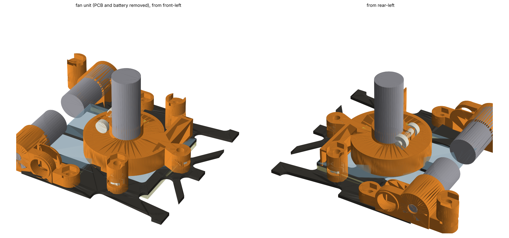

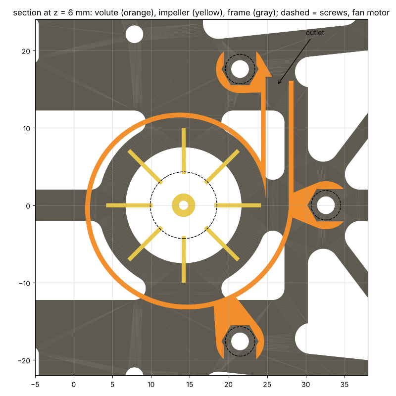

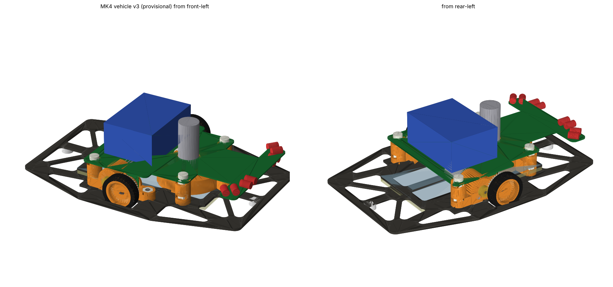

| 部分 | 形 |
|---|---|
| ケース | 樹脂(光造形)、壁0.6mm。羽根(φ20)のまわりを渦巻きで囲い、内側の半径を10.6mm(舌の所、羽根とのすき間0.6mm)から13.6mmまで広げて、左前(+y)の出口(幅3mm × 高さ5.6mm、x 24.8〜27.8、y 15.5)から吐き出す。下は開いていて、ポリカーボネートの上に載る(吸い込みはフレームの穴φ15から)。天井0.6mm(z 8.8〜9.4)。1.79g |
| フレームへの留め方 | **M2 × 3本**: (21.5, ±17.6)、(32.6, 0)。フレームの下から鉄の低頭L5、ナイロンのナットはケースの柱・耳に横から入れる。ねじの頭とスカートの間は0.45mm |
| モーター | NFP-D8620を縦に、前の面を下にして天井に載せる。ケースの筒(z 9.4〜13.2)に割りを入れ、**横からナイロンのM2 L8で締める**(接着しないので、モーターを交換できる) |
| 基板 | ケースの左右の柱 (21.5, ±17.6) の上(z 13.6)に載せ、ナイロンのM2 L4で留める。後ろはマウントの柱 |

- **合計53.9g**(v2は52.6g)。増えたのは、ケース(柱を含めて+0.43g)、ケースを留めるねじ3組とモーターを締めるねじ(+0.8g)、基板を柱まで広げた分(+0.06g)。重心は車軸の0.9mm前、慣性モーメント**265 g·cm²**
- ぶつかりはv2と同じ(一番狭いのはタイヤとフレームのタイヤの穴の角のすき間0.26mm)。羽根とポリカーボネートは0.6mm
- 吐き出しの向きは左前。床やスカートの方へ吹かないように、フレームの上を横へ流す

50gにするには(v3から): 電池を12.5g級に 51.9g、ファンのモーターをφ7級に 51.3g、両方で**49.3g**、さらにマウントをPA12に 48.9g

| ねじ(v3) | 場所 | 数 |
|---|---|---|
| 鉄 低頭 M2 L5 + ナイロンのナット | フレームの下から: マウントの耳4、ファンのケース3 | 7 |
| ナイロン なべ M2 L4 + ナイロンのナット | 基板を、マウントの柱2・ファンのケースの柱2へ | 4 |
| ナイロン M2 L8 + ナイロンのナット | ファンのモーターを締める(横) | 1 |

## v2(2026-10-19、ねじをM2に)

v1のねじ(M3)を**M2**にした(2026-10-19決定)。フレーム v4.5(穴φ2.3)、モーターマウント v2(`docs/mount.md`)。

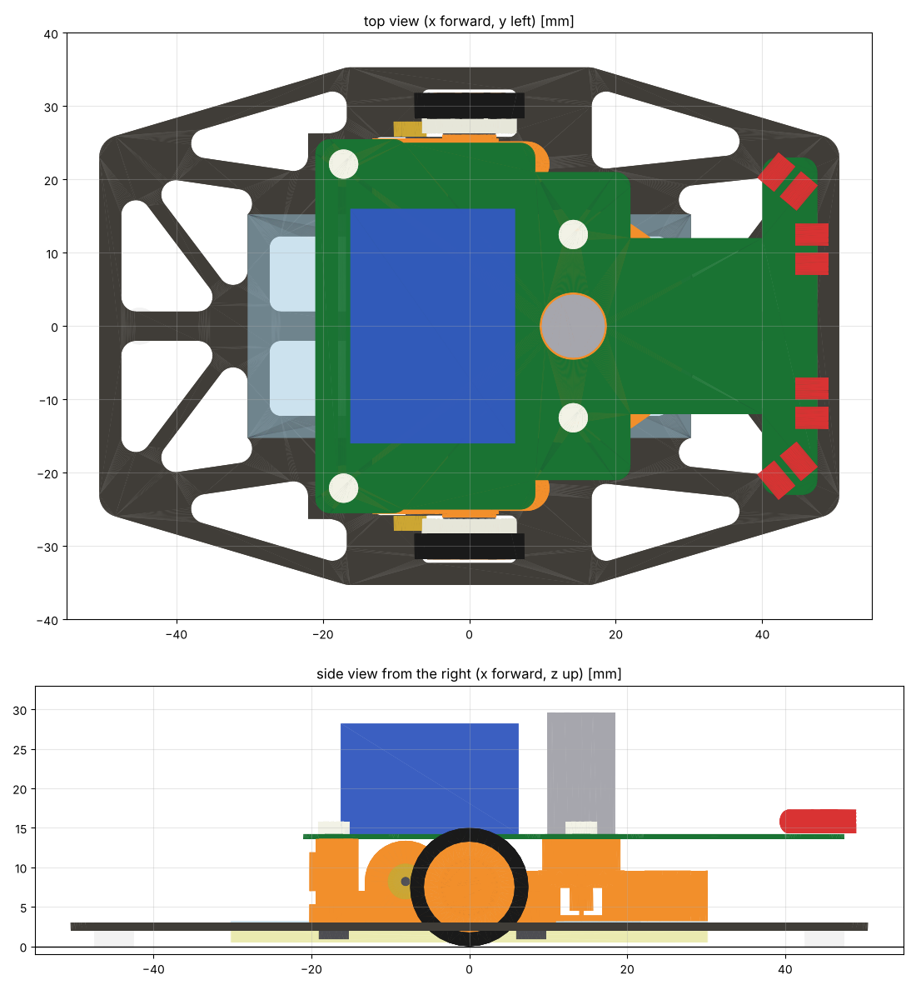

| ねじ | 場所 | 数 |
|---|---|---|
| 鉄 低頭小ねじ M2 L5(頭φ3.8 × 1.1)+ ナイロンのナット | フレームの下から、マウントの前・後ろの耳へ(後ろの耳のナットは横から入れる) | 4 |
| ナイロン なべ小ねじ M2 L4 + ナイロンのナット | 基板を、マウントの後ろの柱とファンのケースの柱へ(ナットは横から入れる) | 4 |

- **ねじ・ナット1.19g**(v1は3.04g)。**合計52.6g**(v1は54.3g)、重心は車軸の0.2mm前、慣性モーメント**252 g·cm²**(v1は264)
- フレームの下の頭の高さは約1.1mmで、床まで約0.9mm(M3の低頭は0.5mm)
- マウントの耳と柱、ファンのケースの柱はナットに合わせて細くした(半径3.1mm)。マウントは1個1.02g
- ぶつかりはv1と同じ(タイヤとフレームのタイヤの穴の角のすき間0.26mmが一番狭い)

| 部分 | v2 | 配分 | 慣性モーメント |
|---|---|---|---|
| フレーム・ポリカーボネート・スカート・滑り板 | 6.30g | 3g(マウントと合わせて) | 72 g·cm² |
| モーターマウント × 2 | 2.04g | (上と合わせて) | 13 |
| 走行用モーター × 2 | 10.60g | 10.6g | 35 |
| 車輪・タイヤ・41T・ピニオン・軸・軸受・磁石・エンコーダ | 3.96g | 5g | 30 |
| 吸引ファン(モーター5.3g・ケース・羽根) | 7.05g | 7g | 17 |
| 基板(0.6mm)+ 部品(仮2.5g) | 5.54g | 8g | 37 |
| 電池(仮) | 14.50g | 15g | 22 |
| 壁センサ × 4(仮) | 0.80g | (基板) | 18 |
| ねじ・ナット | 1.19g | 1.5g(配線と合わせて) | 8 |
| 配線(仮) | 0.60g | (上と合わせて) | 0 |
| **合計** | **52.6g** | **50g** | **252 g·cm²** |

50gにするには(v2から):

| 案 | 重さ | 慣性モーメント |
|---|---|---|
| 電池を12.5g級にする(3S 150mAh級) | 50.6g | 249 |
| ファンのモーターをφ7 × 16級(約2.7g)にする | 50.0g | 247 |
| 電池 + ファンのモーター | **48.0g** | 244 |
| さらにマウントをPA12に | 47.7g | 242 |

## v1(2026-10-18、軽くした案)

v0は59.5gで、50gを9.5g超えていた。形を変えずにできる所を軽くした。

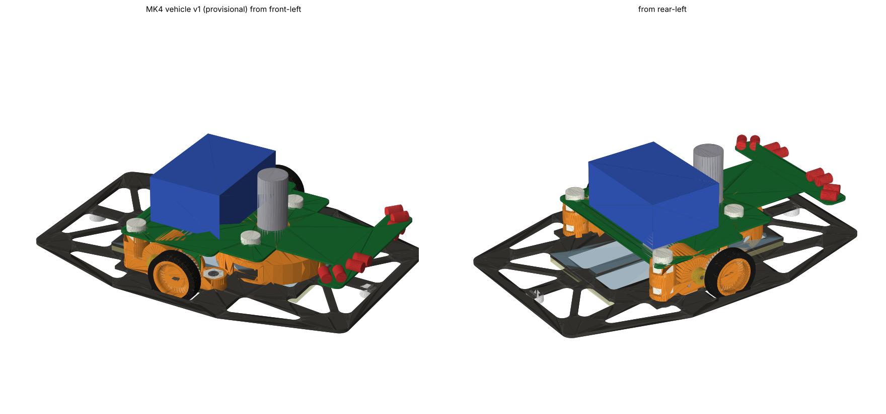

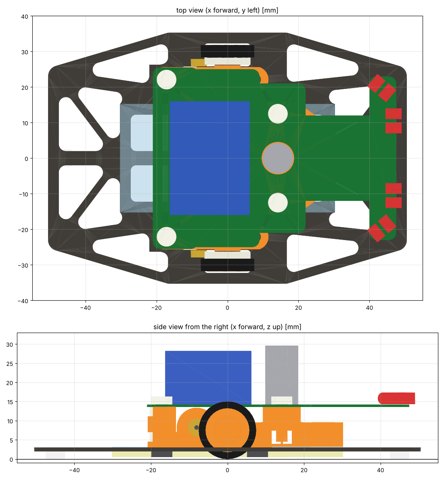

| 変えた所 | v0 | v1 | 重さ |
|---|---|---|---|
| ねじ | 鉄6組(L5 × 4、L15 × 2)、6.6g | **フレームの下から入れる4本だけ鉄の低頭L5**(頭がフレームの下に出るので、床まで0.5mm残すには頭の高さ1.5mm以下が要る)。**ナットと、基板を留めるねじはナイロン**。8組で3.0g。L15は要らなくなった | −3.6g |
| 基板 | 0.8mm | **0.6mm** | −1.0g |
| ファンのケース | 壁・天井0.8mm、押さえ(0.25g)+ ねじ2本 | 壁・天井0.6mm。**押さえはなくし、モーターはケースの筒に接着**。基板はケースの柱にナイロンのねじで留める | −0.5g |
| マウントの後ろの柱 | φ6、下から長いねじ1本で基板まで | φ7.4。耳と柱の上にナットを横から入れ、下(フレーム)と上(基板)を別のねじで留める | −0.07g |
| **合計** | **59.5g** | **54.3g** | **−5.2g** |

- 重心: 車軸から前に0.04mm、高さ12.6mm
- 慣性モーメント: 293 → **264 g·cm²**。V90 3300の入りの電流は約5.9A → **約5.4A**

| 部分 | v1 | 配分 | 慣性モーメント |
|---|---|---|---|
| フレーム・ポリカーボネート・スカート・滑り板 | 6.28g | 3g(マウントと合わせて) | 72 g·cm² |
| モーターマウント × 2 | 2.04g | (上と合わせて) | 13 |
| 走行用モーター × 2 | 10.60g | 10.6g | 35 |
| 車輪・タイヤ・41T・ピニオン・軸・軸受・磁石・エンコーダ | 3.96g | 5g | 30 |
| 吸引ファン(モーター5.3g・ケース・羽根) | 6.99g | 7g | 17 |
| 基板(0.6mm)+ 部品(仮2.5g) | 5.53g | 8g | 37 |
| 電池(仮) | 14.50g | 15g | 22 |
| 壁センサ × 4(仮) | 0.80g | (基板) | 18 |
| ねじ・ナット | 3.04g | 1.5g(配線と合わせて) | 20 |
| 配線(仮) | 0.60g | (上と合わせて) | 0 |
| **合計** | **54.3g** | **50g** | **264 g·cm²** |

### ねじ(v1、8組)

| 場所 | ねじ | 数 |
|---|---|---|
| マウントの前・後ろの耳(フレームの下から) | 鉄 低頭 M3 L5 + ナイロンのナット(前は耳の上、後ろは耳に横から入れる) | 4 |
| 基板 − マウントの後ろの柱 | ナイロン なべ M3 L5 + ナイロンのナット(柱の上に横から入れる) | 2 |
| 基板 − ファンのケースの柱 | ナイロン なべ M3 L5 + ナイロンのナット(柱に横から入れる) | 2 |

### 50gにするには(まだ決めていないもの)

形を変えずに減らせる所は、ほぼ使い切った。残りは部品の選び方で決まる。

| 案 | 重さ | 慣性モーメント | 気をつけること |
|---|---|---|---|
| 電池を12.5g級にする(3S 150mAh級) | 52.3g | 261 | 容量が2割減る(走れる時間)。最大の電流(C)を確かめる |
| ファンのモーターをφ7 × 16級(約2.7g)にする | 51.7g | 258 | 吸引に要る電力(4〜8Wの見積もり)を出せるか、試して確かめる |
| マウントをPA12(MJF)にする | 54.0g | 262 | 軸受の穴(φ6.0)の精度が落ちる |
| **電池 + ファンのモーター** | **49.7g** | 255 | |
| 全部 | 49.4g | 253 | |

効き目が小さかったもの:

- フレームの後ろを短くする(−50.5 → −44mm): 端の辺を作り直す分が要るので、−0.16gしか減らない
- ポリカーボネート0.2mmを、PET 0.1mmにする: −0.17g
- フレームの下の4本も樹脂のねじにする: 頭の高さ1.5mm以下の樹脂のねじ(低頭・トラス)が手に入れば −1.9g。ふつうのなべ(頭2mm前後)は床に当たる

### ねじを細くしたら(2026-10-18)

v1のねじ8組を、全部鉄の細いねじにした場合(`FAST=1 python3 vehicle.py 出力 v2`、`v2_m16`、`v2_m2`)。マウントの耳と柱、ファンのケースの柱も、ナットに合わせて細くした(ナットのまわりに0.8mm)。

| ねじ | ねじ・ナット | マウント × 2 | 合計 | 慣性モーメント | 穴 | フレームの下の頭の高さ |
|---|---|---|---|---|---|---|
| v1(M3: フレームの下は鉄の低頭、ほかはナイロン) | 3.04g | 2.04g | 54.3g | 264 g·cm² | φ3.2 | 1.5mm(床まで0.5mm) |
| M2(鉄、フレームの下は低頭) | 2.82g | 2.04g | 54.2g | 262 | φ2.3 | 1.2mm |
| M1.6(鉄、なべ) | 1.72g | 1.94g | 53.0g | 254 | φ1.8 | 1.3mm |
| **M1.4(鉄、なべ)** | **1.14g** | 1.91g | **52.4g** | **251** | φ1.7 | 0.9mm(床まで1.1mm) |

- 減るのはほとんどフレームの下の4本(M3の鉄の低頭 → M1.4)。基板を留める4本は、ナイロンのM3とM1.4の鉄でほぼ同じ重さ
- M1.4の強さ: 有効断面積0.98mm²、鉄(4.8)で約300N。走行や衝突でねじ1本にかかる力は数N〜十数Nなので足りる。締めすぎると切れるので、締める力は小さく(約0.03N·m)
- 穴φ1.7は、加工業者の最小の穴(φ1.5)より大きい

### ねじ1本にかかる力(M1.4の案、2026-10-19)

機体52.4g、吸引400g(全部を車輪で受けるとする)、タイヤと床の摩擦係数1.0、正面衝突は50N(`docs/frame.md`の荷重D。機体全体で約97Gの減速)として計算した。1N ≒ 102gf。

| ねじ | ふだん(吸引・加速・ターン) | 正面衝突(50N) |
|---|---|---|
| マウントの前の耳 × 2 | 引っぱり 約180gf(1.7N)、横 約110gf | 横 約400gf(3.9N)、引っぱり 約160gf |
| マウントの後ろの耳 × 2 | 引っぱり 約100gf(0.9N)、横 約110gf | 横 約400gf、引っぱり 約160gf |
| 基板 − マウントの柱 × 2 | ほぼ0(基板と電池は柱の上に載っている) | 横 約510gf(5.0N)、引っぱり 約160gf |
| 基板 − ファンのケース × 2 | ほぼ0 | 横 約510gf、引っぱり 約160gf |

- 車輪1つにかかる力は約226gf(機体の半分 + 吸引の半分)。マウントの耳は車軸から前に7.85mm、後ろに17.15mmなので、前の耳が約7割を受ける
- M1.4(鉄 4.8): 引っぱりは約300N(約31kgf)まで、横(せん断)は約210N(約21kgf)まで。一番大きい力(約5N)の40倍以上ある
- 締め付け(0.03N·m)でねじにかかる力は約110N(約11kgf)。走るときの力よりずっと大きいので、つなぎ目は開かない。横の力も、締め付けの摩擦(約20N)で受けられる

## v0(2026-10-18、最初の案。記録)

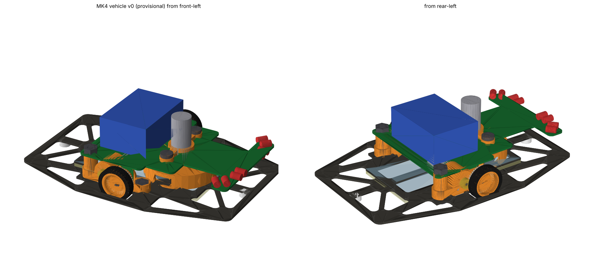

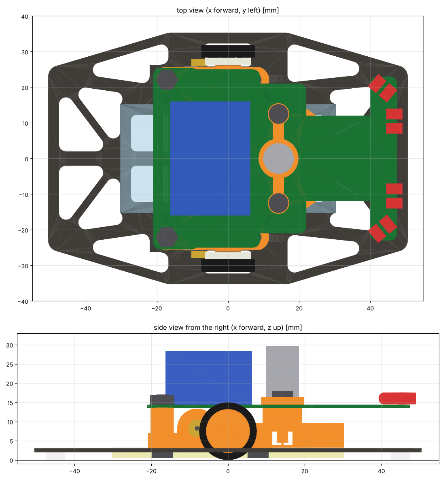

### 1. 高さの並び(床から)

| 部品 | 高さ [mm] |
|---|---|
| スカート(0.1mmのフィルム) | 0.5〜2.0 |
| 滑り板(カグスベール 約1.5mm、2026-10-19) | 0.5〜2.0 |
| フレーム(カーボン1mm) | 2.0〜3.0 |
| ポリカーボネート0.2mm | 3.0〜3.2 |
| 走行用モーター | 3.9〜12.5(中心8.21、車軸の後ろ) |
| 吸引ファンの羽根 / ケース | 3.8〜8.0 / 3.2〜13.6 |
| モーターマウント | 3.0〜13.36(後ろの柱は13.6まで) |
| **基板(v0 0.8mm、v1 0.6mm)** | **13.6〜14.4(v1は14.2)** |
| 壁センサ(発光・受光、φ3) | 中心16.0 |
| 電池 | 14.4〜28.4 |
| ファンのモーター | 9.6〜29.6(一番高い所) |

基板の下面は、マウントのモーターの筒の上から0.24mm、モーターの上から1.1mm。**基板の裏のモーターの上(x −12.4〜−3.7)には、背の低い部品(IMUのLSM6DSRは0.83mm)だけを置く。**

### 2. 配置と理由

| 部品 | 置き方 | 理由・メモ |
|---|---|---|
| 基板 | 0.8mmのFR4、z 13.6。外形は後ろ(x −21〜−9、\|y\| ≤ 25.5)、車輪の間(\|y\| ≤ 25.0)、ファンのまわり(\|y\| ≤ 21)、首(x 22〜40、\|y\| ≤ 12)、壁センサの板(x 40〜47.5、\|y\| ≤ 23)。面積約2,830mm²、板だけで4.2g + 部品2.5g(仮) | 41Tの一番上はz 13.95なので、車輪の間は\|y\| 25.8より内側。前の端はフレームの前の辺(50.5)より内側にして、フレームで守る |
| 基板の支え | 4点: マウントの後ろの柱 × 2、ファンのケースの柱 × 2 | |
| 電池 | 1S 180mAh(7.5 × 32 × 14mm、MK3のSTEPの寸法)× 3を立てて並べる(22.5 × 32 × 14mm)。基板の上、中心は車軸の5mm後ろ。14.5g(仮) | 「モーターは電池の下」(配置図)。バンドか面ファスナーで基板に留める |
| 吸引ファン | ケース(樹脂)φ32、中の部屋はφ30.4 × 高さ5.6mm、左右に吐き出しの窓。羽根φ20(まっすぐな羽根8枚、仮)。モーター(NFP-D8620)を縦に、前の面を下にしてケースの天井に載せる | ケースは**ポリカーボネートに接着**(吸引の空気がもれないように。フレームに穴が要らない) |
| ファンの押さえ | 基板の上からモーターを押さえ、M3 L5 × 2本でケースの柱(ナットは横から入れる)に留める | 基板の前もこれで留まる |
| モーターマウント | v1に、**後ろの耳の上に基板を受ける柱**(半径3.0mm、z 7.0〜13.6)を足した(`mount.py`の`pcb_post`)。1個1.06g(v1は0.83g) | 後ろのねじ1本で、フレーム・マウント・基板をまとめて留める |
| 壁センサ | 発光(OPV332)と受光(SFH 229 FA)を対にして、基板の前の板の上に寝かせる。FL・FR: (44.5, ±10.5)、前向き。L・R: (42, ±18)、外へ50°(仮) | 先は x 49以下で、フレームの前の辺(50.5)より内側。向きと高さは、壁を測って決める |
| 滑り板 | カグスベール(フリーサイズ、約1.5mm)をφ5に切って、背骨の下(x = ±45)に直接貼る。床とのすき間は約0.5mm(2026-10-19、`docs/spec.md`の「段差と滑り板」) | |
| スカート | 0.1mmのフィルムを、吸引する面の縁に沿って下に垂らす(床から0.5mm) | |

**フレームに足す穴はない**(マウントの4か所だけ)。ファンのケースと滑り板は接着、基板はマウントとファンのケースで留まる。(v0のとき。v3ではファンのケースを留める穴が3つ増え、注文用のファイルは`MK4FRAME46_T1.dxf`)

### 3. ねじ(6組)

| 場所 | ねじ | 数 | メモ |
|---|---|---|---|
| マウントの前の耳 | M3 L5 + ナット(耳の上の六角の穴) | 2 | v1と同じ |
| マウントの後ろの耳 | **M3 L15** + ナット(基板の上) | 2 | 下から、フレーム1 + 耳と柱10.6 + 基板0.8 + ナット2.4 = 14.8mm。**L15は手持ちにないので買う**(L5とL10では届かない) |
| ファンの押さえ | M3 L5 + ナット(ケースの柱に横から入れる) | 2 | 押さえ2 + 基板0.8、ナットに約2.2mmかかる |

### 4. 重さ・重心・慣性モーメント

| 部分 | 重さ | 配分(`docs/spec.md`) | 慣性モーメント |
|---|---|---|---|
| フレーム・ポリカーボネート・スカート・滑り板 | 6.28g | 3g(マウントと合わせて) | 72 g·cm² |
| モーターマウント × 2 | 2.11g | (上と合わせて) | 13 |
| 走行用モーター × 2 | 10.60g | 10.6g | 35 |
| 車輪・タイヤ・41T・ピニオン・軸・軸受・磁石・エンコーダ | 3.96g | 5g | 30 |
| 吸引ファン(モーター5.3g・ケース1.55g・羽根・押さえ) | 7.49g | 7g | 18 |
| 基板(0.8mm)+ 部品(仮2.5g) | 6.54g | 8g | 44 |
| 電池(仮) | 14.50g | 15g | 23 |
| 壁センサ × 4(仮0.1g × 8) | 0.80g | (基板) | 18 |
| ねじ・ナット(鉄) | 6.62g | 1.5g(配線と合わせて) | 40 |
| 配線(仮) | 0.60g | (上と合わせて) | 0 |
| **合計** | **59.5g** | **50g** | **293 g·cm²** |

- **重心**: 車軸から前に0.34mm、高さ12.7mm。前後はほぼ車軸の真上(滑り板にかかる力が前後で同じくらい)
- **50gを9.5g超える**。配分を大きく超えているのは、ねじ(+5.7g)と、フレーム・マウント(+5.4g)
- **慣性モーメントは293 g·cm²**(これまでの見積もりは220)。V90 3300の入りの電流は、ロータの分(約45)を足して比べると、約4.6A → **約5.9A**になる
- 樹脂の密度は1.2 g/cm³、ねじはモデルの体積から計算した(実物は少し軽く、6組で約5.5g)

もしもの計算:

| 変えるもの | 重さ | 慣性モーメント |
|---|---|---|
| ねじ・ナットをナイロン(1.14 g/cm³)にする | 53.8g(−5.7) | 259 g·cm² |
| 基板を0.6mmにする | 58.5g(−1.0) | 286 g·cm² |
| 両方 | **52.8g(−6.7)** | **252 g·cm²** |

一番効くのは**ねじをナイロンにすること**(MK3もナイロンのナットを使っていた)。それでも50gには2.8g足りないので、電池・基板の実物の重さで見直す。

### 5. すき間(1mm未満のもの)

| 組み合わせ | すき間 | メモ |
|---|---|---|
| 内の軸受のつば − モーター | 0.20mm | マウントの確認と同じ |
| **タイヤ − フレーム(タイヤの穴の角)** | **0.26mm** | 穴の角の丸み(R1)の所。タイヤの振れで当たるおそれがある。**フレーム v4.7でタイヤの穴を前後14mmにして、0.50mmになった** |
| 基板 − マウントのモーターの筒 | 0.24mm | |
| マウント − ピニオン / 41T | 0.30 / 0.36mm | マウントの確認と同じ |
| 羽根 − ポリカーボネート / フレーム | 0.6 / 0.8mm | |
| モーター − ポリカーボネート / フレーム | 0.71 / 0.91mm | |

ぶつかる所はない(`vehicle_v0_result.json`の`clearances`)。

### 6. 次に決めること

1. ~~ねじの材料~~(v1でフレームの下だけ鉄、ほかはナイロンにした)
2. ~~タイヤの穴を前後14mmに広げる~~(フレーム v4.7でした)
3. 電池の品番と重さ(仮に14.5g)。50gにするには12.5g級(v1の「50gにするには」)
4. 基板の外形と部品の配置(回路図のあとで)。裏のモーターの上は背の低い部品だけ
5. 吸引ファンのケースと羽根(仮の形)、ファンのモーター(φ7級で−2.6g)。作って吸引力と電流を測る
6. 壁センサの向きと高さ
