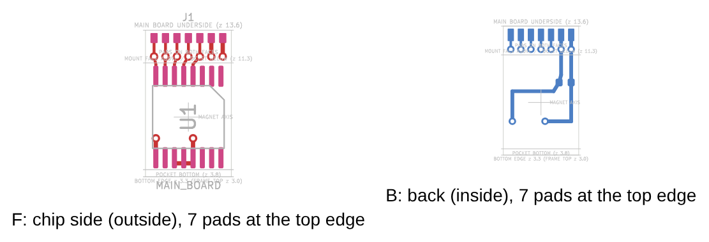

# KOGUMA-Mk4_Encoder(エンコーダの基板)

KiCad 9.0 で開く(`KOGUMA-Mk4_Encoder.kicad_pro`)。左右で同じ基板を2枚使う。

| ファイル | 中身 |
|---|---|
| `KOGUMA-Mk4_Encoder.kicad_sch` | 回路図: MT6835、C1(0.1µF)、J1(メイン基板へのパッド7つ) |
| `KOGUMA-Mk4_Encoder.kicad_pcb` | 基板 **v2**(2026-11-02): **6.0 × 10.3 × 0.6mm**、2層。MT6835 はチップの面(F)、C1 は裏の面(B)。パッド7つは表と裏の両方 |
| `KOGUMA-Mk4_Encoder.kicad_sym` | MT6835 の記号(KiCad の標準ライブラリにないので作った。ピンはデータシート Rev.1.3 の表) |
| `KOGUMA-Mk4_Encoder.pretty/ENC_Edge` | 基板の上の辺のパッド(表と裏)。`Dwgs.User` にメイン基板の裏、マウントのくぼみの上下、磁石の軸、下の辺を描いてある |
| `KOGUMA-Mk4_Encoder.pretty/TSSOP-16_4.4x5mm_P0.65mm_Pad0.35` | KiCad の TSSOP-16 のパッドの幅を 0.4 → 0.35mm にしたもの |
| `gen_encoder.py` | v2 を作るスクリプト。`ENC_Edge` とメイン基板の側の `ENC_Base_Butt` を書き、部品の位置・外形・配線を作り直す |
| `KOGUMA-Mk4_Encoder_v2.png` | 図(左がチップの面、右が裏の面。どちらもチップの面の側から見た向き) |

メイン基板の側のフットプリントは `../KOGUMA-Mk4/KOGUMA-Mk4.pretty/ENC_Base_Butt`(J5・J6、メイン基板の裏のパッドをエンコーダ基板の内側と外側に1列ずつ。穴はない)。番号は J1 と同じ。

## 置き方(モーターマウント v12、基板 v18、2026-11-02)

- **メイン基板(0.6mm、z 13.6〜14.2)の裏に、上の辺を突き当てて**はんだ付けする(ToraNeko.Mk3 と同じ付け方。メイン基板に穴は開けない)。机の上で治具を使って直角に付けてから、メイン基板ごとマウントに載せる
- 基板は z 3.3〜13.6(下の辺はフレームから 0.3mm 浮く)、x −3.0〜3.0(x 0 が車軸の真上)。チップの面(F)は外(磁石の側)を向き、**マウントの面(y ∓21.0)に当たる**
- MT6835 の中心は x 0、z 7.5(上の辺から 6.1mm)。IC と磁石のすき間は 0.5mm
- チップの面は、上の辺から 2.3mm(z 11.3〜13.6)がマウントの面に当たり、その下(z 3.8〜11.3)がマウントのくぼみ。チップの面の部品はくぼみの中だけ。上の 2.3mm にはパッド・ビア・線だけ
- **パッドは表と裏の両面に7つずつ**(同じ番号は同じネット)。両面でメイン基板にはんだ付けして固定する。表(チップの面)のはんだのフィレットは、マウント v12 の面の上の端の逃げ(z 12.6 より上、面から外へ 1.2mm)に入る
- 左右で同じ基板。右は 180° 回した向きで付ける(メイン基板の J6 を 180° 回して置く)

## J1(裏は上の辺から 0.2〜1.2mm、表は 0.2〜0.9mm。幅 0.5mm、0.8mm おき)

チップの面の側から見て左から:

| x | 番号 | ネット |
|---|---|---|
| −2.4 | 6 | ENC_CS |
| −1.6 | 5 | ENC_SCK |
| −0.8 | 4 | ENC_MOSI |
| 0.0 | 3 | ENC_MISO |
| 0.8 | 2 | ENC_CAL(CAL_EN) |
| 1.6 | 1 | +3V3 |
| 2.4 | 7 | GND |

表と裏で x は同じ(表も裏も、チップの面の側から見た向き)。

メイン基板の裏のパッド(`ENC_Base_Butt`)は、エンコーダ基板の内側の面から 0.3〜1.3mm(ToraNeko の TN_ENC_Base と同じ)と、外側の面から 0.3〜1.1mm(マウントの逃げの中)、幅 0.5mm。x はエンコーダ基板と逆向き(左のエンコーダ J5 では、3.3V が機体の後ろ側)。

## 回路と配線

- MT6835 は 180° 回し、SPI と CAL_EN のある辺(1〜8番)を上に向けた。5本はチップの面をまっすぐ上へ出し、上の辺から 1.85mm のビア(0.6/0.3mm)から表と裏の真上のパッドへ。3.3V・GND も同じ高さのビアで表のパッドへ
- VDD(9)・VSS(12)は IC の下の列のすぐ上のビアで裏に移り、C1(0.1µF、0402、裏の面)を通って上の 3.3V・GND のパッドへ。11・12・13 番(VSS・TEST・TEST_EN)はチップの面でつなぐ
- TEST(11)・TEST_EN(13)は GND(データシートの図5・6)。U・V・W・A・B・Z・OUT は使わない
- CAL_EN(4)は中に 250kΩ のプルダウンがあり、ふだんは L。校正のときにメイン基板の PC15 で H にする
- TVS(データシートの推奨)は場所がないので付けない

## 確かめたこと(2026-11-02、kicad-cli 9.0.9)

- ERC: エラー 0
- DRC: エラー・警告 0、つながっていないパッド 0、回路図と基板の食い違い 0。ルールは ToraNeko.Mk3 と同じ(クリアランス 0.2mm、ビア 0.6/0.3mm、穴と穴 0.25mm、縁まで 0.2mm)
- メイン基板(J5・J6 を `ENC_Base_Butt` に)も DRC で回路図との食い違い 0
- v1(2026-10-29、5.3 × 12.3mm、メイン基板の穴に通して上ではんだ付け)は git の履歴にある

## まだ決めていないこと

- 面付け(1枚が小さいので、何枚かつないで注文する。ToraNeko.Mk3 の `panel/` を参考に)
- 直角の出し方(はんだ付けのときの治具。ToraNeko の `mechanical/jigs/encoder_solder_jig/` を 6.0 × 10.3mm に合わせる)
