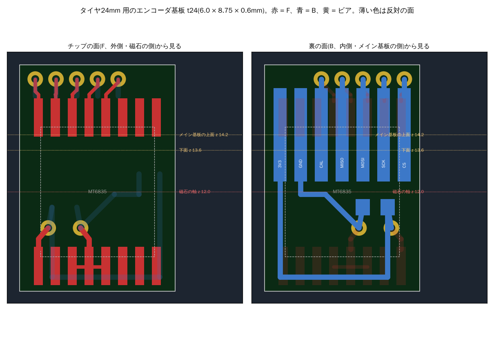

# KOGUMA-Mk4_Encoder_t24(タイヤ24mm 用のエンコーダの基板、2026-11-21)

ブランチ `claude/trusting-dirac-1tdt54`(タイヤを MK3 と同じ 24mm にした機体。`docs/spec.md` の「方針の変更(2026-11-21)」)。KiCad 9.0 で開く(`KOGUMA-Mk4_Encoder_t24.kicad_pro`)。左右で同じ基板を2枚使う。

**回路は main の `KOGUMA-Mk4_Encoder` と同じ**(MT6835、C1 0.1µF、J1 のパッド7つ。回路図は J1 のフットプリントだけを `ENC_Edge_T24` にした)。基板は `../make_encoder_t24.py` で、main のプロジェクトを写してから作り直す(`/usr/bin/python3.12 hardware/kicad/make_encoder_t24.py`。Ubuntu 24.04 の KiCad 9 の Python は 3.12 向けで、3.13 では落ちる。作り直すたびに部品とパッドの uuid は変わる)。絵は `python3 hardware/kicad/draw_encoder_t24.py`。

## 置き方

| 項目 | 値 |
|---|---|
| 基板 | **6.0 × 8.75 × 0.6mm**、2層。機体では x −3.0〜3.0、**z 8.15〜16.9**、右は y −17.5〜−16.9 |
| MT6835 | チップの面(F、外側)。中心は x 0、**z 12.0(車軸)**。磁石とのすき間 0.5mm(main と同じ) |
| メイン基板との関係 | メイン基板(z 13.6〜14.2)の切り欠き(x ±4.5、y ±16.7 より外)の縁に沿って、縁から 0.2mm 外に立てる。基板の上に 2.7mm 出る |
| はんだ付け | **J1 のパッド7つは裏の面(B、内側 = メイン基板の側)**、**z 12.4〜16.0**(メイン基板の上に 1.8mm、下に 1.2mm 出る)。メイン基板の**上の面のパッドと裏の面のパッド**(`ENC_Base_Edge_T24`)の**どちらとも**直角にはんだ付けできる(片方だけでも、両方でも。2026-11-25、ユーザー)。直角は治具とマウントの面で保つ |
| 左右 | **左右とも同じ基板**。右はこのまま、左は z 軸のまわりに 180° 回して付ける。上・裏のどちらではんだ付けしても同じ基板 |

## J1(裏の面、チップの面から見て左から)

| 基板の真ん中から | −2.4 | −1.6 | −0.8 | 0 | +0.8 | +1.6 | +2.4 |
|---|---|---|---|---|---|---|---|
| ピン | 6 | 5 | 4 | 3 | 2 | 7 | 1 |
| ネット | ENC_CS | ENC_SCK | ENC_MOSI | ENC_MISO | ENC_CAL | GND | +3V3 |

パッドは 0.5 × 3.6mm(2026-11-25 に 1.8mm から。メイン基板の裏の面のはんだのため下へ延ばした)、ピッチ 0.8mm(0.85mm では外のビアが基板の縁から 0.15mm になったため)。

**メイン基板の裏でのはんだ付け**: エンコーダ基板の内側(メイン基板の下、z 12.4〜13.6)は、x ±2.9 の幅ではマウントがない(マウントは基板の左右の端の横、|x| 3.0 より外だけ。`mechanical/motor_mount/check_t24.py` の形で確かめた)。こてはメイン基板の下の、内側から入れる

## 配線

- 信号5本: チップの面で、上の段のピン(4〜8番)の端から 45° で斜めに上へ出し、パッドの真上(上の縁から 0.55mm)のビアで裏へ移り、パッドへ
- 3V3・GND: 下の段のピン(9番、11〜13番)からビアで裏へ移り、C1(0402、裏)へ。3V3 は下の縁と右の縁に沿って、GND は 45° で斜めに上がり、ほかのパッドの下の端の下(0.35mm あけて)を横に通ってパッドへ
- 線は信号 0.2mm、電源 0.3mm。ビア 0.6 / 0.3mm

## 確かめたこと(2026-11-21、kicad-cli 9.0.9)

- DRC: エラー 0、つながっていないパッド 0、回路図と基板の食い違い 0(`--schematic-parity`)。警告は、確かめた環境に KiCad の標準ライブラリ(`Capacitor_SMD`)が登録されていないことによるものだけ(main の基板も同じ)。ルールは main と同じ(クリアランス 0.2mm、ビア 0.6/0.3mm、縁まで 0.2mm)
- ERC: main と同じ 10件(標準ライブラリが登録されていないことによる警告だけ)
- 機体での置き場所は `mechanical/motor_mount/check_t24.py`・`mechanical/vehicle/t24_mass.py` で確かめた

## メイン基板の側

`../KOGUMA-Mk4/KOGUMA-Mk4.pretty/ENC_Base_Edge_T24`: 切り欠きの縁(local Y = 0)の内側、**上の面と裏の面の両方**に、同じ位置にパッド7つずつ(0.5 × 0.8mm、Y 0.2〜1.0、ピッチ 0.8。裏は 2026-11-25 に足した)。上と裏の同じ番号のパッドは同じピンで、上と裏をつなぐビアは配線のときに置く。回転 0 = チップの面(縁の外)が画面の上 = 左のエンコーダ(J5、縁は機体の y +16.9)。右(J6、y −16.9)は 180°。

## まだ決めていないこと

- 面付け、はんだ付けの治具(main と同じ)
- はんだ付けのパッドの大きさ(メイン基板の側 0.5 × 0.8mm、上・裏とも)は、実物で付けてみて直す
