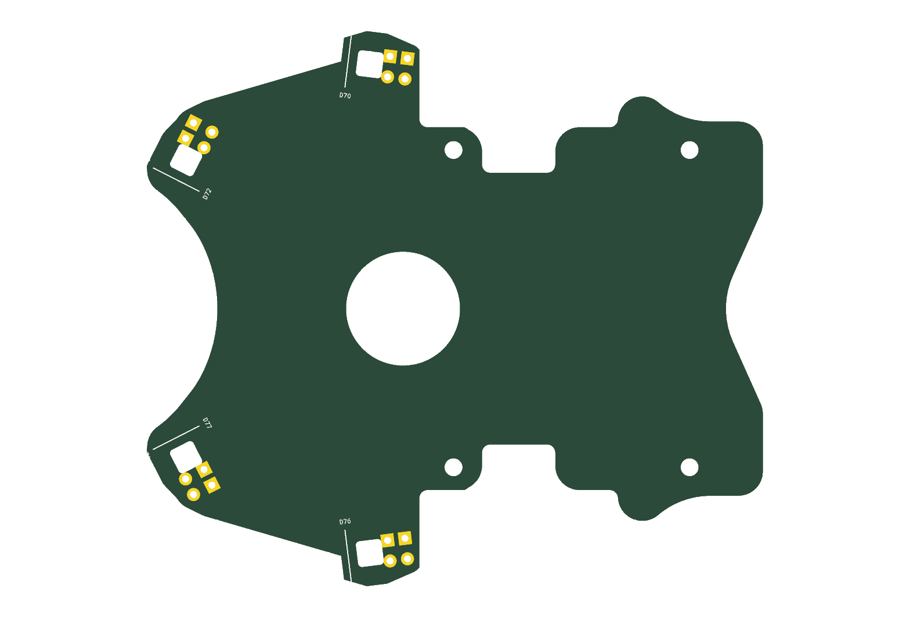

# KOGUMA-Mk4_t24(タイヤ24mm 用のメイン基板、2026-11-21。部品の仮の配置 2026-11-23)

ブランチ `claude/trusting-dirac-1tdt54`(タイヤを MK3 と同じ 24mm にした機体。`docs/spec.md` の「方針の変更(2026-11-21)」)。KiCad 9.0 で開く(`KOGUMA-Mk4_t24.kicad_pro`)。

**回路は `KOGUMA-Mk4` と同じ**(2026-11-23 にブランチ `claude/magical-einstein-bdr00d`(PR #21)の回路図を取り込んだ: PGND と GND を NT1 で1点、+3V3A、品番、回路図のレビューとノイズの評価の対策(`docs/review_2026-11-06.md`)、SW1・SW2・BZ1・U70〜U73 のフットプリント、前の LED D98、BLE モジュール HY0020(U5、2026-11-23)、モーターの電流を 5mΩ + INA241A3 で測る形(U6・U7、2026-11-23。MP6551 の CM はやめた))。`../make_main_t24.py` が main の回路図を写して作る(`/usr/bin/python3.12 hardware/kicad/make_main_t24.py`。Ubuntu 24.04 の KiCad 9 の Python は 3.12 向け。標準のフットプリントのパッケージ `kicad-footprints` が要る)。回路図で変えたのは次のとおり:

- J5・J6(エンコーダの基板とのつなぎ)のフットプリント: `ENC_Base_Butt`(タイヤ15mm、エンコーダ基板 v2 を裏に突き当てる)→ **`ENC_Base_Edge_T24`**(`../KOGUMA-Mk4_Encoder_t24` を切り欠きの縁に沿って立て、上の面ではんだ付け)
- UI の LED は回路図のまま **1608**(2026-11-23、ユーザーの決定。それまでは 0402 に替えていた)。1.9mm おきの並びに、長い方を x(前後)に向けて置く(重ならない)
- J2・J3(モーターの線)のフットプリント: 穴のパッド → **`MotorWire_SMD_1x02_P3.2mm`**(裏の面の SMD のパッド2つ、1.6 × 2.6mm、間 3.2mm。2026-11-23、`make_main_t24.py` が `../KOGUMA-Mk4/KOGUMA-Mk4.pretty/` に書く)。下の「部品の仮の配置」
- **0603 のコンデンサ・抵抗を 1005 に**(2026-11-23、ユーザーの決定。`make_main_t24.py` の `to_1005`、コンデンサ 41個・抵抗 46個)。**3.3V にかかる 10µF・4.7µF(C50・C51・C62・C78・C79・C80・C85・C91)だけ 0603 のまま**(1005 は耐圧 6.3・10V の品しかなく、3.3V で実際の容量が大きく減る)。0805・1206・2512 と、フェライトビーズ(0603)は替えない。
  - 1005 の 10µF は C54・C65(VCORE、約 1.2V)だけ。耐圧 6.3V の品を選ぶ。抵抗はどれも数 mW 以下で、1005 の 1/16W に足りる
  - 今の回路で 0603 のままと比べて: 上の面の部品 1,160 → 935mm²、電池の下の使用 379 → 266 / 720mm²、信号の線の長さの目安 1,596 → 1,490mm(`T24_SMALL=0` を付けて作り直すと 0603 のまま)
- 設計ルール `KOGUMA-Mk4_t24.kicad_dru` は `../KOGUMA-Mk4/KOGUMA-Mk4.kicad_dru` を写す(細かいピッチの IC のパッドの間だけ 0.14mm)

記号・フットプリントのライブラリは `../KOGUMA-Mk4/` のものを使う(`fp-lib-table`・`sym-lib-table`)。**main の回路図を直したら、スクリプトを動かし直して写す**(この中の回路図は直接直さない)。




## 置いたもの(機構で位置が決まるもの)

| 部品 | 位置(機体の座標、x 前・y 左) | もと |
|---|---|---|
| 外形 | **t24v3**(3,269mm²、厚さ 0.6mm。2026-11-22 に実装する面積のため広げ(B 案)、後ろを V 字にして角を丸めた(案1)) | `mechanical/vehicle/pcb_t24.py`、`mechanical/pcb/pcb_outline_t24v3.dxf` |
| H1〜H4(M2 の柱、基板だけの部品) | (8, ±19.5)・(−21, ±19.5) | マウント t24v2 |
| J5(左)・J6(右) | 切り欠きの縁 (0, ±16.7)、J5 は回転 0、J6 は 180° | エンコーダ基板 t24 |
| D70〜D77(壁センサのホルダ、**裏**) | FL・FR (20.8, ±30.35) 外へ 7°、R・L (42, ±16) | `pcb_shape.SENS`(FL・FR は t24 で前へ動かした)。足の穴は `pcb_shape.pads()` とずれ 0.000mm |
| D90〜D96(UI の LED、1608) | `pcb_shape.LEDS` の順(左の角2つ、V 字の先3つ、右の角2つ)。長い方を x に。**割り当ては ToraNeko.Mk3 と同じ**(2026-11-23): 左の角 = No. の 8・4(D96・D95)、V 字の先 = モードの 4・2・1(D92・D91・D90)、右の角 = No. の 2・1(D94・D93) | ToraNeko.Mk3 と同じ並び・同じ割り当て(`docs/software.md` の 6.2) |
| D98(前の LED、1608) | `pcb_shape.LED_FRONT` (35.2, 0)、前の円弧の切り欠きの真ん中 | PB3 |
| LED の抵抗 R90〜R96・R99、エンコーダのパスコン C86・C87 | LED のパッド・J5・J6 の 3.3V のパッドのそば(`../KOGUMA-Mk4/place_caps.py t24`、LED から 1.7mm、J5・J6 から 1.5mm) | |

## 部品の仮の配置(2026-11-23、配線はまだ)

ほかの部品は **IC ごとのグループ**(IC のまわりにコンデンサ・抵抗をノイズと線の長さを考えて置いたもの、20個、`../KOGUMA-Mk4/place_caps.py t24`。置き方は `../KOGUMA-Mk4/README.md` の「IC ごとのグループ」)を**塊のまま**基板に置き、残りを1つずつ置いた(`../place_main_t24.py`)。**138個(上の面 133、裏の面 5)**(2026-11-23: C65・R24・R25・R34・R35、有線と無線をぶつけない D99〜D101・R101 を足した)。結果は `place.json`(機体の座標と向き)。


- **要の部品・グループは目当ての位置を手で決め、その近くで空いている所を探す**(`place_main_t24.py` の `FIXED`。値 = 4 × 目当てからの距離 + 0.25 × つなぐ先までの長さ。向きは 90° おきに選ぶ):

| 部品・グループ | 位置 | 理由 |
|---|---|---|
| J2・J3 モーターの線(**裏の SMD のパッド**) | (−5.1, ±12.0) | モーターの端子 (−12, ±1.5) から線を前へ出し、モーターとファンの囲いの間(裏 x −6.9〜−3.3)ではんだ付けする。穴のパッドだと上の面の真ん中をふさぎ、MCU のグループ(約 25 × 25mm)が入らなかった |
| U4 MCU のグループ(高さ 1.0mm まで) | 電池の下の真ん中(探す半径 1mm。大きくすると左へずれて U6 か U2 のグループが入らない) | 真下はモーター。ADC の RC も ADC のピンのそばに入っている |
| U2・U3 モータードライバのグループ | (−9, ±12.5) 付近、電池の下 | 線のパッドの近く |
| U6・U7 モーターの電流の INA241A3 のグループ(5mΩ のシャントを含む。INA241A3IDDFR は高さ 1.1mm 以下) | 電池の縁の左右(目当て (−9.5, ±19.5)。シャントは電池の下にかかる) | ドライバの OUT1 とモーターの線の間。**電池の下にも置ける**(2026-11-23 に高さを 1.45 → 1.1mm に直した)。目当てを電池の下に変えて6通り試したが、OUT1 → シャント → 線の長さは今の所(合計 22.5mm)がいちばん短かった |
| U76 IMU のグループ | 回転の中心の近く | |
| U1 3.3V の DC-DC のグループ(出力の 22µF は 1.25mm) | 電池の前の右 | 電池の下に置けない |
| Q40 ファンのグループ(線のパッド J4 も) | ファンのモーターの穴の左 | |
| U74・U75 受光のアンプのグループ | 前の左右 | U74 は FL と R、U75 は FR と L |
| J1 電池の線 | (−19.3, 11.0) | 電池の後ろの左 |
| C4 100µF(3.1mm。2026-11-23 に 47µF から)、Q1 電源スイッチの MOSFET(1.75mm) | **裏の面**の後ろ(モーターの後ろ、x < −17.2)。Q1 は電池の線 J1 のそば | 高いので電池の下に置けず、上の面の後ろは UI の LED とその抵抗で埋まっている。**Q1 のグループ(13.6 × 20.9mm)は入らないので、ばらして置いた**(C1・C10・R1・R2 は J1 のそば、22µF の C2・C3 と TVS の D1 は DC-DC のそば) |
| SW1 電源スイッチ | 前の円弧の縁、前の LED D98 の左、**つまみを前へ** | 後ろの縁は UI の LED、横の縁はタイヤ・スパー(つまみが当たる)、後ろの羽の縁は柱があって入らない |
| U5 BLE モジュール HY0020 のグループ(3.5 × 10mm) | 前の右 | **電池の下に置かない**(アンテナがシールドの上の面)。縁の近くで、モーター・ファンの線から離す。MCU の UART・NRST まで約 62mm |
| BZ1 ブザーのグループ | 前の真ん中(ファンの穴の前) | 音の穴は前 |
| J7 デバッグの端子・SW2 スイッチのグループ | 後ろの右の羽 | |
| TP4 BOOT0 のテストパッド(2026-11-23) | (−22, −11)、J7 のそば | 復旧のとき、電池から電源を入れたまま J7 の1番(3.3V)とつなぐので、電池の下に置かない。R50(10kΩ のプルダウン)は MCU のそば |

- **ほかのグループと部品は、つながる先の近くへ1つずつ置く**(グループから、つながりの多いものから)。値は「各パッドから、同じネットのもう置いた部品のパッドまでの距離の和」(GND・PGND は重み 0.12。電源のネット(+3V3・+3V3A・VBAT・BAT+)は同じシートの IC・コネクタだけを相手にする。裏の面は 2.5mm 分の損)
- 置いてよい所: コートヤードが外形の中(コートヤードのない NT1 はパッドの箱 + 0.25mm)。**上の面の電池の下(x −16.25〜6.25、y ±16)は高さ 1.2mm 以下の部品だけ**。**裏の面はモーター(x −17.2〜−6.9)・マウント・ファンの囲い(半径 17.5)・壁センサのホルダの所に置かない**。両方の面で、ファンのモーターの穴・柱・エンコーダのパッド・壁センサの足の穴をよける。SW1 のつまみだけは外形の外に出す
- **C22・C32(モータードライバの VBAT の 10µF 25V、0805)は厚さ 0.85mm の品にする**(村田 GRM219 系など。電池の下のドライバのすぐ横に置くため)。注文する前に品番を確かめる
- SW1 から Q1 のゲートまでの線は約 49mm になる(電流はほとんど流れない)。TVS の D1 は電池の入り口(J1)から離れている(配線のときに見直す)

**部品表**: `docs/bom_t24.md`(品番・LCSC の番号・高さ)と、JLCPCB に出す `bom_t24.csv`(`/usr/bin/python3.12 hardware/kicad/bom_t24.py` で作る。2026-11-23)。層は **2層・0.6mm**(JLCPCB は 4層を 0.6mm で作らない)、配線はユーザーがする。JLC で部品を載せてもらうときの位置は `cpl_t24.csv`(同じスクリプト)。

**設計ルール(JLCPCB の2層、2026-11-23)**: 最小は線・すき間 0.127mm、ビア 穴 0.3・径 0.5mm、穴のまわりの銅 0.13mm。細かいピッチの IC のパッドの間は `.kicad_dru` で 0.14mm。**ネットクラス**(配線の初期値): Default 0.15mm(すき間 0.15)、Power(VBAT・BAT+・PGND)0.6mm、Motor(MP6551 の出力・シャント・モーターの線)0.5mm、Fan 0.4mm、Supply(+3V3・+3V3A・VCORE・GND)0.3mm。ビアは 0.6/0.3mm(Power・Motor は 0.8/0.4mm)。

作り直すとき(リポジトリの一番上で。KiCad の Python 3.12 に shapely・numpy・scipy・matplotlib が要る):

```
/usr/bin/python3.12 hardware/kicad/make_main_t24.py
(cd hardware/kicad/KOGUMA-Mk4 && /usr/bin/python3.12 place_caps.py t24)
/usr/bin/python3.12 hardware/kicad/place_main_t24.py
```

**電池の下(上の面、x −16.25〜6.25、|y| ≤ 16。Cmts.User の四角)には高さ 1.2mm までの部品だけ置く**(電池は 1.5mm のスペーサーで浮かせる。2026-11-23、`docs/spec.md` の「電池の下にも部品を置く」)。座標は KiCad の X = 150 + x、Y = 100 − y(画面の上が機体の左、右が前)。**層の数は決めていない**(2層のまま。電池の下に MCU・ドライバ・IMU が集まっているので4層が楽。0.6mm の4層が作れるか、注文先で確かめる)。

## DRC(2026-11-23、部品を置いたあと、kicad-cli 9.0.9、`--schematic-parity`)

| 項目 | 数 | 中身 |
|---|---|---|
| 回路図との食い違い | **0** | 165 部品すべて基板に入っている |
| 基板の上の銅と縁 | **0** | 壁センサの受光の足のパッドとほぞの穴の重なりは、ホルダ v5(ほぞを 0.4mm 前へ、`pcb_shape.PEG_BACK`)で直った |
| 部品の外形(コートヤード)の重なり・間隔 | **0** | 細かいピッチの IC のパッドの間は `.kicad_dru` で 0.14mm |
| シルク(警告) | 1 | U72 の1番の印がソルダーマスクの穴で少し欠ける(問題なし)。**部品の番号はシルクに出さない**(2026-11-23、ユーザー。JLC が載せるので要らない。KiCad の Fab の層には出る)。ほかの警告(約150)は、確かめた環境に標準ライブラリが登録されていないことによるもの |
| つながっていない | 410 | 配線がまだなので |

ERC: エラー 0。

## これから

- 配線(ユーザー。2層・0.6mm。配置は配線しながら直す)
- 電源スイッチ SW1 を前の縁に置いてよいか(UI の LED の割り当ては 2026-11-23 に ToraNeko と同じに決めた)
- C22・C32 の薄い品番
