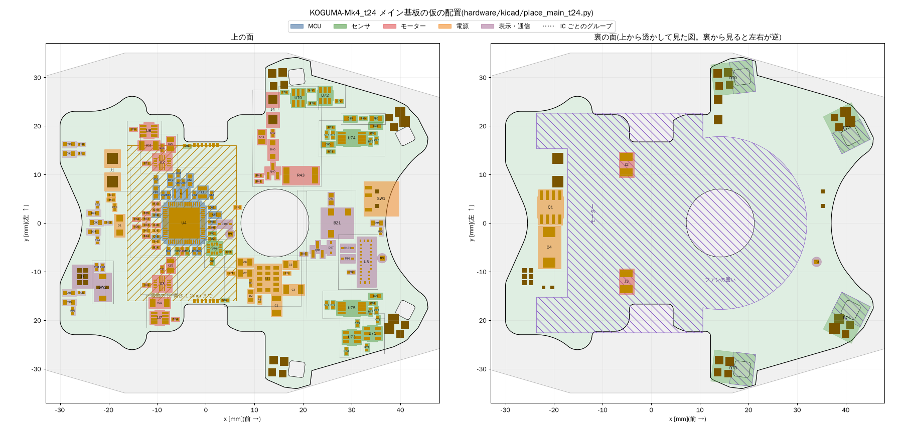
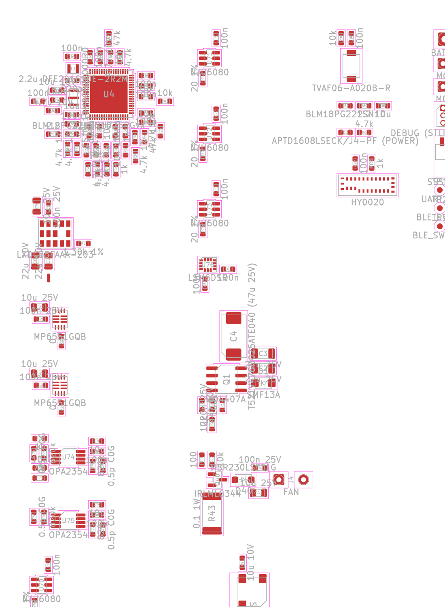
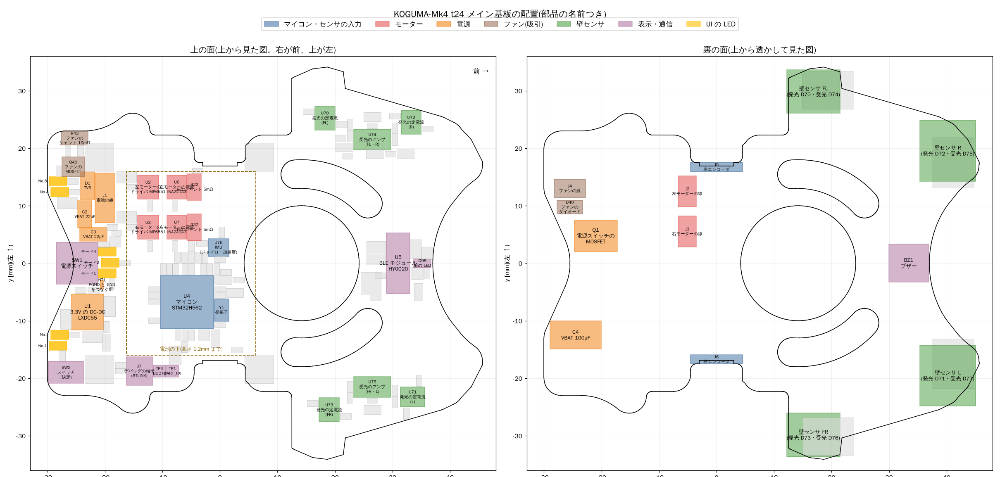

# KOGUMA-Mk4_t24(タイヤ24mm 用のメイン基板、2026-11-21。部品の仮の配置 2026-11-23)

ブランチ `claude/trusting-dirac-1tdt54`(タイヤを MK3 と同じ 24mm にした機体。`docs/spec.md` の「方針の変更(2026-11-21)」)。KiCad 9.0 で開く(`KOGUMA-Mk4_t24.kicad_pro`)。

**回路は `KOGUMA-Mk4` と同じ**(2026-11-23 にブランチ `claude/magical-einstein-bdr00d`(PR #21)の回路図を取り込んだ: PGND と GND を NT1 で1点、+3V3A、品番、回路図のレビューとノイズの評価の対策(`docs/review_2026-11-06.md`)、SW1・SW2・BZ1・U70〜U73 のフットプリント、前の LED D98、BLE モジュール HY0020(U5、2026-11-23)、モーターの電流を 5mΩ + INA241A3 で測る形(U6・U7、2026-11-23。MP6551 の CM はやめた))。`../make_main_t24.py` が main の回路図を写して作る(`/usr/bin/python3.12 hardware/kicad/make_main_t24.py`。Ubuntu 24.04 の KiCad 9 の Python は 3.12 向け。標準のフットプリントのパッケージ `kicad-footprints` が要る)。回路図で変えたのは次のとおり:

- J5・J6(エンコーダの基板とのつなぎ)のフットプリント: `ENC_Base_Butt`(タイヤ15mm、エンコーダ基板 v2 を裏に突き当てる)→ **`ENC_Base_Edge_T24`**(`../KOGUMA-Mk4_Encoder_t24` を切り欠きの縁に沿って立て、上の面・裏の面のどちらか(または両方)ではんだ付け。パッドは上と裏の両方にある、2026-11-25)
- UI の LED は回路図のまま **1608**(2026-11-23、ユーザーの決定。それまでは 0402 に替えていた)。1.9mm おきの並びに、長い方を x(前後)に向けて置く(重ならない)
- J2・J3(モーターの線)のフットプリント: 穴のパッド → **`MotorWire_SMD_1x02_P3.2mm`**(裏の面の SMD のパッド2つ、1.6 × 2.6mm、間 3.2mm。2026-11-23、`make_main_t24.py` が `../KOGUMA-Mk4/KOGUMA-Mk4.pretty/` に書く)。下の「部品の仮の配置」
- **0603 のコンデンサ・抵抗を 1005 に**(2026-11-23、ユーザーの決定。`make_main_t24.py` の `to_1005`、コンデンサ 41個・抵抗 46個)。**3.3V にかかる 10µF・4.7µF(C50・C51・C62・C78・C79・C80・C85・C91)だけ 0603 のまま**(1005 は耐圧 6.3・10V の品しかなく、3.3V で実際の容量が大きく減る)。0805・1206・2512 と、フェライトビーズ(0603)は替えない。
  - 1005 の 10µF は C54・C65(VCORE、約 1.2V)だけ。耐圧 6.3V の品を選ぶ。抵抗はどれも数 mW 以下で、1005 の 1/16W に足りる
  - 今の回路で 0603 のままと比べて: 上の面の部品 1,160 → 935mm²、電池の下の使用 379 → 266 / 720mm²、信号の線の長さの目安 1,596 → 1,490mm(`T24_SMALL=0` を付けて作り直すと 0603 のまま)
- 設計ルール `KOGUMA-Mk4_t24.kicad_dru` は `../KOGUMA-Mk4/KOGUMA-Mk4.kicad_dru` を写す(細かいピッチの IC のパッドの間だけ 0.14mm)

記号・フットプリントのライブラリは `../KOGUMA-Mk4/` のものを使う(`fp-lib-table`・`sym-lib-table`)。**main の回路図を直したら、スクリプトを動かし直して写す**(この中の回路図は直接直さない)。




## 置いたもの(機構で位置が決まるもの)

| 部品 | 位置(機体の座標、x 前・y 左) | もと |
|---|---|---|
| 外形 | **t24v3**(3,269mm²、厚さ 0.6mm。2026-11-22 に実装する面積のため広げ(B 案)、後ろを V 字にして角を丸めた(案1)) | `mechanical/vehicle/pcb_t24.py`、`mechanical/pcb/pcb_outline_t24v3.dxf` |
| H1〜H4(M2 の柱、基板だけの部品) | (8, ±19.5)・(−21, ±19.5) | マウント t24v2 |
| J5(左)・J6(右) | 切り欠きの縁 (0, ±16.9)、J5 は回転 0、J6 は 180° | エンコーダ基板 t24。パッドは上の面と裏の面の同じ位置に7つずつ(2026-11-25、ユーザー: 表裏どちらでもはんだで固定できるように)。上と裏をつなぐビアは配線のときに置く |
| D70〜D77(壁センサのホルダ、**裏**) | FL・FR (20.8, ±30.35) 外へ 7°、R・L (42, ±16) | `pcb_shape.SENS`(FL・FR は t24 で前へ動かした)。足の穴は `pcb_shape.pads()` とずれ 0.000mm |
| D90〜D96(UI の LED、1608) | `pcb_shape.LEDS` の順(**V 字の先の 3 個は 2026-11-24 に 3.5mm 前へ**、電源スイッチを後ろの真ん中に置くため)(左の角2つ、V 字の先3つ、右の角2つ)。長い方を x に。**割り当ては ToraNeko.Mk3 と同じ**(2026-11-23): 左の角 = No. の 8・4(D96・D95)、V 字の先 = モードの 4・2・1(D92・D91・D90)、右の角 = No. の 2・1(D94・D93) | ToraNeko.Mk3 と同じ並び・同じ割り当て(`docs/software.md` の 6.2) |
| D98(前の LED、1608) | `pcb_shape.LED_FRONT` (35.2, 0)、前の円弧の切り欠きの真ん中 | PB3 |
| LED の抵抗 R90〜R96・R99、エンコーダのパスコン C86・C87 | LED のパッド・J5・J6 の 3.3V のパッドのそば(`../KOGUMA-Mk4/place_caps.py t24`、LED から 1.7mm、J5・J6 から 1.5mm) | |

## 部品の仮の配置(2026-11-23、配線はまだ)

**2026-11-24: ファンの線のパッド J4 を裏の面に(ユーザー: ファンの線は裏側でいい)**。裏の後ろへはファンから線を通せない(走行用モーターが基板の裏いっぱい)ので、モーターとファンの囲いの間のすき間の右半分 (−5.1, −9)。ファンの MOSFET・シャント・ダイオード・コンデンサ(Q40 のグループ)も真ん中の右(電池の前、ファンの穴の右後ろ)に寄せた(ユーザー)。VBAT は後ろの左から引く。後ろの右は 3.3V の DC-DC だけになった。

**2026-11-25: ファン(吸引)の部品と線のパッド J4 を後ろの左へ(ユーザー: 吸引は左後ろに。そこなら裏に線を出せる)**。R43 を小さくした(1206)ので、ファンの部品は全部で約 6 × 8mm。後ろの左の角の上の面に Q40・R43・D40・C41・C42、その裏に J4。電池の入口 J1 のすぐ後ろなので、ファンの大きい電流の輪が後ろの左だけで閉じる。裏の後ろの左にあった電池の 100µF C4 は裏の後ろの右(SW1 のすぐ右)へ。電池の 22µF C2・C3 は J1・Q1 のそばに決めた(決めないとファンの部品に押されて後ろの右へ流れた)。ファンのゲートの抵抗 R41 はマイコンのそば。**ファンの線は、ファンから裏を通して後ろへは出せない(走行用モーターと取り付けがふさぐ)ので、上の面(電池の上)を後ろへ通し、後ろの縁で裏へ回して J4 にはんだ付けする**

**2026-11-26: 配線は作者が KiCad で全部やる(ユーザー)。下の電池の電圧の配線は基板から消した**(基板は配線なし・ベタなし)。`../route_power_t24.py` と `power_route.ses` は参考に残す(作り直す順には入れない)。配線を始めたら、配置のスクリプトは走らせない(手の配線が消える)

**2026-11-25: 電池の電圧の部分(BAT+・VBAT・PGND)を配線した(ユーザー: 全部の配線はしない。電池の電圧の部分を引いて)**。`../route_power_t24.py`(`place_main_t24.py` のあとに走らせる)。全部を自動で配線する試し(Freerouting、113 か所つながらず)はやめて、ファイルを消した。
- **PGND は裏の面の後ろ(x ≤ −9)のベタ**。モーター・ファンの大きい電流が戻る道を太く短くする。PGND のパッドは短い線とビアでベタへ。マイコンの GND とは NT1 の1点でつなぐ(GND のベタは、ほかの配線のあとで作者が入れる)
- **BAT+・VBAT は 0.6mm の線**(ネットクラス Power)。Freerouting 2.4.1 で、この3本だけを自動で引いた(ほかのネットのパッドはよける)。結果は `power_route.ses` に残し、`route_power_t24.py` が毎回それを入れる。引けなかった4か所(R1 の BAT+、C5 と U3 の PGND、U1 の VBAT の1番と3番)は、スクリプトの中で手で決めた線・ビア
- 線 121 本、ビア 23 個。DRC のエラー 0、回路図との食い違い 0、電池の電圧のつながっていない所 0。`power_route.png`
- **気をつけること**: 裏を通る VBAT の線2本(x −21〜−23 の縦)が PGND のベタを細くしている(両端の外でつながっている)。手で配線するときに上の面へ移せればよい。部品の位置を変えたら `route_power_t24.py reroute` で引き直す(Freerouting の jar と Java 25 が要る)
- ファンの還流のダイオード **D40 は裏の面**の J4 のすぐ前(上の面の後ろの左は、角の LED を内側へずらしたのでいっぱい。J4 と同じ面なので両方の端子が短い線でつながる)。C41 は J4 の上

**2026-11-25: ファンの穴の前の左右に、円弧の長穴の肉抜き(外形 t24v11、ユーザー: 前の右の空いた所を肉抜き → ファンの穴に沿った形のスケッチ → 左右対称に → きれいに見えるように)**。ファンの穴と同じ中心の円弧の長穴(幅 5mm で一定、両端が丸い)を左右に1つずつ。円弧の真ん中の線はファンの中心から半径 15.5mm、角度 42〜94°(機体の前 = 0°)。穴の内側のふちはファンの中心から 13mm(ファンの穴のふちとの間 3mm)、外側は 18mm。1つ約 90mm²、2つで約 0.2g、基板の面積 2,940mm²。左右どちらでも、部品から 1mm・基板の縁から 1.5mm・壁センサのホルダから 2mm 以上はなれる一番大きい形(`mechanical/vehicle/pcb_t24.py` の `light_slot`、`LIGHT_ARC_R`・`LIGHT_ARC_HALF_W`・`LIGHT_ARC_DEG`)。前とマイコンの間の線(左右それぞれ 6本くらいと電源)は、ファンの穴との間の 3mm と、長穴の外側を通す。前の部分は、壁センサのホルダを通してフレームにも支えられている。外形の DXF は `mechanical/pcb/pcb_outline_t24v11.dxf`

**2026-11-25: 受光のアンプ U74・U75 を左右対称に(ユーザー: オペアンプも左右対称に)**。IC のピンの並びは鏡に映せないので、**回路図で U75 の2つのアンプ(A・B)を入れかえ**(FR を B = 5〜7番、L を A = 1〜3番。シンボルの unit 1 と 2 を入れかえただけ。配線での小さな入れかえ)、U75 を 180° 回した(U74 は 0°)。帰還の R・C(R74・C74 ↔ R76・C76、R75・C75 ↔ R77・C77)は左右でほぼ対称(ずれはピン1つ分 0.65mm)、受光の入力はどちらも受光の側を向く。VDD のパスコン(C83・C78 ↔ C84・C79)は、どちらも機体の外側の短い辺の真ん中に(`place_caps.py`)。PD_BIAS の R78・R79・C80 と +3V3A のフィルタ FB2・R80・C85 は1組しかないので左だけ

**2026-11-25: 車輪の所の前の切り欠きを x 12.2 → 12.5 に(外形 t24v12、ユーザー: タイヤと基板が近すぎない?)**。タイヤ(φ24、車軸 z 12)と基板の下の面の角のすき間が 0.30mm しかなかった(基板の外形の作る誤差 ±0.2mm、タイヤの外径の誤差で当たりうる)。前の縁を 0.3mm 前へ出して **0.60mm** に。前の壁センサ FL・FR の足のパッド(x 12.77 から)と縁の間は 0.57 → 0.27mm(DRC の決まり 0.2mm 以上)。後ろは基板がタイヤから 0.83mm 離れているのでそのまま。部品の位置は変わらない。ERC 0、DRC(回路図との食い違いも)0。外形の DXF は `mechanical/pcb/pcb_outline_t24v12.dxf`

**2026-11-25: 6ピンのデバッグの端子 J7 を前の右から後ろの右へ(ユーザー: 6ピンは後ろに持ってきて)**。後ろの上の面は空きがなく、TP1(UART_RX)の横の、電池の右の外 (−14.0, −18.75) に置いた。BOOT0 の TP4 と TP1 も J7 の右に並べ、有線のケーブルの線を1か所にまとめた(前は J7 が前の右、TP1 が後ろの右で約 40mm 離れていた)。真下は右の走行用モーターなので、足を通すヘッダのすき間を `mechanical/motor_mount/check_t24.py` の形で測り、いちばんあく向き(縦、x −14.0)にした: 外の列(1・3・5番 = 3.3V・NRST・GND)0.84mm、内の列(2・4・6番)0.40mm。**足は裏の面と同じ高さに切り、裏にはんだを盛らない**(モーターの缶は金属。当たると 3.3V・GND などが缶を通してつながる。心配ならポリイミドのテープ 0.05mm を貼る)。SMD のヘッダにすれば気にしなくてよいが、ユーザーが足を通すヘッダのまま足を切ることにした。前の右があいた

**2026-11-25: ブザー BZ1 を裏の面の BLE の真下へ(ユーザー: ブザーは BLE の裏に実装できるのでは)**。前は上の面の BLE の後ろ(6.6 × 6.9mm)。裏の真っ前はファンの囲いの輪の上で、輪の上の端 z 10.0 から基板の下面 z 13.6 まで 3.6mm あき、ブザー(2.0mm)が入る。上の面のファンの穴の前があいた

**2026-11-25: 決定のスイッチ SW2 を前の左から後ろの右の角へ(ユーザー)**。後ろの上の面は空きがなかった(SW2 は 6 × 4.4mm、裏に位置決めの穴が2つ)。空く場所を調べると、後ろの右の角(LED No.1 の所)・電源スイッチの前(モードの LED の所)・後ろの左(電池の線 J1 の所)の3つで、ユーザーが後ろの右の角を選んだ。左右の角の LED 2個ずつを縁に沿って1つ分(約 1.9mm)内側へずらした(`mechanical/vehicle/pcb_t24.py` の `ps.LEDS`。内側の No.4・No.2 は縁が V 字へ入りはじめるので x −27.85)。3.3V の DC-DC U1 は 90° に決めて少し前へ (−23, −8.5)(決めないと出力の 22µF が LED の抵抗に押されて 5mm 離れた。今は入力・出力のコンデンサ 4個とも約 2mm)

**2026-11-25: 配置の見直し(ユーザー: 部品の配置がこれでいいか確かめて)**。つながる先までの距離を部品ごとに測り、次を直した(DRC 0 のまま):
- **マイコンの SMPS(コアの電圧の DC-DC)**: 前は発振子 Y1 を先に置いたので、VDDSMPS の 10µF(C50)がピンから 4.2mm 外へ押し出され、ピン → C50 の線が Y1 のパッドの 0.6mm 横を通っていた(スイッチングの雑音が発振子にのる)。`place_caps.py` で SMPS の部品を先に置くようにした: C50 はピンから 1.7mm、L1 はその横、出力の 10µF(C54・C65)は L1 の出口のそば、Y1 は C50 から 2.6mm 離れた 10・11 番のピンの前。NRST の C63 は 5.9 → 3.9mm
- **ファン**: ゲートの抵抗 R41 をマイコンのそばから Q40 のそばへ(前は抵抗から Q40 まで 22mm の線)。シャント R43 も Q40 のそばに決めた(決めないと、ばらしたときにマイコンのそばへ流れた)
- **ブザー**: 鳴らす MOSFET Q90 とプルダウン R97 をマイコンのそばからブザーのそばへ(前はブザーの電流が 27mm 基板を横切っていた)
- **受光のアンプ U74・U75**: (30, ±17.5) → (26.5, ±21.5)。前と横の受光の真ん中へ寄せ、受光 → アンプの入力の線を 16mm → 10mm(4つとも 10mm 前後)。帰還の 0.5pF(C74〜C77)は R の外の列から R のとなりへ
- 配置のスクリプトの順を直した: U6・U7(位置ちょうど、重なりを見ない)をマイコンより先に置く(マイコンのグループの形が変わったら、マイコンの ADC のフィルタと重なったため)
- 配線のときに気をつける所(配置は変えない): 壁センサの基準の電圧 PD_BIAS(C80 から右のアンプ U75 まで約 40mm)は GND の線と並べる。ファンの電流の線 FAN_ISENSE(数十 mV)はモーターのドライバの近くを通さない。BLE モジュール U5 の RFIO(B3)と ANT(A3)は、上の面でいちばん短い線でつなぐ(ネット BLE_ANT、パッドは 0.8mm となり。データシート 5章: 50Ω の線をできるだけ短く。アンテナはモジュールのシールドの上にあるので、外にアンテナは要らない。モジュールの上に電池・金属を置かない)

**2026-11-24: モータードライバをきれいにそろえた(ユーザー)**: U2・U3 を同じ向きで x −12.5 に 7mm おき、U6・U7 も同じ向きで x −7.5、シャント R22・R32 は x −4.4。2組がそっくり同じ形(コンデンサ → ドライバ → INA241A3 → シャント → 線のパッド)。TVS D1 は電池の線 J1 のそばに。

**2026-11-24: 駆動用モーターの部品をひとまとまりに(ユーザー)**: ドライバ U2・U3 を縦に並べ(間に VBAT のコンデンサ)、すぐ前に電流の INA241A3 U6・U7、シャント R22・R32 はモーターの線のパッド J2・J3(裏)の真上。ドライバの出力 → シャント → 線のパッドが一続き。

**2026-11-24: モータードライバを2個とも左へ、マイコンを 180° 回した(ユーザー: ドライバは片側に寄せて電池の電圧を通す所を減らす。マイコンから出る配線を考えて)**。
- マイコンを 180° 回すと、モーターの PWM・電流の ADC・EN のピンが後ろの左の角に集まり、左のドライバへ短く出られる。壁センサの ADC(FL・L)は前、UART・ファンの PWM・ブザーは右、SWDIO・SPI2 は後ろ
- モーターの線のパッドも2つとも左(J2 は y 12.5、J3 は y 5.5。右のモーターの端子は y −1.5 なので線は約 7mm)。モーターの電流は左半分だけを通る
- 後ろの左 = 電池の線 J1・VBAT のコンデンサ・TVS・ドライバ・ファン(2026-11-25)、後ろの右 = 3.3V の DC-DC・C4(裏)、後ろの真ん中 = 電源スイッチ SW1
- デバッグの端子 J7・BOOT0 の TP4・UART_RX の TP1 は**後ろの右、電池の右の外**に並べた(2026-11-25、ユーザー。下)。決定のスイッチ SW2 は**後ろの右の角**(2026-11-25、ユーザー)
- 配置のスクリプト: LXDC55 の高さを 1.0 → 2.1mm に直した(データシート)。グループが入らないときも、IC だけは目当ての近くに置くようにした

**2026-11-24: ファンの上の穴を φ14 → φ20 に広げた(外形 t24v10、肉抜き。ファンの空気は上へ抜けるので、基板はふたではない。`mechanical/vehicle/pcb_t24.py` の `HUB_HOLE`)**。ブザーは穴の左前、マイコンのグループは少し左へ、IMU はマイコンの右上。φ22 以上はマイコンのパスコンなどにかかる。前の空き(壁センサの腕の根元など、約 320mm²)は、配線のあとに線とベタの通らない所を抜く。

**2026-11-24 に置き直した(ユーザーが確かめて決定)**。同じ日に、BLE を前の真ん中、決定のスイッチ SW2 を後ろの真ん中、デバッグの端子 J7 を後ろの右へ(ユーザー)。配置のスクリプトは、足を通す穴・位置決めの穴が反対の面でもほかの部品・機構に当たらないかを見るようにした(ユーザー: MK3 では吸引のノイズが壁センサにのったので、**電池の電圧(大きい電流)は基板の後ろに集める**。**定電流の NJU6080 はそれぞれの LED の近く**。**全体を左右で線対称に**)。後ろの左 = 電池の入口と DC-DC、後ろの右 = ファン、前 = 壁センサ。裏の面に置いてよいのは C4・Q1・線のパッド・テストパッドだけにした(2026-11-25 にブザー BZ1 も)(`place_main_t24.py` の `BOTTOM_OK`。JLC は上の面だけで組み立てる)。

ほかの部品は **IC ごとのグループ**(IC のまわりにコンデンサ・抵抗をノイズと線の長さを考えて置いたもの、20個、`../KOGUMA-Mk4/place_caps.py t24`。置き方は `../KOGUMA-Mk4/README.md` の「IC ごとのグループ」)を**塊のまま**基板に置き、残りを1つずつ置いた(`../place_main_t24.py`)。**138個(上の面 133、裏の面 5)**(2026-11-23: C65・R24・R25・R34・R35、有線と無線をぶつけない D99〜D101・R101 を足した)。結果は `place.json`(機体の座標と向き)。



**部品の名前つきの配置図**(どの IC が何か。`../draw_labeled_t24.py`、2026-11-24):



- **要の部品・グループは目当ての位置を手で決め、その近くで空いている所を探す**(`place_main_t24.py` の `FIXED`。値 = 4 × 目当てからの距離 + 0.25 × つなぐ先までの長さ。向きは 90° おきに選ぶ):

| 部品・グループ | 位置 | 理由 |
|---|---|---|
| J2・J3 モーターの線(**裏の SMD のパッド**) | (−5.1, ±12.0) | モーターの端子 (−12, ±1.5) から線を前へ出し、モーターとファンの囲いの間(裏 x −6.9〜−3.3)ではんだ付けする。穴のパッドだと上の面の真ん中をふさぎ、MCU のグループ(約 25 × 25mm)が入らなかった |
| U4 MCU のグループ(高さ 1.0mm まで) | 電池の下の真ん中(探す半径 1mm。大きくすると左へずれて U6 か U2 のグループが入らない) | 真下はモーター。ADC の RC も ADC のピンのそばに入っている |
| U2・U3 モータードライバのグループ | (−9, ±12.5) 付近、電池の下 | 線のパッドの近く |
| U6・U7 モーターの電流の INA241A3 のグループ(5mΩ のシャントを含む。INA241A3IDDFR は高さ 1.1mm 以下) | 電池の縁の左右(目当て (−9.5, ±19.5)。シャントは電池の下にかかる) | ドライバの OUT1 とモーターの線の間。**電池の下にも置ける**(2026-11-23 に高さを 1.45 → 1.1mm に直した)。目当てを電池の下に変えて6通り試したが、OUT1 → シャント → 線の長さは今の所(合計 22.5mm)がいちばん短かった |
| U76 IMU のグループ | 回転の中心の近く | |
| U1 3.3V の DC-DC(とまわりのコンデンサ・TVS D1) | **後ろの左**、電池の線 J1 のそば(2026-11-24) | スイッチングのノイズを壁センサから一番遠くに。グループは入りきらないので、ばらして近くに置く。NT1(PGND と GND をつなぐ所)は出力のコンデンサのそば |
| Q40 ファン(Q40・D40・R43・C41・C42)と線のパッド J4 | **後ろの左の角**(上の面。J4 は裏の (−25.5, 13)。2026-11-25、ユーザー) | ファンの電流の輪(VBAT → J4 → ファン → Q40 → R43 → PGND)を電池の入口 J1 のそばで閉じ、壁センサの近くを通さない(MK3 は吸引のノイズが壁センサにのった)。**ファンの線は電池の上を通して後ろへ延ばし、後ろの縁で裏へ回す** |
| U74・U75 受光のアンプのグループ | 前の左右 | U74 は FL と R、U75 は FR と L |
| U70〜U73 定電流の NJU6080 のグループ | それぞれが動かす発光の LED の足のそば(U70 → D70 FL、U73 → D73 FR、U72 → D72 左の横、U71 → D71 右の横)。左右対称(2026-11-24) | LED までの電流の線を短く |
| J1 電池の線 | (−20, 12) 付近、後ろの左 | 電池の電圧(大きい電流)は後ろに集める(2026-11-24) |
| C4 100µF(3.1mm)、Q1 電源スイッチの MOSFET(1.75mm) | **裏の面**の後ろ。C4 は後ろの右(SW1 のすぐ右、2026-11-25)、Q1 は J1 のそば(2026-11-24) | 高いので電池の下に置けない。後ろの左の裏はファンの線のパッド J4 に空けたので、C4 を右へ |
| SW1 電源スイッチ | **上の面の後ろの真ん中**(V 字の切り欠きの先の縁)、**つまみを後ろへ**(2026-11-24、ユーザー: 電源スイッチは後ろに置きたい) | そのため V 字の先のモードの LED 3個を 3.5mm 前へ動かした(`mechanical/vehicle/pcb_t24.py`。基板の外形はそのまま)。LED の抵抗はここに置かない(`place_caps.py t24`) |
| U5 BLE モジュール HY0020(3.5 × 10mm) | **前の真ん中**(2026-11-24、ユーザー) | **電池の下に置かない**(アンテナがシールドの上の面)。縁の近く、モーター・ファンの線から離す |
| BZ1 ブザー | **裏の面、BLE モジュール U5 の真下** (33.75, 0)(2026-11-25、ユーザー)。音の穴(横の面)は前の縁へ | 真下はファンの囲いの輪の上の端(z 10.0)で、基板の下面(z 13.6)まで 3.6mm。ブザーは 2.0mm なので 1.6mm あく(羽根は z 8.0 まで、腕は 45° の向きだけ)。`place_main_t24.py` の `UNDER` で、ファンの囲いのうち真っ前(x 29〜34、\|y\| 4 まで)だけ低い部品を許した。手ではんだ付け(LCSC の在庫 0 でもある)。鳴らす MOSFET Q90・R97 は上の面の BLE の後ろ、10µF の C91 と還流の D97 は上の面のブザーの真上のあたり |
| J7 デバッグの端子、TP4 BOOT0、TP1 UART_RX | **後ろの右、電池の右の外**(2026-11-25、ユーザー: 6ピンは後ろに)。J7 は縦 (−14.0, −18.75)、その右に TP4 (−10.5)・TP1 (−8.25) | ケーブルの線を1か所にまとめる。**J7 の真下は右の走行用モーター**(基板の下面から缶まで 外の列 0.84mm・内の列 0.40mm)。**足は裏の面と同じ高さに切り、裏にはんだを盛らない**(ユーザー: 足は切る)。3.3V(1番)・GND(5番)は外の列。SWD の線は 44 → 11mm |
| SW2 決定のスイッチ | **後ろの右の角** (−26.75, −19)、縦(2026-11-25、ユーザー: スイッチは後ろに) | 後ろの上の面に空きがなかったので、右の角の LED No.1・No.2 を縁に沿って1つ分内側へずらし、あいた角に置いた。左の No.8・No.4 も同じだけ内側へ(左右対称、並びはそのまま)。位置決めの穴が裏へ抜けるが、裏はマウント(x > −23.6)・C4 から離れている。プルアップ R98・C90 はマイコンのそば(SW の入力) |

- **ほかのグループと部品は、つながる先の近くへ1つずつ置く**(グループから、つながりの多いものから)。値は「各パッドから、同じネットのもう置いた部品のパッドまでの距離の和」(GND・PGND は重み 0.12。電源のネット(+3V3・+3V3A・VBAT・BAT+)は同じシートの IC・コネクタだけを相手にする。裏の面は 2.5mm 分の損)
- 置いてよい所: コートヤードが外形の中(コートヤードのない NT1 はパッドの箱 + 0.25mm)。**上の面の電池の下(x −16.25〜6.25、y ±16)は高さ 1.2mm 以下の部品だけ**。**裏の面はモーター(x −17.2〜−6.9)・マウント・ファンの囲い(半径 17.5)・壁センサのホルダの所に置かない**。両方の面で、ファンのモーターの穴・柱・エンコーダのパッド・壁センサの足の穴をよける。SW1 のつまみだけは外形の外に出す
- **C22・C32(モータードライバの VBAT の 10µF 25V、0805)は厚さ 0.85mm の品にする**(村田 GRM219 系など。電池の下のドライバのすぐ横に置くため)。注文する前に品番を確かめる
- SW1 から Q1 のゲートまでの線は約 49mm になる(電流はほとんど流れない)。TVS の D1 は電池の入り口(J1)から離れている(配線のときに見直す)

**部品表**: `docs/bom_t24.md`(品番・LCSC の番号・高さ)と、JLCPCB に出す `bom_t24.csv`(`/usr/bin/python3.12 hardware/kicad/bom_t24.py` で作る。2026-11-23)。層は **2層・0.6mm**(JLCPCB は 4層を 0.6mm で作らない)、配線はユーザーがする。JLC で部品を載せてもらうときの位置は `cpl_t24.csv`(同じスクリプト)。

**設計ルール(JLCPCB の2層、2026-11-23)**: 最小は線・すき間 0.127mm、ビア 穴 0.3・径 0.5mm、穴のまわりの銅 0.13mm。細かいピッチの IC のパッドの間は `.kicad_dru` で 0.14mm。**ネットクラス**(配線の初期値): Default 0.15mm(すき間 0.15)、Power(VBAT・BAT+・PGND)0.6mm、Motor(MP6551 の出力・シャント・モーターの線)0.5mm、Fan 0.4mm、Supply(+3V3・+3V3A・VCORE・GND)0.3mm。ビアは 0.6/0.3mm(Power・Motor は 0.8/0.4mm)。

作り直すとき(リポジトリの一番上で。KiCad の Python 3.12 に shapely・numpy・scipy・matplotlib が要る):

```
/usr/bin/python3.12 hardware/kicad/make_main_t24.py
(cd hardware/kicad/KOGUMA-Mk4 && /usr/bin/python3.12 place_caps.py t24)
/usr/bin/python3.12 hardware/kicad/place_main_t24.py
```

**電池の下(上の面、x −16.25〜6.25、|y| ≤ 16。Cmts.User の四角)には高さ 1.2mm までの部品だけ置く**(電池は 1.5mm のスペーサーで浮かせる。2026-11-23、`docs/spec.md` の「電池の下にも部品を置く」)。座標は KiCad の X = 150 + x、Y = 100 − y(画面の上が機体の左、右が前)。**層の数は決めていない**(2層のまま。電池の下に MCU・ドライバ・IMU が集まっているので4層が楽。0.6mm の4層が作れるか、注文先で確かめる)。

**LCSC の在庫品への差し替え(2026-11-26、ユーザー: JLC で注文できるかが肝)**: 基板は作り直さず、今の `.kicad_pcb` の値だけを直した(フットプリント・位置は同じ)。
- Y1: CSTNE10M0G52Z000R0 → **CSTNE10M0G52A000R0**(C907976。仕様は同じ、車載用)
- R22・R32: PMR18EZPFU5L00 → **RLM12FTCMR005**(C316225。5mΩ 1% 1W 1206、±50ppm/°C、厚さ最大 0.8mm)
- SW2: TVAF06-A020B-R → **TS-1088-AR02016**(C720477、JLC の Basic。ランドの中心は同じ。位置決めの足がないので穴2つは使わない)

## DRC(2026-11-23、部品を置いたあと、kicad-cli 9.0.9、`--schematic-parity`)

| 項目 | 数 | 中身 |
|---|---|---|
| 回路図との食い違い | **0** | 165 部品すべて基板に入っている |
| 基板の上の銅と縁 | **0** | 壁センサの受光の足のパッドとほぞの穴の重なりは、ホルダ v5(ほぞを 0.4mm 前へ、`pcb_shape.PEG_BACK`)で直った |
| 部品の外形(コートヤード)の重なり・間隔 | **0** | 細かいピッチの IC のパッドの間は `.kicad_dru` で 0.14mm |
| シルク(警告) | 1 | U72 の1番の印がソルダーマスクの穴で少し欠ける(問題なし)。**部品の番号はシルクに出さない**(2026-11-23、ユーザー。JLC が載せるので要らない。KiCad の Fab の層には出る)。ほかの警告(約150)は、確かめた環境に標準ライブラリが登録されていないことによるもの |
| つながっていない | 410 | 配線がまだなので |

ERC: エラー 0。

## これから

- 配線(ユーザー。2層・0.6mm。配置は配線しながら直す)
- 電源スイッチ SW1 を前の縁に置いてよいか(UI の LED の割り当ては 2026-11-23 に ToraNeko と同じに決めた)
- C22・C32 の薄い品番
