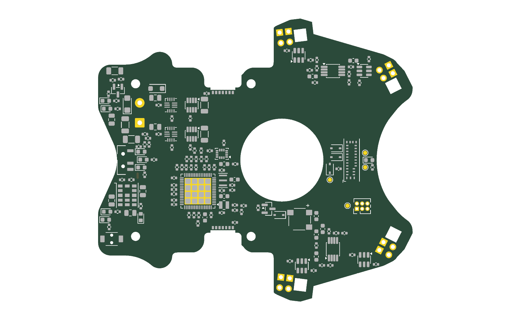

# KOGUMA-Mk4_t24(タイヤ24mm 用のメイン基板の土台、2026-11-21)

ブランチ `claude/trusting-dirac-1tdt54`(タイヤを MK3 と同じ 24mm にした機体。`docs/spec.md` の「方針の変更(2026-11-21)」)。KiCad 9.0 で開く(`KOGUMA-Mk4_t24.kicad_pro`)。

**回路は `KOGUMA-Mk4` と同じ**(2026-11-23 にブランチ `claude/magical-einstein-bdr00d`(PR #21)の回路図を取り込んだ: PGND と GND を NT1 で1点、+3V3A、品番、回路図のレビューとノイズの評価の対策(`docs/review_2026-11-06.md`)、SW1・SW2・BZ1・U70〜U73 のフットプリント、前の LED D98、BLE モジュール HY0020(U5、2026-11-23))。`../make_main_t24.py` が main の回路図を写して作る(`/usr/bin/python3.12 hardware/kicad/make_main_t24.py`。Ubuntu 24.04 の KiCad 9 の Python は 3.12 向け。標準のフットプリントのパッケージ `kicad-footprints` が要る)。回路図で変えたのは1か所だけ:

- J5・J6(エンコーダの基板とのつなぎ)のフットプリント: `ENC_Base_Butt`(タイヤ15mm、エンコーダ基板 v2 を裏に突き当てる)→ **`ENC_Base_Edge_T24`**(`../KOGUMA-Mk4_Encoder_t24` を切り欠きの縁に沿って立て、上の面ではんだ付け)
- UI の LED は回路図のまま **1608**(2026-11-23、ユーザーの決定。それまでは 0402 に替えていた)。1.9mm おきの並びに、長い方を x(前後)に向けて置く(重ならない)
- 設計ルール `KOGUMA-Mk4_t24.kicad_dru` は `../KOGUMA-Mk4/KOGUMA-Mk4.kicad_dru` を写す(細かいピッチの IC のパッドの間だけ 0.14mm)

記号・フットプリントのライブラリは `../KOGUMA-Mk4/` のものを使う(`fp-lib-table`・`sym-lib-table`)。**main の回路図を直したら、スクリプトを動かし直して写す**(この中の回路図は直接直さない)。

## 置いたもの(機構で位置が決まるもの)

| 部品 | 位置(機体の座標、x 前・y 左) | もと |
|---|---|---|
| 外形 | **t24v3**(3,269mm²、厚さ 0.6mm。2026-11-22 に実装する面積のため広げ(B 案)、後ろを V 字にして角を丸めた(案1)) | `mechanical/vehicle/pcb_t24.py`、`mechanical/pcb/pcb_outline_t24v3.dxf` |
| H1〜H4(M2 の柱、基板だけの部品) | (8, ±19.5)・(−21, ±19.5) | マウント t24v2 |
| J5(左)・J6(右) | 切り欠きの縁 (0, ±16.7)、J5 は回転 0、J6 は 180° | エンコーダ基板 t24 |
| D70〜D77(壁センサのホルダ、**裏**) | FL・FR (20.8, ±30.35) 外へ 7°、R・L (42, ±16) | `pcb_shape.SENS`(FL・FR は t24 で前へ動かした)。足の穴は `pcb_shape.pads()` とずれ 0.000mm |
| D90〜D96(UI の LED、1608) | `pcb_shape.LEDS` の順(左の角2つ、V 字の先3つ、右の角2つ)。長い方を x に。**どの LED をどこに置くかは仮** | ToraNeko.Mk3 と同じ並び |
| D98(前の LED、1608) | `pcb_shape.LED_FRONT` (35.2, 0)、前の円弧の切り欠きの真ん中 | PB3 |
| LED の抵抗 R90〜R96・R99、エンコーダのパスコン C86・C87 | LED のパッド・J5・J6 の 3.3V のパッドのそば(`../KOGUMA-Mk4/place_caps.py t24`、LED から 1.7mm、J5・J6 から 1.5mm) | |

ほかの部品は基板の右に、**IC ごとのグループ**(IC のまわりにコンデンサ・抵抗をノイズと線の長さを考えて置いたもの、18個、`../KOGUMA-Mk4/place_caps.py t24`。置き方は `../KOGUMA-Mk4/README.md` の「IC ごとのグループ」)にして並べてある(**配置と配線はこれから**)。グループごと基板に動かせる。電池の下に置くときは、グループの中の部品の高さ(1.2mm まで)に気をつける(Q1 のグループの C4・Q1 は入らない)。**BLE モジュール HY0020(U5、2026-11-23)は電池の下に置かない**(アンテナがシールドの上の面)。基板の縁の近く、モーター・ファンの線から離す。

**電池の下(上の面、x −16.25〜6.25、|y| ≤ 16。Cmts.User の四角)には高さ 1.2mm までの部品だけ置く**(電池は 1.5mm のスペーサーで浮かせる。2026-11-23、`docs/spec.md` の「電池の下にも部品を置く」)。部品を置ける所は、上の面 2,823mm²(うち電池の下 716mm²)、裏の面 2,273mm²(モーター・マウントの上を除く)で、置く部品(壁センサのホルダを除く、未定の7部品を含む)約 980mm² に対して密度 19%(上の面だけなら 35%)。**両面に置き、4層にする**のを考える(0.6mm の4層が作れるか、注文先で確かめる)。座標は KiCad の X = 150 + x、Y = 100 − y(画面の上が機体の左、右が前)。層の数は決めていない(2層のまま)。

## DRC(2026-11-23、kicad-cli 9.0.9、`--schematic-parity`)

| 項目 | 数 | 中身 |
|---|---|---|
| 回路図との食い違い | **0** | フットプリントが決まっていない部品はなくなった(159 部品すべて基板に入っている) |
| 基板の上の銅と縁 | **0** | 壁センサの受光の足のパッドとほぞの穴の重なりは、ホルダ v5(ほぞを 0.4mm 前へ、`pcb_shape.PEG_BACK`)で直った |
| 部品の外形(コートヤード)の重なり・間隔 | **0** | 細かいピッチの IC のパッドの間は `.kicad_dru` で 0.14mm |
| シルク・文字 | 175 | 部品の番号・値の文字の重なり、壁センサのホルダのフットプリントの文字の大きさ(配置してから直す) |
| つながっていない | 392 | 配線がまだなので |

作り直すとき: `python3 hardware/kicad/make_main_t24.py` → `cd hardware/kicad/KOGUMA-Mk4 && python3 place_caps.py t24`

## これから

- 部品の配置と配線、層の数
