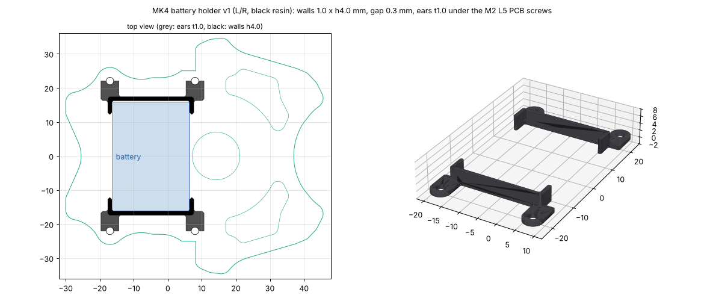

# 電池のホルダ(v1、2026-10-31)

電池(3S 180mAh、22.5 × 32 × 14mm、基板の上、x −16.25〜6.25)の**位置だけを決める**、左右2個の印刷部品。**ねじは増やさない**: 基板を留める上のねじ4本(マウントの前後の柱 (−17, ±22)・(8, ±22)、鉄の低頭 M2 L5)の頭の下に耳をはさむ。

| 項目 | 内容 |
|---|---|
| 形 | 左右それぞれコの字の壁(電池の横の面に沿う壁と、前後の角を 4mm 回り込む壁)+ ねじの耳2つ |
| 壁 | 厚さ 1.0mm、高さ 4.0mm(基板の上面から。電池の高さ 14mm の下の 4mm を囲む)。電池とのすき間 0.3mm |
| 耳 | 厚さ 1.0mm、半径 2.6mm、穴 φ2.2(ねじの頭 φ3.8 の下にはさむ) |
| 重さ | 1個 約0.23g(199mm³、光造形の樹脂)。2個で機体 +0.48g |
| 材料 | JLC3DP 光造形 **JLC Black Resin**(モーター関連ではないので黒) |
| ファイル | `battery_holder_L_v1.step/.stl`(左、y > 0)、`battery_holder_R_v1.step/.stl`(右)。作り直すときは `python3 mechanical/battery_holder/battery_holder.py` |

## 留め方

- 前後・左右は壁で止める。上下は**電池の底を両面テープで基板に貼る**(電池を替えるときははがす)。
- 耳の分(1.0mm)だけ、ねじの頭が上がる。ねじは L5 のままで、マウントの柱のねじ山にかかるのは 4.4 → **3.4mm**(ファンの台の継ぎ目の 3.0mm より長い)。
- 基板の上面の、壁と耳の下(電池のまわり幅 1.3mm と、ねじのまわり)には部品を置かない。エンコーダ基板のはんだ付け (0, ±20.7) とは 2.9mm 離れている。
- 電池の線は前後の面の真ん中(回り込みの壁のない所)から出せる。

## 届いたら

- 電池を測り、すき間(片側 0.3mm)がきつい・ゆるいときは `battery_holder.py` の `gap` を直す(電池の品番は未定。寸法は MK3 の電池)。
