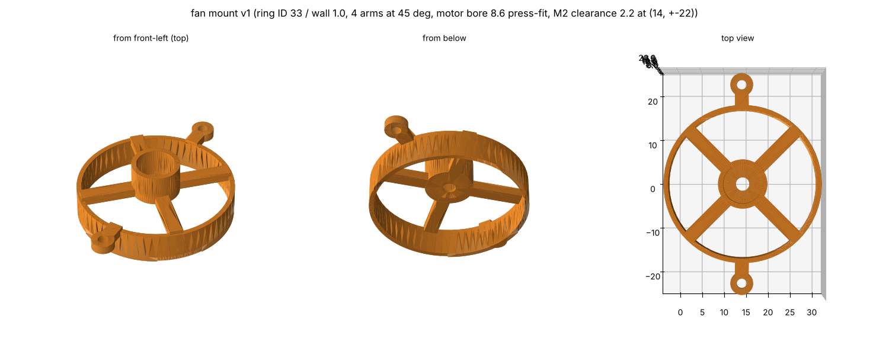

# 吸引ファンの台(fan mount v3、2026-11-11)

機体の案 v4(`docs/vehicle.md`)の吸引ファンの台(`vehicle.py` の `fan_case`)を、1つの部品として書き出したもの。座標は機体と同じ(原点は車軸の中心、+x が前、+y が左、z は床から上、mm)。



| ファイル | 中身 |
|---|---|
| `fan_mount_v3.step` | Fusion 360 などで読み込む |
| `fan_mount_v3.stl` | 印刷に出す用 |

## v3(2026-11-11): モーターの穴をしまりばめに

走行用のモーターマウント v20 と同じ作り方にした(当たり面3つ φ8.5、逃がし φ8.8、入口 1.0mm は寸法どおり)。ほかは v2 と同じ。

## v2(2026-11-01): 自分で用意する羽根に合わせた

羽根の STEP(`mechanical/parts/impeller_v1.step`): **φ32.0 × 高さ 5.5mm**。下に羽根6枚(高さ 3.0mm)、その上に板(1.0mm)、上にハブの出っ張り φ3.5 × 1.5mm、軸の穴 φ0.98。アクリルで 1.39g。

- 羽根の台の中のすき間は、床の塩ビ(z 3.2)からハブの底(z 8.8)まで 5.6mm しかなく、5.5mm の羽根が入らない。**ハブの底の穴を φ3.0 → φ4.5 に広げ**、羽根のハブの出っ張りを底の穴の中まで上げた
- 羽根の位置: ハブの出っ張りの上 z 9.0(モーターの軸受けの出っ張り z 9.1 と 0.1mm)、板 z 6.5〜7.5、羽根の下 z 3.5(塩ビと 0.3mm)。輪とは半径 0.5mm、腕(z 8.8)とは 1.3mm
- モーターの面は、穴のまわりの輪(半径 2.25〜4.3)で受ける
- **羽根の穴 φ0.98 は、φ1.0 の軸用**。ファンのモーターを NFP-D8620(軸 φ1.2)にするなら、羽根の穴を φ1.2 用(φ1.18 前後)にする必要がある。モーターの軸を測って確かめる

## 形

| 部分 | 寸法 |
|---|---|
| 輪(囲い) | 内径 φ33(羽根 φ32 とのすき間 0.5mm)、壁 1.0mm、z 3.2〜10.0。中心 (14.2, 0)。塩ビのない所(吸引する面の外)は、輪の下をフレームの上面 z 3.0 まで下げてある |
| 腕 | ハブと輪を斜め45°の4本でつなぐ。幅 3mm × 厚さ 2mm(z 8.8〜10.8) |
| 継ぎ目の耳 | (14, ±22)、半径 2.5、z 8.8〜10.8、通し穴 φ2.2。輪から短い腕で出す。モーターマウント v7 の腕に載せ、上から鉄の低頭 M2 L5(2026-10-30 にねじを1種類にそろえた)で留める(マウントの腕にねじ山) |
| ハブ(モーターの筒) | 外径 φ10.7、z 8.8〜16.0。モーターの穴は**しまりばめ**(v3。走行用のマウント v20 と同じ: 当たり面3つ φ8.5、その間の逃がし φ8.8、上の入口 1.0mm は φ8.6 のまっすぐな丸い穴。上から圧入)、z 9.4 から上。底(z 8.8〜9.4、厚さ 0.6mm)に穴 **φ4.5**(v2。羽根のハブの出っ張り φ3.5 が入る。v1 は φ3.0) |
| 重さ | 1.63g(樹脂 1.2 g/cm³ として、体積 1358mm³) |

## 注文と作るとき

- JLC3DP の光造形、**JLC Temp Resin**(荷重たわみ温度 101°C。モーターの熱で筒がゆるまないように)。予備を含めて3個くらい
- **ハブの底が 0.6mm**で、JLC がすすめる壁 0.8mm を下回る。欠けていないか見る
- **モーターの穴**(v3 からしまりばめ): きつすぎるときは当たり面をカッターで軽く削り、ゆるければ接着する
- **羽根は自分で用意する**(2026-11-01。それまでは DMM.make の高精細アクリルで作る予定だった)。高速で回るので、羽根の振れ(重さの偏り)と、輪とのすき間(半径0.5mm)を最初に確かめる。モーターの熱が羽根のハブに伝わるので、高精細アクリルの耐熱温度も確かめる。この台は「羽根 φ32、羽根の上面 z 8.0(腕との間 0.8mm)」として作ってある。**羽根の直径・高さ・モーターの面から羽根までの距離を測って、合っているか確かめる**

## 作り直すには

`mechanical/vehicle/vehicle.py` を回して機体の STEP を作り直し、そこから取り出す:

```
cd mechanical/vehicle
python3 vehicle.py
python3 export_part.py mk4_vehicle_v4.step fan_case ../fan_mount/fan_mount_v3
```
