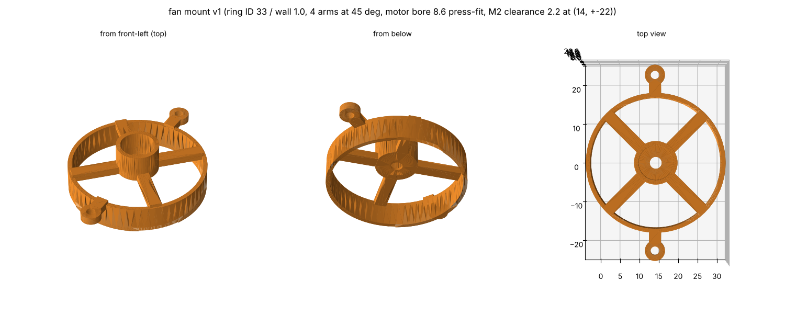

# 吸引ファンの台(fan mount v1、2026-10-27)

機体の案 v4(`docs/vehicle.md`)の吸引ファンの台(`vehicle.py` の `fan_case`)を、1つの部品として書き出したもの。座標は機体と同じ(原点は車軸の中心、+x が前、+y が左、z は床から上、mm)。



| ファイル | 中身 |
|---|---|
| `fan_mount_v1.step` | Fusion 360 などで読み込む |
| `fan_mount_v1.stl` | 印刷に出す用 |

## 形

| 部分 | 寸法 |
|---|---|
| 輪(囲い) | 内径 φ33(羽根 φ32 とのすき間 0.5mm)、壁 1.0mm、z 3.2〜10.0。中心 (14.2, 0)。塩ビのない所(吸引する面の外)は、輪の下をフレームの上面 z 3.0 まで下げてある |
| 腕 | ハブと輪を斜め45°の4本でつなぐ。幅 3mm × 厚さ 2mm(z 8.8〜10.8) |
| 継ぎ目の耳 | (14, ±22)、半径 2.5、z 8.8〜10.8、通し穴 φ2.2。輪から短い腕で出す。モーターマウント v7 の腕に載せ、上からナイロンのなべ M2 L6 で留める(マウントの腕にねじ山) |
| ハブ(モーターの筒) | 外径 φ10.7、z 8.8〜16.0。モーターの穴 φ8.6(寸法どおり、上から圧入)、z 9.4 から上。底(z 8.8〜9.4、厚さ 0.6mm)に軸の穴 φ3.0 |
| 重さ | 1.64g(樹脂 1.2 g/cm³ として、体積 1363mm³) |

## 注文と作るとき

- JLC3DP の光造形、**JLC Temp Resin**(荷重たわみ温度 101°C。モーターの熱で筒がゆるまないように)。予備を含めて3個くらい
- **ハブの底が 0.6mm**で、JLC がすすめる壁 0.8mm を下回る。欠けていないか見る
- **モーターの穴 φ8.6**: 精度が ±0.2mm なので、きつければリーマで広げ、ゆるければ接着する
- 羽根は手持ちのものを使う。この台は「羽根 φ32、羽根の上面 z 8.0(腕との間 0.8mm)」として作ってある。**羽根の直径・高さ・モーターの面から羽根までの距離を測って、合っているか確かめる**

## 作り直すには

`mechanical/vehicle/vehicle.py` を回して機体の STEP を作り直し、そこから取り出す:

```
cd mechanical/vehicle
python3 vehicle.py
python3 export_part.py mk4_vehicle_v4.step fan_case ../fan_mount/fan_mount_v1
```
