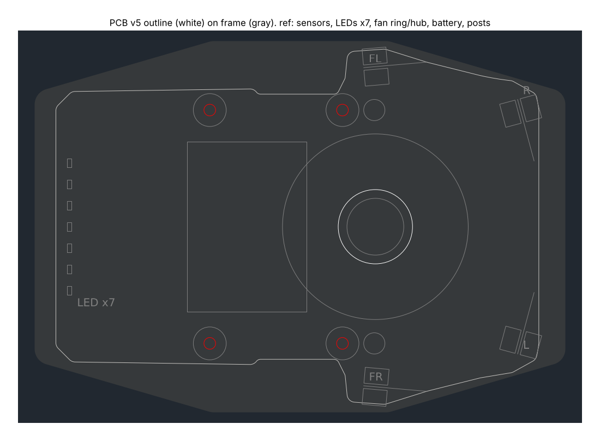

# 基板の外形(基板 v5、2026-10-28)

機体の案 v4 の基板(0.6mm)の外形。形は `mechanical/vehicle/pcb_shape.py` で決め、`vehicle.py`(機体の確認)と同じ。**回路を描くときに直す前提の外形**。座標は機体と同じ(原点は車軸の中心、+x が前、+y が左、mm)。基板の下面は z 13.6。

| レイヤー | 中身 |
|---|---|
| OUTLINE | 外形(直線と円弧)。x −46.0〜45.0、y ±33.5、面積約 4,800mm²(ねじの穴を除く) |
| HOLES | M2 の通し穴 φ2.2 × 4: マウントの柱 (−17, ±22)・(8, ±22)。柱にねじ山を切り、上からナイロンのなべ M2 L4 で留める |
| REF | 参考(切らない): ファンの輪の外側(半径17.5)とハブ(半径5.35)、マウントの柱(半径3.1)、ファンの台のねじの頭 (14, ±22)、電池(x −21.25〜1.25、y ±16)、UI の LED 7個(後ろの縁 x −43.5、y −12〜12 を 4mm おき)、壁センサ(前 (12, ±30) は外へ5°、前の角 (41, ±24) は反対側の壁へ75°) |

## v4 からの変更

- **ファンの上を覆う**: ファンのハブ(半径5.35、z 16.0 まで基板を抜ける)とモーターを通す穴(半径7)だけ開ける。前の腕どうしもつなげた。吸引の空気は、輪の上(z 10.0)と基板(z 13.6)の間の 3.6mm のすき間から横へ出る(すき間の面積は輪のまわりで約 400mm²。吸い込みの穴 φ15 は 177mm²)
- **後ろを x −46 まで広げる**(v4 は −19)。後ろの縁に UI の LED 7個(ToraNeko のように)。後ろの角はフレームの角より内側
- 面積は約 2,000 → 4,800mm²

## 気をつけること

- **基板の裏**: ファンの輪の上(z 10.0、基板まで 3.6mm)、ファンの台の腕(z 10.8、2.8mm)、ファンの台のねじの頭 (14, ±22)(z 12.4、1.2mm)。この上の裏には背の高い部品を置けない。吸引の空気の通り道でもあるので、ファンの上の裏はなるべく平らに
- **電池**(基板の上、x −21.25〜1.25)の下も部品を置けない(表側)
- 壁センサの光の通り道(REF の線)に背の高い部品を置かない
- ファンの台を外すときは、先に基板を外す(ファンの台のねじが基板の真下にある)
- 振動(`docs/vehicle.md` の「基板の振動」): 前の板が 165Hz、後ろの板が 283Hz で揺れやすい

作り直すには(リポジトリの一番上で): `python3 mechanical/vehicle/pcb_dxf.py`
