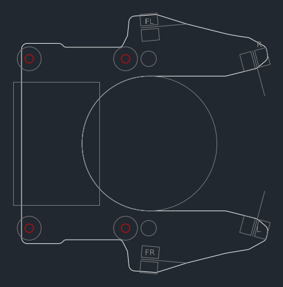

# 基板の外形(機体の案 v4、2026-10-27)

`vehicle.py` の基板(U字、0.6mm)を DXF にしたもの。**仮の外形**で、回路を描くときに直す。座標は機体と同じ(原点は車軸の中心、+x が前、+y が左、mm)。基板の下面は z 13.6。

| レイヤー | 中身 |
|---|---|
| OUTLINE | 外形(直線と円弧)。面積約 2,000mm²、x −19.0〜44.9、y ±33.5 |
| HOLES | M2 の通し穴 φ2.2 × 4: マウントの柱 (−17, ±22)・(8, ±22)。柱にねじ山を切り、上からナイロンのなべ M2 L4 で留める |
| REF | 参考(切らない): ファンの輪の外側(半径17.5、真ん中は開ける)、マウントの柱(半径3.1)、ファンの台のねじの頭 (14, ±22)(基板の真下、頭の上 z 12.4。基板との間 1.2mm)、電池(基板の上、x −21.25〜1.25、y ±16)、壁センサ(発光・受光 φ3 × 4.5 を寝かせる。前 (12, ±30) は外へ5°、前の角 (41, ±24) は反対側の壁へ75°) |

- ファンの台を外すときは、先に基板を外す(ファンの台のねじが基板の真下にある)
- 前の角の壁センサの腕は、前の柱 (8, ±22) から約37mm の片持ち。揺れやすい振動は約169Hz(`docs/vehicle.md`)

作り直すには(リポジトリの一番上で): `python3 mechanical/vehicle/pcb_dxf.py`
