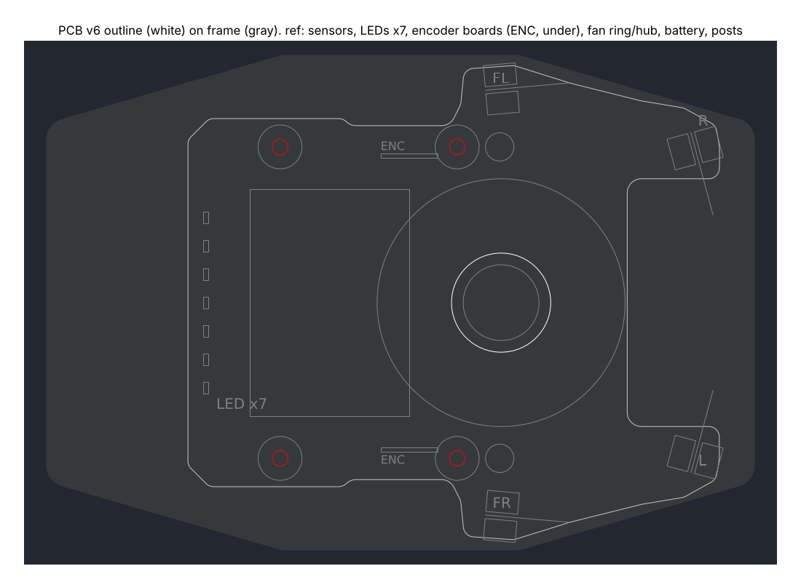

# 基板の外形(基板 v6、2026-10-29)

機体の案 v4 の基板(0.6mm)の外形。形は `mechanical/vehicle/pcb_shape.py` で決め、`vehicle.py`(機体の確認)と同じ。**回路を描くときに直す前提の外形**。座標は機体と同じ(原点は車軸の中心、+x が前、+y が左、mm)。基板の下面は z 13.6。

| レイヤー | 中身 |
|---|---|
| OUTLINE | 外形(直線と円弧)。x −30.0〜45.0、y ±33.5、面積約 3,500mm²(ねじの穴を除く) |
| HOLES | M2 の通し穴 φ2.2 × 4: マウントの柱 (−17, ±22)・(8, ±22)。柱にねじ山を切り、上からナイロンのなべ M2 L4 で留める |
| REF | 参考(切らない): ファンの輪の外側(半径17.5)とハブ(半径5.35)、マウントの柱(半径3.1)、ファンの台のねじの頭 (14, ±22)、電池(x −21.25〜1.25、y ±16)、UI の LED 7個(後ろの縁 x −27.5、y −12〜12 を 4mm おき)、エンコーダ基板を立てる所(ENC、基板の裏、x −2.6〜5.2、y ±20.4〜21.0)、壁センサ(前 (12, ±30) は外へ5°、前の角 (41, ±24) は反対側の壁へ75°) |

## 変更

- **v6(2026-10-29)**: v5 が大きすぎたので小さくした
  - **前はクワガタの形**: 左右の腕の間を x 32 より前で開ける(幅35mm、奥の角 R2)。ファンの上はハブとモーターを通す穴(半径7)だけ開けて覆うので、左右の腕はファンの上の板でつながる
  - **後ろは x −30 まで**(電池の後ろの端 −21.25 から約9mm)。後ろの縁に UI の LED 7個
  - 面積は約 3,500mm²(v4 の U字は約 2,000、v5 は約 4,800)
- v5(2026-10-28): ファンの上を覆い、前の腕どうしもつなげ、後ろを x −46 まで(約 4,800mm²)
- v4: U字(ファンの上を半径17.5で開け、後ろは x −19、約 2,000mm²)

吸引の空気は、ファンの輪の上(z 10.0)と基板(z 13.6)の間の 3.6mm のすき間と、前の切り欠きから出る。

## 気をつけること

- **エンコーダ基板を裏に立てる**(左右に1枚ずつ、7.8 × 10.3 × 0.6mm、z 13.6 から 3.3 まで下ろす)。AS5047P はマウントの側(外側、y の絶対値が大きい側)に向ける。直角に付け、AS5047P の中心はメイン基板の下面から6.1mm 下、x 0(車軸の真上)。付け方は `docs/mount.md` の「決まっていないこと」

- **基板の裏**: ファンの輪の上(z 10.0、基板まで 3.6mm)、ファンの台の腕(z 10.8、2.8mm)、ファンの台のねじの頭 (14, ±22)(z 12.4、1.2mm)。この上の裏には背の高い部品を置けない。吸引の空気の通り道でもあるので、ファンの上の裏はなるべく平らに
- **電池**(基板の上、x −21.25〜1.25)の下も部品を置けない(表側)
- 壁センサの光の通り道(REF の線)に背の高い部品を置かない
- ファンの台を外すときは、先に基板を外す(ファンの台のねじが基板の真下にある)
- 振動(`docs/vehicle.md` の「基板の振動」): 前の角の腕が 203Hz、264Hz で揺れやすい

作り直すには(リポジトリの一番上で): `python3 mechanical/vehicle/pcb_dxf.py`
