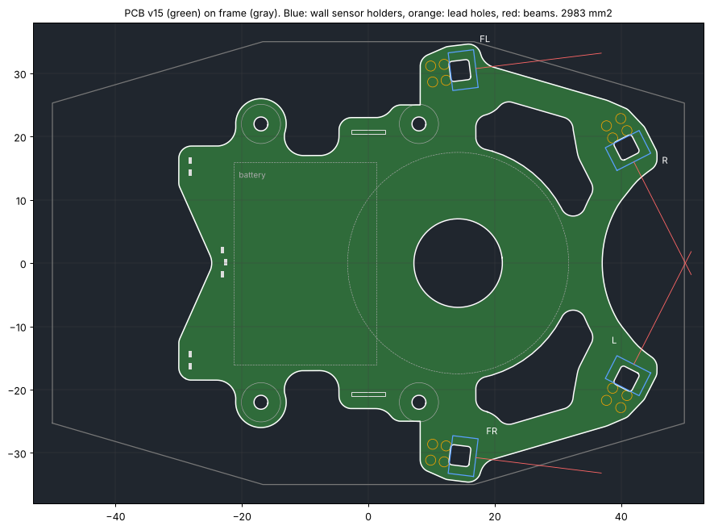

# 基板の外形(基板 v15、2026-10-30)

機体の案 v4 の基板(0.6mm)の外形。今の形は **v15**(`pcb_outline_v15.dxf`)。形は `mechanical/vehicle/pcb_shape.py` で決め、`vehicle.py`(機体の確認)と同じ。**回路を描くときに直す前提の外形**。座標は機体と同じ(原点は車軸の中心、+x が前、+y が左、mm)。基板の下面は z 13.6。

| レイヤー | 中身 |
|---|---|
| OUTLINE | 外形(直線と円弧)、くり抜き(前と横のセンサの間のポケット2つ)、ハブの穴、壁センサのホルダのほぞの穴(3.2 × 3.2mm、角 R0.5、4つ)。x −30.0〜45.7、y ±34.6、面積約 2,980mm²(穴を除く) |
| HOLES | M2 の通し穴 φ2.2 × 4: マウントの柱 (−17, ±22)・(8, ±22)。柱にねじ山を切り、上からナイロンのなべ M2 L4 で留める |
| REF | 参考(切らない): ファンの輪の外側(半径17.5)とハブ(半径5.35)、マウントの柱(半径3.1)、ファンの台のねじの頭 (14, ±22)、電池(x −21.25〜1.25、y ±16)、UI の LED 7個(0402。ToraNeko.Mk3 と同じ並び: 左右の角 (−28.15, ±14.3・±16.2)、V 字の切り欠きの先 (−23.1, ±1.9)・(−22.6, 0))、エンコーダ基板が通る所(ENC、x −2.65〜2.65、y ±20.4〜21.0)、壁センサのホルダ(6.0 × 4.04mm)と足の穴(φ0.9、パッド φ1.6)と光(前 (17, ±30.75) は外へ7°、横 (42, ±16) は反対側の前の柱の前半分へ63.0°。位置はホルダの前の面の真ん中) |

## 変更

- **v15(2026-10-30)**: UI の LED 7個を ToraNeko.Mk3 と同じ並びにした(`TORANEKO.Mk3.kicad_pcb` の D18〜D24 を MK4 の座標へ。ToraNeko の車軸は KiCad の y 66、真ん中は x 110)
  - 後ろの縁を ToraNeko と同じく V 字に切り欠く(先は x −24.5)。左右の角(羽、|y| 12.3〜18.5)に2個ずつ、V 字の先に3個(真ん中が 0.5mm 前)
  - LED1・2 = 左の角 (−28.15, 16.21)・(−28.15, 14.29)、LED3〜5 = (−23.1, 2.0)・(−22.6, 0.1)・(−23.1, −1.8)、LED6・7 = 右の角 (−28.15, −14.39)・(−28.15, −16.31)。ToraNeko は後ろの縁が x −32.05 なので、角の LED は MK4 の後ろの縁(x −30)から ToraNeko と同じ 1.85mm
  - 1次 146Hz・2次 247Hz・3次 275Hz。面積は v14 とほぼ同じ
  - v14 の形は `pcb_shape.py` の `outline_v14()` に残してある
- **v14(2026-10-30)**: 後ろも前と同じように削った(3つの案から選んだ。v13 から約 400mm²、−0.44g)
  - x < 4 は、電池の下(マイコンを置く、x −22.25〜2.25、|y| ≤ 17)、後ろの LED の列(x −30〜−20、|y| ≤ 15)、柱のまわり(半径 4 の耳)、エンコーダ基板の穴のまわり(2mm)だけ残す。へこんだ角 R3
  - 1次 147Hz・2次 248Hz は変わらない(前のセンサで決まる)。3次(電池が上下)は 303 → 280Hz
  - 比べた案: へこんだ角を R6 にして柱の間をつなげたままにすると −0.29g
  - v13 の形は `pcb_shape.py` の `outline_v13()` に残してある
- **v13(2026-10-30)**: 電池の下にはマイコンを置くので、v12 の電池の下の窓をやめた。前と横のセンサの間のポケットだけ
  - 約 3,450mm²(v11 から −345mm²、−0.38g)。1次 147Hz・2次 250Hz・3次 303Hz
  - v12 の形は `pcb_shape.py` の `outline_v12()` に残してある
- **v12(2026-10-30)**: 軽くするため中をくり抜いた(v11 から約 770mm²、−0.85g)
  - 電池の下に窓(x −18.25〜−1.75、|y| ≤ 13、角 R3。電池の縁から 3mm 内側)。電池は窓のまわりの 3mm の縁に両面テープで貼る。電池の下には部品を置けない
  - 前と横のセンサの間にポケット(外の縁・ファンのまわり(半径 18.5 まで)・センサのまわりに 4.5mm 残す、角 R2)。センサの配線は縁を通す
  - 1次 145Hz・2次 248Hz・3次 324Hz(v11 は 160Hz、v10 は 136Hz)
  - 比べた案: 電池の下の窓だけなら 159Hz(−0.47g)。前を縁 2.5mm でくり抜くと 80Hz、ファンからセンサへの梁(幅 4.5mm)だけ残すと 137Hz(−0.88g)。電池の下は抜いても振動はほぼ変わらないが、前は抜くとすぐ下がる
  - 機体(`vehicle.py`): 54.25g、慣性モーメント 269 g·cm²(v11 は 55.10g・273)、ぶつかりなし、光を遮る部品なし
  - v11 の形は `pcb_shape.py` の `outline_v11()` に残してある
- **v11(2026-10-30)**: 振動対策で面積を増やした(v10 から約 550mm²、+0.6g)
  - v10 は角の先のセンサ(ホルダ込み 0.39g)が重く、基板の1次の振動が 136Hz だった
  - 左右それぞれ、前のセンサ(FL・FR)と横のセンサ(R・L)の間を埋めた(横の縁はまっすぐ)。前の切り欠きは小さな円弧(中心 (55, 0)、半径 18)
  - 1次 160Hz・2次 288Hz・3次 306Hz(基板 0.6mm。0.8mm なら 234Hz)
  - 比べた案: 前の切り欠きを V 字にすると 163Hz(3,754mm²)、前の切り欠きも埋めると先が重くなって 145Hz(3,979mm²)。首を 15mm に太くするだけでは 146Hz
  - 機体(`vehicle.py`): 55.10g、慣性モーメント 273 g·cm²(v10 は 54.48g・262)、ぶつかりなし、光を遮る部品なし
  - v10 の形は `pcb_shape.py` の `outline_v10()` に残してある
- **v10(2026-10-30)**: 前の腕(クワガタ)をもっと削った
  - 芯(後ろの長方形と、ファンのまわりの半径 14 の円)に、4つのセンサの所(ホルダと足の穴を 1mm 広げた形)を、ファンの中心へ向かう幅 9mm の首でつなぎ、つけ根を R7 で丸める。前の腕は横のセンサの所だけ残る角になる
  - 首の幅は 5・9・12・15mm を比べて 9mm にした(5mm は細すぎて振動が 163Hz に下がる)
  - 横の壁センサを (37.5, ±17.5) → (37.5, ±14)。光はファンの輪の外側から 8mm 離れる
  - 同じ日に、前の壁センサを (17, ±30.75) 外へ 7° にした(フレームから出さずに一番外、角度は斜めのとき柱にかかる一番小さい所。センサの所の基板はフレームの 0.3mm 内側まで)
  - 同じ日に、横の壁センサを (42, ±16) に前へ出し、真横から 27.0° にした(柱を見たまま角度を小さくするため。前の角が長くなり、基板の1次の振動は 136Hz)
  - 同じ日に、横の壁センサの向きを 75° → 60.5° にした。区画の中心で反対側の前の柱の中心より前 (93, ∓84) を見る(前の壁があれば前の壁の y ∓68)。基板の1次の振動 197Hz、面積約 3,190mm²
  - v9 から約 210mm²(−0.23g)減。基板の1次の振動は 192Hz(v9 は 196Hz)
  - v9 の形は `pcb_shape.py` の `outline_v9()` に残してある
- **v9(2026-10-30)**: もっと削った(v8 から約 450mm²、−0.5g)
  - フレームから 3mm 内側(v8 は 1.5mm)、前の円弧を半径 20 に(x 31 まで)、後ろの横(車輪より後ろ)は |y| 26.5 でまっすぐ
  - 壁センサを削った形に収まる所へ: 前 (18, ±29) → (21, ±27)(マウントの腕・ファンの台の継ぎ目から 1.1mm)、横 (40, ±18) → (37.5, ±17.5)。光が当たる所は前の壁 ±32.5mm、横の壁 65mm 前
  - 前の腕が短くなり、基板の1次の振動は 176 → 196Hz に上がった
  - 機体(`vehicle.py`): 54.75g、慣性モーメント 263 g·cm²(v8 は 275)、ぶつかりなし、光を遮る部品なし
  - 後ろの柱 (8, ±22) は基板の縁から 0.1mm はみ出す(柱の上は基板の下面に当たるので問題ない。v6〜v8 も同じ)
- **v8(2026-10-30)**: v7 の形がよくないので作り直した(4つの案を並べて選んだ)
  - 外形はフレームと平行な八角形(フレームの 1.5mm 内側)。前の切り欠き(クワガタの腕の間)は大きな円弧(中心 (51, 0)、半径 19、x 32 まで)。ToraNeko.Mk3 の基板の前後の円弧と同じ考え方
  - 車輪(41T・タイヤ)の所は四角く切る(x −8〜8.5 で |y| > 25)。へこんだ角 R3、出っ張った角 R5
  - 横の壁センサを (41, ±18.5) → (40, ±18)(ホルダと足の穴を基板の中に収めるため)
  - v7 より約 330mm² 広い(+0.4g)。基板の1次の振動は 169 → 176Hz に上がった(前の腕が太くなった)
  - 機体(`vehicle.py`): 55.25g、慣性モーメント 275 g·cm²、ぶつかりなし、光を遮る部品なし
- **v7(2026-10-30)**: 形をすっきりさせ、壁センサをホルダ(`mechanical/sensor_holder/`、ToraNeko.Mk3 と同じ形)に入れる
  - 後ろは長方形(x −30、|y| 26)。前は、後ろの長方形と4つのセンサ(ホルダと足の穴を 1mm 広げた形)を囲む凸の形を、フレームの外形の 1mm 内側で切る。へこませるのは車輪(41T・タイヤ、x −8〜8.5 で |y| > 25)の所と、前の腕の間(x ≥ 32、|y| ≤ 17.5)だけ。角はすべて R3
  - 壁センサを動かした: 前の2本 (12, ±30) → (18, ±29)(ホルダの後ろの足の穴を 41T の上に出さないため)、横の2本 (41, ±24) → (41, ±18.5)(ホルダと足の穴をフレームの中に収めるため)。向きは同じ
  - エンコーダ基板の穴は回路図の `ENC_Base_Slot`(NPTH 1.0 × 5.9mm)で開ける(DXF には描いていない。REF の ENC は通る所)
  - ホルダは基板の裏に付ける(同じ日)。外形は同じ
  - 機体(`vehicle.py`): 54.88g、慣性モーメント 271 g·cm²、ぶつかりなし。基板の1次の振動は 169Hz(`docs/vehicle.md`)
- **v6(2026-10-29)**: v5 が大きすぎたので小さくした
  - **前はクワガタの形**: 左右の腕の間を x 32 より前で開ける(幅35mm、奥の角 R2)。ファンの上はハブとモーターを通す穴(半径7)だけ開けて覆うので、左右の腕はファンの上の板でつながる
  - **後ろは x −30 まで**(電池の後ろの端 −21.25 から約9mm)。後ろの縁に UI の LED 7個
  - 面積は約 3,500mm²(v4 の U字は約 2,000、v5 は約 4,800)
- v5(2026-10-28): ファンの上を覆い、前の腕どうしもつなげ、後ろを x −46 まで(約 4,800mm²)
- v4: U字(ファンの上を半径17.5で開け、後ろは x −19、約 2,000mm²)

吸引の空気は、ファンの輪の上(z 10.0)と基板(z 13.6)の間の 3.6mm のすき間と、前の切り欠きから出る。

## 気をつけること

- **エンコーダ基板を穴に通して立てる**(左右に1枚ずつ、5.3 × 12.3 × 0.6mm、2026-10-29)。基板に穴(NPTH 1.0 × 5.9mm の長円、中心 (0, ±20.7)、`KOGUMA-Mk4:ENC_Base_Slot`)を開け、エンコーダ基板を下から通して上の面ではんだ付けする(z 3.3〜15.6、上に 1.4mm 出る)。MT6835 はマウントの側(外側)に向け、中心は x 0(車軸の真上)
- **壁センサのホルダは基板の裏(下)に付ける**(4つ、z 3.7〜13.6。2026-10-30): ほぞの穴は OUTLINE に描いてある。ホルダの後ろに足の穴が2列(受光、発光の順)。裏のホルダの所と、その前の光の通り道(z 6.0・10.4)には部品を置かない

- **基板の裏**: ファンの輪の上(z 10.0、基板まで 3.6mm)、ファンの台の腕(z 10.8、2.8mm)、ファンの台のねじの頭 (14, ±22)(z 12.4、1.2mm)。この上の裏には背の高い部品を置けない。吸引の空気の通り道でもあるので、ファンの上の裏はなるべく平らに
- **電池**(基板の上、x −21.25〜1.25)の下も部品を置けない(表側)
- 壁センサの光の通り道(REF の線)に背の高い部品を置かない
- ファンの台を外すときは、先に基板を外す(ファンの台のねじが基板の真下にある)
- 振動(`docs/vehicle.md` の「基板の振動」): 前の角の腕が 203Hz、264Hz で揺れやすい

作り直すには(リポジトリの一番上で): `python3 mechanical/vehicle/pcb_dxf.py`
