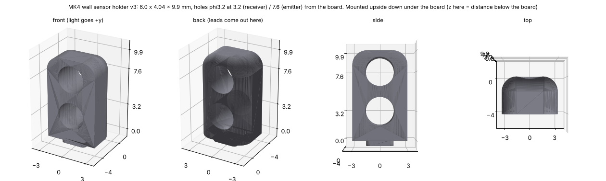

# 壁センサのホルダ(v3、2026-10-31)

発光(OPV332)と受光(SFH 229 FA)を入れて、**基板の裏(下)にさかさまに付ける**樹脂の部品。4個(FL・FR・L・R)。**ToraNeko.Mk3 のセンサホルダ v4 と同じ形**(`mechanical/exported/TORANEKO.Mk3_v36.step` の「センサホルダ v4」を CadQuery で読んで測った)。

図の z は基板の面からの距離(機体では下向き)。

| 項目 | 寸法 |
|---|---|
| 大きさ | 幅 6.0 × 奥行き 4.04 × 高さ 9.9mm(基板の下面 z 13.6 から下の端 z 3.7。フレームの上面 z 3.0 まで 0.7mm) |
| 穴 | φ3.2 を光の向きに貫通。**基板から 7.6mm(z 6.0)が発光 OPV332、3.2mm(z 10.4)が受光 SFH 229 FA**(どちらも φ3 の T-1)。ToraNeko と同じく、発光が基板から遠い穴 |
| 角 | 前の縦の辺 R1.6、前の端(基板から遠い所)の辺 R1.6、端の横の辺 R1.0 |
| ほぞ | 3.0 × 3.0 × 0.6mm(基板の厚さ)、角 R0.4。**後ろの面から 0.4mm 前**(v3。v2 は後ろの面にそろえていた)。基板の穴は 3.2 × 3.2mm、角 R0.5 |
| 重さ | 163mm³、約0.19g(光造形の樹脂 1.15 g/cm³) |

**v3(2026-10-31)**: ほぞを 0.4mm 前へ。メイン基板を起こして DRC をかけたら、基板のほぞの穴が受光の足のパッド(φ1.6)に 0.04mm 食い込んでいた。これで穴とパッドは 0.36mm 離れる。ほかの寸法は v2 と同じ(v2 のファイルは git の履歴にある)

**v2(2026-10-30)**: 基板の裏に付けることにしたので、ToraNeko と同じ高さ 10.5mm(穴 3.5・8.1mm)ではフレームまで 0.1mm しかない。高さを 9.9mm、穴を 3.2・7.6mm(穴の間の壁 1.2mm、端の壁 0.7mm)にした。v1 は基板の上に立てる ToraNeko と同じ寸法だった

機体(`mechanical/vehicle/vehicle.py`)で確かめた: ほかの部品とぶつからない(フレームと 0.7mm)。光(前の面から 60mm、広がりを見て円すい)を遮る部品はない

- **光を通さない黒い樹脂**で作る。発光の光がホルダの中を通って受光に入らないようにする(ToraNeko の README:「LED からの光が隣の受光素子に直接入らないよう、センサホルダで遮光する」)
- 発光・受光は後ろから穴に差し、足を後ろの面で基板の側(上)に曲げて基板の穴に通し、基板の上の面ではんだ付けする。受光(下)の足は後ろの面の 0.85mm 後ろ、発光(上)の足は 3.0mm 後ろ(ToraNeko は 2.8mm。基板のパッドどうしを離すため少し後ろにした)。足のピッチは 2.54mm
- 穴の φ3.2 は ToraNeko と同じ。OPV332 の外径は販売店の資料で 3.18mm なので、きつければ φ3.2 のドリルでさらう。ゆるければ接着する
- 基板への付け方: ほぞを下から基板の穴に差して、足を上からはんだ付けする。ホルダは足でつり下がるので、基板の裏に接着もする
- 基板の側: フットプリント `KOGUMA-Mk4:WallSensor_Holder_Emitter`(ほぞの穴を Edge.Cuts で含む)と `WallSensor_Holder_Receiver` を、**裏の面に**、同じ位置・同じ向き(光の向き)に置く。位置は `mechanical/vehicle/pcb_shape.py` の `SENS`(ホルダの前の面の真ん中)

| ファイル | 中身 |
|---|---|
| `sensor_holder.py` | CadQuery のスクリプト。寸法は `P` |
| `sensor_holder_v3.step`・`.stl` | 注文用(単位 mm) |
| `sensor_holder_v3.png` | 図 |

作り直すには(このフォルダで): `python3 sensor_holder.py`
