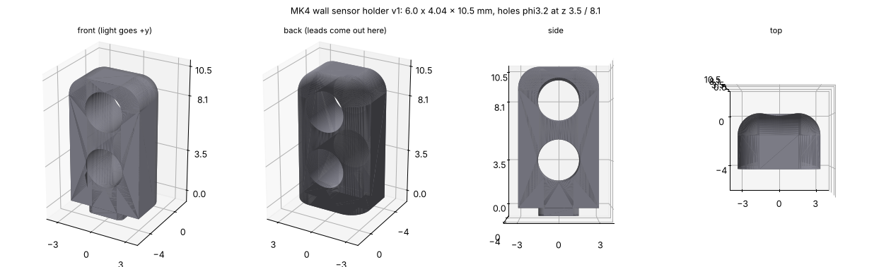

# 壁センサのホルダ(v1、2026-10-30)

発光(OPV332)と受光(SFH 229 FA)を入れて基板に立てる樹脂の部品。4個(FL・FR・L・R)。**ToraNeko.Mk3 のセンサホルダ v4 と同じ形**(`mechanical/exported/TORANEKO.Mk3_v36.step` の「センサホルダ v4」を CadQuery で読んで測った)。

| 項目 | 寸法 |
|---|---|
| 大きさ | 幅 6.0 × 奥行き 4.04 × 高さ 10.5mm(基板の上の面から) |
| 穴 | φ3.2 を光の向きに貫通。**上(8.1mm)が発光 OPV332、下(3.5mm)が受光 SFH 229 FA**(どちらも φ3 の T-1)。ToraNeko も上が発光 |
| 角 | 前の縦の辺 R1.6、前の上の辺 R1.6、上の横の辺 R1.0 |
| ほぞ | 3.0 × 3.0 × 0.6mm(基板の厚さ)、角 R0.4。後ろの面にそろえる。基板の穴は 3.2 × 3.2mm、角 R0.5 |
| 重さ | 177mm³、約0.21g(光造形の樹脂 1.15 g/cm³) |

- **光を通さない黒い樹脂**で作る。発光の光がホルダの中を通って受光に入らないようにする(ToraNeko の README:「LED からの光が隣の受光素子に直接入らないよう、センサホルダで遮光する」)
- 発光・受光は後ろから穴に差し、足を後ろの面で下に曲げて基板の穴に通す。受光(下)の足は後ろの面の 0.85mm 後ろ、発光(上)の足は 3.0mm 後ろ(ToraNeko は 2.8mm。基板のパッドどうしを離すため少し後ろにした)。足のピッチは 2.54mm
- 穴の φ3.2 は ToraNeko と同じ。OPV332 の外径は販売店の資料で 3.18mm なので、きつければ φ3.2 のドリルでさらう。ゆるければ接着する
- 基板への付け方: ほぞを基板の穴に差して、足をはんだ付けする。ホルダは足で押さえられる(ToraNeko と同じ)。外れやすければ接着する
- 基板の側: フットプリント `KOGUMA-Mk4:WallSensor_Holder_Emitter`(ほぞの穴を Edge.Cuts で含む)と `WallSensor_Holder_Receiver` を、同じ位置・同じ向き(光の向き)に置く。位置は `mechanical/vehicle/pcb_shape.py` の `SENS`(ホルダの前の面の真ん中)

| ファイル | 中身 |
|---|---|
| `sensor_holder.py` | CadQuery のスクリプト。寸法は `P` |
| `sensor_holder_v1.step`・`.stl` | 注文用(単位 mm) |
| `sensor_holder_v1.png` | 図 |

作り直すには(このフォルダで): `python3 sensor_holder.py`
