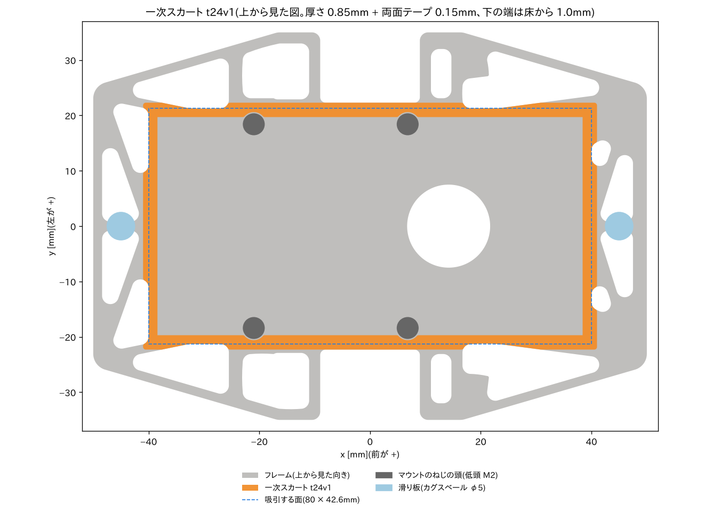

# 一次スカート(タイヤ24mm の機体)

吸引する面(フレームの下、80 × 42.6mm)のまわりを囲む、平らな枠です。自分の 3D プリンタ(FDM)で印刷し、両面テープでフレームの下に貼ります。
下に二次スカート(フィルム)を貼って、床に近づける前提です(二次スカートはまだ決めていない)。

- 考え方は KOGUMA.MK3 の「一次スカート」(底板の下に貼る四角い枠、外 23 × 49.6mm・内 15 × 41.6mm・厚さ 1mm)と、ToraNeko.Mk3 のスカート枠(`mechanical/skirt_slider/`)と同じ
- 作るスクリプト: `skirt_t24.py`(寸法はファイルの先頭)

| ファイル | 中身 |
|---|---|
| `skirt_t24v1.stl` | 印刷する用。フレームに貼る面が下(そのまま印刷できる向き) |
| `skirt_t24v1.step`、`../order_t24/14_skirt_t24v1.step` | 機体の座標。Fusion で原点に挿入すると、付いた位置に来る |
| `skirt_t24v1.png` | 上から見た図(フレーム・ねじの頭・滑り板と重ねた) |

## 寸法(t24v1、2026-11-26)

| 項目 | 値 |
|---|---|
| 下の端 | 床から **1.0mm**(ユーザー) |
| 厚さ | **0.85mm**(フレームの下の面 z 2.0 から、両面テープ 0.15mm の分だけ低く作る) |
| 内のふち | 吸引する面から 1.6mm 内(x ±38.4、y ±19.7) |
| 外のふち | 吸引する面から 1.0mm 外(x ±41、y ±22.3)。ただしフレームのカーボンがある所だけ(窓の上には貼れないので、そこは吸引する面のふちまで) |
| 枠の幅 | 1.6〜2.6mm(一番細い所 約 1.6mm = 0.4mm のノズルで 4 周) |
| 囲む面積 | 3,035mm²(吸引する面は 3,408mm²) |
| 重さ | 約 0.6g(PETG) |

**よけているもの**(機体のモデル `mechanical/vehicle/mk4_vehicle_t24.step` と重ねて確かめた):

| 相手 | すき間 |
|---|---|
| マウントのねじの頭(鉄 低頭 M2、φ3.8、z 0.9〜2.0) | 0.3mm(枠を丸く欠いてある) |
| 71T(下の端 z 1.35) | 横に 0.5mm |
| 滑り板(カグスベール φ5、(±45, 0)) | 1.5mm |
| フレーム | 0.15mm(両面テープの厚さ) |

- **ねじの頭(z 0.9)は、枠の下の端(z 1.0)より 0.1mm 低い**。どちらも吸引する面の中なので空気はもれないが、床に近いのはねじの頭の方
- 加減速で機体が 0.64° 傾いて滑り板が床に着いても、枠の前後の端(x ±41)は床から 0.54mm 残る(床に当たらない)

## 作り方(上から順に)

### 1. 印刷する

1. `skirt_t24v1.stl` をスライサーに読み込む。向きはそのまま(平らな面が下)
2. 材料は PETG(PLA でもよい)。サポートなし
3. 厚さが 0.85mm なので、積層は「1 層目 0.25mm + 0.2mm × 3 層」か「0.17mm × 5 層」にする(合計 0.85mm になる組み合わせ)
4. 壁(外周)は 4 周以上(枠の幅 1.6mm を全部、外周の線で埋めると強い)
5. 印刷したら、ノギスで厚さを測る。0.85mm から ±0.05mm くらいならよい

### 2. 両面テープを貼る

1. 薄い両面テープ(厚さ 0.1〜0.15mm)を用意する。厚さが 0.15mm と違うときは、`skirt_t24.py` の `TAPE_T` を変えて作り直す(下の端が床から 1.0mm になるように、厚さが変わる)
2. テープを幅 1.5mm くらいに細く切る
3. 枠の上の面(印刷のとき下だった平らな面)に、一周すきまなく貼る。継ぎ目は重ねずに突き合わせる(重ねると厚くなって、すきまができる)
4. ねじの頭をよける丸い欠きの所は、テープも欠きに沿って切る

### 3. フレームに貼る

1. フレームの下の面の、枠を貼る所をアルコールで拭いて脂を取る
2. 機体を裏返して置き、テープのはく離紙をはがす
3. 4 つの丸い欠きに、マウントのねじの頭が入る位置に合わせて、枠をフレームの下に当てる(欠きが位置決めになる)
4. 枠を一周、指で押さえて密着させる。横から見て、枠とフレームのあいだにすきまがないことを確かめる

### 4. 確かめる

1. 機体を平らな床に置き、横から見て、枠が床に当たっていない(タイヤと滑り板だけが床に付いている)ことを確かめる
2. 名刺(約 0.2mm)を枠の下に差し込んで、前後左右どこでも通ることを確かめる(床から 1.0mm あるはず)
3. 吸引ファンを回し、機体を持ち上げたときに床に吸い付く感じがあるかを確かめる(二次スカートなしでは、すき間 1.0mm から空気がもれるので弱い)
