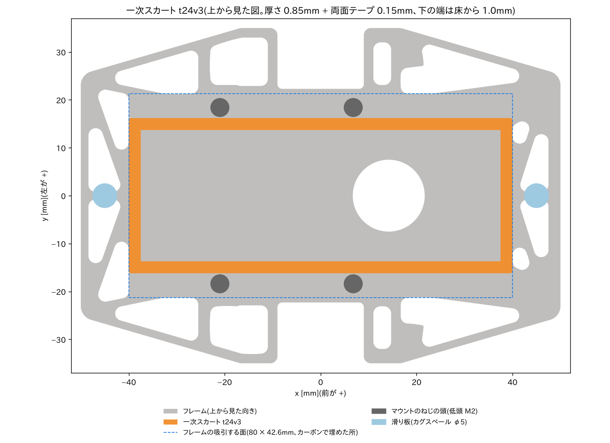

# 一次スカート(タイヤ24mm の機体)

吸引する面(フレームの下、80 × 42.6mm)のまわりを囲む、平らな枠です。自分の 3D プリンタ(FDM)で印刷し、両面テープでフレームの下に貼ります。
下に二次スカート(フィルム)を貼って、床に近づける前提です(二次スカートはまだ決めていない)。

- 考え方は KOGUMA.MK3 の「一次スカート」(底板の下に貼る四角い枠、外 23 × 49.6mm・内 15 × 41.6mm・厚さ 1mm)と、ToraNeko.Mk3 のスカート枠(`mechanical/skirt_slider/`)と同じ
- 作るスクリプト: `skirt_t24.py`(寸法はファイルの先頭)

| ファイル | 中身 |
|---|---|
| `skirt_t24v3.stl` | 印刷する用。フレームに貼る面が下(そのまま印刷できる向き) |
| `skirt_t24v3.step`、`../order_t24/14_skirt_t24v3.step` | 機体の座標。Fusion で原点に挿入すると、付いた位置に来る |
| `skirt_t24v3.png` | 上から見た図(フレーム・ねじの頭・滑り板と重ねた) |

## 寸法(t24v3、2026-11-27)

**t24v3(ユーザー「2.5mm にして」)**: 枠の幅を 2.0 → 2.5mm にした(外のふちはそのまま、内へ太くした)。

**t24v2(ユーザー「それは吸着できない。ネジの内側に入れて」)**: 枠の横を、マウントのねじの頭より内側に入れた。
t24v1 は吸引する面(80 × 42.6mm)のふちに沿い、ねじの頭が囲む面の中に入っていた(ねじの頭は床から 0.9mm で、枠の 1.0mm より低い)。

| 項目 | 値 |
|---|---|
| 下の端 | 床から **1.0mm**(ユーザー) |
| 厚さ | **0.85mm**(フレームの下の面 z 2.0 から、両面テープ 0.15mm の分だけ低く作る) |
| 外のふち | 前後 x ±40(フレームの吸引する面のふち。そのすぐ外は窓)、横 **y ±16.2**(ねじの頭 |y| 16.5 の 0.3mm 内) |
| 枠の幅 | **2.5mm**(t24v3、ユーザー。t24v2 は 2.0mm) |
| 外のふちで囲む面積 | 80 × 32.4 = 2,592mm²(枠の中は 75 × 27.4 = 2,055mm²) |
| 重さ | 約 0.58g(PETG) |

- 囲む面積は、main の 68 × 34mm(2,312mm²)と同じくらい。docs/spec.md の「600g = 2.54kPa(68 × 34mm)」がそのまま目安になる
- マウントのねじの頭は、囲む面の外になる(枠の外のふちとねじの頭の間 0.3mm)
- 加減速で機体が 0.64° 傾いて滑り板が床に着いても、枠の前後の端(x ±40)は床から 0.56mm 残る(床に当たらない)
- 前後の外のふちを x ±41 に広げると、フレームの窓(前後の角の近く)にかかって枠が切れるので、x ±40 にした

## 作り方(上から順に)

### 1. 印刷する

1. `skirt_t24v3.stl` をスライサーに読み込む。向きはそのまま(平らな面が下)
2. 材料は PETG(PLA でもよい)。サポートなし
3. 厚さが 0.85mm なので、積層は「1 層目 0.25mm + 0.2mm × 3 層」か「0.17mm × 5 層」にする(合計 0.85mm になる組み合わせ)
4. 壁(外周)は 6 周くらい(枠の幅 2.5mm を全部、外周の線で埋めると強い)
5. 印刷したら、ノギスで厚さを測る。0.85mm から ±0.05mm くらいならよい

### 2. 両面テープを貼る

1. 薄い両面テープ(厚さ 0.1〜0.15mm)を用意する。厚さが 0.15mm と違うときは、`skirt_t24.py` の `TAPE_T` を変えて作り直す(下の端が床から 1.0mm になるように、厚さが変わる)
2. テープを幅 2.5mm に細く切る
3. 枠の上の面(印刷のとき下だった平らな面)に、一周すきまなく貼る。継ぎ目は重ねずに突き合わせる(重ねると厚くなって、すきまができる)

### 3. フレームに貼る

1. フレームの下の面の、枠を貼る所をアルコールで拭いて脂を取る
2. 機体を裏返して置き、テープのはく離紙をはがす
3. 枠の横のふちを、マウントのねじの頭のすぐ内側(頭との間 0.3mm)に合わせ、前後のふちをフレームの吸引する面(カーボンで埋めた所)の前後のふちにそろえて、フレームの下に当てる
4. 枠を一周、指で押さえて密着させる。横から見て、枠とフレームのあいだにすきまがないことを確かめる

### 4. 確かめる

1. 機体を平らな床に置き、横から見て、枠が床に当たっていない(タイヤと滑り板だけが床に付いている)ことを確かめる
2. 名刺(約 0.2mm)を枠の下に差し込んで、前後左右どこでも通ることを確かめる(床から 1.0mm あるはず)
3. 吸引ファンを回し、機体を持ち上げたときに床に吸い付く感じがあるかを確かめる(二次スカートなしでは、すき間 1.0mm から空気がもれるので弱い)

# 二次スカート(Digi-Key の青い袋、2026-11-27)

一次スカートの下の面に、Digi-Key の青い袋を切って両面テープで貼り、外のふちから外へはみ出した分を下へ折って垂らす(ユーザー「ここにデジキーのあおい袋を切って貼る」「外向きに垂らすよ」)。
外向きに垂らすと、吸ったときに外の空気がフィルムの上から押すので、フィルムが床に押し付けられてすき間が閉じる(内向きだと、吸ったときに中へ引き上げられて開きやすい)。

| ファイル | 中身 |
|---|---|
| `film_t24v1_template_A4_1to1.pdf` | 型紙(A4、「実際のサイズ」で印刷) |
| `film_t24v1.dxf` | 切る線(レーザーやカッティングマシン用) |
| `film_t24.py` | 型紙を作るスクリプト(垂らす長さ `HANG` など) |

| 項目 | 値 |
|---|---|
| 形 | 枠(t24v3)と同じ四角い輪 + 外へ 1.0mm の垂らす分。外 82 × 34.4mm、内 75 × 27.4mm |
| 折る線 | 枠の外のふち(80 × 32.4mm)。型紙の青い点線 |
| 四隅 | 垂らす分の角 1.0 × 1.0mm を切り落とす(4 辺を別々に折れるように) |

- 枠の下の端は床から 1.0mm。テープとフィルムの厚さを引くと、1.0mm 垂らせば床に軽く届く。届かない・こすれすぎるときは `HANG` を変えて作り直す
- **横の垂らす分は、マウントのねじの頭(|y| 16.5 から)の 0.3mm 手前で下へ折れる**。外へ広がるとねじの頭に当たるので、折り目をしっかり付ける

## 作り方(上から順に)

1. 型紙の PDF を「実際のサイズ」(100%)で印刷し、50mm の線をものさしで測って合っているか確かめる
2. 青い袋を 1 枚に切り開き、しわを伸ばして型紙の上に置き、マスキングテープで留める
3. 実線に沿って、カッターと金属の定規で切る(内の四角も切り抜く)。四隅の小さな角も切り落とす
4. 一次スカートの下の面(床に向く面)に、幅 2.5mm に切った両面テープを一周貼る
5. フィルムを、青い点線(折る線)が枠の外のふちにそろうように貼る
6. 外へはみ出した 1.0mm を、定規の角などで枠の外のふちに沿って下へ折る(折り目をしっかり付ける)
7. 機体を床に置き、横から見て、フィルムの先が床に軽く触れる(または床のすぐ上にある)ことを確かめる。横の垂らす分がねじの頭に当たっていないかも見る
