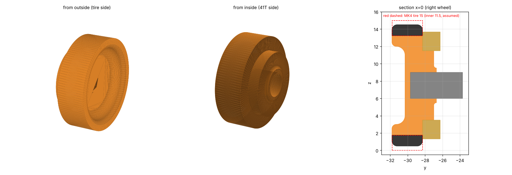
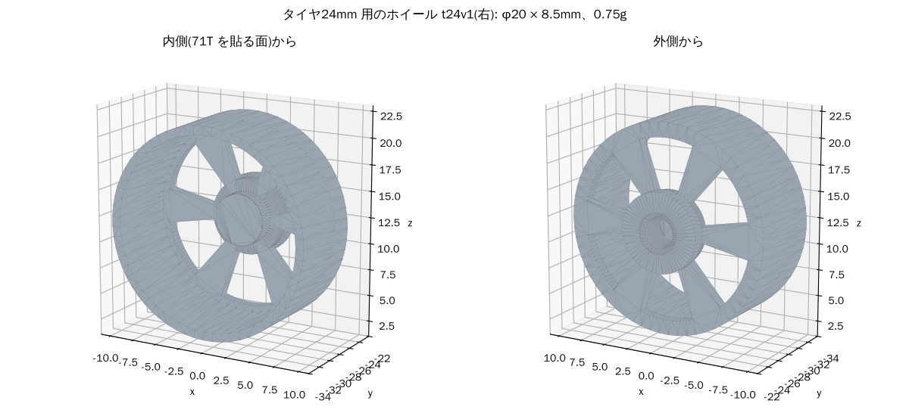

# ホイール(wheel v1、2026-10-30)

ToraNeko.Mk3 のホイールを、そのまま MK4 の位置(右側、車軸 (0, y, 7.5))で書き出したもの。座標は機体と同じ(原点は車軸の中心、+x が前、+y が左、z は床から上、mm)。左は右を左右反転したもの。

| ファイル | 中身 |
|---|---|
| `wheel_R_v1.step` / `wheel_L_v1.step` | 右・左(Fusion 360 などで読み込む) |
| `wheel_R_v1.stl` / `wheel_L_v1.stl` | 印刷に出す用 |
| `export_wheel.py` | 書き出しのスクリプト(`mechanical/motor_mount/tn_drive_mk4_right.step` から取り出す) |

## 形

| 部分 | 寸法 |
|---|---|
| タイヤを受ける所 | 外径 φ11.5、幅 3.5mm(y −31.8〜−28.3) |
| 全体 | 外径 φ11.5、幅 5.1mm(y −31.8〜−26.7) |
| 車軸(3×6 の平行ピン) | 内側から差す止まり穴(y −29.7 まで、深さ約 3mm)。圧入 |
| 41T | ホイールの内側の面(y −28.3)に当てて付ける(41T の穴は約 φ8 で、ホイールのハブには触れない) |
| 重さ | 0.38g(樹脂 1.2 g/cm³ として、体積 320mm³) |

## 注文と作るとき

- **材料は JLC3DP の光造形、JLC Black Resin**(2026-10-31。モーターに付く部品だけ熱に強い Temp Resin にし、ほかは黒にそろえる。ホイールは熱がかからない)。予備を含めて R・L を 2〜3 個ずつ
- **タイヤ**: MK4 は直径 15mm のミニッツのタイヤを使う予定(ToraNeko は 14mm)。このホイールは **タイヤの内径 φ11.5・幅 3.5mm** として作ってある。15mm のタイヤの内径と幅を測り、合わなければホイールの外径を直す
- 平行ピンの穴は圧入。きつければ穴を少し広げ、ゆるければ接着する
- 41T は内側の面に接着する(ToraNeko と同じ)

## タイヤ24mm 用 t24v1(2026-11-21、ブランチ `claude/trusting-dirac-1tdt54`)

タイヤを MK3 と同じ 24mm にした機体のホイール(`docs/spec.md` の「方針の変更(2026-11-21)」)。`wheel_t24.py` で作る(`python3 mechanical/wheel/wheel_t24.py`)。STEP・STL は `wheel_R_t24v2.*`・`wheel_L_t24v2.*`(2026-11-24 の t24v2: 平行ピンを 3×8 にして 5mm 圧入。強さは `docs/calc/t24_wheel_strength.py`。t24v1 は `wheel_*_t24v1.*`)、絵は `wheel_t24v1.png`。車軸は (0, y, 12.0)。

| 部分 | 寸法(右側の y) |
|---|---|
| タイヤを受ける外の輪 | 外径 **φ20**、幅 **8.5mm**(y −33.3〜−24.8)、厚さ0.8mm。**タイヤの内径と幅はミニッツのナローからの推定**。実物で測り、`W['od']`・`y_out` を直す |
| 円板 | 内側の面(y −25.8〜−24.8、1.0mm)。扇形の窓6つで肉抜き(スポーク1.4mm〜)。**71T をこの面に接着する** |
| ハブ | φ5.0(y −27.2〜−24.8) |
| 71T の芯出しの段 | φ7.6(y −24.8〜−23.4)。71T の穴を φ8 として。**71T の穴の径は実物で確かめる** |
| 軸受に当たる段 | φ3.8(y −23.4〜−23.2)。外の軸受(LF-630)の**内輪だけ**に当たる(外輪・つばとは0.2mm) |
| 車軸(**3×8 の平行ピン**、t24v2) | 内側から差す止まり穴 φ2.95(圧入)、**深さ 5.0mm**(y −28.2 まで。ハブは y −29.2 まで)。ピンは y −28.2〜−20.2(内の端は t24v1 と同じ)。t24v1 は 3×6 を 3mm |
| 重さ | **0.75g**(樹脂 1.2 g/cm³) |

- ぶつかりは `mechanical/motor_mount/check_t24.py` で、マウント t24v1 と一緒に確かめた(ピニオンと0.53mm、マウントと0.8mm)
- タイヤは接着する(main と同じ)
