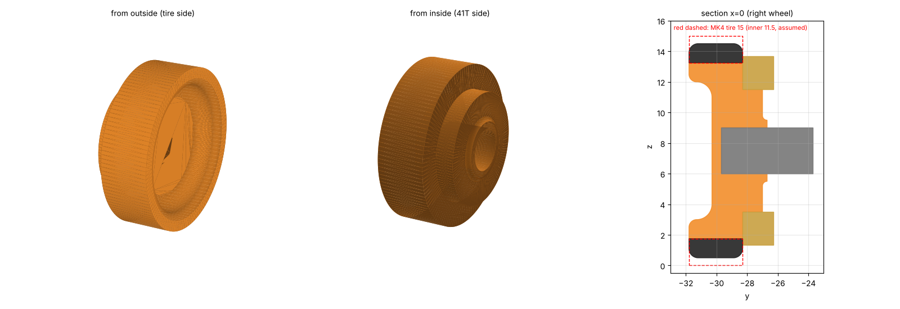

# ホイール(wheel v1、2026-10-30)

ToraNeko.Mk3 のホイールを、そのまま MK4 の位置(右側、車軸 (0, y, 7.5))で書き出したもの。座標は機体と同じ(原点は車軸の中心、+x が前、+y が左、z は床から上、mm)。左は右を左右反転したもの。

| ファイル | 中身 |
|---|---|
| `wheel_R_v1.step` / `wheel_L_v1.step` | 右・左(Fusion 360 などで読み込む) |
| `wheel_R_v1.stl` / `wheel_L_v1.stl` | 印刷に出す用 |
| `export_wheel.py` | 書き出しのスクリプト(`mechanical/motor_mount/tn_drive_mk4_right.step` から取り出す) |

## 形

| 部分 | 寸法 |
|---|---|
| タイヤを受ける所 | 外径 φ11.5、幅 3.5mm(y −31.8〜−28.3) |
| 全体 | 外径 φ11.5、幅 5.1mm(y −31.8〜−26.7) |
| 車軸(3×6 の平行ピン) | 内側から差す止まり穴(y −29.7 まで、深さ約 3mm)。圧入 |
| 41T | ホイールの内側の面(y −28.3)に当てて付ける(41T の穴は約 φ8 で、ホイールのハブには触れない) |
| 重さ | 0.38g(樹脂 1.2 g/cm³ として、体積 320mm³) |

## 注文と作るとき

- **材料は JLC3DP の光造形、JLC Black Resin**(2026-10-31。モーターに付く部品だけ熱に強い Temp Resin にし、ほかは黒にそろえる。ホイールは熱がかからない)。予備を含めて R・L を 2〜3 個ずつ
- **タイヤ**: MK4 は直径 15mm のミニッツのタイヤを使う予定(ToraNeko は 14mm)。このホイールは **タイヤの内径 φ11.5・幅 3.5mm** として作ってある。15mm のタイヤの内径と幅を測り、合わなければホイールの外径を直す
- 平行ピンの穴は圧入。きつければ穴を少し広げ、ゆるければ接着する
- 41T は内側の面に接着する(ToraNeko と同じ)
